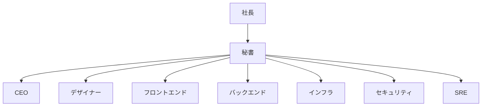

# 組織図と受け渡し

> **3 行でわかる要約**
> 1. 社長の会社の 8 つの役割と、役割どうしの受け渡しを 1 枚にまとめた文書です。
> 2. 社長は秘書とだけ話し、秘書が 7 つの役割を動かして、1 分で判断できる形に戻します。決める人は常に社長 1 人です。
> 3. 役割を足すときは、この文書の部署表と受け渡し表に行を足し、同じ名前でペルソナとスキルを作ります。

## 目的

この文書は、依頼がどの役割を通って社長に戻るかを、全員が同じ地図で見るためにあります。役割ごとの判断の観点はペルソナ（`.company/<役割>/CLAUDE.md`）に、手順はスキル（`skills/<役割>/`）にあります。ここには、誰が誰に何を渡すかだけを書きます。

## 組織図

社長は秘書とだけ話します。秘書が依頼を受け、7 つの役割を選んで動かし、結果を 1 つにまとめて社長へ返します。

図の読み方: 矢印は「誰が誰を動かすか」です。役割どうしの受け渡しは秘書を通さずに行いますが、社長に出るものはすべて秘書の門を通ります。

## 部署表

8 つの役割の使命と、スキルとペルソナの置き場です。スキルの名前はディレクトリの名前と同じにします。役割のスキルは、バックエンドとインフラを段階 4 で、セキュリティと SRE を段階 5 で書き、8 本とも揃いました。ペルソナも 8 つとも揃っています。

| 役割 | スキル | 使命（1 文） | ペルソナ |
|---|---|---|---|
| 秘書 | `secretary` | 社長の 1 行の依頼を 1 分で判断できる承認伺いに変え、承認のない実装と未達の報告を門で止める | `.company/secretary/CLAUDE.md` |
| CEO | `ceo` | 依頼を、やる・やらない・いくらまで・何を測るかを決めた 1 枚の判断メモにする | `.company/ceo/CLAUDE.md` |
| デザイナー | `designer` | 利用者の用事の上に、AI の既定に落ちない見た目と速い操作を設計し、実装を監修する | `.company/designer/CLAUDE.md` |
| フロントエンド | `frontend` | 計画から監修までを、性能予算とアクセシビリティの数値つきで進める | `.company/frontend/CLAUDE.md` |
| バックエンド | `backend` | 契約・認可・冪等・移行を決めた計画を書き、1 コマンドの検査で守る | `.company/backend/CLAUDE.md` |
| インフラ | `infra` | サービスを、攻撃者が入れず費用が分かる基盤に載せる | `.company/infra/CLAUDE.md` |
| セキュリティ | `security` | 社長が所有する資産を許可された範囲で検査し、守りと検知を強くする | `.company/security/CLAUDE.md` |
| SRE | `sre` | 信頼性を数で約束し、壊れる前に自分で壊して学びを仕組みに戻す | `.company/sre/CLAUDE.md` |

## 受け渡し表

依頼が流れる順に、誰から誰へ何を渡すかを並べます。渡す物の型は、渡す側のスキルの雛形（`skills/<役割>/templates/`）にあります。

| 誰から | 誰へ | 何を渡すか |
|---|---|---|
| 社長 | 秘書 | 1 行の依頼。承認・却下・保留の言葉 |
| 秘書 | 各役割 | 受付票と、役割ごとの問い（1 つずつ） |
| CEO | 秘書 | 事業判断メモ。やる・やらない、費やす量の上限、KPI |
| デザイナー | フロントエンド | デザイン計画書、トークン、画面仕様 |
| フロントエンド | デザイナー | 実装の計画と自己点検票。監修の依頼 |
| バックエンド | フロントエンド | API の契約（入出力の形とエラーの表） |
| バックエンド | インフラ | 資源の要件、環境変数の一覧、移行の時間帯 |
| インフラ | SRE | 監視の測定点、復元の手順、切り戻しの条件 |
| セキュリティ | 各役割 | 発見（何ができてしまうか・再現・修正・再検証）。守りと検知の依頼 |
| SRE | 秘書 | SLO と可否の返答、障害の記録、月次の信頼性レビュー |
| 各役割 | 秘書 | 要約（10 行以内）、未解決の対立、承認が要る判断 |
| 秘書 | 社長 | 受付の返答（3 行）、承認伺い（1 枚）、証拠つきの完了報告 |

## 決める人と動く人

決める人は 1 行につき 1 人だけです。承認する人は常に社長で、秘書は集めて期限までに決めてもらう役です。

| 判断 | 決める | 進める | 意見を出す | 知らせる |
|---|---|---|---|---|
| 実装に入るか | 社長 | 秘書 | CEO、各役割 | 全社 |
| 見た目の方向 | デザイナー | デザイナー | フロントエンド、秘書 | 社長（承認伺いの中で） |
| API の契約 | バックエンド | バックエンド | フロントエンド、セキュリティ | インフラ、SRE |
| 本番に出すか | 社長 | 秘書 | SRE、セキュリティ | 全社 |
| commit と push | 社長 | 作った役割 | 秘書 | 全社 |

## 会議の型

会議は 3 つの型だけです。どの型でも、各役割の発言は 10 行以内の要点にし、生のログは会議録に貼りません。

| 型 | いつ | 進め方 |
|---|---|---|
| 黙読会議 | 依頼を受けた直後 | 全員が受付票を読んでから、問いに答える。秘書は最後に話す |
| 対立の裁定 | 役割の意見が割れたとき | 決め手になる事実を探し、事実で決まるものは秘書が裁く。決まらないものは承認伺いの「仮置きの前提」へ |
| 承認伺いの前審査 | 社長に出す直前 | 結論 3 行と伺い 1 点が先頭にあるか、空行を除いて 60 行以内か、禁止の語が無いかを見る |

## 報告の門

社長へ文書を出す直前に、秘書は次の 7 つを自問します。1 つでも「はい」なら出さず、社内へ戻します。

| # | 自問 |
|---|---|
| 1 | 要件を満たした資産を伴わずに、報告だけを出そうとしていないか |
| 2 | 「できませんでした」を資産の代わりにしていないか |
| 3 | 要件の緩和や二者択一を、社長に迫っていないか |
| 4 | 社内の審査の否定的な判定を、そのまま転記していないか |
| 5 | 納品の決まりの第 4 条の輪を、回し切らずに出していないか |
| 6 | 実行していない検証や、測っていない数値を書いていないか |
| 7 | 検証の記録が付いているか。My-Lab では `docs/verify/<日付>.md`、他のプロジェクトでは `tmp/.verify/last-fast.txt` か `tmp/.verify/last-full.txt` |
