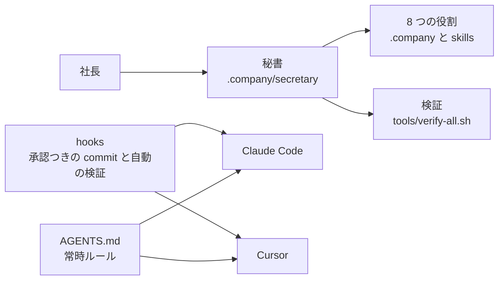

# My-Lab — 秘書と 8 つの役割を、Claude Code と Cursor で同じように動かす

> **3 行でわかる要約**
> 1. このリポジトリは、秘書と 8 つの役割を Agent Skills（AI に手順を渡す公開の形式）として 1 から作る正本です。
> 2. 承認のない commit と push は hooks（コマンドの直前と編集の直後に走る検査）が止めます。ローカルでできる検証は 11 種類を自動で回します。
> 3. 段階 0〜2（骨格と検証、日本語と Git の下地、秘書・CEO・ペルソナ）は 2026-11-06 に承認を得ました。段階 3（デザイナーとフロントエンド）は 14 件のうち 13 件を満たし、社長の指示で輪を止めました（2026-11-07、承認記録 A-6）。見やすさの条件は後で扱います。段階 4（バックエンドとインフラ）も、社長の指示で輪を止めました（2026-11-08、承認記録 A-7）。インフラの攻撃者役の条件は未充足です。段階 5（セキュリティと SRE）は作り終え、段階 6（全体試験）も AI の作業を終えました。残りは社長の機械での操作（旧環境の整理と最初の commit）です。

## 1. 目的

社長が Cursor と Claude Code のどちらでも、同じ秘書と同じ役割を、同じ守りのもとで使えるようにします。役割は CEO、デザイナー、フロントエンド、バックエンド、インフラ、セキュリティ、SRE の 7 つと、窓口の秘書です。仕様書は `docs/SPEC_20261106_company-skills.md`（版 4）にあり、承認の記録はその 14 章にあります。My-Lab の中では root 直下のものをそのまま使い、他のプロジェクトでは `tmp/` に写して使います。

## 2. 全体図

社長は秘書とだけ話し、秘書が役割を動かします。両ツールは同じ `AGENTS.md` と同じ hooks を読むので、どちらで使っても同じ順と同じ守りで進みます。

図の読み方: 左の社長から右へ依頼が流れます。下の hooks と AGENTS.md は、両ツールに同じように効きます。

## 3. 中身

正本はこの 1 つで、外部に依存する物はありません。場所ごとの中身は次のとおりです。

| 場所 | 中身 |
|---|---|
| `.company/` | 全社ルール、納品の決まり、組織図、全社の決まり（文書・図・証拠と安全）、秘書のペルソナ（役割の判断の観点と成果物を書いた人物像） |
| `skills/` | スキル 9 本。下地 5 本（`verify`、`ja-professor`、`ja-fluent`、`git-issue`、`git-pr`）と役割 4 本（`secretary`、`ceo`、`designer`、`frontend`）。1 本ずつが 6 点構成 |
| `hooks/` | 判定本体 `guard-core.sh`、Claude Code と Cursor の接続口、自己試験 `selftest.sh` |
| `tools/` | `verify-all.sh` と 11 種類の検査、直したファイル 1 つ分の `check-file.sh`、配置の試験 |
| `router/` | 常時ルールの本文（Cursor の User Rules に貼るもの、Claude Code への接続） |
| `.claude/`、`.cursor/` | 両ツールの接続。承認の規則、hooks の登録、サブエージェント（別の文脈で動く補助の AI）、常時ルール |
| `.github/` | Issue のフォーム 3 つ（不具合、機能、調査）と PR の型 |
| `samples/app/` | 見本アプリ（注文一覧）。デザイナーのトークン（`samples/app/tokens.css`）だけで描き、Lighthouse（Google の性能測定）、axe（アクセシビリティ検査）、Playwright（ブラウザの自動操作）が実測する対象 |
| `docs/` | 仕様書と、検証の記録（`docs/verify/<日付>.md`） |
| `install.sh`、`deploy.sh` | この Mac への 1 回の接続と、他のプロジェクトの `tmp/` への写し |

## 4. 使い方

My-Lab の中では、開くだけで動きます。他のプロジェクトでは、写してから常時ルールを 1 回貼ります。

| 場面 | 手順 |
|---|---|
| My-Lab を Claude Code で開く | `CLAUDE.md` が `AGENTS.md` を読み、`.claude/settings.json` が承認の規則と hooks を登録する。`/verify` が候補に出る |
| My-Lab を Cursor で開く | `.cursor/rules/company.mdc` が常時ルール。スキルは `.cursor/skills`（`skills/` へのリンク）。Cursor の hooks は 2026-11-10 に社長の指示で外した（`.cursor/hooks.json` と Mac 全体の登録は空）。戻すときは `./install.sh` と、`.cursor/hooks.json` の登録の復元 |
| 他のプロジェクトで使う | `./deploy.sh <プロジェクト>` で `tmp/` に写す（手でコピーしても同じ）。Cursor の User Rules に `tmp/cursor-user-rule.md` の本文を 1 回貼る。検証は `bash tmp/tools/project-verify.sh --fast`（既定は AI が書いた `tmp/` の文書だけ。プロジェクトの試験は `tmp/verify-commands.txt` に 1 行 1 命令で書いたときだけ回す） |
| この Mac に hooks を登録する（1 回） | `./install.sh --dry-run` で中身を見てから `./install.sh`。Claude Code の `PreToolUse` には Bash の判定と Write・Edit の門の 2 本が入る。旧 cradle のリンクを外すときは `--remove-old-links`。常時ルールには書き込まない |

## 5. 守り

hooks の判定本体が、コマンドの文字列を見て 3 つの判定を返します。承認は社長の言葉だけを数えます。合図の語 `APPROVE_GIT=1` が付いたコマンドは、Claude Code でも Cursor でも、設定によらず拒否します。

| 操作 | 判定 |
|---|---|
| `git commit`、`git push`、Issue と PR の作成、`npm publish`、`docker push` ほか外に出る操作 | 確認（ask）。社長の承認なしには通らない |
| `git reset --hard`、`clean -f`、`stash drop`、ブランチの削除、`--ours`・`--theirs`、`rebase` ほか取り消せない操作 | 確認 |
| 守りの設定（root 所有の `/usr/local/etc/company-guard/mode`。無いときは互換の `~/.cursor/company-guard.mode`）と `~/.cursor` への書き込み・削除・権限の変更 | 拒否（deny）。社長が `sudo` で書く |
| Write・Edit で `~/.cursor/`、`~/.claude/settings.json`、`~/.claude/hooks/`、`~/.claude/CLAUDE.md`、守りの設定の置き場、My-Lab の `hooks/`・`.claude/settings.json`・`.cursor/hooks.json` を書く | 拒否（deny）。シェルを通らない道も閉じる |
| 符号化した命令を復号してシェルに渡す書き方 | 確認（ask）。中身を照合できない |
| 読むだけか、取り消せる操作 | 許可 |

命令の文字列の照合は隠し方のすべてを見つけられないので、芯は置き場の所有者で守ります。守りの設定は root 所有の `/usr/local/etc/company-guard/mode` に置き、AI の利用者権限では書けません。置き場があるのにファイルが無い・読めない・中身が壊れているときは、拒否に倒します（fail-closed）。

## 6. 検証

作業の最後に `bash tools/verify-all.sh --fast` が hooks から自動で走り、commit の承認を求める前に `--full` を回します。道具が無いことによる SKIP は FAIL と同じに扱います。

| 命令 | 回すもの | 所要 |
|---|---|---|
| `--fast` | 形式、文体・資料・図、固有の検査の自己試験、hooks の自己試験、参照の実在、スクリプトの静的検査 | 数十秒 |
| `--full` | 上に加えて、図の実描画、試験ケース、配置の試験、見本アプリの実測、秘密と依存（gitleaks・trivy・semgrep） | 数分。記録を `docs/verify/<日付>.md` に書く |

## 7. 段階と状態

7 つの段階に分け、段階ごとに社長の承認を得て進みます。

| 段階 | 納品物 | 状態 |
|---|---|---|
| 0 | `.company/` の憲法と決まり、`AGENTS.md`、両ツールの接続、hooks、`verify-all.sh`、`install.sh`、`deploy.sh`、試作スキル `verify` | 承認済み（2026-11-06） |
| 1 | `ja-professor`、`ja-fluent`、`git-issue`、`git-pr`、User Rules の本文 | 承認済み（2026-11-06）。判定者パネルの未達（平均 4.0〜4.2）は記録に残し、社長の実例で測り直す |
| 2 | `secretary`、`ceo`、8 部署のペルソナ、サブエージェント 7 本 | 承認済み（2026-11-06）。振り分け試験は 30 件中 30 件、試験ケースは秘書 13 件・CEO 11 件とも PASS。試運転（架空の 2 段階認証の依頼）は承認記録まで通り、歪み 6 件のうち 4 件を直した |
| 3 | `designer`、`frontend`、AI らしさの目録と検査、デザイン監修の手順、見本アプリの再塗装 | 輪を止めた（2026-11-07、承認記録 A-6。条件 11 は後で扱う）。受け入れ条件 14 件のうち 13 件を満たした。見本アプリは、根本から違う 3 案を比べて選んだ「帳簿の紙面」の 1 画面で、Lighthouse 100・100・100、axe 違反 0、押せる領域は最小 44px。人の画面と混ぜた判定の的中率は、第 11 回で依頼文 a・b とも 50% になり基準を満たした。判定者パネルの見やすさ 4.00（基準 4.5、第 7 回から 11 回続けて同じ点）は、判定の作りから後で見直す。途中経過は `tmp/flow/stage3/progress-report.md` |
| 4 | `backend`、`infra`、見本の API（`samples/api/`）、構成コード（`samples/infra/`） | 輪を止めた（2026-11-08、承認記録 A-7）。契約の検査、N+1（一覧の行ごとに問い合わせを出すこと）の検出、構成コードの静的検査、復元の実測は満たした。バックエンドは敵対的レビューの重大が 0（第 12 回）。インフラは攻撃者役の条件が未充足（最後の審査で答えの無い道 8 本）。途中経過は `tmp/flow/stage4/progress-report.md` |
| 5 | `security`、`sre` | 作り終えた（2026-11-08）。仕込んだ穴は 5 つとも見つけ、守る側の役は報告だけで直しと再検証を再現した。バーンレートの計算は原典の表と一致した。当番役は 2 回目の訓練で、Runbook（当番の手順書）の見分けどおりに 4 分で直した。途中経過は `tmp/flow/stage5/progress-report.md` |
| 6 | 全体試験、他のプロジェクトでの試運転、旧環境の整理 | AI の作業は終えた（2026-11-08、承認記録 A-8）。全部の検証は 11 種類とも PASS、試験ケースは 13 本とも PASS。試運転は 2 回で、重い引っかかりは 0 件になった。完成の条件 20 行のうち充足 14、未充足 5、社長の判定に残す 1。旧環境の整理と最初の commit は 2026-11-08 に済み、PR #1 で main に入った。残りは User Rules の貼り替えと、実際のプロジェクトでの試運転。到達点は `tmp/flow/stage6/progress-report.md` |

## 8. 実機で確かめること（未確認）

次の 2 点は、スクリプトの自己試験では確かめられず、社長の手元での確認が要ります。結果が出たら、この節に日付と結果を書きます。

| 確かめること | 手順 | 結果 |
|---|---|---|
| Cursor で `ask` と `stop` が効く | My-Lab を Cursor で開き、「`git status` を実行して」と「commit して」を頼む。前者は止まらず、後者で確認が出れば `ask` が効く。文書を 1 つ直して終え、`verify-all.sh --fast` が走れば `stop` が効く | 未確認。効かなければ、社長が自分の端末で `sudo install -d -o root -g wheel -m 755 /usr/local/etc/company-guard && printf 'deny\n' \| sudo tee /usr/local/etc/company-guard/mode` を回す。root 所有なので AI は書き換えられず、互換の `~/.cursor/company-guard.mode` は root の置き場が無いときだけ読む。deny では承認が要る操作をすべて拒否し、合図の語が付いていても通さない。commit や push は、社長が hooks の掛からない自分の端末で実行する |
| Claude Code で commit が確認で止まり、承認で通る | 社長が commit を承認する最初の機会に見る。`PostToolUse`（直したファイルの検査）と `Stop` は、段階 0 の作業中に実際に動いた | 確認済み（2026-11-08。AI の commit の直前に確認が出て、承認で通った。hooks の記録 `tmp/.verify/hooks.log` に 22:54 の ask が残る） |
| 両ツールでサブエージェントが呼べる | Claude Code のサブエージェントの一覧に ceo・designer・frontend・backend・infra・security・sre が出るか見る。Cursor では `/ceo` を呼び、`.company/ceo/CLAUDE.md` を読んで答えるか見る | Claude Code は確認済み（2026-11-06。作った会話の途中で 7 本が一覧に出た）。Cursor は未確認 |
