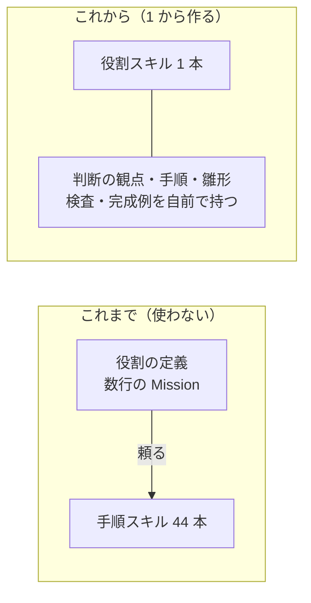
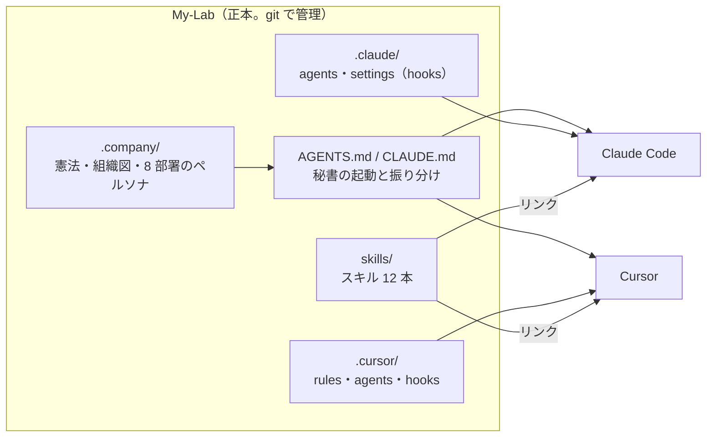
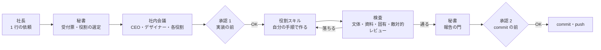
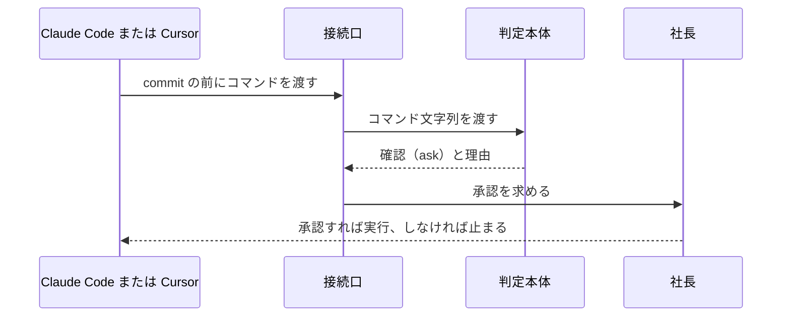
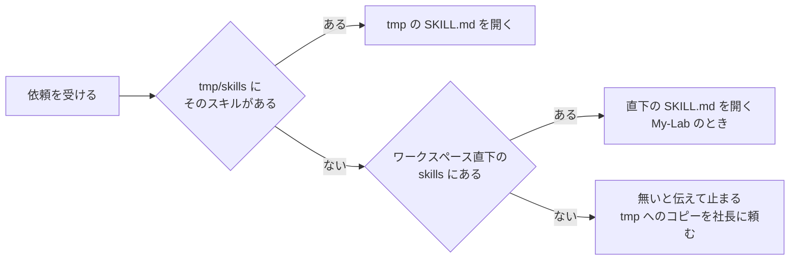
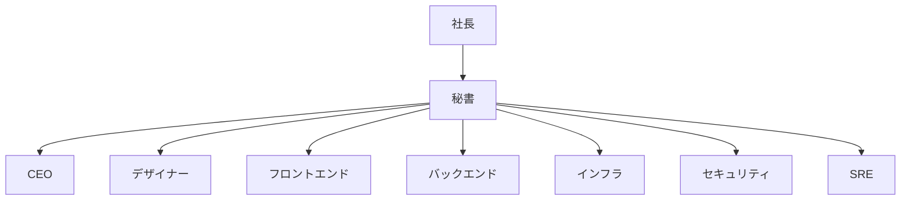
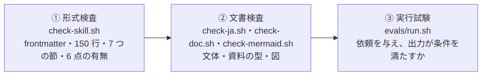
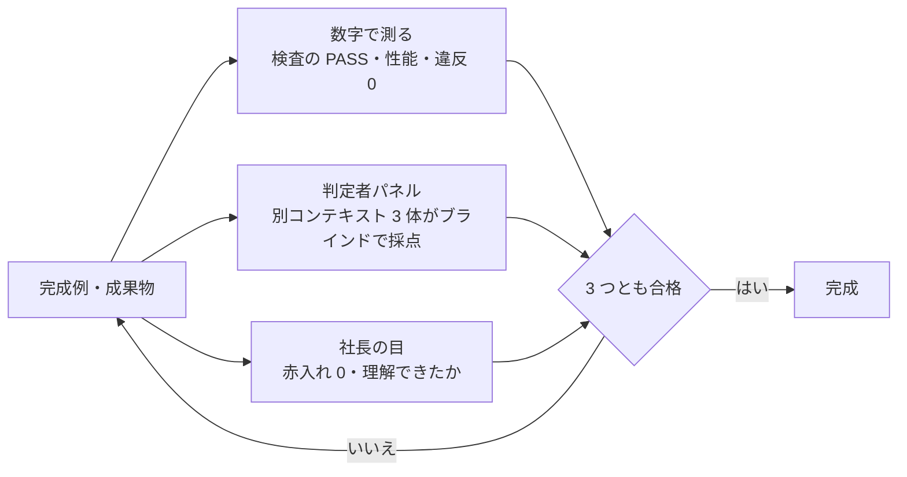
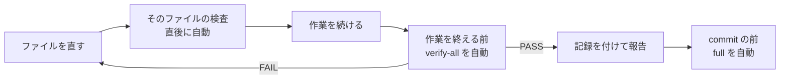

# 仕様書: 会社の形と役割スキル（.company・.claude・skills）を 1 から作る

| 項目 | 内容 |
|---|---|
| 文書の種類 | 仕様書（実装前の合意文書） |
| 作成日 | 2026-11-06 |
| 作成 | 取りまとめ役（役割ごとの一次情報の調査 11 本と、別コンテキストの敵対的レビューを反映） |
| 状態 | **承認済み**（2026-11-06。確認事項 6 点はすべて既定案で承認。段階ごとに次の承認を得る） |
| 版 | 6（版 5 の承認後に、作業の終わりの引き戻しの回数の数え方と、写した先の検証の範囲を変えた。2026-11-11 に社長の指示「進めて」で承認） |
| 関連 | 棚卸し `tmp/flow/company-skills/discovery.md`、役割ごとの調査・完成例・レビュー `tmp/flow/company-skills/briefs/`、Issue と PR の見本 `tmp/flow/company-skills/samples/` |

> **3 行でわかる要約**
> 1. 新リポジトリ My-Lab に、会社の形（.company）・両ツールの接続（.claude と .cursor）・スキル 12 本（skills）を作る仕様書です。既存の cradle-skills は使わず、1 から作ります。
> 2. 完成の条件は 20 件で、すべてに確認方法を付けました。Cursor の回答は教授の解説になり、UI は AI らしさの検査を通ります。Issue と PR は、誰でも読める型にします。他のプロジェクトでは tmp に置き、検証はローカルで全部自動で回し、commit は承認を経てだけ通します。
> 3. 社長の承認を 2026-11-06 に得たので、12 章の段階 0 から実装に入ります。段階の終わりごとに資産をお見せし、次の承認を得ます。

## 版 6 の変更点

2026-11-11 に版 5 の実装を Cursor で試すと、作業の終わりの引き戻しが止まりませんでした。同じ FAIL の文が、延々とプロンプトに入りました。原因は 2 つあり、1 つは上限の数え方です。Cursor は Claude Code 形式の hooks（自動で走る台本）も回し、続きの指示の印を送りません。

印は stop_hook_active という欄です。上限はこの印があるときだけ数えていたので、効きませんでした。もう 1 つは検証の範囲です。引き戻しの文が「範囲外の FAIL は直さない」と言うのに、検証は前からある文書の FAIL も数えました。

AI には直せないので、終われない輪になります。社長の指示「進めて」（2026-11-11）で、4 か所を変えました。hooks の差分は社長が当て、残りは秘書が直しました。

| # | 変えた所 | 前の版 | この版 | 理由 |
|---|---|---|---|---|
| 1 | 9.4 節の表の「作業を終える前」の行（上限の数え方） | 続きの指示の回数は、印（stop_hook_active）が true のときだけ数える | 回数だけで数え、3 回で止める。印が false の新しい依頼の始まりと、検証が通ったときに 0 に戻す | Cursor が Claude Code 形式の hooks を回すときは印が無く、上限が効かなかった |
| 2 | 9.4 節の本文（写した先の検証の範囲） | AI が `tmp/` に書いた文書を全部 FAIL に数える | 最後に検証が通った印（tmp/.verify/last-pass）より新しい文書だけを FAIL に数える。他は「範囲外」の行と WARN の 1 行で見せ、数えない。印が無ければ全部を数える | 引き戻しの文の線引き（範囲外は直さない）と、検証の数え方を揃える |
| 3 | 9.4 節の本文（写した時点の印） | `deploy.sh` は印を置かない。最初の検証が通るまで、前からある文書も数える | `deploy.sh` が写した直後に `tools/project-verify.sh` の `--baseline` を回し、印とファイルの一覧を置く。前からある文書は、変えるまで範囲外 | 写した先に前からある文書で、最初の作業が止まらないようにする |
| 4 | 13.3 節の表の 2 行目（Cursor の hooks の実機確認） | 段階 0 で実機確認 | 2026-11-11 の結果を書いた。Cursor は Claude Code 形式の hooks も回し、stop の続きの指示は効く。印は送らず、Claude Code 形式の hooks には Cursor 側の回数の上限（loop_limit）が無い | 実機の結果を仕様書に残す |

## 版 5 の変更点

版 4 の実装を他のプロジェクトで試運転すると、作業の終わりの検証がプロジェクト全体の試験を回し、前から落ちている試験まで FAIL に数えました。引き戻された AI は、指示されていないファイルを直しに行きました。社長の指示（2026-11-09）「指示していないことまで見ない。変えなくていいファイルを変えるのはあってはならない」を受け、3 か所を変えました。

| # | 変えた所 | 前の版 | この版 | 理由 |
|---|---|---|---|---|
| 1 | 9.4 節の本文（他のプロジェクトの検証） | `tmp/tools/project-verify.sh` がプロジェクトの検証の命令を見つけて全部回す | 既定は AI が `tmp/` に書いた文書の検査だけ。プロジェクトの試験は、社長が `tmp/verify-commands.txt` に書いたときだけ回す | 前から落ちている試験や社長の手の変更を、AI の作業の FAIL に数えない |
| 2 | 4.3 節の表の「検証」の行 | `tmp/tools/` | `tmp/tools/`（既定は AI の文書だけ。試験は `tmp/verify-commands.txt` で任意） | 同上 |
| 3 | 9.4 節の表の「作業を終える前」の行 | FAIL なら終われない | FAIL なら終われない。直すのは、この依頼で自分が変えたファイルだけ。範囲外の FAIL は直さず、報告に書いて終える | 引き戻しの文に線引きを持たせ、範囲外のファイルに手を出させない |

## 版 4 の変更点

版 3 の承認後、段階 0 で作った資料の検査（`tools/check-doc.sh`）がこの仕様書に 2 件の指摘を出しました。用語の括弧説明だけを足し、内容と条件は変えていません。この版は、2026-11-06 に段階 0 の確認と一緒に承認を得ました。

| # | 変えた所 | 前の版 | この版 | 理由 |
|---|---|---|---|---|
| 1 | 版 2 の変更点の導入文 | User Rules | User Rules（Cursor の設定に 1 回貼れば全プロジェクトに効く常時ルール） | 用語は初出で括弧説明を付ける決まり（`.company/rules/documents.md`） |
| 2 | 9.4 節の表の 3 行目 | Mermaid | Mermaid（文字で図を描く記法） | 同上 |

## 版 3 の変更点

版 2 への社長のご指示 3 点と、確認事項の承認を反映し、6 か所を変えました。最も大きな変更は、スキルを探す順から Mac 全体のリンクを外し、他のプロジェクトでは社長が `tmp/` にコピーする形に揃えたことです。

| # | 変えた所 | 前の版 | この版 | 理由 |
|---|---|---|---|---|
| 1 | スキルを探す順（4.3 節） | `tmp/` → ワークスペース直下 → Mac 全体のリンク | `tmp/` → ワークスペース直下。無ければ無いと伝えて止まる | 社長のご指示（Mac 全体のリンクまで探らない） |
| 2 | 他のプロジェクトへの置き方（3.1・4.3 節） | `deploy.sh` で写す | 社長が `tmp/` にコピーする。`deploy.sh` は同じことをする補助 | 社長のご指示（My-Lab は root 直下、他は tmp にコピー） |
| 3 | サブエージェント（4.1・4.3 節） | Mac 全体にリンクし、全プロジェクトで呼ぶ | My-Lab の `.claude/agents/` だけ。他のプロジェクトでは `tmp/.company/` のペルソナを順に演じる | 1 に伴う |
| 4 | PR の型（6.5 節） | 「AI が書いた範囲」の節があった | 節を外した。見本と雛形からも消した | 社長のご指示 |
| 5 | 確認事項（13 章・14 章） | 6 点を伺っていた | 全点を既定案で承認。未確定は 2 件に減った | 社長の承認（2026-11-06） |
| 6 | 状態 | 承認待ち | 承認済み。段階 0 に着手 | 同上 |

## 版 2 の変更点

初版への社長のご指摘 4 点を反映し、6 か所を変えました。最も大きな変更は、他のプロジェクトでは各プロジェクトの `tmp/` に置く形にしたことです。Cursor の User Rules（Cursor の設定に 1 回貼れば全プロジェクトに効く常時ルール）は、既定でそこから読みます。

| # | 変えた所 | 前の版 | この版 | 理由 |
|---|---|---|---|---|
| 1 | 題名と名前 | 「Cradle Team」というチーム名を付けていた | チーム名を外した。完成例の題材も「架空の EC サイト」と書く | 社長のご指示（チーム名は要らない） |
| 2 | 他のプロジェクトでの置き場（4.3 節） | 他のプロジェクトでも `.cursor/` と `.claude/` に写す案だった | 各プロジェクトの `tmp/` に skills・会社の形・検証を写し、git に入れない | 共有のリポジトリの root には個人の物を置けないため |
| 3 | Cursor の User Rules（4.3 節、6.3 節） | Cursor が `tmp/` を読む決まりは無かった | 既定で `tmp/` の skills と `.company` を読み、無いときだけ次を探す | 社長のご指示（既定で tmp から呼ぶ） |
| 4 | 実装中の検証（9.4 節、12 章） | 検査は段階の終わりに回すだけだった | ローカルでできる検証を 1 本にまとめ、hooks で自動で全部回す。道具が無いことを SKIP にしない | 社長のご指示（ローカルの検証を全部自動で） |
| 5 | Issue と PR（6.4〜6.6 節） | 型が無かった | 共通の下地に `git-issue` と `git-pr` を足し、誰でも読める型と検査と完成例を持たせた | 社長のご指示（世界最高峰の型で、誰でも読める水準に） |
| 6 | 本数と確認事項 | スキル 10 本、確認事項 5 点 | スキル 12 本、確認事項 6 点（検証の道具を入れてよいか） | 4 と 5 の追加による |

---

## 目次

1. [なぜ作るのか](#1-なぜ作るのか)
2. [完成の条件](#2-完成の条件)
3. [全体像](#3-全体像)
4. [Claude Code と Cursor の両方で動く仕組み](#4-claude-code-と-cursor-の両方で動く仕組み)
5. [会社の形（.company）](#5-会社の形company)
6. [共通の下地 4 本（日本語と Git）](#6-共通の下地-4-本日本語と-git)
7. [役割スキル 8 本の設計方針](#7-役割スキル-8-本の設計方針)
8. [スキル 1 本の作り](#8-スキル-1-本の作り)
9. [世界一をどう証明するか](#9-世界一をどう証明するか)
10. [将来の変化と拡張点](#10-将来の変化と拡張点)
11. [既存の環境との関係](#11-既存の環境との関係)
12. [実装の進め方](#12-実装の進め方)
13. [やらないこと・未確定事項](#13-やらないことと未確定事項)
14. [確認事項と承認の記録](#14-確認事項と承認の記録)

---

## 1. なぜ作るのか

### 1.1 社長のご要望 7 つ

棚卸し（`tmp/flow/company-skills/discovery.md`）で、依頼の背後にある困りごとと追加のご指示を 7 つに整理しました。どれも、今の手元に「それを守る部品」が無いことが原因です。

| # | ご要望と困りごと | 今の原因 | この仕様での手当て |
|---|---|---|---|
| 1 | Cursor の回答が理解できず、求めた答えになっていない | 常時ルールに解説の型（結論、全体像、用語、仕組み、例、確認）が無い。質問の意図に先に答える決まりも無い | 教授の解説 `ja-professor` と流暢さ `ja-fluent` を作り、Cursor の常時ルールにも仕込む（6 章） |
| 2 | UI が AI らしい見た目になる | 見た目を決める方法（計画、トークン、シグネチャ、自己批評）が無く、AI らしさを見つける検査も無い | デザイナー `designer` に、AI らしさの目録と検査、超高機能 UI の型、方向づけの手順を持たせる（7.3 節） |
| 3 | 世界一の役割（誰が、どう判断し、何を出すか）が手元に無い | 役割の定義が数行の Mission で、判断の観点、成果物、受け渡し、検査が無い。セキュリティと SRE の役割は無い | 8 つの役割スキルと .company を 1 から作る（5 章、7 章） |
| 4 | commit と push を承認つきで任せたい | 今の仕組みは commit と push を一律に拒否する | 承認（ask）つきの commit と push。承認なしは引き続き止める（4.2 節） |
| 5 | 他のプロジェクトでも個人で使いたいが、リポジトリの root には置けない | 共有のリポジトリに個人の物を置けない。Cursor が tmp を読む決まりも無い | 各プロジェクトの `tmp/` に写し、Cursor の User Rules が既定で `tmp/` から読む（4.3 節） |
| 6 | 実装の確かめを人に頼らず、全部自動で回したい | 検証を回すかどうかが AI の判断に任されている | ローカルでできる検証を 1 本の命令にまとめ、hooks で自動で回す（9.4 節） |
| 7 | Issue と PR を、誰が読んでも分かるようにしたい | 書き方の型が無く、読み手が質問しないと着手もレビューもできない | Issue と PR の型を共通の下地にし、検査と読み手テストで守る（6.4〜6.6 節） |

### 1.2 1 から作る

社長の指示で、既存の cradle-skills（44 本）は使いません。参照もリンクも写しも作らず、新しい体系は役割ごとに自己完結させます。



図の読み方: 左は役割が手順を外に頼る形、右は役割が必要な物を全部自分の中に持つ形です。右では、1 本のスキルを開けばその役割の仕事が全部できます。

自己完結にする理由は 3 つです。第一に、社長が「これ以上は要らない。1 から作る」と決めたこと。第二に、役割ごとに必要な手順は役割ごとに違い、共通の手順に寄せると薄くなること。第三に、依存が無ければ、別の Mac や別のツールに 1 ディレクトリで配れることです。

### 1.3 新版が目指す姿

社長が 1 行の依頼を秘書に渡すと、秘書が役割を選びます。役割スキルが自分の手順で成果物を出し、検査を通した資産だけが社長に届きます。
答えは教授の解説の型で返り、UI は AI らしさの検査を通ります。他のプロジェクトでも、`tmp/` に写すだけで同じように動きます。検証は自動で全部回り、commit は承認を経たときだけ行われます。

---

## 2. 完成の条件

社長のご要望 7 つと、両ツールで同じに動くこと、承認つきの commit を、確かめられる条件に分けました。実装後はこの表の全行を「充足」にしてから提出します。各行の確認方法は、誰が何を見れば判定できるかまで書きます。

| # | ご要望 | 完成の条件 | 確認方法 |
|---|---|---|---|
| R1 | Cursor の回答が理解できる | 教授の解説 `ja-professor` の完成例が、結論を先に置き、用語を初出で説明し、図と例を持つ | `explain-check.sh` が PASS（`verify-all.sh` の中で自動） |
| R1 | 〃 | 社長が Cursor の実例 3 本の解説を読み、「理解できた」と答える | 段階 1 で社長が判定し、`docs/review-<年月>.md` に記録 |
| R1 | 〃 | 別コンテキストの判定者 3 体が「求めた答えに先に答えている」を 5 段階で平均 4.5 以上と採点する | 判定者パネルの採点を `evals/results-<日付>.md` に残す |
| R2 | AI らしくない UI | デザイナー `designer` の完成例が、AI らしさの検査を通り、色の全組のコントラスト比が基準を満たす | `ai-look-check.sh` と `contrast-check.sh` が PASS |
| R2 | 〃 | 人が作った画面と混ぜたブラインド判定で、「AI が作った」と見分けられる的中率が 5 割以下 | 判定者パネルの採点を記録 |
| R2 | 〃 | 見本の注文一覧が、性能と見やすさの数値を満たす | `verify-all.sh` の見本アプリの実測で、Lighthouse の性能 90 以上、axe の違反 0 |
| R3 | 役割が世界一の水準 | 役割 8 本と共通の下地 4 本の計 12 本が、6 点構成と形式検査を通る | `verify-all.sh` が RESULT: PASS |
| R3 | 〃 | 各役割の完成例が、固有の検査と判定者パネルの両方を通る | 9 章の表の各行が充足 |
| R3 | 〃 | 攻撃者の目が設計に入る | インフラとバックエンドの設計書に、データ流出経路図と 6 つの出口の対策がある |
| R3 | 〃 | 秘書が 1 行の依頼から役割を選べる | 依頼文 30 件の振り分け試験で、正答率が 95% 以上 |
| R4 | Issue と PR を誰でも読める | `git-issue` と `git-pr` の完成例が、Issue と PR の検査と文の運びの検査を通る | `issue-check.sh`、`pr-check.sh`、`fluency-check.sh` が PASS |
| R4 | 〃 | 初めて見る人が、Issue だけで「何をすれば終わりか」を、PR だけで「何を・なぜ・どう確かめたか・どこを見るか」を答えられる | 別コンテキストの新人役の読み手テストで全問正答。結果を記録 |
| R5 | 検証を全部自動で | `verify-all.sh` が 9.4 節の 11 種類を全部回し、SKIP が 0 | `verify-all.sh` の出力に 11 種類の RESULT があり、SKIP の行が無い |
| R5 | 〃 | ファイルを直した直後と作業を終える前に検証が自動で走り、FAIL のあいだは完了と書けない | hooks の自己試験で、FAIL を返す場面を流して止まることを確かめる |
| 共通 | 両ツールで動く | Claude Code と Cursor の両方で、自動起動と `/役割名` 起動が動く | 両ツールで同じ依頼を出し、同じスキルが読まれたログを残す |
| 共通 | 〃 | 片方にしかない機能に頼っていない | hooks の自己試験が、両ツールの接続口で PASS |
| 共通 | tmp に置く | 他のプロジェクトの `tmp/` にコピーすると（手でも `deploy.sh` でも）、skills・会社の形・検証が揃い、git に入らない | `verify-all.sh` の配置の試験（使い捨てのリポジトリで `git status` に `tmp/` が出ない） |
| 共通 | 〃 | Cursor の User Rules が、既定で `tmp/` から skills と会社の形を読む | User Rules の本文が指すパスの実在を `verify-all.sh` が確かめる。Cursor で依頼し、`tmp/` の SKILL.md が読まれたログを残す |
| 共通 | 承認つきの commit | 承認のない commit・push と、Issue・PR の作成を機械が止め、承認があれば通す | Claude Code で commit が ask で止まり、承認で通ることをログで確かめる |
| 共通 | 〃 | 常時ルールを AI が書き換えない | `install.sh` と `deploy.sh` が常時ルールに書き込まないことを、`verify-all.sh` の配置の試験が確かめる |

---

## 3. 全体像

### 3.1 3 つのディレクトリと両ツール

My-Lab の中に、会社の形、両ツールの接続、スキルの 3 つを置きます。正本はこのリポジトリ 1 つで、外部に依存する物はありません。



図の読み方: 左の箱が正本です。AGENTS.md と CLAUDE.md が秘書を起動します。.claude と .cursor は、ツールごとの接続（サブエージェント、常時ルール、hooks）を受け持ちます。スキルは 1 か所に置き、両ツールからリンクで読みます。

| 場所 | 中身 | 読むのは誰か |
|---|---|---|
| `.company/` | 全社ルール、納品の決まり、組織図（ORG.md）、全社の決まり（文書、図、証拠、安全）、8 部署のペルソナと雛形 | 秘書が起動時に読む。各役割は自分のペルソナを読む |
| `skills/` | 役割スキル 8 本と共通の下地 4 本（日本語 2 本・Git 2 本）。1 本ずつが 6 点構成で自己完結 | 秘書が役割を呼ぶとき。社長が `/役割名` で呼ぶとき |
| `AGENTS.md`、`CLAUDE.md` | 秘書の起動手順、振り分け表、返答の規範。CLAUDE.md は AGENTS.md を読み込む 1 行 | 両ツールが起動時に読む |
| `.claude/` | `agents/`（役割のサブエージェント 8 本）、`settings.json`（承認の規則と自動の検証）、`skills`（`../skills` へのリンク） | Claude Code |
| `.cursor/` | `rules/`（My-Lab で使う常時ルール）、`skills`（`../skills` へのリンク）。サブエージェントは `.claude/agents/` を互換で読む | Cursor |
| `.github/` | Issue の型（`ISSUE_TEMPLATE/`）と PR の型（`pull_request_template.md`）。GitHub が新規作成の画面に出す | 社長と AI。他のプロジェクトでは `tmp/` の型を使う（6.6 節） |
| `hooks/`、`tools/`、`router/`、`install.sh`、`deploy.sh`、`docs/` | 判定本体と接続口（Mac 全体に 1 回登録）、検証、常時ルールの本文、接続の手順、他のプロジェクトの `tmp/` へ写す手順、仕様書。すべて新規 | 社長と秘書 |

My-Lab の中では、これらを root 直下にそのまま置きます。他のプロジェクトでは、社長が `skills/`・`.company/`・`tools/` を各プロジェクトの `tmp/` にコピーして使います（4.3 節）。

### 3.2 依頼が流れる道

依頼は秘書が受け、役割が動き、検査を通った資産だけが社長に戻ります。承認の関所は 2 つで、実装の前と commit の前です。



図の読み方: 左から右へ進みます。承認 1 の前は読み取りと提案だけで、承認 2 は hooks（コマンド実行の直前に走る検査の仕組み）が機械で守ります。検査で落ちたら役割に戻り、通るまで社長には届きません。

### 3.3 4 つの層

下の層ほど全員が常に従う土台で、上の層ほど場面ごとに読む知識です。

| 層 | 中身 | 一言でいうと |
|---|---|---|
| 憲法 | `.company/CLAUDE.md`、納品の決まり、ORG.md、全社の決まり | 誰が誰に何を渡し、何を禁じるか |
| 役割 | 8 部署のペルソナと役割スキル 8 本、共通の下地 4 本 | 誰が、何を判断し、何を出すか。手順と雛形も役割の中にある |
| 接続 | `AGENTS.md`、`.claude/`、`.cursor/`、`router/`、`deploy.sh` | 両ツールで同じように起動し、他のプロジェクトでも `tmp/` から同じものを読む |
| 機械 | `hooks/`、`tools/verify-all.sh`、各スキルの `scripts/` と `evals/` | 約束ではなく「できない」「落ちる」にし、自動で回す |

---

## 4. Claude Code と Cursor の両方で動く仕組み

両ツールは同じ `SKILL.md` 形式（先頭に名前と説明を書いた手順書）を読みます。正本を 1 か所に置き、両ツールが読む場所へリンクを張れば、1 本書くだけで両方が同じ手順を使います。この章は、どこに何を置き、承認つきの commit をどう守り、他のプロジェクトでどう使うかを決めます。

### 4.1 どこに置けば両方が読むか

スキルは `skills/` に 1 本ずつ置き、`.claude/skills/` と `.cursor/skills/` からリンクで指します。常時読まれる文は `AGENTS.md` に 1 本だけ書きます。Claude Code は `CLAUDE.md` の 1 行で取り込み、Cursor は素で読みます。役割のサブエージェントは `.claude/agents/` に置き、Cursor も互換で読みます。

| 項目 | Claude Code | Cursor | この仕様での扱い |
|---|---|---|---|
| スキルの置き場 | `.claude/skills/`、`~/.claude/skills/` | `.cursor/skills/` に加えて `.claude/skills/` も互換で読む | 正本 `skills/` へのリンクを両方に張る |
| 常時ルール | `CLAUDE.md`、`.claude/rules/` | User Rules、`.cursor/rules/*.mdc` | My-Lab では `AGENTS.md` に本文を 1 つ。他のプロジェクトでは Cursor の User Rules に貼る（社長が 1 回） |
| サブエージェント | `.claude/agents/<役割>.md` | `.cursor/agents/` と `.claude/agents/` を読む | 定義は My-Lab の `.claude/agents/` だけ。他のプロジェクトでは、`tmp/.company/<役割>/CLAUDE.md` を読んで役割を順に演じる |
| hooks | `settings.json` の `PreToolUse` | `hooks.json` の `beforeShellExecution` | 判定本体 1 つ、接続口 2 つ。Mac 全体の設定に 1 回だけ登録し、全プロジェクトに効く |
| 手動起動 | `/役割名` | `/役割名` | My-Lab では同じ名前で呼べる。他のプロジェクトでは候補に出ないので、User Rules の振り分けで `tmp/` の SKILL.md を開く |

### 4.2 承認つきの commit を両ツールで守る

commit と push、Issue と PR の作成は、承認を経たときだけ通します。判定本体は、コマンド文字列を受け取り、許可・確認・拒否を返す 1 本のスクリプトです。接続口は、ツールごとの入出力の変換だけを持ちます。



図の読み方: 左から右へ、commit の直前に判定が入ります。Claude Code は確認ダイアログで承認を受けます。Cursor は確認が効かない版があります。段階 0 で実機を確かめ、効かなければ拒否に寄せ、社長が自分の手で実行します。

承認の形は 2 つ案を持ちます。1 つ目は、commit と push を確認ダイアログにする案です。Claude Code の `PreToolUse` と設定の `ask` を重ねます。2 つ目は、Cursor で確認が効かないとき、拒否のまま社長が合図の語を付けて自分で実行する案です。どちらも、AI が合図を自分で付けることは最も重い違反とします。

### 4.3 他のプロジェクトでは tmp に置く

社長は、この一式を他のプロジェクトでも個人で使います。共有のリポジトリの root には置けないので、My-Lab の `skills/`・`.company/`・`tools/` を各プロジェクトの `tmp/` にコピーし、git に入れません。My-Lab の中だけは root 直下にそのまま置きます。Cursor の User Rules は、既定で `tmp/` から skills と会社の形を読みます。

| 置くもの | My-Lab（正本） | 他のプロジェクト |
|---|---|---|
| スキル | `skills/` | `tmp/skills/`（社長がコピーする。`deploy.sh` でも同じ） |
| 会社の形 | `.company/` | `tmp/.company/` |
| 検証 | `tools/` | `tmp/tools/`（既定は AI が書いた `tmp/` の文書だけ。プロジェクトの試験は、社長が `tmp/verify-commands.txt` に書いたときだけ回す） |
| 常時ルール | `AGENTS.md`、`.cursor/rules/` | Cursor の User Rules（社長が 1 回貼る。全プロジェクトに効く） |
| サブエージェント | `.claude/agents/` | 無し。`tmp/.company/<役割>/CLAUDE.md` を読んで、秘書が役割を順に演じる |
| hooks | Mac 全体の設定 | 同じ（全プロジェクトに効く） |
| git | ふつうに管理する | `.git/info/exclude` に `tmp/` を足し、コミットに入れない |

User Rules がスキルを探す順は、次の図のとおりです。`tmp/` を最初に見るので、他のプロジェクトではコピーした版が既定で使われます。Mac 全体のリンクは張らず、探しもしません。



図の読み方: 左から右へ、見つかった所で止まります。2 か所に無ければ、それ以上は探さず、無いと伝えて止まります。会社の形も同じ順で、`tmp/.company/`、ワークスペース直下の `.company/` の順に探します。

コピーは手で行えます。`deploy.sh <プロジェクト>` は、同じコピーと `.git/info/exclude` への追記を 1 コマンドで行う補助で、コピーした日時と正本の場所を `tmp/DEPLOYED.md` に書きます。手でコピーしても、中身は同じです。

### 4.4 他のツールへの備え

AGENTS.md と Agent Skills 形式は、ほかのツールも読みます。Gemini CLI・Codex・Copilot が読むと、各社の文書が書いています。ツール固有の物（サブエージェントの形式、hooks の入出力、常時ルール）は、`.claude/` と `.cursor/` に閉じます。こうしておけば、3 つ目のツールは接続口のディレクトリを 1 つ足すだけで繋がります。確かめた URL と確認日は、`skills/secretary/references/` の出典表に残します。

---

## 5. 会社の形（.company）

会社の形は、憲法・組織図・8 部署のペルソナ（部署の役割定義）の 3 つです。憲法は全員が従う土台、ペルソナは「誰が、どんな責任で判断するか」を決めます。手順そのものは役割スキルに置き、ペルソナは短く保ちます。他のプロジェクトでは、この一式を `tmp/.company/` に写して読みます（4.3 節）。

### 5.1 組織図と受け渡し

部署は社長が挙げた 8 役割です。秘書が社長の唯一の窓口になり、ほかの 7 役割を会議とサブエージェントで動かします。日本語の 2 本は部署ではなく、全部署が使う共通の下地として扱います。



図の読み方: 社長は秘書とだけ話します。秘書が依頼を受け、下の 7 役割を選んで動かし、結果を 1 つにまとめて社長へ返します。受け渡しの詳しい表は `.company/ORG.md` に置きます。

### 5.2 ペルソナの作り

ペルソナは `.company/<役割>/CLAUDE.md` に 40〜60 行で書きます。冒頭に納品の決まりへの参照を 1 行置き、その下を 6 節にします。

| 節 | 書くこと |
|---|---|
| Mission | その役割が何をもって良しとするか。1 文 |
| 判断の観点 | 判断のときに問うこと。5 つ以内 |
| 成果物 | 出すものと置き場 |
| 受け渡し | 誰から何を受け、誰に何を渡すか |
| 作業前に読むスキル | 自分の役割スキルと、呼ぶ手順の順番 |
| 禁止 | 役割の越境と、承認のない実行 |

### 5.3 納品の決まり

納品の決まりは、趣旨を保って新しく書きます。要件を満たした資産だけを出す、承認のないうちは動かない、事実でないことを書かない、の 3 つが芯です。旧版にあった長い複製は、参照 1 行と要約に圧縮し、条文は `.company/DELIVERY.md` の 1 か所に置きます。各ペルソナは、その 1 か所を指すだけにします。

---

## 6. 共通の下地 4 本（日本語と Git）

共通の下地は 4 本です。日本語の 2 本（`ja-professor`・`ja-fluent`）は、読んで分かる答えと文を受け持ちます。Git の 2 本（`git-issue`・`git-pr`）は、読んで分かる Issue と PR を受け持ちます。どの役割の成果物も、この 4 本を通ってから社長や他の人に届きます。

### 6.1 4 本の分担

4 本は、読み手が困る原因を 1 つずつ受け持ちます。原因が違えば直し方も違うので、機械検査も 1 本ずつ持ちます。

| スキル | 受け持つもの | 機械検査 | FAIL にするもの |
|---|---|---|---|
| `ja-professor` | 問いに答える解説の型（結論・全体像・用語・仕組み・例・手順・確認の順）、読み手の水準の見立て、確認の問い | `explain-check.sh` | 結論が後ろ、問いに答えていない、用語が裸、例がない、英語の裸出し |
| `ja-fluent` | 文の運び（語順・読点・助詞・受身・二重否定・冗長・カタカナ語・和語と漢語） | `fluency-check.sh` | 読点が 1 文に 4 つ以上、「の」の 3 連続、二重否定、翻訳調の型 |
| `git-issue` | 初めて見る人が、質問せずに着手できる Issue | `issue-check.sh` | 必須の節の欠け、確認方法のない完了の条件、優先度の語、不具合なのに再現手順・期待する結果・実際の結果のどれかが無い |
| `git-pr` | 差分を読まなくても、何を・なぜ・どう確かめたかが分かる PR | `pr-check.sh` | 題名の型の欠け、関連 Issue の欠け、実行した証拠の無い検証、却下した案の欠け、戻し方の欠け |

### 6.2 教授の解説の型

Cursor の回答で社長が困ることは、2 つに分かれます。「理解できない」は語彙と構造の問題です。英語混じり・専門語の裸出し・翻訳調・全体像の欠落が原因です。「求めた答えでない」は、問いへの直答の欠落です。この 2 つを、`ja-professor` と `ja-fluent` の別々の検査で落とします。

`ja-professor` は、教授が生徒に教えるように答えます。問いを言い直し、求めた答えを先に言います。続けて、全体像の図、用語の表、仕組みと理由、業務の数字の例、手順、確認の問いの順に並べます。完成例は「なぜ注文一覧で N+1（一覧を取ったあと、行ごとに 1 回ずつ問い合わせる作り）が起きるのか」への解説です。理解できない回答との対比を添えています。下書きは `tmp/flow/company-skills/briefs/ja-professor/example.md` にあります。

根拠は一次情報から取ります。結論を先に置くことは、文化庁『公用文作成の考え方』が支えます。完成した例を先に見せることは認知負荷の研究、確認の問いは形成的テストの研究が支えます。文の字数の目安は、公用文の解説が「50〜60 字を超えたら読みにくくないか意識する」と述べる記述に合わせます。

### 6.3 Cursor への仕込み

社長が Cursor で困っているので、解説の型を Cursor の常時ルールにも仕込みます。他のプロジェクトでは root に `.cursor/` を置けないので、仕込み先は Cursor の User Rules です。User Rules は、Cursor の設定に 1 回貼れば全プロジェクトに効く常時ルールです。問いに答えるときは、既定で `tmp/skills/ja-professor/SKILL.md` を開き、その型で答えます（4.3 節）。My-Lab では、同じ本文を `.cursor/rules/` にも置きます。

常時読まれる文は短く保ち、手順はスキルに置きます。本文は社長が貼り、AI は常時ルールに書き込みません。`ja-fluent` との境目は、`ja-professor` が順番と問いへの答え、`ja-fluent` が一文の中の運びです。別スキルにするか 1 本にするかは、段階 1 で行数を測って決めます。既定は 2 本です。

### 6.4 Issue の型

Issue は、その件を初めて見る人が質問せずに着手できるように書きます。読み手は、新人、運用の担当、他のチームの人です。型は、Mozilla のバグ報告の指針と、GitHub の Issue フォームを土台にしました。

| 節 | 書くこと | 根拠 |
|---|---|---|
| 題名 | 起きている問題を 1 行で。直し方ではなく症状を書く。60 字以内 | Mozilla（要約は解決策ではなく問題を書く） |
| 3 行の要約 | 何の Issue か、どうなれば終わりか、着手する人が最初にすること | 読み手は上から読み、分からない所で止まる |
| 背景と目的 | 誰が、どの場面で、何に困っているか。件数や時間の数字。なぜ今か | 目的が無いと、直し方の良し悪しを決められない |
| 起きていること | 不具合なら、番号つきの再現手順、期待する結果、実際の結果、再現の頻度、環境。機能なら、今の動きと望む動き | Mozilla（再現手順が最も大事。事実と推測を分ける） |
| 完了の条件 | 1 行 1 条件で、全行に確認方法 | 確認できない条件では、終わりを決められない |
| やらないこと | 範囲の外 | 書かないと、読み手は好きに広げる |
| 手がかり | 関係する画面・ファイル・ログ・過去の決定。見当は事実と分ける | 着手する人が探す時間を減らす |
| 用語と未確定 | 初出の専門語の言い換え。決まっていないことと決め方 | 新人でも読める |

1 つの Issue には、1 つの問題だけを書きます。優先度は書きません（社長のご指示）。GitHub では、Issue フォームの必須欄（`validations` の `required: true`）で、再現手順と完了の条件を空のまま出せないようにします。完成例は、注文一覧で期間を 1 年にすると表示に 9 秒かかる不具合の Issue で、`tmp/flow/company-skills/samples/issue-example.md` にあります。

### 6.5 PR の型

PR は、差分を読まなくても、何を・なぜ・どう確かめたかが分かるように書きます。PR の文は、何年も後に何百人もが読む記録になるからです。型は、Google のコードレビューの指針と、Kubernetes の PR の型を土台にしました。題名の付け方は、Conventional Commits に合わせます。

| 節 | 書くこと | 根拠 |
|---|---|---|
| 題名 | `fix:` や `feat:` の型と、何をするかを命令の形で。60 字以内 | Conventional Commits の型。Google（1 行目は何をするかの短い要約） |
| 3 文の要約 | 何を変えたか、なぜか、レビュアーにしてほしいこと | 読み手が最初の判断に要るもの |
| 背景と目的 | 関連 Issue（`Closes #番号`）と困りごとの要点。リンク先が消えても読めるよう、要点を本文に書く | Google（リンクが将来見えなくなる前提で文脈を書く） |
| 変えたこと | 場所・変更・理由の表。構造が変わるなら前後の図 | 差分だけでは理由が分からない |
| 方針 | 採用した案と、却下した案と理由 | Google（なぜこの方法が良いか、既知の弱点を書く） |
| 影響 | 利用者・既存のデータ・性能・セキュリティ・互換・他のチーム | 読み手が、自分への影響を探さずに済む |
| 検証 | 実行したコマンドと結果の抜粋。実行した事実だけ | 推測の「動くはず」を残さない |
| レビューの観点 | 重点的に見てほしい所と、読む順 | Kubernetes（レビュアーへの特記） |
| リリースと戻し方 | 出し方、見る指標、戻す手順 | 戻せない変更を混ぜない |

1 つの PR は、1 つの目的に絞ります。Google は、100 行ほどを妥当、1,000 行を大きすぎとしています。整理のための変更は、別の PR に分けるよう勧めています。`pr-check.sh` は、差分が 400 行を超えると分割を促します。完成例は 6.4 節の Issue を直す PR で、`tmp/flow/company-skills/samples/pr-example.md` にあります。

### 6.6 型の置き場と、出し方

Issue と PR の型の正本は、`skills/git-issue/` と `skills/git-pr/` に置きます。GitHub が新規作成の画面に型を出すのは、型をそのリポジトリの中に置いたときだけです。そのため、置き場はリポジトリによって変わります。

| リポジトリ | 型の置き場 | 出し方 |
|---|---|---|
| My-Lab | `.github/ISSUE_TEMPLATE/`（不具合・機能・調査の 3 つのフォームと、白紙の Issue を出させない設定）と `.github/pull_request_template.md` | AI が型に沿って書き、社長の承認を得てから出す |
| 他のプロジェクト | リポジトリの中には置けないので、`tmp/skills/git-issue/templates/` と `tmp/skills/git-pr/templates/` | AI が `tmp/ISSUE_<日付>_<件名>.md` と `tmp/PR_<番号>.md` に書き、社長の承認を得てから出す |

どちらでも、出す前に `issue-check.sh` か `pr-check.sh` と `fluency-check.sh` を通します。そのうえで、別コンテキストの新人役が読み手テストに全問正答してから、承認を求めます。不具合のフォームの見本は `tmp/flow/company-skills/samples/bug.yml` にあります。

---

## 7. 役割スキル 8 本の設計方針

役割スキルは 8 本です。どれも「判断」を書き、作業の手順と雛形は同じスキルの中に持ちます。完成例はすべて共通の題材「架空の EC サイトの管理画面の注文一覧」で書き、`skills/<役割>/examples/` に置きます。数値はすべて架空と明記します。

### 7.1 8 本の一覧

役割ごとの使命と、主な成果物の完成例を並べます。完成例は、社長が出来上がりの姿を 1 本で読めるように、全節を埋めてあります。

| 役割 | スキル | 使命（1 文） | 主な成果物の完成例 |
|---|---|---|---|
| 秘書 | `secretary` | 社長の 1 行の依頼を、1 分で判断できる承認伺いに変え、承認のない実装と未達の報告を門で止める | 受付票・会議録・承認伺い・承認記録の 4 点 |
| CEO | `ceo` | 依頼を、やる・やらない・いくらまで・何を測るかを決めた 1 枚の判断メモにする | 事業判断メモ（40〜60 行） |
| デザイナー | `designer` | ペルソナの用事の上に、AI の既定に落ちない見た目と速い操作を設計し、実装を監修する | デザイン計画書と画面仕様 |
| フロントエンド | `frontend` | 計画から監修までを、性能予算とアクセシビリティの数値つきで進める | 実装計画と自己点検票 |
| バックエンド | `backend` | 契約・認可・冪等・移行を決めた計画を書き、1 コマンドの検査で守る | 設計と実装計画（API） |
| インフラ | `infra` | サービスを、攻撃者が入れず費用が分かる基盤に載せる | インフラ構成設計書 |
| セキュリティ | `security` | 社長が所有する資産を許可された範囲で検査し、守りと検知を強くする | 侵入テストの計画と報告 |
| SRE | `sre` | 信頼性を数で約束し、壊れる前に自分で壊して学びを仕組みに戻す | SLO 定義書 |

### 7.2 新しく作る検査

役割ごとに、成果物を機械で見る検査を新しく書きます。曖昧な採点ではなく、欠けや数値で合否が決まるものだけにします。

| 役割 | 検査 | 主に落とすもの |
|---|---|---|
| `designer` | `ai-look-check.sh`、`contrast-check.sh` | AI の既定の見た目、計算していないコントラスト比 |
| `frontend` | `frontend-gate.sh`、`motion-lint.sh` | 性能予算の超過、動きを減らす設定の欠落 |
| `backend` | `contract-check.sh`、`query-count-check.sh` | 契約を壊す変更、件数に比例する問い合わせ |
| `infra` | `arch-check.sh`、`iac-scan.sh` | 6 本の柱の欠け、構成コードの穴 |
| `security` | `report-check.sh`、`cvss4.sh` | 発見の 5 点の欠け、採点の根拠のなさ |
| `sre` | `slo-doc-check.sh`、`burn-rate.sh` | 承認者のない SLO、通知の計算の食い違い |
| `ceo` | `ceo-check.sh` | 判断の言い切りのなさ、測り方のない KPI |
| `secretary` | `intake-check.sh`、`gate-check.sh` | 承認の範囲の曖昧さ、未達の報告 |

### 7.3 AI らしくない、超高機能な UI

社長の「AI らしくない、超高機能でおしゃれな UI」に、デザイナーは 3 つの道具で応えます。第 1 に、AI の既定の見た目を名指しで外します。既定とは、紫のグラデーション・どこでも同じ書体・均一な角丸と影・3 枚カードの見出し・意味のない番号です。これを機械で見つける一覧にします。第 2 に、超高機能の型を持ちます。密度の高い表、キーボードだけで終わる操作、コマンドで全操作を呼ぶ入口、一覧を隠さない右の面、一括操作、保存した検索です。第 3 に、方向づけの手順を踏みます。依頼から、色 4〜6 色・書体 2〜3 役・レイアウト・記憶に残す 1 要素を計画にします。既定との差を言葉にしてから、コードを書きます。

見た目の下限は、文字の読みやすさの国際基準です。本文のコントラスト比は 4.5 対 1 以上を、計算して満たします。押せる領域の大きさは、既存の体験設計の基準（44px）に合わせます。実装のあと、計画との見た目のずれを機械で突き合わせ、デザイナーが監修します。

### 7.4 攻撃者の目で守る

インフラ・バックエンド・セキュリティの 3 役割は、攻撃者の目を設計に入れます。設計書には、データの在りかと、外に出うる経路の図を必ず付けます。出口は 6 つあります。公開設定・権限の持たせすぎ・ログへの混入・他人の ID での閲覧・依存部品・放置された複製です。それぞれに守りと確認方法を書きます。

セキュリティの役割は、守りを強くするために穴を探します。検査の道具は、社長が所有し許可した対象（検証環境と自社のコード）だけに向けます。ほかの誰かのシステムには向けません。この線は、スキルの禁止の節に明記し、始める前に範囲と許可と連絡先を書いた文書を結ぶことを必須にします。報告は、穴を使って何ができてしまうかと、再現の手順と、直し方と、直したあとの再検証を 1 件ずつ書きます。

### 7.5 重複を 1 つに寄せる

役割ごとの調査では、付き添いのスキルがいくつか挙がりました。重複は 1 本に寄せます。デザイナーの監修とフロントエンドの忠実度の確認は、同じ内容なので監修側に寄せます。供給網の検査は、インフラとセキュリティの両方から挙がったので 1 本にし、両役割が呼びます。秘書の委任の型は、CEO と SRE も使うので共通の下地にします。どれを独立させ、どれを参考資料に畳むかは、段階ごとに行数と呼び分けの手間を見て決めます。

---

## 8. スキル 1 本の作り

### 8.1 6 点構成で自己完結させる

1 本のスキルは 6 点で構成し、その役割の仕事に要る物を全部その中に持ちます。本文は短く保ち、知識と雛形は参考資料に逃がします。

```
<スキル名>/
├── SKILL.md          本文。いつ使うか・先に読むもの・判断の観点・手順・出力と受け渡し・禁止・提出前の確認（150 行以内、常体）
├── references/       世界一の基準と根拠（出典 URL つき）、判断の表、用語。必要なときだけ読む
├── templates/        成果物の雛形（役割が出す文書・コード・設定）
├── examples/         完成形の実例（共通の題材「架空の EC サイトの注文一覧」）
├── scripts/          固有の検査（bash と perl。macOS 標準。LC_ALL=C で動かす）
└── evals/            試験ケース（cases.md）と実行（run.sh）
```

`SKILL.md` を 150 行以内に保つのは、常に読まれる文章が長いと肝心の手順が埋もれるためです。両ツールとも、frontmatter（先頭の名前と説明）だけを見て自動起動を判断します。

### 8.2 `SKILL.md` の型

役割スキルは「判断」を書き、手順と雛形は参考資料と雛形が受け持ちます。7 つの節は全スキルで同じ順にし、形式検査で必須にします。

```markdown
---
name: designer
description: >-
  世界一の UI/UX デザイナーとして、AI らしくない超高機能な画面を方向づけ、画面仕様を書き、実装を監修する。
  Use when designing screens, choosing visual direction, writing UI specs, or reviewing implemented UI.
  Triggers: デザイン, 画面, UI, UX, 見た目, トークン, デザイン監修.
---

# デザイナー — 誰のどの用事を、どんな見た目で片付けるか

## いつ使うか
## 先に読むもの（自分のペルソナと references/）
## 判断の観点（5 つ以内。世界一の基準は誰か）
## 手順（番号つき。各手順に「終わりの印」）
## 出力と受け渡し（成果物の置き場と、誰に何を渡すか）
## 禁止（役割の越境、承認なしの実行、AI らしい既定の見た目）
## 提出前の確認（検査と、別コンテキストのレビュー）
```

### 8.3 ペルソナ（.company）とスキルの分担

ペルソナは「誰か」、役割スキルは「どう判断し動くか」です。ペルソナは短く保ち、長い知識は役割スキルの `references/` に置きます。

| 置き場 | 書くこと | 長さの目安 |
|---|---|---|
| `.company/<役割>/CLAUDE.md` | Mission 1 文、判断の観点、成果物、受け渡し、作業前に読むスキル、禁止。冒頭に納品の決まりへの参照 1 行 | 40〜60 行 |
| `skills/<役割>/SKILL.md` | いつ使うか、先に読むもの、判断の観点と世界一の基準、手順、出力と受け渡し、禁止、提出前の確認 | 150 行以内 |
| `skills/<役割>/references/` | 世界一の実践と出典、判断の表、用語、手順の詳しい中身 | 制限なし。1 ファイル 1 話題 |

---

## 9. 世界一をどう証明するか

### 9.1 三段の検査

検査は 3 段で、すべて `tools/` と各スキルの `scripts/` に新しく書きます。`tools/verify-all.sh` で一括で回し、1 つでも落ちれば提出しません。9.4 節のとおり、この検証は自動で走ります。



図の読み方: 左から右へ、軽い検査から重い試験へ進みます。前の段が通らなければ次へ進みません。

| 検査 | 何を見るか | 落とすもの |
|---|---|---|
| `check-skill.sh` | frontmatter の name と description、150 行、7 つの節、references・templates・examples・scripts・evals の有無 | 節の欠け、完成例の欠け、150 行超 |
| `check-ja.sh` | 禁則語、一文 60 字、同じ文末の連続、調の混在、電報調、絵文字 | 禁則語 1 件、60 字超が 5% 超、文末 4 連続 |
| `check-doc.sh` | 冒頭 3 文の要約、節の冒頭の導入の文、図と表の密度（本文 500 字に 1 つ）、図の読み方、用語の初出説明 | 要約の欠け、表から始まる節、説明の無い用語 |
| `check-mermaid.sh` | 図の種類、ラベルの引用符、id の文字、subgraph の対応、ノード 12 個以内 | 描画が崩れる書き方 |
| 各スキルの `scripts/*-check.sh` | 役割固有の条件（例: 画面仕様の 5 状態、RoE の範囲、SLO の測定点） | 役割の成果物に欠けがある |
| `evals/run.sh` | 試験ケース 3 件以上。依頼を与えて出力の条件を機械で見る | 条件を満たさない出力 |

### 9.2 「世界一」を数字と第三者で確かめる

世界一は言葉では証明できません。役割ごとに「数字で測るもの」と「別コンテキストの判定者が決めるもの」を置き、どちらも合格して初めて完成とします。



図の読み方: 1 つの成果物を 3 つの目で見ます。数字は機械、判定者は別コンテキストの AI、最後は社長です。どれか 1 つでも落ちたら作り直します。

役割ごとに、数字で測るものと判定者パネルが決めるものを並べます。どちらも合格して初めて完成とします。数値はすべて、実装後に検証環境で測った実測で埋めます。

| 役割 | 数字で測るもの | 判定者パネルで決めるもの |
|---|---|---|
| `ja-professor` | `explain-check.sh` が PASS。新人役の読み手テストで 5 問に正答 | 「理解できた」「問いに先に答えている」を 3 体が採点し、平均 4.5 以上 |
| `ja-fluent` | `fluency-check.sh` と `ja-lint` が PASS | 人の文と混ぜたブラインド判定で、見分けの的中率が 5 割前後 |
| `designer` | `ai-look-check.sh` と `contrast-check.sh` が PASS | 「AI が作った」の的中率が 5 割以下。見やすさの採点が平均 4.5 以上 |
| `frontend` | Lighthouse の性能 90 以上、axe の違反 0、型とテストが PASS | デザイナー役の監修で、計画との見た目のずれが 0 |
| `backend` | 契約の検査が PASS、問い合わせ回数が件数に比例しない、p99 が予算内 | 敵対的レビューの重大な指摘が 0 |
| `infra` | 構成コードの静的検査が PASS、復元の所要時間を実測 | 攻撃者役の「私ならここから入る」に、6 つの出口すべての答えがある |
| `security` | 交戦規則と報告の検査が PASS、仕込んだ穴の検出率 | 守る側の役が、報告だけで修正と再検証を再現できる |
| `sre` | SLO 文書の検査が PASS、バーンレートの計算が原典と一致 | 当番役が Runbook だけで、架空の障害を復旧できる |
| `secretary` | 振り分け試験 30 件の正答率 95% 以上 | 社長が受付票と報告を 1 分で判断できる |
| `ceo` | 判断メモの検査が PASS（5 観点・KPI の測り方・可逆性） | 社長がメモだけで「やる・やらない」を決められる |
| `git-issue` | `issue-check.sh` と `fluency-check.sh` が PASS | 新人役が Issue だけで「何をすれば終わりか」を答えられる |
| `git-pr` | `pr-check.sh` と `fluency-check.sh` が PASS | レビュアー役が PR 文だけで「何を・なぜ・どう確かめたか・どこを見るか」を答えられる |

### 9.3 月次の見直し

効いていないスキルは直すか削ります。本数を増やすことを目的にしません。判定者パネルの採点と社長の赤入れの数を、秘書が `docs/review-<年月>.md` に記録します。

### 9.4 実装中の検証は自動で全部回す

実装するときは、ローカルでできる検証を 1 本の命令にまとめ、AI の判断を待たずに自動で走らせます。検証を回すかどうかを AI に任せると、飛ばしたまま「完了」と書く失敗が起きるからです。`tools/verify-all.sh` が回す検証は 11 種類です。

| # | 検証 | 何を見るか | 落とすもの |
|---|---|---|---|
| 1 | 形式 | 全スキルの構成、150 行、必須の節 | 節や完成例の欠け |
| 2 | 文体・資料・図 | すべての Markdown | 禁則語、60 字超、用語の説明の欠け、図の書き方の誤り |
| 3 | 図の実描画 | Mermaid（文字で図を描く記法）をローカルのブラウザで描く | 描けない図、崩れる図 |
| 4 | 固有の検査の自己試験 | 各スキルの `scripts/` を正例と負例で回す | 正例が落ちる、負例が通る |
| 5 | 試験ケース | `evals/` のうち機械で判定できる分 | 条件を満たさない出力 |
| 6 | hooks の自己試験 | 両ツールの接続口に、承認つきと承認なしの入力を流す | 承認なしの commit が通る |
| 7 | 配置の試験 | 使い捨てのリポジトリに `deploy.sh` を流す | `tmp/` に揃わない、git に入る、User Rules の参照先が無い |
| 8 | 参照の実在 | `SKILL.md` と User Rules が指すパス | 無いファイルを指す |
| 9 | スクリプトの静的検査 | `shellcheck` | 書き方の誤り |
| 10 | 見本アプリの実測 | 型、単体テスト、Lighthouse、axe、Playwright | 性能予算の超過、アクセシビリティの違反 |
| 11 | 秘密と依存 | `gitleaks`、`trivy`、`semgrep` | 秘密の混入、既知の穴 |

自動で走らせる仕組みは、両ツールの hooks です。ファイルを直すたびにそのファイルの検査を回し、作業を終える前に `verify-all.sh` を回します。



図の読み方: 左から右へ進みます。作業を終える前の検証で FAIL なら、報告に進めず直す作業に戻ります。commit の前にも full を回し、PASS でなければ承認を求めません。

| 場面 | Claude Code | Cursor |
|---|---|---|
| ファイルを直した直後 | `PostToolUse`（編集の道具）で、そのファイルの検査 | `afterFileEdit` で、そのファイルの検査 |
| 作業を終える前 | `Stop` で `verify-all.sh` の fast。FAIL なら終われない。直すのは、この依頼で自分が変えたファイルだけ。範囲外の FAIL は直さず、報告に書いて終える。続きの指示は回数だけで数え、3 回で止める。印（stop_hook_active）が false の新しい依頼と、検証が通ったときに 0 に戻す | `stop` で同じ検査。FAIL なら続きの指示で直させ、回数の上限を置く。線引きは同じ。Cursor が Claude Code 形式の接続口を回すときは印が無いが、回数だけで止まる |
| commit の前 | 承認を求める前に `verify-all.sh` の full | 同じ |
| 記録 | 結果を `docs/verify/<日付>.md` に自動で書き、報告に付ける | 同じ |

道具が無い検証は、段階 0 で社長の承認を得て一度だけ入れます（14 章）。入れたあとは、道具が無いことによる SKIP を FAIL と同じに扱います。他のプロジェクトでは、`tmp/tools/project-verify.sh` が、AI が `tmp/` に書いた文書（`tmp/flow/`、`tmp/ISSUE_*.md`、`tmp/PR_*.md`）を検査します。これが既定で、プロジェクトの lint や試験は自動では回しません。回すなら、社長が `tmp/verify-commands.txt` に 1 行 1 命令で書きます（例: `pnpm run lint`）。役割スキルの実装の手順は、最後に必ずこれを呼びます。FAIL が依頼の範囲外（前から落ちている試験、触っていないファイル）なら、AI は直さずに報告して終えます。

検証もこの線引きに揃えます。FAIL に数えるのは、最後に通った印（tmp/.verify/last-pass）より新しい文書だけです。他の文書の FAIL は「範囲外」の行と WARN の 1 行で見せ、数えません。

印が無ければ、全部を数えます。`deploy.sh` は写した直後に印とファイルの一覧を置くので、前からある文書は変えるまで範囲外です。

## 10. 将来の変化と拡張点

1〜3 年で来る変化を 5 つの目（量、関係者、規制、運用、技術）で並べ、6 つの拡張点を残します。どれも機能は作らず、後から足せる形だけを置きます。

| 変化 | 時期の見込み | 備え（拡張点） | どの部の設計に置くか |
|---|---|---|---|
| 関係者: 部署が増える。QA・CTO・企画・営業・マーケや、新しい役割（PM、データ） | 1 年以内 | 区分の予約。`.company/<役割>/` と `skills/<役割>/` の命名規約と ORG.md の部署表に行を足すだけで増やせる形にし、振り分け表は ORG.md の部署表と各 SKILL.md の説明から写す | 会社の形（5 章）、振り分け（4 章） |
| 技術: Claude Code と Cursor 以外のツール（Gemini CLI、Codex、Copilot、Antigravity）が Agent Skills と AGENTS.md を読む | 1 年以内 | 境界の分離。スキルは標準の形式だけで書き、ツール固有の物（サブエージェントの形式、hooks の入出力、常時ルール）は `.claude/` と `.cursor/` に閉じる。3 つ目のツールは接続口のディレクトリを 1 つ足す | 両ツール（4 章） |
| 運用: 別の Mac とチームのリポジトリに配り、社長以外も使う | 1〜3 年 | 段階的な移行。この Mac 向けの `install.sh` と、他リポジトリ向けの `deploy.sh`（各プロジェクトの `tmp/` に写す）の 2 経路を最初から持ち、正本は My-Lab の 1 つにする | 両ツール（4 章） |
| 技術: モデルの更新で、文体や判断の癖が変わる | 1 年以内 | データの版。`evals/results-<日付>.md` にモデル名と日付を残し、更新のたびに三段の検査と判定者パネルを回して前の版と比べる | 検査（9 章） |
| 規制: 社長の実案件の写しが増え、機密を git に入れない決まりが要る | 1 年以内 | 設定への切り出し。`.gitignore` に `tmp/` を入れ、案件の写しは正本に置かない。全社の決まり（秘密）に 1 行で書く | 会社の形（5 章） |
| 関係者: 英語の依頼者や英語の読み手が現れる | 3 年以上 | 設定への切り出し。言語の規範を日本語の 2 本（`ja-professor`、`ja-fluent`）に閉じ、英語版は同じ型で別スキルにする。役割スキルは言語に触れない | 日本語（6 章） |

拡張点の費用は、どれも機能の 1 割に満たない見込みです。命名規約と置き場の決まりを守るだけで済み、コードを増やしません。

## 11. 既存の環境との関係

新体系は既存の資産を使いません。ただ、この Mac には旧版の接続が残っているので、二重に読まれないように外し方を決めておきます。

| 既存の物 | 新体系での扱い | 外し方（段階 0、社長の承認後） |
|---|---|---|
| `My Lab/cradle-skills/`（44 本、検査、hooks、振り分け文） | 使わない。参照もリンクも写しも作らない。設計の参考に読むだけ | 触らない。残すか消すかは社長の判断 |
| `~/.claude/skills/` の旧リンク 44 本 | 新体系は Mac 全体のリンクを張らず、root か `tmp/` だけを読む。旧リンクが残ると、両ツールが旧スキルも読み、振り分けが衝突する | `install.sh` が旧リンクを外す（実体は消さない） |
| `~/.claude/settings.json` と `~/.cursor/hooks.json` の旧 hooks の登録 | 新 hooks（承認つきの commit と自動の検証）に置き換える。旧 hooks が残ると、commit が常に拒否される | `install.sh` が退避ファイルを作ってから旧の登録を外し、新の登録を足す |
| Cursor の User Rules の旧本文（10-28） | 新本文（`router/cursor-user-rule.md`。既定で `tmp/` を読む）に置き換える | 社長が 1 回貼り替える。AI は書き込まない |
| `My Lab/.company/`（12 ペルソナ）と `roles/`（11 本） | 使わない。新 .company は 1 から書く。Mission の良い言い回しは読んで学ぶ | 触らない |
| `.company/frontend/cradle-design-atlas/`（MIT の配色・書体の DB） | 既定では使わない。デザイナーの参考資料を自前で書く（13.2 節の未確定 4） | 触らない |
| 他のプロジェクトの `tmp/cradle-skills/` と `tmp/.company/`（旧版の写し） | 社長が新体系の `skills/`・`.company/`・`tools/` を `tmp/` にコピーする（`deploy.sh` でも同じ）。`tmp/.company/` は新しい版で上書きされる | 新しい写しで動くのを確かめてから、社長の判断で `tmp/cradle-skills/` を消す |

外す順は、新体系を入れる、両ツールで新体系だけが読まれることを確かめる、旧の接続を外す、の 3 歩です。先に旧を外すと、確かめる間に何も動かない時間ができるためです。

## 12. 実装の進め方

7 つの段階に分け、各段階の終わりに確認できるものを置きます。社長の困りごとの 1 番目（Cursor の回答）に早く効くよう、共通の下地 4 本を段階 1 に置きました。


図の読み方: 左から右へ時間が進みます。各段階の終わりに完成した資産をお見せし、社長のご承認を得てから次へ進みます。

| 段階 | 納品物 | 段階の終わりに確認すること |
|---|---|---|
| 0 | `.company/` の憲法と ORG.md と全社の決まり、`AGENTS.md` と `CLAUDE.md`、`.claude/` と `.cursor/`、`hooks/`（承認つきの commit と自動の検証）、`tools/verify-all.sh`、`install.sh`、`deploy.sh`、試作スキル 1 本 | `verify-all.sh` が 11 種類を SKIP なしで PASS。両ツールで秘書が起動し、`/試作スキル名` が候補に出る。Claude Code で commit が ask で止まり、承認で通る。使い捨てのリポジトリに `deploy.sh` を流し、`tmp/` に揃って git に入らない。Cursor で ask と stop が効くかの実機確認の結果が README にある |
| 1 | `ja-professor`、`ja-fluent`、`git-issue`、`git-pr`（6 点構成）、User Rules の貼り付け本文（既定で `tmp/` を読む）、My-Lab の `.github/` の Issue と PR の型 | 社長の Cursor の実例 3 本（無ければ架空の質問 3 本）を解説し、社長が「理解できる」と判定する。判定者パネルの採点が平均 4.5 以上。Issue と PR の完成例が検査を通り、新人役の読み手テストで全問正答 |
| 2 | `secretary`、`ceo`、8 部署のペルソナ、受け渡し表、会議の型、報告の門、サブエージェント 8 本 | 依頼文 30 件の振り分け試験で正答率 95% 以上。社長が受付票と報告を 1 分で判断できる。両ツールでサブエージェントが呼べる |
| 3 | `designer`、`frontend`、AI らしさの目録と検査、デザイン監修の手順 | 注文一覧の完成例（デザイン計画、画面仕様、実装計画）が、AI らしさの検査とブラインド判定を通る。見本アプリで Lighthouse（Google の性能測定）の性能 90 以上、axe（アクセシビリティ検査）の違反 0 |
| 4 | `backend`、`infra` | 契約の検査、N+1 の検出、IaC（インフラをコードで作る仕組み）の静的検査が PASS。流出経路図の 6 つの出口に答えがある |
| 5 | `security`、`sre` | RoE（侵入テストの範囲と許可の文書）と報告の検査が PASS。仕込んだ穴を検出する。当番役が Runbook（当番の手順書）だけで、架空の障害を復旧する |
| 6 | 全スキルの `evals/` の結果、README、他のプロジェクトでの試運転、旧環境の整理の記録 | 2 章の完成の条件の全行が「充足」。社長が実際のプロジェクトの `tmp/` にコピーし、Cursor の User Rules が `tmp/` から読む。旧リンクと旧 hooks が外れ、新体系だけが読まれる |

どの段階でも、確認は `verify-all.sh` が自動で回した結果と、その記録（`docs/verify/<日付>.md`）でお見せします。各段階は、社長のご承認なしに次へ進みません。段階ごとに完成した資産をお見せし、修正点を反映してから進めます。

## 13. やらないことと未確定事項

### 13.1 やらないこと

やらないことは 12 件です。社長の「1 から」の指示と、名前と置き場の指示に関わる 6 件を先頭に置きました。

| やらないこと | 理由 |
|---|---|
| cradle-skills（44 本）の流用、参照、リンク、移行 | 社長の指示。新体系は自己完結させ、二重の体系を作らない |
| 旧 .company と roles/ の流用 | 同上。読んで学ぶだけで、文章は 1 から書く |
| チーム名を付けること | 社長の指示。題名と完成例に、固有の名前を作らない |
| 他のプロジェクトの root への配置 | 共有のリポジトリに個人の物を置かない。社長が `tmp/` にコピーし、git に入れない |
| Mac 全体のリンクを張ること、探すこと | 社長の指示。`tmp/` と root に無ければ、無いと伝えて止まる |
| PR に「AI が書いた範囲」を書くこと | 社長の指示 |
| 常時ルール（`~/.claude/CLAUDE.md`、Cursor の User Rules）への自動書き込み | AI が常時ルールを書き換えるのは安全側に反する。生成した本文を社長が貼る |
| 片方のツールにしかない機能の利用 | 両方で同じ動きにならない。差がある所（hooks の ask と stop）は実機で確かめ、安全側に寄せる |
| 他者のシステムへの侵入テスト | セキュリティの役割は、社長が所有し許可した対象（検証環境と自社のコード）だけに道具を向ける。範囲と許可の文書が無ければ始めない |
| CTO・QA・企画・営業・マーケの役割の作成 | 社長の依頼にある 8 つの役割に集中する。増やす形は、10 章の区分の予約で残す |
| 画像や Figma のデザインの実物の作成 | デザイナーが出すのは、計画、トークン、画面仕様、コードとその監修。絵を描く道具は持たない |
| スキルの本数を増やすこと自体 | 効いていないスキルは直すか削る。本数は目的にしない |

### 13.2 承認で決まったこと

版 2 で伺った 6 点は、2026-11-06 に社長が「確認事項は全て承認」と答え、すべて既定案で決まりました。

| # | 決まったこと | 決めた内容 |
|---|---|---|
| 1 | 旧環境（旧リンク 44 本、旧 hooks の登録、User Rules の旧本文）の外し方 | 段階 0 で新体系が動くのを確かめてから、`install.sh` が旧リンクと旧 hooks の登録を外す。User Rules は社長が貼り替える |
| 2 | commit・push と Issue・PR の作成の承認の形 | Claude Code は毎回ダイアログ（ask）。Cursor は段階 0 で実機確認し、ask が効かなければ拒否のまま社長が合図を付けて実行 |
| 3 | 納品の決まりの書き方 | 趣旨（要件を満たした資産だけを出す、承認なしに動かない、事実でないことを書かない）を保って新しく書く |
| 4 | 旧 design-atlas の扱い | 使わない。デザイナーの参考資料を自前で書く |
| 5 | 役割サブエージェントのモデルと effort | 省略してセッションの設定を継ぐ。判定者パネルだけ、別のモデルを使えるようにする |
| 6 | 検証の道具（`semgrep`・`gitleaks`・`trivy`・`shellcheck`・Playwright のブラウザ） | 段階 0 で一度だけ入れる。入れたあとは SKIP を認めない |

### 13.3 未確定事項

残る未確定は 2 件です。1 は社長への依頼です。2 は実機で決め、stop は 2026-11-11 に確かめました。ask が残ります。

| # | 決まっていないこと | 決め方 | 既定案 |
|---|---|---|---|
| 1 | Cursor の回答で困った実例 3 本 | 社長に写しを依頼する（段階 1 の前） | 無ければ、架空の質問 3 本（注文一覧の N+1 ほか）で代用 |
| 2 | Cursor の hooks で、ask と stop の続きの指示が効くか | 2026-11-11 の試運転で stop を確かめた。Cursor は Claude Code 形式の接続口も回し、stop の続きの指示は効く。ただし印（stop_hook_active）を送らず、Claude Code 形式の接続口には Cursor 側の回数の上限（loop_limit）が無い | 上限は接続口が回数だけで数える（版 6）。ask は本件では見ていない |

## 14. 確認事項と承認の記録

この仕様書は、2026-11-06 に社長の承認を得ました。承認の言葉は原文のまま残し、範囲と条件を書きます。

| 項目 | 内容 |
|---|---|
| 承認の言葉（原文） | 「確認事項は全て承認。」 |
| 同じ指示で受けた条件 | My-Lab の中は root 直下に置く。他のプロジェクトでは社長が `tmp/` にコピーする。Mac 全体のリンクまで探らず、無ければ止まる。PR に「AI が書いた範囲」を書かない |
| 承認した範囲 | この仕様書の全体と、13.2 節の 6 点（既定案） |
| 承認で始まること | 12 章の段階 0（骨格、検証、hooks、`tmp/` へのコピーの手順、試作スキル 1 本） |
| 承認が出ても止まっていること | 段階 1 以降は、各段階の終わりに資産をお見せしてから次の承認を得る。git への commit と push、Issue と PR の作成は、そのたびに承認を得る |
| 再承認が要る条件 | 完成の条件を変える。やらないことに触れる。検証の道具を 13.2 節の 6 点の外に増やす |

承認後にこの仕様書を変えるときは、版を上げ、「版 n の変更点」の表に書いて、もう一度承認を得ます。

版 4 は、2026-11-06 に段階 0 の資産と一緒に「承認する」の言葉で承認を得ました。変更は用語の括弧説明 2 か所だけで、承認の範囲と条件は版 3 のままです。同じ承認で、12 章の段階 1 に着手します。
