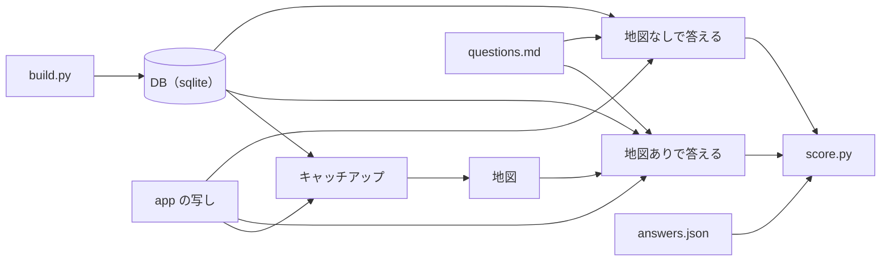

# messy-shop: 罠を仕込んだ通販のサンプル

> **3 行でわかる要約**
> 1. 素人が書いた通販の管理アプリのコードと、DB を作るスクリプトと、答えがデータで決まる 10 問のサンプルです。
> 2. 罠を 10 個仕込んであり、キャッチアップの地図がある答えと無い答えを、同じ 10 問で比べるのに使います。
> 3. 試すときは `build.py` で DB を作り、答える側には app の写しと DB と `questions.md` だけを渡して、`score.py` で採点します。

## 1. 目的

このサンプルは、キャッチアップの効き目を数で測るための材料です。キャッチアップは、移した先のプロジェクトの構成とデータと罠を、作業の前に掴むことです。完成の条件 C-3 は「罠を 10 個仕込んだサンプルで、10 問のうち 9 問以上がデータと合う」で、このサンプルはその試験に使います。

答えるのは、キャッチアップをしたセッションとは別のセッションです。地図だけを頼りに答えた結果と、地図なしで答えた結果を、同じ採点で比べます。

## 2. 全体図

試験では、DB とコードの写しを 3 つのセッションに渡し、2 つの答えを同じ正答で採点します。

図の読み方: 左から右へ読みます。`build.py` が作った DB と app の写しを、キャッチアップと 2 つの答える側に渡し、`score.py` が 2 つの答えを正答と比べます。

## 3. 用語

この文書で繰り返し使う語の意味は、次の表のとおりです。

| 語 | 意味 |
|---|---|
| キャッチアップ | 移した先のプロジェクトの構成・データ・語彙・罠を、作業の前に掴むこと |
| 地図 | キャッチアップで残す文書。構成、入口、データの辞書、罠を、根拠つきで書く |
| 罠 | コードだけを読むと、データの数を取り違える所。名前と中身が合わない所や、動いていない経路など |
| 答える側 | 10 問に答えるセッション。地図ありと地図なしの 2 つを立てる |
| 種 | 乱数の種。同じ種なら、`build.py` は同じ行の DB を作る |

## 4. 中身

サンプルは、答える側に渡す物と渡さない物に分かれます。渡さない物には正答と罠の説明があるので、答える側からは読めない場所に置いてください。

| 置き場 | 中身 | 答える側に渡すか |
|---|---|---|
| `app/` | 管理アプリのコード（python）と、マイグレーションの SQL | 写しを渡す |
| `questions.md` | 10 問と、言葉の決まりと、答えの形 | 渡す |
| `build.py` | 決まった種で sqlite の DB を作るスクリプト | 渡さない |
| `answers/answers.json` | 正答と、正答を出す SQL | 渡さない |
| `answers/traps.md` | 罠ごとの説明と見つけ方 | 渡さない |
| `score.py` | 採点と、DB と正答の照合と、自己試験 | 渡さない |
| `README.md` | この文書 | 渡さない。罠があると知ると、答え方が変わる |

アプリは、小さな雑貨の通販「こもの屋」の管理画面です。python の標準だけで書き、サーバーは立てません。コードを読む材料と DB の実物があれば、試験ができます。

## 5. 作り方

DB は `build.py` で作り、リポジトリの外に置きます。種が決まっているので、何度作っても同じ行になります。

| 順 | すること | コマンド | 期待する結果 |
|---|---|---|---|
| 1 | 作業の場所を決める | mkdir -p （作業の場所） | フォルダができる。リポジトリの外にする |
| 2 | DB を作る | python3 build.py （作業の場所）/shop.db | 「作った」の行と、表ごとの行の数が出る |
| 3 | 正答と DB が合うか確かめる | python3 score.py --verify-db （作業の場所）/shop.db | RESULT: PASS verify-db |
| 4 | コードの写しを置く | cp -R app （作業の場所）/app | 作業の場所に app ができる |

`build.py` は、サンプルのディレクトリの中を指すと止まります。同じパスに DB があるときも止まり、--force を付けると作り直します。python3 は 3.9 以上で動き、手元では 1 秒かからずに終わりました。

## 6. 試験での使い方

試験は、キャッチアップと、地図ありの答えと、地図なしの答えの 3 つのセッションで回します。このリポジトリの samples は読ませず、3 つとも作業の場所の中だけを読ませてください。

キャッチアップのスキルには、このサンプルで作った完成例があります。完成例は 10 問の数え方と一部の正答をそのまま含むので、3 つのセッションのどれにも見せません。スキルの一式は、次の表の物を抜くか伏せた写しを作業の場所に置いて渡します。

| 完成例 | 置き場 | 写しでの扱い |
|---|---|---|
| 地図の完成例 | `skills/catchup/examples/messy-shop/` | 抜く |
| 回したコマンドの記録 | `skills/catchup/examples/messy-shop-run.md` | 抜く |
| データの辞書の完成例 | `skills/backend/examples/data-dictionary-messy-shop.md` | 抜く |
| 完成例の値で崩す試験 | `skills/catchup/evals/run.sh` | 抜く。完成例の数と根拠の行を負例に使っている |
| 最後の返答の例 | `skills/catchup/references/procedure.md` の 8 節の表の例の列 | 伏せる。完成例で数えた数が載っている |

| セッション | 渡すもの | 渡さないもの | 出すもの |
|---|---|---|---|
| キャッチアップ | app の写し、DB、完成例を抜いたスキルの一式 | 問い、正答、`build.py`、`score.py`、この文書、完成例 | 地図 |
| 地図ありで答える | 地図、app の写し、DB、問い、記録を書く道具（`skills/backend/scripts/` の写し） | 正答、`build.py`、`score.py`、この文書、完成例 | 答えの JSON と、クエリの記録 |
| 地図なしで答える | app の写し、DB、問い、記録を書く道具（`skills/backend/scripts/` の写し） | 地図、正答、`build.py`、`score.py`、この文書、完成例 | 答えの JSON と、クエリの記録 |

キャッチアップのセッションには、問いを見せません。問いに合わせて地図を書くと、地図の効き目を測れなくなるからです。2 つの答える側の違いは地図の有無だけにし、ほかの渡し方はそろえます。

答える側は、それぞれ別の作業の場所で回し、クエリの記録（data-query.sh の --log）も別のファイルにします。記録を分けておけば、2 つの答えが別々に作られたことを後から確かめられます。

## 7. 採点と確かめ

採点は `score.py` で行い、問いごとの正誤と点数を出します。正答は既定では出さないので、結果を答える側に戻しても正答は漏れません。

| すること | コマンド | 結果 |
|---|---|---|
| 採点する | python3 score.py （答えの JSON） | 問いごとの正か誤と、RESULT の行の点数 |
| C-3 の線で判定する | python3 score.py （答えの JSON） --min 9 | 9 問に届かなければ終了コード 1 |
| 正答も並べる | python3 score.py （答えの JSON） --show | 問いごとに正答と許す誤差も出る |
| 採点の自己試験 | python3 score.py --selftest | RESULT: PASS score --selftest |

答えの JSON の形と、問いごとの許す誤差は `questions.md` にあります。数の答えは、桁区切りや単位が付いていても読みます。

## 8. やらないことと未確定

このサンプルは試験の材料で、アプリとしては動かしません。表には、やらないと決めた点と、まだ確かめていない点を並べます。

| 区分 | 内容 |
|---|---|
| やらない | サーバーを立てること。コードは読む材料で、DB は `build.py` が直接作る |
| やらない | DB をリポジトリに入れること。試験のたびに `build.py` で作る |
| やらない | 罠の中身をこの文書に書くこと。罠は `answers/traps.md` にだけ書く |
| 未確定 | 地図ありの答えが 9 問に届くか。キャッチアップのスキルができてから測る |
| 未確定 | 罠の見つけにくさが、移した先の実物に近いか。実物とは比べていない |
