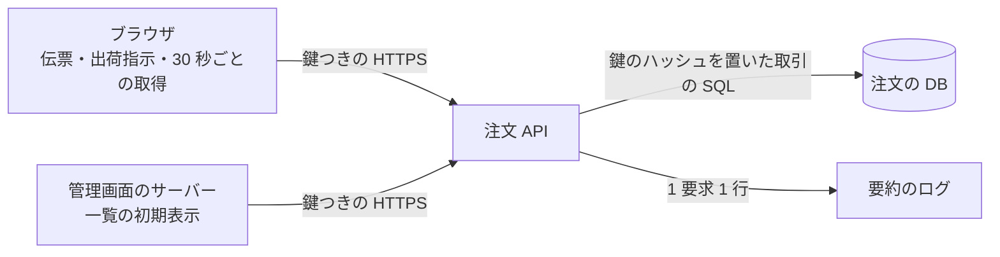
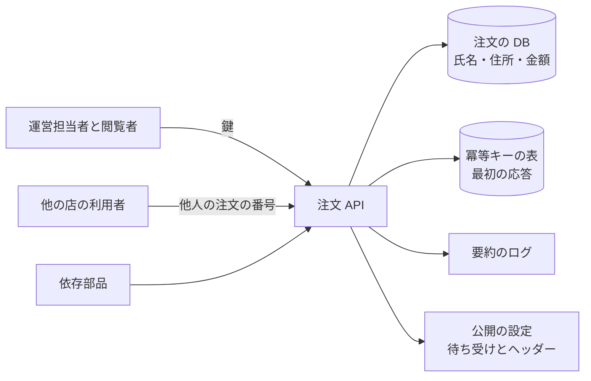

# 設計と実装計画: 管理画面の注文一覧の API

> **3 行でわかる要約**
> 1. 画面仕様と実装計画を受けた、注文一覧の API の設計と実装計画です。運用の件数と予算は架空で、見本の API で測った値は実測と書きます。
> 2. 要望 9 件はすべて契約で受けます。エラー 8 コードのうち 7 つを API が返し、残る OFFLINE は端末の側で決めます。一覧の SQL は件数によらず 6 回で、p99 は 400 件で 2.89ms 以下でした。
> 3. 取りまとめ役は契約・段階・未確定の 3 点を承認伺いに写してください。移行は意味を変えない足し算だけにし、足した物は移行のあいだ外しません。戻すのは新 API の機能フラグと書き込みだけです。CEO の決めが要るのは未確定 5 と 6 と 17 と 19 と 20 です。インフラは 8 から 12 と 15 と 16、フロントエンドは 13 と 14 と 18 と 19 を決めます。デザイナーは画面仕様に無い 8 コードの文と、出荷のあとの取り消しの見せ方（未確定 18）を決めてください。

| 項目 | 内容 |
|---|---|
| 作成日 | 2026-11-07 |
| 状態 | 承認待ち |
| 数値 | 運用の件数・時間・予算・期限は架空。見本の API の問い合わせの数と p99 は、2026-11-07 に手元の機械で測った実測（12 回目の直しのあとで測り直した）。本番の形の SQL は、手元の PostgreSQL 17 で流して確かめた |
| 入力 | 画面仕様 `skills/designer/examples/screen-spec-order-list.md`、実装計画 `skills/frontend/examples/frontend-plan-order-list.md` |
| 契約 | `skills/backend/examples/openapi-order-list.json`（OpenAPI 3.1） |
| 見本の API | `samples/api/orders_api.py`（本体）、`samples/api/server.py`（入口）、`samples/api/test_orders_api.py`（試験） |
| DB の権限の一覧 | `samples/api/db-access.json`（API の DB の利用者が表ごとに持つ操作と列、行の絞り方。正はこのファイル） |
| 置き場 | 本番の案件では tmp/flow/admin-orders/backend-plan.md |

## 背景と目標

運営担当者 5 人が毎朝 9 時から 10 時に、未出荷の注文 400 件を出荷指示にします（架空）。いまの API は 20 件ずつの OFFSET の送りで、件数は別の要求です。出荷指示に冪等キーが無く、二度押しで同じ注文に 2 回の指示が出ていました。この計画で、画面の要望に答える契約と、件数が増えても遅くならない API を決めます。

| 項目 | いま（架空） | 目標 |
|---|---|---|
| 一覧の要求の数 | 一覧と件数で 2 回 | 1 回。件数と利用者を同じ応答に入れる |
| 一覧の送り | OFFSET で 20 件ずつ。途中で行が飛ぶ | 起点の送りで 24 件ずつ。送りの途中で動いた行は `since` で届け、落とさない |
| 二度押しの出荷指示 | 月 4 件 | 0 件。冪等キーで 1 回にする |
| 他の店の注文の閲覧 | 番号を変えると読めた | 404 で隠す |
| 一覧の SQL の数 | 行の数に比例（1 + 行数） | 件数によらず 6 回 |
| 一覧の p99 | 計測なし | 300ms 以内（サーバーの処理） |

## 用語

この計画では次の語を使います。画面仕様と実装計画に出る語は、それぞれの用語の表と同じ意味です。

| 用語 | 意味 |
|---|---|
| 契約 | API の入出力の形とエラーの表。OpenAPI 3.1（API の形を書く国際的な書式）の JSON で書く |
| 冪等キー | 同じ操作を 2 回送っても 1 回しか効かない印。要求の見出し `Idempotency-Key` で送る |
| 起点の送り | 最後の行の値を起点にして次の行を取る送り方。OFFSET（先頭から数えて飛ばす送り方）と違い、行が増えても飛ばさない |
| 追跡番号 | 1 つの要求をログとエラーでたどる番号。画面では「お問い合わせ番号」と書く |
| p99 | 99 パーセンタイル。遅い方から 1% の応答時間 |
| N+1 | 一覧の行ごとに問い合わせを出してしまうこと。行が 100 なら問い合わせも 100 増える |
| Mermaid | 文字で書く図の書式。この計画の図はこれで描く |
| 店 | 注文を持つ単位。1 つの API に複数の店が載る（テナント） |
| 全件か無し | 書く行を 1 つのトランザクションで更新し、途中で失敗したら全部を戻すこと |

## 全体像

API は管理画面のサーバーとブラウザの両方から呼ばれ、注文の DB だけを読み書きします。外部の呼び出しは持たず、書き込みは 1 つのトランザクションで終えます。旧 API の取り消しと出荷が列のほかに外の仕事（返金や倉庫への連絡）をしていれば、新 API はそれをしません。段 0 の 7 つ目で調べ、見つかれば段 4 に進みません（未確定 17）。

図の読み方: 左の 2 つの呼び手は、どちらも利用者の鍵を付けて注文 API を呼びます。API は DB とログにだけ書き、ほかのサービスは呼びません。

## 契約

契約の本体は `skills/backend/examples/openapi-order-list.json` で、操作は 4 つです。壊す変更は版を分け、`/v2` を足すまで `/v1` は消しません。契約の検査は `skills/backend/scripts/contract-check.sh` で回し、2 版を渡すと壊す変更を落とします。

| 操作 | 成功 | エラー | 答える要望 |
|---|---|---|---|
| `GET /v1/orders`（一覧） | 200。行、件数、群ごとの件数、利用者、サーバーの時刻、次の起点 | 400、401、500、503 | 1〜5、7 |
| `GET /v1/orders/{orderId}`（詳細） | 200。明細、過去の注文 2 件、荷物の大きさと割れ物、履歴 5 件 | 400、401、404、500、503 | 9 |
| `POST /v1/orders/ship`（出荷指示） | 200。行ごとの結果と件数の要約 | 400、401、403、409、422、500、503 | 6 |
| `POST /v1/orders/cancel`（取り消し） | 200。行ごとの結果と件数の要約 | 400、401、403、409、422、500、503 | 8 |

実装計画の要望 9 件には、次のように答えます。要望の 9 件で断ったものはありません。ただし実装計画の本文は、要望の外の 3 操作を送る前提で書かれています。出荷予定日の PATCH、担当の付け替え、出荷指示の取り消しの 3 つです。この 3 つはこの版の契約に無く、「やらないこと」と未確定 5 に置きます。

| # | 要望 | 答え |
|---|---|---|
| 1 | 件数を同じ応答に入れる。空なら候補の件数 | `total` と `counts` と、保存ビューのタブの件数 `viewCounts` を同じ応答に入れる。`counts` はこの応答の条件に当たる行だけを数え、済の群の件数 `shippedToday` も行と食い違わない。店全体の今日の済は `viewCounts.shipped` に入れる。0 件のときは、条件を 1 つ外した件数を `suggestions` で返す |
| 2 | 利用者の設定とサーバーの時刻 | `me`（名前・役割・1 文字キー）と `servedAt` を入れる。`keys` はこの版で動く S と P だけ。閲覧者の `keys` は空 |
| 3 | 降順の並び | `sort=-orderedAt` を受ける。既定は次にすることの順（`next`）。済のビューは出荷指示の新しい順（`-shippedAt`）が既定 |
| 4 | 起点の送り | `after` に前の応答の `nextCursor` をそのまま渡す。起点は群・時刻・番号と絞り込みの印で、API の鍵で署名する。条件を変えた起点、画面で組み立てた起点、書き換えた起点は 400。一覧の起点は日付（日本時間）にも結びつき、日付が変わると 400 で、画面は先頭から読み直す。送りの途中で群が前に戻った行は、最初の頁の `servedAt` からの `since` で届く。前へ戻る起点は無い（未確定 7） |
| 5 | 指定の時刻より後の変化 | `since` に `servedAt` を渡すと、どの書き手の変更でも、変わった行を変わった順に返す。済、取消、取り消しの戻し、新しい注文、決済待ちから出荷可への移りを含む。済の行は `shippedBy` と `shippedAt`、取消の行は `cancelledBy` と `cancelledAt` で、した担当と日時を返す。行はビューで絞らず、行ごとの `inViews` が今入る保存ビューを示す。画面は今のビューが `inViews` にあれば行を今の群に置き直し、無ければ外す。タブの件数 `viewCounts` も返す（未確定 13）。`limit` を超えたら `nextCursor` で送る。10 秒の重ね幅を取るので、画面は注文番号で重複を除く。起点で送るあいだは、全部の頁が最初の頁の `servedAt` を返す。画面は最後の応答の `servedAt` を、そのまま次の `since` に使う。15 分（架空）より前の `since`、絞り込みの引数との併用は 400。出荷のあとに印が立った済の行は `cancelledAfterShip` が true |
| 6 | 出荷指示の行ごとの結果 | `results` に行ごとの結果を入れる。先に済の行は ORDER_ALREADY_SHIPPED と担当と日時。全件がそうなら 409 |
| 7 | 一覧の応答の目標と打ち切り | 目標は p99 で 300ms（サーバーの処理）。API 自身は 8 秒で打ち切り、ORDER_LIST_UPSTREAM_SLOW を返す |
| 8 | 取り消しの POST | 冪等キーを受け、行ごとの結果を返す。出荷指示済みは ORDER_CANCEL_NOT_ALLOWED、閲覧者は 403 |
| 9 | 詳細に過去の注文と荷物 | `pastOrders`（新しい順に 2 件）と `parcel`（大きさと割れ物）を入れる。伝票のための要求は増えない |

保存ビューの今日出荷と自分の担当は、未出荷の 4 群のあとに、今日出荷指示した行を群 `shipped` で続けます。画面仕様の直後の群と済の群を、一覧の要求 1 回で描くためです。済の行は出荷指示の新しい順に並び、タブの件数 `viewCounts` には数えません。自分の担当のビューに `staff` を併せると 400 にし、自分の担当の条件を上書きさせません。

取り消しで書けた行が 0 件なら、全部が見つからないときも 409 で返し、行ごとの結果を添えます。他の店の注文を 404 にしないのは、一括の中の 1 行で存在を教えないためです。

一括の書き込みは、条件つきの UPDATE の 1 文で、書ける行だけを書きます。1 文なので、書く行は全件か無しです。書けなかった行は、あとで読んで行ごとの結果に分けます。先に済の行と出荷可でない行は書きません。文が途中で失敗したら全部を戻し、500 の ORDER_WRITE_INTERNAL を返します。どこまで書けたか分からない部分成功は作りません。この読み方は未確定の 1 に置き、取りまとめ役の確認を待ちます。

## 認可

役割は運営担当者と閲覧者の 2 つで、判定はすべてサーバー側で資源 1 件ごとに行います。店の id は鍵から決め、要求の引数では受けません。全部の SQL に店の id の条件を入れるので、他の店の注文は行として見つかりません。

| 役割 | 読む | 書く | 判定の場所 |
|---|---|---|---|
| 運営担当者（operator） | 自分の店の一覧と詳細 | 出荷指示、取り消し | 鍵から利用者と店を引き、SQL に店の id を入れる |
| 閲覧者（viewer。経理、サポート） | 自分の店の一覧と詳細 | なし。書き込みは 403 の FORBIDDEN_ROLE | 書き込みの入口で役割を確かめる |
| 鍵なし、鍵の誤り | なし。401 の AUTH_REQUIRED | なし | 鍵のハッシュ（SHA-256）で利用者を引く |
| 他の店の利用者 | 他の店の注文は 404 の ORDER_NOT_FOUND | 他の店の注文は行ごとの結果で ORDER_NOT_FOUND。書けた行が 0 件なら 409 | 403 にせず 404 にして、注文があることを教えない |

利用者の id は一覧の担当の欄に出るので、秘密ではありません。守りが鍵だけに頼るので、鍵は id から作れない形にし、次の決まりで発行して失効させます。

| 鍵の項目 | 決め |
|---|---|
| 発行 | ログインのたびに 256 ビットの乱数で作り、端末ごとに表 sessions の 1 行を足す。ほかの端末の鍵は失効しない。見本は API を作るたびに乱数で作り、id から作った鍵は 401 になる |
| 保存 | sessions に SHA-256 のハッシュと期限だけを持ち、鍵そのものは持たない |
| 期限 | 12 時間（架空）。過ぎた鍵は 401 の AUTH_REQUIRED |
| 失効 | ログアウトでは、その端末の sessions の 1 行を消す。役割の変更、退職、漏えいの疑いでは、その利用者の行を全部消す。発行と失効はインフラの秘密の置き場の決まりに従う |

## 冪等と同時の更新

書き込みの 2 つの操作は、冪等キーを必須にします。キーは店と利用者ごとに分けて 24 時間（架空）保持します。過ぎたものは 10 分ごとの掃除の仕事で消し、消す前でも再生には使いません。書き込みの取引では消しません。消した行の鍵で、同じ店の関係の無い書き込みが 1 本目のコミットを待つからです。期限の切れた自分の同じキーが残っていれば、その 1 行だけを消して取り直します。同じキーで同じ内容が来たら、最初の応答をそのまま返し、見出しに `Idempotent-Replayed: true` を付けます。同じキーで違う内容が来たら 422 の IDEMPOTENCY_KEY_MISMATCH を返し、何も書きません。

| 場面 | 振る舞い |
|---|---|
| 同じ人の二度押し | 2 回目は 1 回目の応答を返す。SQL は 3 回（鍵のハッシュの設定、鍵、冪等キー）で、注文の行は書かない |
| 2 人が同じ行を出荷指示 | 読んでから書く形にしない。先に `UPDATE … WHERE status IN ('ready') RETURNING id` で書き、書けなかった行だけをあとで読む。行の鍵で待つ本番の DB（READ COMMITTED）でも、2 本目の UPDATE は 1 本目のコミットを待ってから条件を読み直し、その行は 0 行になる。後の人には行ごとの結果で ORDER_ALREADY_SHIPPED と先の人の名前を返し、500 にしない。`SELECT … FOR UPDATE` は要らない。見本の `BEGIN IMMEDIATE` は sqlite3 の都合で、本番の形ではない |
| 読んだあとで行が変わった | 起きない。書いたあとで読むので、読みは書けなかった理由を分けるだけに使う |
| 2 つのプロセスが同じキーを同時に受けた | プロセスの中の lock には頼らない。注文の行を読む前に、冪等キーの行を `INSERT … ON CONFLICT DO NOTHING` で先に入れる。2 本目はその INSERT で 1 本目のコミットを待ち、誤りを出さずに 0 行を返す。取引を戻さないので、鍵のハッシュ（app.key_hash）を置いたまま 1 本目の行を読み直せる。本番の RLS の下でも 0 行にならず、1 本目の応答を返す。DB のログに主キーの重複の誤りと冪等キーの値も出ない |
| 一覧の行と servedAt の時点 | servedAt は、読みの取引を始める前に、取引の外の 1 つの文で取る。一覧の文は、そのあとの 1 つの読みだけの取引で流す（本番は READ ONLY の REPEATABLE READ）。行と件数は同じ時点を見るので、行の文と件数の文の間で重ね幅が減らない |
| 時刻を打ってから遅れてコミットした | 書き手に取引の上限を掛けず、servedAt の側で吸収する。changed_at はトリガーが行を書いた時刻なので、その取引の始まりより後になる。servedAt は、まだコミットしていない orders の書き手の取引の始まりより後にしない（関数 orders_write_horizon。定義は `samples/infra/db/roles.sql` の 1 つだけ）。読みの写しが決まってから horizon を読むと、そのあいだにコミットした取引は写しにも horizon にも出ない。そこで servedAt は、写しが決まる前に `least(statement_timestamp(), orders_write_horizon())` で読む（`samples/api/orders_api.py` の SERVED_PG）。長い取引が写しのあとにコミットしても、その行は次の `since` に入る。旧 API の取引の長さは変えない。`since` は 10 秒の重ね幅で読む。決めは `samples/api/db-access.json` の sinceOverlap にある。書き手を利用者の名前で固定せず、orders に行の書き込みの鍵（RowExclusiveLock）を持つ取引を pg_locks で数える案をインフラに渡す（未確定 11） |
| 出荷予定日の更新 | この版の契約には入れない。足すときは版番号（`If-Match`）で競合を 409 にする |

## エラー

エラーの本文は 4 点（分類・原因・対処・追跡番号）とコードを必ず持ちます。原因と対処の文は画面仕様の表と同じにし、N と M には件数を入れます。1 件だけのときは、画面仕様の 1 件の文にします。画面は文をコードの鍵から引きます。

違うのは ORDER_CANCEL_NOT_ALLOWED の対処だけです。画面仕様の文は、出荷指示を戻してから取り消すよう求めます。その API はこの版にありません。できない操作を指示しないよう、決まるまで別の文にします（未確定 5）。

| コード | 状態番号 | 分類 | 原因 | 対処 | 追跡番号 | 画面仕様 |
|---|---|---|---|---|---|---|
| ORDER_LIST_UPSTREAM_SLOW | 503 | upstream | 注文一覧を読み込めませんでした | しばらく待ってから、もう一度読み込んでください | 本文と見出しに入れる | あり |
| ORDER_LIST_INTERNAL | 500 | internal | 問題が発生し、注文一覧を表示できませんでした | お問い合わせ番号を添えて、お問い合わせください | 本文と見出しに入れる | あり |
| ORDER_SHIP_PARTIAL | 行ごと。0 件なら 409 | conflict | N 件のうち M 件を出荷指示にできませんでした | 残った M 件を選び直して、もう一度出荷指示してください | 本文と見出しに入れる | あり |
| ORDER_ALREADY_SHIPPED | 行ごと。全件なら 409 | conflict | N 件のうち M 件は、ほかの担当者が先に出荷指示していました | 先に押した人の検印を付けたので、出荷指示をやり直す必要はありません | 本文と見出しに入れる | あり |
| ORDER_CANCEL_NOT_ALLOWED | 行ごと。0 件なら 409 | conflict | N 件のうち M 件は出荷指示済みのため、取り消せませんでした | 出荷指示済みの注文の取り消しは、店の責任者に相談してください（画面仕様と違う） | 本文と見出しに入れる | あり |
| ORDER_NOT_FOUND | 404。取り消しで書けた行が 0 件なら 409 | not_found | この注文は見つかりませんでした | 注文番号を確かめて、一覧から開き直してください | 本文と見出しに入れる | あり |
| ORDER_DETAIL_UPSTREAM_SLOW | 503 | upstream | この注文を読み込めませんでした | 一覧に戻って、もう一度開いてください | 本文と見出しに入れる | あり |
| AUTH_REQUIRED | 401 | auth | 利用者を確かめられませんでした | もう一度ログインしてください | 本文と見出しに入れる | 無い |
| FORBIDDEN_ROLE | 403 | permission | この操作の権限がありません | 運営担当者に依頼してください | 本文と見出しに入れる | 無い |
| INVALID_REQUEST | 400 | validation | 要求の形が契約と違います | 契約のとおりに直して送ってください | 本文と見出しに入れる | 無い |
| IDEMPOTENCY_KEY_REQUIRED | 400 | validation | 冪等キーがありません | 冪等キーを付けて送ってください | 本文と見出しに入れる | 無い |
| IDEMPOTENCY_KEY_MISMATCH | 422 | validation | 同じ冪等キーで違う内容が送られました | 新しい冪等キーで送り直してください | 本文と見出しに入れる | 無い |
| ORDER_WRITE_INTERNAL | 500 | internal | 問題が発生し、変更を保存できませんでした | お問い合わせ番号を添えて、お問い合わせください | 本文と見出しに入れる | 無い |
| ORDER_WRITE_UNAVAILABLE | 503。何も書かずに断った（利用者ごとの同時の要求の上限、lock と行の鍵の待ちの打ち切り） | upstream | いまは変更を受け付けられませんでした | しばらく待ってから、同じ操作をもう一度してください | 本文と見出しに入れる | 無い |
| ORDER_WRITE_DISABLED | 503。新 API の書き込みを止めた（戻し） | upstream | この画面からの変更は、いま止めています | 画面を読み込み直してから、もう一度操作してください | 本文と見出しに入れる | 無い |

画面仕様の 8 コードのうち、OFFLINE は通信が無いときに端末が決めるので、API は返しません。ほかの 7 コードは同じ名前で返します。画面仕様に無い 8 コードは、デザイナーが文を決めるまで、API の原因と対処の文をそのまま出します。この案をフロントエンドに渡します（未確定 3 と 14）。ORDER_LIST_INTERNAL の文にまとめると、ORDER_WRITE_UNAVAILABLE が「お問い合わせください」になります。このコードは何も書かずに断ったときだけ返り、冪等キーも取らないので、画面は同じキーで送り直せます。書き込みが 8 秒の打ち切りで止まったときも、全部を戻したのでこのコードです。本番の打ち切りは statement_timeout と lock_timeout です。

ORDER_WRITE_DISABLED は、戻しで新 API の書き込みを止めたときだけ返ります。送り直しても通らないので、対処は画面の読み込み直しです。機能フラグを旧 API に戻してあれば、読み込み直した画面は旧画面になります。同じ文を 2 つのコードに使うと、利用者は旧画面へ移らずに送り直し続けます。

## データと移行

データは 8 つの表に置き、時刻は UTC、金額は円の整数で持ちます。表の定義は `samples/api/orders_api.py` の冒頭にあります。移行の前の表が LEGACY_SCHEMA で、それに足す段が ADDITIONS です。本番の文は ADDITIONS の pg に、見本が流す同じ意味の文は sqlite に置きました。見本の `BEGIN IMMEDIATE` と、AFTER のトリガーで列を書き直す形は sqlite3 の都合です。本番は BEFORE のトリガーで NEW の値を変えます。

| 表 | 中身 | 個人情報 |
|---|---|---|
| shops | 店の id と名前 | 無い |
| orders | 注文。状態、金額（円の整数）、担当、出荷予定日、出荷指示の人と時刻、取り消しの印 is_cancelled（移行の前からの列で、意味を変えない）。足す列は、取り消しの人と時刻（cancelled_by、cancelled_at）、行が変わった時刻（changed_at。どの書き手の変更でも DB が進める）、トリガーが書いた取引の番号（stamped_xid） | 無い（氏名は customers） |
| customers | 宛先の氏名、郵便番号、住所 | ある |
| order_items | 明細。商品、数量、金額、税率 | 無い |
| order_events | 履歴。受注、引き当て、出荷指示、取り消し | 無い（人は利用者の id） |
| users | 利用者と役割 | 名字だけ |
| sessions | 端末ごとの鍵のハッシュと期限。1 人が複数の行を持てる | 無い |
| idempotency | 冪等キー、要求のハッシュ、最初の応答。作った時刻に索引を付ける | 応答に氏名が入る。24 時間で消す |

注文番号は全店で 1 つの主キーです。6 桁では、架空の 1 日 400 件の店が 1 つでも約 7 年で尽きます。契約の注文番号は 6〜12 桁で受け、桁が増えても契約を壊しません。画面は番号を桁で切らずに文字列で持ちます。

### 取り消しの印は 1 つのまま

取り消しの印は is_cancelled の 1 つのままにし、status の 'cancelled' へは移しません。第 3〜8 回の審査の重大 9 件は、どれも印を移す案から出ました。旧 API の書き手（取り消し、戻し、決済の通知、受注）が動くかぎり、印が 2 つあると、版と段と書き手の組み合わせごとに穴が出ます。

決まりは 5 つです。1 つ目に、DB の取り消しの正は is_cancelled のままで、意味を変えません。status に 'cancelled' を書かず、表の制約（CHECK）も変えません。2 つ目に、契約の status の cancelled は、新 API が読むときに is_cancelled から作ります。応答の形は今の契約のままです。

3 つ目に、新 API の書き込みは is_cancelled を条件に入れます。出荷指示は is_cancelled = 0 の行だけを書きます。取り消しは is_cancelled を 1 にするだけで、status を動かしません。4 つ目に、旧 API の書き込みは何も変えません。取り消し中の決済待ちに決済が届けば、移行の前と同じく出荷可に移ります。取り消しを戻せば、その注文は出荷できます。

5 つ目に、出荷のあとに印が立った行は、取消でなく済のまま読みます。旧 API の取り消しの文は status を条件に持たないので、新 API が出荷指示した行にも印を立てられます。荷物は出ていくので、取消と読んで済の群から消すと、誰も荷物を止められません。行は済のビューと件数に残し、`cancelledAfterShip` を true にして知らせます。前の日までに出荷指示した行も、出荷済み（shipped）のあいだは今日出荷と済のビューに残します。夕方の出荷指示を翌朝に倉庫が出す運用でも、夜の取り消しが朝の画面に出ます。印の立て下ろしは、何日前の出荷でも changed_at を進めるので、`since` にも出ます。印から決めるので、取り消しの時刻が分からない行でも知らせます。新 API の取り消しは ORDER_CANCEL_NOT_ALLOWED を返します。

この知らせを画面に出す要素は、画面仕様にも実装計画にもまだありません。普通の済と同じに描くと、客が取り消した注文に誰も気づかず、荷物が出ていきます。そこで、画面仕様と実装計画がこの行を受け持つまで、段 4（新 API への切り替え）に進みません（未確定 18）。

同時の書き込みは、1 文の条件つき UPDATE どうしの順で決まります。PostgreSQL の READ COMMITTED は、行の鍵を待ったあとに条件を新しい行で読み直します。旧 API が先に取り消した行は、新 API の出荷指示の条件 is_cancelled = 0 で外れます。新 API の取り消しは旧 API と同じ印を立てるので、旧 API の出荷は自分の取り消しと同じ扱いをします。

取り消しの人と時刻（cancelled_by、cancelled_at）は、印を立てた取引でトリガーだけが書きます。人は、要求の鍵のハッシュ（取引の設定 app.key_hash）から sessions で引きます。旧 API は鍵を置かないので、旧 API の取り消しの人は null です。API の文がこの 2 列に書いても、トリガーが上書きします。トリガーの関数は表の持ち主の権限で動き、RLS を受けずに sessions を引きます。

読みは、印が立っていれば列の値を返します。行の xmin（その行を最後に書いた取引の番号）とは比べません。第 11 回までは、xmin がトリガーの書いた取引の番号と同じときだけ返していました。ところが、セーブポイント（取引の中の小さな取引）の中の書き込みでは、xmin が子の取引の番号になります。ORM の入れ子の取引や、ドライバーの文ごとのセーブポイントがこれに当たります。表の写し直し（pg_dump からの復元、論理複製での入れ替え）でも xmin は変わります。そのため正しく書いた人と時刻を読みで null にし、次の書き込みでトリガーが列からも消していました。

素通りの書き手は、トリガーを ENABLE ALWAYS にして無くしました。`session_replication_role` を replica にした取り込みでもトリガーが動くので、印を戻して立て直せば、立て直した取引の時刻と null の人に替わります。論理複製の適用は、元の DB のトリガーが書いた値を運ぶので、運んできた値をそのまま入れます。残る素通りは、表の持ち主が `DISABLE TRIGGER` を流したときだけです。足した物を外す操作なので、この計画では流さず、段 0 の 8 つ目で探します。新 API は、書いた行をトリガーが通したかを stamped_xid で確かめます。止められていれば、全部を戻して 503 にします。手元の PostgreSQL 17 で、次の 4 つを流して確かめました。セーブポイント内の決済の通知と取り消し、replica の戻しと立て直し、pg_dump から復元した表への書き込みです（`test_pg_who_cancelled_is_returned_only_when_the_trigger_saw_the_mark`）。

### 移行の段

移行は、意味を変えない足し算だけです。列も表もトリガーも消さず、既存の行を書き直さず、表をなめて数えません。段を変える取引も、段の表も、段ごとの門もありません。足した物（列、表、トリガー、索引）は、移行が終わるまで外しません。戻すのは新 API の機能フラグと、新 API の書き込みだけです。第 9・10 回の審査の重大は、どれも足した物を戻しで外したあいだに、旧い書き手が書く窓から出ました。外さなければ、その窓はできません。

足す物は、旧い書き手を変えない形に限ります。決まりは 3 つです。1 つ目に、旧い書き手の文を断りません。外部キーと CHECK は足しません。sessions から users への外部キーは ON DELETE CASCADE にし、旧い書き手が users を消す文も通します。2 つ目に、列の型を前提にしません。トリガーは行を字にして比べ（等しさの演算子の無い型の列があっても比べられる）、印と状態も字で読みます。出荷の時刻は、字にしてから時刻として読みます。読めないときと、どこで失敗したときも、書き込みを止めず changed_at を進める側にします。時差の無い型（timestamp や時差の無い字）と DateStyle（時刻を字にする形）の違いは、境の幅で吸います。境は、今日の始まりの 2 日前です。トリガーが読む旧い列は、is_cancelled、status、shipped_at の 3 つだけです。3 つ目に、旧い書き手の値を書き換えません。トリガーが書くのは足した 4 列だけです。

段 1〜3 は、orders の今の持ち主で流します。ALTER TABLE と CREATE TRIGGER は、表の持ち主しか流せないからです。持ち主を orders_migrate に移すと、旧 API が持ち主の権限と RLS の素通りを失います。そのため、この計画では持ち主を移しません。表の定義を変える文は 1 つの取引に入れ、`SET LOCAL lock_timeout = '2s'` を取引の中だけに置きます。セッションに残さないので、あとの索引作りが 2 秒で打ち切られません。

| 段 | 変更 | リリース | 止めたとき | 戻し方 | 確かめ方 |
|---|---|---|---|---|---|
| 0 | DB は変えない。下の 8 つを調べる | 11-10（架空） | 何も変わらない | 戻すものは無い | 調べの結果を未確定 6、15、17 に渡す |
| 1 | 列 cancelled_at・cancelled_by・changed_at・stamped_xid を足す。既定値も制約も無い列なので、表をなめない。表 sessions と idempotency を足す。全部を 1 つの取引で流す | 11-12（架空） | 安全。足した列は null のまま誰も読まない。列の数に頼る読み手と書き手は、段 0 の 4 つ目で先に直す | 外さない。列を消すのは、旧い書き手を全部移したあとの別の計画 | 列の定義を読む。旧 API の書き手の試験と、段 0 で見つけた読み手の試験を流す |
| 2 | トリガー orders_before_write を、足した時刻の注釈と 1 つの取引で足し、ENABLE ALWAYS にする（replica の取り込みでも動く）。changed_at を進め、印の立て下ろしで取り消しの人と時刻を書き、書いた取引の番号を stamped_xid に残す。書くのは足した 4 列だけ | 11-12（架空） | 安全。旧い列と、書き込みの成否を変えない。列の型によらないことを PostgreSQL で確かめた | 外さない。新 API に不具合があれば、機能フラグで画面を旧 API に戻し、新 API の書き込みを止める | 検証の環境で 1 行を書き、changed_at と stamped_xid が進むのを読む。注釈に時刻があり、tgenabled が A |
| 3 | 索引 5 つ（出荷のあとの取り消しを引く orders_marked を含む）を、取引の外の CREATE INDEX CONCURRENTLY で 1 つずつ作る。前に lock_timeout と statement_timeout を 0 に戻す。IF NOT EXISTS は付けない。書き込みを止めない | 11-13（架空） | 安全。作りかけの索引は INVALID のまま使われない。長い旧い取引の終わりを待つ | 外さない。作りかけで止めた INVALID の索引だけは、DROP INDEX CONCURRENTLY で消してから流し直す | pg_index の indisvalid が 5 つとも true。作る時間と書き込みの p99 を見る |
| R | インフラが roles.sql で RLS を有効にし、CONNECT を PUBLIC から取り上げる。その前に、旧い書き手の全部に全行の方針と CONNECT と USAGE を付け、確かめの SQL を流す | 11-13（架空） | 確かめが通らなければ roles.sql はそこで止まり、RLS は有効にならない | RLS を表ごとに無効にする（DISABLE ROW LEVEL SECURITY）。旧い書き手の方針と権限は残す | 旧 API の書き手の試験を、旧 API の DB の利用者で流す。読みも書きも 0 行にならない |
| 4 | 新 API `/v1` を出し、画面の呼び先を機能フラグで `/v1` に変える。段 0 の 7 つ目で列のほかの仕事が見つからず、画面が出荷のあとの取り消しを受け持ち、戻す先の旧画面を残す決めがあるときだけ進む（未確定 17、18、19、20） | 11-16（架空） | 旧 API と新 API が同じ印を書くので、どちらに戻しても食い違いは無い | 機能フラグで画面を旧 API に戻す。開いたままの新しい画面のために、新 API の書き込みも止める（503 の ORDER_WRITE_DISABLED で、画面を読み込み直させる）。データの戻しは要らない。戻す先の旧画面と機能フラグ admin_orders_v2 は、この戻しが要るあいだ消さない（未確定 19） | 4 つの決まりの試験。ORDER_WRITE_UNAVAILABLE と ORDER_WRITE_DISABLED の割合 |

トリガーは行ごとに動くので、旧 API の一括を遅くします。手元の PostgreSQL 17 で、過去の済の行 300,000 行を配達済みに移す 1 文は 657ms から 3,294ms になりました。値の変わらない 1 文の直しは 801ms から 3,203ms でした（各 1 回、2026-11-07 に第 11 回の形のトリガーで実測。第 12 回の直しのあとは測り直していない）。どちらも changed_at は 1 行も進まず、`since` には出ません。一括の取引が長くなるぶん、行の鍵を持つ時間も延びます。段 0 の 5 つ目で、本番の写しの DB の一括の時間も測り、SRE に渡します。

外部キーの段（cancelled_by から users）は、第 11 回で外しました。旧い書き手が users を消す文を断りうるからです。cancelled_by には、トリガーが sessions から引いた利用者だけが入ります。読みは users を左から結ぶので、名前を引けなければ人は null です。

確かめの SQL は `samples/api/orders_api.py` の RLS_PREFLIGHT_PG で、インフラの roles.sql の検査 9 と同じ除き方をします。1 つ目のループは、表を読み書きする役割のうち、全行の方針（USING (true)）の無いものを探します。書き手かどうかは、表の単位の権限に加えて、列の単位の権限でも見ます。例は `GRANT UPDATE (is_cancelled) ON orders` で、見る関数は has_any_column_privilege です。列の権限だけの旧い取り消しの書き手を見落とすと、RLS を有効にした日から、その取り消しが黙って 0 行になります。除くのは orders_api と、名前が pg_ か rds で始まる既定の役割です。上の権限と BYPASSRLS を持つ役割、表の持ち主とその一員も除きます。2 つ目のループは、この DB を使う入れる役割に、PUBLIC からでない CONNECT があるかを見ます。使う役割は、public の表のどれかに権限を持つ役割と、監視の役割（pg_monitor の一員）です。既定の役割を付けたバックアップの利用者は除かないので、方針か BYPASSRLS と、CONNECT を求めます。RLS は方針の無い利用者を全部拒むので、無いまま有効にすると、旧 API の読みは 0 行になります。取り消しと決済の通知の UPDATE も、黙って 0 行になります。手元の PostgreSQL 17 で、通る形と止まる形を流して確かめました（`test_pg_rls_preflight_passes_built_in_roles_and_owner_members`、`test_pg_rls_preflight_catches_column_privilege_writers`）。roles.sql の検査 9 は、まだ表の単位の権限だけを見ています。同じ直しをインフラに渡します（未確定 16）。

段 0 では、旧 API のコードと 30 日分のログと DB の権限で 8 つを調べます。1 つ目は、orders を書く DB の利用者の全部です。決済の通知（決済待ちから出荷可）と受注を書くのが、旧 API の利用者か別の利用者かを確かめます。2 つ目は、旧 API の出荷の文が is_cancelled = 0 を条件に持つかです。持たなければ、取り消した注文を旧画面が出荷できます。新 API で取り消しても旧 API で取り消しても同じ印なので、移行の前からある穴です。それでも新画面で取り消した注文が開いたままの旧画面から出ていくので、持たなければ段 4 に進まない決めにします。旧 API の持ち主がその文を直すか、穴のまま進めるかを CEO が決めます（未確定 20）。

3 つ目は、取り消しの文と、決済を知らせる文の条件です。取り消しは status を条件に持たず、出荷した行にも印を立てると見込みます。決済の通知は is_cancelled を条件に持たず、取り消し中の決済待ちも出荷可に移すと見込みます。どちらの結果でも新 API は変えず、移行の前と同じ結果になります。

4 つ目は、列の数や位置に頼る読み手と書き手です。`SELECT *` で準備した文の使い回し、行を位置で受けるコード、`INSERT INTO 写し SELECT * FROM orders`、列名の無い `COPY` を探します。コードと pg_stat_statements（流れた文の統計）の両方で探し、見つかれば段 1 の前に列名を並べる形へ直します。段 1 の列は外さないので、直すまで段 1 に進みません。5 つ目は、本番の写しの DB で索引を作る時間と、トリガーのある表で旧 API の一括が延びる時間です。

6 つ目は、表の持ち主と、旧い書き手の権限です。orders と、関わる表の持ち主の名前を調べます。旧 API の利用者が持つ表の権限と、CONNECT と USAGE を PUBLIC からだけ得ていないかも一覧にします。この一覧が、段 R で付ける方針と権限の元です。

7 つ目は、旧 API の取り消しと出荷が、列の書き込みのほかにしている仕事です。探すのは、返金と在庫の戻しと客への知らせです。倉庫と運送会社への連絡と、旧い履歴の表への書き込みも探します。新 API はどれもしないので、1 つでもあれば、画面を切り替えた日から黙って抜けます。そのときは段 4 に進まず、その仕事を移す別の計画を CEO に諮ります（未確定 17）。

8 つ目は、トリガーを止める作業と、セーブポイントを使う書き手です。トリガーは ENABLE ALWAYS なので、`session_replication_role` を replica にする取り込みでも動きます。残る素通りは `DISABLE TRIGGER` で、それを流す作業を探します。止めたあいだの書き込みは changed_at を進めず、`since` に出ません。見つかれば段 2 の前にその作業を変え、変えられなければ画面に一覧を読み直させる決めを未確定 15 に足します。旧 API と ORM がセーブポイントを使うかも調べます。使っていても人と時刻は消えませんが、`test_pg_who_cancelled_is_returned_only_when_the_trigger_saw_the_mark` の形で、本番の写しの DB でも流して確かめます。

段の文は列を消さないので、読みの取引が古い写しと新しい表の定義を同時に見ても、読む列は全部あります。新 API は列を名前で並べて読みます。表に列を足しても、準備済みの文の結果の形は変わりません。列の権限も、列を消さないので消えません。

### 版と段の表

行は orders を書きうる書き手と API の版で、列は移行の段と、新 API を戻したあとの状態です。升には、書き込みを受けるか断るかと、その理由を書きます。足した物は外さないので、「段を戻したあと」の列はありません。開いたままの古い画面は旧 API を呼ぶので、旧 API の行に入ります。開いたままの新しい画面は、機能フラグで戻したあとも `/v1` を呼ぶので、新 API の行に入ります。右の 2 列は、戻す先の旧画面と機能フラグ admin_orders_v2 があることが前提です。フロントエンドの実装計画は、12-25 にフラグと旧画面を消すと書きます。消したあとに新 API の不具合が出ると、戻す先が無く、書き込みを止めればどの画面からも出荷指示と取り消しができません。そこで、段 4 のあと戻しが要らなくなるまで旧画面とフラグを消さない決めを未確定 19 に置きます。

| 版（書き手） | 段 0・1 | 段 2 | 段 3 | 段 R（RLS） | 段 4 | 段 4 で機能フラグを戻したあと | 新 API の書き込みを止めたあと |
|---|---|---|---|---|---|---|---|
| 旧 API（今の版。文を変えない） | 受ける。足した列には触れない | 受ける。トリガーは足した列だけを書き、列の型を前提にしない | 受ける。索引は結果を変えない | 受ける。全行の方針と CONNECT が無ければ、確かめの SQL が roles.sql を止める | 受ける。出荷した行への取り消しも、新 API は済のまま見せ、cancelledAfterShip で知らせる | 受ける。画面が旧 API に戻る | 受ける |
| 新 API の版 1（`/v1`。この見本） | まだ無い | まだ無い | まだ無い | まだ無い。出たあとは、取引ごとに鍵のハッシュを置くので、RLS の下でも 0 行にならない | 受ける。出荷指示は is_cancelled = 0 の行だけ、取り消しは印を立てるだけ。書いた行をトリガーが印していなければ、全部を戻して 503 | 受ける（開いたままの新しい画面）。同じ印を書くので害が無い | 断る。書き込みは 503 の ORDER_WRITE_DISABLED で、冪等キーも取らない。画面を読み込み直させ、旧画面に移す。一覧と詳細と `since` は返す |
| 決済の通知と受注の書き手（段 0 で旧 API か別の利用者かを確かめる） | 受ける。新しい列は既定の null | 受ける。トリガーが changed_at を進めるので `since` に出る | 受ける | 受ける。別の利用者なら、その利用者にも全行の方針と CONNECT を付ける | 受ける。取り消し中の決済待ちも、移行の前と同じく出荷可に移る | 受ける | 受ける |
| replica の取り込みと、トリガーを止める作業（段 0 の 8 つ目） | 受ける | 受ける。replica でもトリガーが動く（ENABLE ALWAYS）。`DISABLE TRIGGER` のあいだの書き込みだけは `since` に出ない | 受ける | 受ける | 受ける。トリガーを止める作業は段 2 の前に変えるか、画面に一覧を読み直させる（未確定 15） | 受ける | 受ける |
| 移行の利用者（orders の持ち主） | 受ける。列と表を足すだけ | 受ける。トリガーを足すだけ | 受ける。行を書かず、取引の上限も掛けない | 受ける。持ち主なので RLS を受けない | 受ける。何も書かない | 受ける。何も書かない | 受ける。何も書かない |

旧 API を止める段は、この計画にありません。決済待ちから出荷可へ移すのも、受注を書くのも旧 API だからです。止めるには、その 2 つの書き手を先に移す別の計画が要ります（未確定 6）。旧 API の呼び出しが 0 回でも、この計画の中では旧 API を止めません。

表の升は、次の試験で回します。`test_old_and_new_writers_keep_the_four_rules` は、旧 API と新 API の書き込み 7 種を同じ注文に流します。始めの状態 6 つで 2 手の順を全部（294 通り）流し、乱数の 300 手を続けます。1 手ごとに、移行の前の DB（全部を旧 API の文で流した DB）と同じ結果かを比べます。

確かめるのは 4 つと、出荷のあとの印の読み方です。(a) 取り消した注文が出荷されない。(b) 取り消しが黙って外れない。(c) 戻した取り消しが黙って残らない。(d) 決済待ちから出荷可への移りが、移行の前と同じに起きる。(e) 出荷のあとに印が立った行を、取消と読んで済から消さない。わざと穴を入れた写しは 4 つで、どれも落ちます。出荷指示の条件に印の無い版、別の印で取り消す版、取り消しで status を動かす版、印が立てば済の行も取消と読む版です。

新 API の書き込みを止めた升は `test_new_api_writes_only_rows_the_trigger_stamped` と `test_rollback_sends_the_screen_back_and_plan_keeps_the_old_screen` で回します。トリガーが外された場合も、新 API は書いた行に印が無いのを見て全部を戻し、503 にします。門を通ったあとで外されても、人と時刻の無い取り消しをコミットしません。

本番の形は、手元の PostgreSQL 17 で叩きました。`test_pg_added_objects_never_change_legacy_writers` は、足した物がある DB で旧 API の書き手 12 手を流し、足す前の DB と比べます。列の型は 4 通りです（時刻が文字、時刻が timestamptz、等しさの演算子の無い json と point の列、boolean の印）。どれも、書けた行の数と旧い列の値と定義が同じでした。出荷の時刻の型による `since` のあふれは `test_pg_old_settled_rows_do_not_flood_since_for_any_time_type` で回します。型は timestamp、時差の無い字、DateStyle SQL の timestamptz です。replica とセーブポイントと取り消しの人の升は `test_pg_who_cancelled_is_returned_only_when_the_trigger_saw_the_mark` で回します。

`test_additive_steps_keep_every_legacy_writer_working` は、見本の sqlite3 で段を 1 つずつ流した DB で、旧 API の書き手 12 手の結果を比べます。`test_migration_steps_are_additive_and_index_builds_are_separate` は、本番の文が足し算だけであることを確かめます。消す文、行を書き直す文、数える文、CHECK と外部キーが無いことを見ます。表の定義を変える文は 1 つの取引と SET LOCAL の中に置きます。索引の前に lock_timeout と statement_timeout を 0 に戻すことも見ます。

### 第 12 回の審査の指摘の扱い

第 12 回の敵対的レビューの指摘 16 件（重なりを除いて 13 件）を、この案でどう扱ったかを並べます。

| 指摘 | この案での扱い | 試験 |
|---|---|---|
| 重大。確かめの SQL が表の単位の権限だけを見て、列の権限だけの旧い取り消しの書き手を通す | 列の単位の権限でも書き手と見る（has_any_column_privilege）。CONNECT のループも同じ。roles.sql の検査 9 の直しはインフラへ（未確定 16） | `test_pg_rls_preflight_catches_column_privilege_writers` |
| 高 2 件。前の日に出荷した行への旧 API の取り消しが、どのビューにも `since` にも出ない | 印の立て下ろしは必ず changed_at を進める。出荷済みで印の立った行は、前の日までの出荷も今日出荷と済のビューに残す（索引 orders_marked） | `test_cancel_after_ship_on_an_earlier_day_reaches_the_screen` |
| 高。12-25 にフラグと旧画面を消すと、戻す先が無い。戻したあとの文が送り直しを促す | 戻しのあいだは ORDER_WRITE_DISABLED（画面を読み込み直す）。旧画面とフラグを消す日を未確定 19 にし、段 4 の門にする | `test_rollback_sends_the_screen_back_and_plan_keeps_the_old_screen` |
| 高・中。セーブポイントの中の書き込みと表の写し直しで、取り消しの人と時刻が読みで null になり、次の書き込みで消える | xmin と比べるのをやめ、印が立っていれば列の値を返す。素通りの書き手は ENABLE ALWAYS で無くした | `test_pg_who_cancelled_is_returned_only_when_the_trigger_saw_the_mark` |
| 高・低。出荷の時刻が timestamp か時差の無い字か、DateStyle が ISO でないと、過去の済の一括が `since` をあふれさせる | 字の形の正規表現をやめ、字を時刻として読み、境を 2 日前に置いて時差の読み違いを吸う | `test_pg_old_settled_rows_do_not_flood_since_for_any_time_type` |
| 中 2 件。書き込みの取引が店の古い冪等キーを消し、同じ店の書き込みを並ばせる | 書き込みの取引では店のキーを消さない。掃除の仕事が消す。期限の切れた自分の同じキーが残っていれば、その 1 行だけを消して取り直す（権限は変えない） | `test_write_does_not_purge_other_keys_in_its_transaction`、`test_pg_claim_does_not_wait_on_other_writers_of_the_shop` |
| 中。打ち切りで止めた書き込みが 500 で問い合わせを求める | 全部を戻したので 503 の ORDER_WRITE_UNAVAILABLE（同じキーで送り直せる） | `test_write_cut_by_the_deadline_is_503_not_500` |
| 中。鍵ごとに数える同時の要求の上限は、ログインを重ねた鍵の本数で抜けられる | 数える単位を鍵の利用者にした | `test_inflight_limit_counts_per_user_not_per_token` |
| 中。orders_write_horizon の書き手が 2 つの名前に固定 | pg_locks で orders の書き込みの鍵を持つ取引を数える案をインフラに渡す（未確定 11）。手元の PostgreSQL 17 で、列の権限だけの決済の書き手の取引を、今の関数は数えず（null）、案は数えた | 手で流した（下の段落） |
| 中。段 0 の 2 つ目に、条件を持たないときの決めが無い | 持たなければ段 4 に進まない。CEO が決める（未確定 20） | `test_plan_answers_round_12_reading_findings` |
| 低。未確定 9 と users の行の制限が食い違う | 未確定 9 を今の決め（users は店の列で絞る）に合わせた | 同上 |
| 低。IDEMPOTENCY_KEY_REQUIRED の対処の文が計画と実装で違う | 実装と契約を計画の文（冪等キーを付けて送ってください）にそろえた | 同上 |

horizon の案は、手元の PostgreSQL 17 で流しました。列の権限だけを持つ書き手の取引が、決済の通知の UPDATE のあと 3 秒眠るあいだに読みました。今の関数の形（名前の一覧）は null で、案の形はその取引の始まりの時刻を返しました。コミットのあとは、どちらも null でした。

### 第 10 回の審査の指摘の扱い

第 10 回の敵対的レビューの指摘 16 件を、この案でどう扱ったかを並べます。どの行も、右の列の試験で確かめます。PostgreSQL の試験は手元の容器で流し、容器が無ければ飛ばします。

| 指摘 | この案での扱い | 試験 |
|---|---|---|
| 重大 1 と 8。トリガーを外したあいだに旧 API が取り消しを戻して立て直すと、前の人と時刻が残る。素通りの取り込みでも同じ | 足した物は外さない（戻しの文を消した）。素通りの書き込みは、stamped_xid と xmin が合わないので、人と時刻を null で返し、トリガーも引き継がない | `test_pg_who_cancelled_is_returned_only_when_the_trigger_saw_the_mark`、`test_plan_keeps_added_objects_and_hands_cancel_after_ship_to_the_screen` |
| 高 2 と中 10。トリガーが列の型（等しさの演算子、shipped_at の型）を前提にし、全部の書き手を止めうる | 行と値を字にして比べ、時刻は読めるときだけ読み、失敗しても書き込みを止めない | `test_pg_added_objects_never_change_legacy_writers`（4 通りの型） |
| 高 3。出荷のあとの取り消しを見せる画面の要素が無い | 契約に cancelledAfterShip を足し、デザイナーとフロントエンドに渡す。受け持つまで段 4 に進まない（未確定 18） | `test_old_cancel_after_ship_keeps_the_parcel_in_sight`、`test_plan_keeps_added_objects_and_hands_cancel_after_ship_to_the_screen` |
| 中 4。写しが決まってから horizon を読むと、そのあいだのコミットを落とす | servedAt を、読みの取引を始める前の文で読む | `test_served_at_is_read_before_the_read_snapshot`。PostgreSQL では手で流した（下の段落） |
| 中 5 と低 13。確かめの SQL が既定の役割と持ち主の一員で必ず止まり、監視の利用者を見落とす | roles.sql の検査 9 と同じ除き方にし、CONNECT は表を使う役割と監視の役割を見る | `test_pg_rls_preflight_passes_built_in_roles_and_owner_members` |
| 低 6。トリガーの有無の門がロックを取らない | 門をやめ、書いたあとの読みで、行をトリガーがこの取引で印したかを確かめる | `test_new_api_writes_only_rows_the_trigger_stamped`、`test_pg_who_cancelled_is_returned_only_when_the_trigger_saw_the_mark` |
| 中 7。段 1 の戻しが RLS の方針に止められ、段 2 の戻しで新 API が全部 503 になる | 列とトリガーを外す戻しを消した。users の方針は注文の列を参照しない形にする | `test_plan_keeps_added_objects_and_hands_cancel_after_ship_to_the_screen` |
| 高 9 と低 14。同じキーの 2 本目が ROLLBACK で鍵のハッシュを失い 500。DB のログに冪等キーの値が出る | `INSERT … ON CONFLICT DO NOTHING` で誤りを出さず、取引を戻さずに読み直す | `test_same_key_race_keeps_the_key_hash_and_raises_no_error`、`test_pg_same_key_race_under_rls_replays_without_an_error` |
| 高 15。users の方針が注文の 3 列を行ごとになめ、一覧が約 1 秒 | users を店の列（shop_id = app_key_shop()）で絞る。roles.sql を直すのはインフラ（未確定 16） | `test_pg_users_policy_by_shop_keeps_the_list_fast` |
| 中 11。段 3 の索引作りが、前の段の lock_timeout で打ち切られる | 段 1 と段 2 は SET LOCAL。段 3 は lock_timeout を 0 に戻す | `test_pg_index_build_waits_for_long_old_writers` |
| 中 12。orders_write_horizon の定義が 2 か所にある | 定義は roles.sql の 1 つだけにし、orders_api.py から消した | `test_plan_keeps_added_objects_and_hands_cancel_after_ship_to_the_screen` |
| 低 16。文書の中の数が食い違う | 一覧の SQL の数と、穴を入れた写しの数をそろえた | 同上 |

中 4 は、手元の PostgreSQL 17 で手で流しました。旧 API の取引が 10:51:18.833 に取り消しを書き、6 秒眠って 10:51:24.849 にコミットしました。その間の 10:51:22.884 に読みの写しが決まり、写しには印が見えませんでした。servedAt は写しの前に読んだので 10:51:18.833 でした。行の changed_at は 10:51:18.834 で、次の `since` の窓に入ります。

### 第 9 回の審査の指摘の扱い

第 9 回の敵対的レビューの指摘 13 件の扱いです。第 11 回の決め（足した物を外さない）で、重大 2 の扱いを置き換えました。

| 指摘 | この案での扱い | 試験 |
|---|---|---|
| 重大 1。RLS を有効にすると、方針の無い旧 API の読み書きが黙って 0 行になる | 旧い書き手の全部に、全行の方針と CONNECT と USAGE を付けてから RLS を有効にする。付いていなければ、確かめの SQL が roles.sql を止める。roles.sql を直すのはインフラ（未確定 16） | `test_plan_hands_over_rls_owner_positional_readers_and_side_effects`、`test_pg_rls_preflight_passes_built_in_roles_and_owner_members` |
| 重大 2。トリガーを外す戻しのあと `/v1` が生きていると、前の取り消しの人が残り、`since` が変化を落とす | トリガーを外す戻しを消した。戻すのは新 API の機能フラグと書き込みだけ | `test_new_api_writes_only_rows_the_trigger_stamped` |
| 高 3 と高 10。旧 API と移行の利用者に取引の上限 8 秒を掛けると、長い取引と索引作りが止まる | 上限を掛けない。servedAt を、まだコミットしていない書き手の取引の始まりより後にしない。索引は lock_timeout と statement_timeout を外し、IF NOT EXISTS を付けない | `test_since_does_not_need_a_time_limit_on_old_writers` |
| 高 4 と中 12。旧 API の一括が `since` をあふれさせる | 値の変わらない書き込みと、どのビューにも入らない過去の済の行の書き込みでは、changed_at を進めない | `test_bulk_writes_on_old_rows_do_not_flood_since` |
| 高 5。計画と API が app.shop_id を置く前提で、roles.sql の app.key_hash と食い違う | 要求の取引の最初の文で app.key_hash を置き、鍵の表は current_setting で引く。app.shop_id と app.shop_scope は置かない | `test_every_transaction_sets_the_key_hash_first` |
| 高 6。段 1〜3 は表の持ち主でないと流せない | 段 1〜3 は orders の今の持ち主で流し、持ち主は移さない。段 0 の 6 つ目で、名前と権限を調べる | `test_plan_hands_over_rls_owner_positional_readers_and_side_effects` |
| 中 7。列の数に頼る読み手が段 1 で壊れる | 段 0 の 4 つ目で、列の数や位置に頼る読み手と書き手を探し、直すまで段 1 に進まない | 同上 |
| 重大 8。新 API が出荷指示した行に旧 API が印を立てると、取消と読まれて済から消える | 出荷のあとに印が立った行は、済のまま読む。済のビューと件数に残し、cancelledAfterShip で知らせる。新 API の取り消しは ORDER_CANCEL_NOT_ALLOWED | `test_old_cancel_after_ship_keeps_the_parcel_in_sight` と、4 つの決まりの試験の (e) |
| 高 9。旧 API の取り消しと出荷の、列のほかの仕事を調べていない | 段 0 の 7 つ目で、返金、在庫、知らせ、倉庫と運送会社、旧い履歴の表を調べる。見つかれば段 4 に進まない（未確定 17） | `test_plan_hands_over_rls_owner_positional_readers_and_side_effects` |
| 中 11。`since` を送るあいだに servedAt が進み、最初の頁のあとにコミットした行を落とす | 送りの全頁で、最初の頁の servedAt を返す。起点に入れて署名する | `test_since_pages_keep_the_first_served_at` |
| 低 13。時刻の無い取り消しで、cancelledAt が後の書き込みの時刻になる | cancelled_at が無ければ null を返す | `test_cancelled_at_is_null_when_unknown` |

### DB の利用者の権限

API の DB の利用者（orders_api）の権限は、`samples/api/db-access.json` を正とします。表ごとに、読めるか、書ける操作と列、行の絞り方を持ちます。インフラは `samples/infra/db/roles.sql` をこれに合わせ、食い違いを検査で落とします。試験 `test_api_writes_only_its_own_tables` は、見本の API が流す SQL がこの一覧の外に出ないことを確かめます。

| 表 | 読む | 書く（列） | 行の絞り方 |
|---|---|---|---|
| orders | 読む | UPDATE だけ。status、is_cancelled、shipped_by、shipped_at、cancelled_by、cancelled_at。shop_id と customer_id は書けない | shop_id の列 |
| order_items | 読む | なし | 親の表 orders を order_id で通す |
| order_events | 読む | INSERT だけ。order_id、at、kind、actor | 親の表 orders を order_id で通す |
| customers | 読む | なし | shop_id の列 |
| idempotency | 読む | INSERT（全列）、UPDATE（status と body）、DELETE（期限の切れた自分の同じキーの 1 行を取り直すときだけ。店の古いキーは掃除の仕事が消す） | shop_id の列 |
| sessions | 読む | なし | 鍵のハッシュで 1 行を引く（鍵のハッシュが合う 1 行だけを見せる方針）。店を決める前に読むので、店では絞らない（未確定 9） |
| users | 読む | なし | shop_id の列。店は鍵のハッシュから DB の側で引くので、鍵の利用者も同じ店にいて、引き当ては 0 行にならない。担当、出荷指示した人、取り消した人の名前も同じ店の利用者から引く |
| shops | 読まない | なし | 触れない |

列 changed_at と stamped_xid は、DB のトリガーだけが書きます。本番は BEFORE のトリガーで NEW の値を変えるので、API の利用者に UPDATE の権限は要りません。cancelled_by と cancelled_at も、この版からトリガーだけが書きます。この 2 列の UPDATE の権限は、roles.sql と同じ日に外します（未確定 16）。

API が orders を書く文は全部 is_cancelled = 0 を条件に持ち、未出荷の行を選ぶ読みも印で取消済みを外します。試験がこれを文ごとに確かめます。取引の上限は、API 自身の打ち切り 8 秒だけです。旧 API と移行の利用者には掛けません。書き手の一覧は db-access.json の sinceOverlap の writers にあります。sessions を書くログインのサービスと、全店の期限切れの冪等キーを消す掃除の仕事は、API とは別の利用者にします（未確定 8）。

db-access.json には、ほかに 3 つがあります。orders の表を読み書きするほかの利用者（otherRoles）、表の持ち主（owner）、API が読む DB の目録（catalogReads）です。第 11 回で、tables の users の行の絞り方を、鍵と注文の 3 列からの道（via）から店の列（shop_id）に変えました。roles.sql の users の方針 key_only は、注文の 3 列を行ごとに EXISTS で引きます。手元の PostgreSQL 17 で、過去の行 300,000 と今日の 400 行の店で一覧の文を流すと、約 1,074ms でした。店の列にすると 1.26ms でした（中央値、各 3 回、2026-11-07 に実測）。インフラの roles.sql は、users の方針を店の列に合わせました。インフラの検査 `skills/infra/scripts/db-grants-check.sh` は FAIL 0 です（2026-11-07 に実行）。otherRoles と段 R の決めは、インフラへ渡します（未確定 16）。

店の行の制限（RLS。表の行ごとに読める行を DB が絞る仕組み）は、API のコードの書き漏らしへの守りです。店の条件を忘れた SQL があっても、他の店の行は 0 行になります。API は、要求ごとの取引の最初の文で、鍵のハッシュを取引の設定 app.key_hash に置きます。値は束ねて渡し、文の文字列には入れません。DB は店をこの値から引くので、API は店の値（app.shop_id、app.shop_scope）を置きません。置き忘れた取引は鍵の表が 0 行になり、401 として表に出ます。乗っ取られた API でも、他の店の鍵を知らなければ、その店の行は読めません。乗っ取りへの答えは、流出経路の表の「他人の ID での閲覧」の行に書きます。乗っ取られた API に対する境界は 2 つです。DB の利用者の権限（読める表、書ける表と列）と、量の上限と通知です。

## 問い合わせの計画

一覧の行と件数は、行の数によらず決まった回数の SQL で取ります。担当と出荷指示した人の名前は JOIN（表を結ぶ問い合わせ）で同じ SQL に入れ、行ごとに引き直しません。N+1 が入っていないことは、件数の違うデータで SQL を数えて確かめます。

| 操作 | 問い合わせの数（実測） | 中身 | 行や件数で増えるか |
|---|---|---|---|
| `GET /v1/orders` | 6 | 取引の前の servedAt（DB の時計と、書き手の取引の始まり）、鍵のハッシュを取引の設定に置く文、鍵（sessions と users とトリガーの有無を同じ文で）、行（JOIN と起点の条件）、条件に当たる件数と群ごとの件数（済の群を含む）、ビューごとの件数。servedAt のあとの 5 つは 1 つの読みの取引で流す | 増えない。行 24 でも 100 でも 6 |
| `GET /v1/orders`（0 件のとき） | 7 | 上の 6 つと、条件を 1 つ外した件数を 1 回で数える SQL | 増えない |
| `GET /v1/orders?since=` | 4 | 取引の前の servedAt、鍵のハッシュの設定、鍵、変わった行と全件の数とタブの件数（窓関数と、件数の 1 行への左からの結合で同じ SQL に入れる） | 増えない。読む行は直近 15 分に、画面のビューに入りうる行で変わった行だけ。値の変わらない書き込みと、前も後もどのビューにも入らない過去の済の行の書き込みは changed_at を進めないので、旧 API の一括でも店の履歴の量によらない。今日の仕事の行を一度に多く書く一括は、その行の数だけ読む |
| `GET /v1/orders/{orderId}` | 6 | 鍵のハッシュの設定、鍵、注文、明細、過去の注文 2 件、履歴 5 件 | 増えない |
| `POST /v1/orders/ship` | 8 | 鍵のハッシュの設定（書き込みの取引の最初の文）、鍵、冪等キー、冪等キーを先に取る INSERT（ON CONFLICT DO NOTHING）、条件つきの更新（RETURNING）、履歴、書けなかった行とトリガーの印の読み、応答の保存 | 増えない。12 件でも 56 件でも 8 |
| 同じ冪等キーの 2 回目 | 3 | 鍵のハッシュの設定、鍵、冪等キー | 増えない |

確かめ方は `skills/backend/scripts/query-count-check.sh` です。見本の API を 24 件と 400 件のデータで HTTP に載せ、`sqlite3` の `set_trace_callback` で 1 要求の SQL を数えます。changed_at のトリガーは行ごとに発火しますが、新しい問い合わせではないので数えません。利用者ごとの同時の要求を数えるために、写しに無い鍵は、要求とは別の取引で鍵のハッシュを置いてから、sessions を 1 行引きます。プロセスごとに鍵 1 本で 1 回だけで、この数には入れません。わざと N+1 にした写しでは、一覧の SQL が行の数とともに増え、検査が落ちました。

ビューごとの件数は、ビューごとに索引で引ける副問い合わせ（SQL の中の SQL）に分け、1 つの SQL に入れます。今日出荷と自分の担当の行と件数も、未出荷の行と今日の済の行を別の索引で引いて足します（UNION ALL）。済の行は出荷指示の時刻で引くので、過去に済になった行が溜まっても読む量は増えません。OR でまとめると、統計の無い DB は店の行を全部なめました。

済から配達済みへ移す処理は、この API にも計画にも無く、頼りません。400 件に過去の済の行を 300,000 行足しても、今日出荷の一覧（行 100）の中央値は 1.53ms から 1.58ms でした。API を直に呼んで各 20 回測りました（2026-11-07、第 9 回の直しのあと）。配達済みで足したときは 1.53ms から 1.59ms でした。索引を分ける前は、同じ量で中央値が 0.46ms から 40.3ms に増えました（審査の実測）。`since` は changed_at の索引で引き、15 分より前の時刻は 400 にします。審査では、`since=2000-01-01` で 300,402 行を数え、1 要求が 651〜1046ms かかりました。直したあとは、同じデータで 400 を返します。

旧 API の一括も `since` をあふれさせません。400 件に 10 月の済の行を 300,000 行足し、旧 API の文で全部を配達済みに移しました（2.3 秒）。そのあとの `since`（limit=100）は total 1 で、1 回 0.20〜0.67ms でした（3 回、2026-11-07 に実測）。審査では、同じ手順で total 300,001、1 回 790ms でした。

## 性能予算

予算は p99 で決め、測定点を添えます。目標を超えた応答は遅いだけで壊れてはいないので、打ち切りの 8 秒とは別に持ちます。

| 操作 | p99 の予算 | 測定点 | 見本の API の実測 |
|---|---|---|---|
| `GET /v1/orders`（注文一覧） | 300ms | 本番は API のサーバーの処理時間（要求を受けてから応答を書き終えるまで）。見本は 127.0.0.1 の HTTP で、送ってから読み終えるまで | 400 件・行 100 で 2.72〜2.89ms、24 件・行 24 で 0.81〜0.90ms（各 200 回を 4 回、2026-11-07、第 12 回の直しのあと） |
| `GET /v1/orders/{orderId}` | 200ms | 同じ | 測っていない（第 2 段階で足す） |
| `POST /v1/orders/ship` | 500ms | 同じ。100 件まで | 測っていない（第 2 段階で足す） |
| API 自身の打ち切り | 8 秒 | API の lock を待つ時間と、SQL の実行中も含めて見る | 打ち切りの時間を 0 にした試験と、lock を 1.5 秒握った試験（打ち切り 0.3 秒）で 503 を確かめた |

見本の実測は、メモリーの上の `sqlite3` で、手元の機械の 1 台で測りました。本番の DB とネットワークの時間を含まないので、本番の予算の根拠にはしません。本番の値は、SRE が計測画面で 75 パーセンタイルと p99 を出してから比べます。

## 観測

ログは 1 要求 1 行の要約を JSON で出し、追跡番号で画面のお問い合わせ番号とつなぎます。呼び手が W3C Trace Context（追跡の見出しの国際規格）の `traceparent` を送れば、その番号を使います。全部 0 の番号など、規格で無効な値は使わずに作り直します。追跡番号は呼び手と共有されうるので、1 要求ごとの要求番号も API が作ります。

| 項目 | 中身 | 例 |
|---|---|---|
| ts | UTC の時刻 | 2026-11-06T00:52:00.000223Z |
| traceId | 追跡番号。エラーの本文と見出し `X-Trace-Id` と同じ | 32 桁の 16 進数 |
| reqId | 要求番号。API が 1 要求ごとに作る。見出し `X-Request-Id` と同じ | 16 桁の 16 進数 |
| method、route | メソッドと、パスの型。メソッドは決まった 7 語のどれかで、ほかは OTHER。実際の番号や問い合わせの文字列は入れない | POST `/v1/orders/cancel` |
| status、code | 状態番号とエラーコード | 200、null |
| durMs、sql | 処理の時間と SQL の数 | 0.18、7 |
| rows | 返した行の数か、書き込みの対象の数 | 2 |
| user、shop、role | 利用者の id、店の id、役割 | u-takagi、s1、operator |
| idemReplayed | 冪等キーで前の応答を返したか | false |
| exc | 予期しない例外の種類の名前。そのときだけ入れ、中身は書かない | OverflowError、LockWaitTimeout |
| reject | 入口で断った理由の語。そのときだけ入れ、要求の行と見出しの中身は書かない | slow_request、uri_too_long、headers_too_large、too_many_connections、evicted_unread、evicted_unsent、write_timeout、too_many_inflight（利用者ごとの同時の要求の上限） |

予期しない例外も 500 にして 1 行を書き、接続を切りません。GET と POST のほかのメソッドも 400 にして 1 行を書きます。`http.server` が自分で断る誤り（壊れた要求の行、長すぎる URI、多すぎる見出し）も、HTML の既定の応答にせず、エラーの 4 点と `Cache-Control: no-store` と 1 行のログを通します。状態番号は 400、414、431 のままで、コードは INVALID_REQUEST です。要求の行から来るメソッドは、決まった語にしてから書きます。鍵の無い相手が要求の行に 60,000 字を入れても、ログの 1 行は短いままです。見本の入口 `server.py` は、作り物の鍵を標準出力に出し、ログの標準エラーと混ぜません。ログに書かないものは、氏名、住所、郵便番号、検索の語、鍵、冪等キーの値です。`http.server` の生のアクセスログは検索の語を含むので止めました。試験は、検索の語と住所と鍵がログに 1 字も出ないことを確かめます。

## 流出経路と 6 つの出口

注文のデータは 2 か所にあり、外に出うる経路は 6 つです。図はデータの在りかと出口を、表は出口ごとの守りと確認方法を示します。

図の読み方: 円筒がデータの在りかで、注文の DB と冪等キーの表の 2 つです。矢印は、データが動くか、外の物が入ってくる向きです。

| 出口 | この API での経路 | 守り | 確認方法 |
|---|---|---|---|
| 公開設定 | API が外の網から呼べる。応答が途中で保存される。前の代理のサーバーと本文の切れ目の読み方が食い違う。遅い要求と、応答を読まない接続で、接続の席を埋める。重い要求を並べて、ほかの要求を後ろで待たせる。1 人が多くの鍵と接続から要求を重ね、lock を待つ接続で席を埋める | 管理画面の網からだけ呼ぶ。見本は 127.0.0.1 だけで待ち受ける。全部の応答に `Cache-Control: no-store` を付ける。Transfer-Encoding の付いた要求は 400 で接続を切る。要求の行・見出し・本文の全体を、最初の 1 バイトから 5 秒で読み終えなければ 400 で切る（recv 1 回ごとの上限ではない）。応答も全体を 5 秒で書き終えなければ、何も書き足さずに切る。同時の接続は 64 まで。上限に達したら、要求を読み終えていない接続か、応答を書き終えていない接続のうち、最も古いものを切って席を空ける。処理中の接続は切らない。書き込みの応答を切っても、冪等キーで同じ応答を返し直せる。黙った接続と応答を読まない接続を 64 本開いても、ほかの要求は止まらない。API の lock を待つ時間も 8 秒の打ち切りに入れ、待ちすぎた要求は 503 にする。利用者ごとの同時の要求は 8 本（架空）までで、超えた要求は lock を待たずに 503 にする。数える単位は確かめた鍵の利用者で、端末ごとに鍵を何本発行しても 1 人で 8 本。作り物の鍵と鍵の無い要求は 1 つの単位（8 本）にまとめる。毎回違う作り物の鍵を付けても上限を抜けない。写しに無い鍵は、API の lock の外の読みだけの接続で sessions を 1 行引いて確かめる。ログインのサービスが DB に書いた鍵も、立て直したプロセスでも、自分の単位で数える。席が空かない瞬間は、新しい接続を切る前に 1 秒まで探し直す。鍵ごとの回数の上限はインフラの WAF（`samples/infra/edge.tf` の rate-per-key）に頼り、鍵の無い相手の量は IP ごとの上限（rate-per-ip）で止める。本番は前の代理のサーバーが接続を束ね、代理を通らない経路は網で閉じる | インフラの構成コードの検査。`test_http_refuses_chunked_slow_body_and_logs_other_methods`、`test_http_whole_request_has_one_deadline`、`test_http_server_own_errors_carry_four_points_and_log`、`test_http_silent_connections_cannot_hold_every_slot`、`test_http_unread_responses_cannot_hold_every_slot`、`test_since_has_a_window_and_lock_wait_counts_toward_the_deadline`、`test_http_one_key_cannot_take_every_slot_by_waiting_on_the_lock`、`test_made_up_keys_share_one_inflight_bucket`、`test_inflight_bucket_knows_keys_the_login_service_wrote`、`test_inflight_limit_counts_per_user_not_per_token` |
| 権限の持たせすぎ | 閲覧者が書ける。API の DB の利用者が、利用者の役割や鍵、注文の店（shop_id）を書き換える | 閲覧者の書き込みは 403。API の DB の利用者の権限は `samples/api/db-access.json` を正とし、列ごとに持つ。orders の UPDATE は状態と出荷指示と取り消しの 6 列だけで、shop_id と customer_id は書けない。shops は読まない。users・sessions・customers・order_items は読むだけ。表を作る権限は移行の利用者だけに置く | `test_auth_and_roles` と `test_api_writes_only_its_own_tables`（表・操作・列・店の絞りを一覧と比べる）。インフラが `samples/infra/db/roles.sql` を一覧と比べて検査で落とす |
| ログへの混入 | 検索の語、氏名、鍵がログに残る。鍵の無い相手が、要求の行に好きな文字列を入れてログに書かせる | 1 要求 1 行の要約に、パスの型と id だけを書く。要求から来る語（メソッド）は、決まった語か OTHER にしてから書く。生のアクセスログは止める | `test_one_line_log_without_personal_data`、`test_log_method_is_a_known_word` |
| 他人の ID での閲覧 | 他の店の注文の番号を指定して読む、書く。応答に出る利用者の id から鍵を作る。API を乗っ取り、app.key_hash を変えて他の店を読む | 店の id は鍵から決め、全部の SQL に入れる。見つからなければ 404 で、存在を教えない。鍵は乱数で、id から作れない。期限は 12 時間。DB の店の行の制限は書き漏らしへの守りで、店は鍵のハッシュから DB が引く。他の店の鍵を知らなければ、app.key_hash を変えても 0 行になる。乗っ取りへの答えは次の 3 つ。(1) 注入を通さない作り。要求の値は置き換え引数でだけ渡し、SQL の文字列に入れない。(2) 量の上限。1 回の読みで出る行を道ごとに絞る。一覧のビューは今日の仕事の行だけで、1 回 100 行まで。`since` は直近 15 分に変わった行だけで、店の全履歴はたどれない。詳細は 1 要求 1 件。起点は API の鍵で署名し、組み立てた起点で別の群へ飛ばせない。書き込みは 100 件、q は 64 字、本文は 16KB、打ち切りは lock の待ちを含めて 8 秒。入れ子の深い本文も 400 にし、500 を起こさせない。鍵ごとの回数の上限はインフラが持つ。(3) 通知。DB の監査ログで、orders_api の 1 取引が読んだ店の数と行の数を数え、閾値を超えたら知らせる（インフラと SRE。未確定 10） | `test_detail_and_other_shop_is_404`、`test_tokens_cannot_be_made_from_user_ids`、`test_request_values_never_enter_sql_text`。量の上限は `test_bad_cursor_and_inputs_are_400`、`test_deeply_nested_body_is_400_not_500`、`test_since_has_a_window_and_lock_wait_counts_toward_the_deadline`、`test_cursor_made_by_the_screen_is_400`。通知はインフラのアラームの検査 |
| 依存部品 | 部品の穴から DB の鍵が漏れる | 見本は python3 の標準だけ。本番は部品の版を固定し、毎週の依存の検査で HIGH 以上を 0 にする | `tools/verify-all.sh --full` の依存の検査 |
| 放置された複製 | 冪等キーの表の応答、検証の環境のデータ。移行は足し算だけで消す段が無いので、消す前の写しは作らない | 冪等キーは 24 時間で消す。書き込みが無い日も 10 分ごとの時計で消す。検証の環境には架空のデータだけを置く。本番の写しの DB（段 0 の調べ）は、インフラの決まりで期限を付けて作る | `test_idempotency_keys_expire_after_24_hours` と `test_expired_keys_are_purged_without_writes`。写しの期限の設定は、インフラの構成コードの検査で見る |

## テスト

受け入れ条件 1 件にテスト 1 本を結びます。試験は `samples/api/test_orders_api.py` と、スキルの検査の 3 本です。

| # | 受け入れ条件 | テスト | レベル |
|---|---|---|---|
| 1 | 一覧が件数・群の件数・利用者を 1 回で返す | `test_list_has_counts_me_and_server_time` | 結合（API と DB） |
| 2 | 起点の送りで行を飛ばさない | `test_cursor_never_skips_rows` | 結合 |
| 3 | 降順と、0 件のときの候補 | `test_sort_desc_and_empty_suggestions` | 結合 |
| 4 | 他の店の注文は 404 | `test_detail_and_other_shop_is_404` | 結合 |
| 5 | 閲覧者の書き込みは 403、鍵なしは 401 | `test_auth_and_roles` | 結合 |
| 6 | 二度押しで 1 回だけ効き、行ごとの結果が出る | `test_ship_idempotent_and_row_results` | 結合 |
| 7 | 出荷指示済みは取り消せない | `test_cancel_not_allowed_for_shipped` | 結合 |
| 8 | 打ち切りで 503 と 2 つの SLOW のコード | `test_deadline_returns_upstream_slow` | 結合 |
| 9 | エラーに 4 点、ログに個人情報が無い | `test_errors_carry_four_points` と `test_one_line_log_without_personal_data` | 結合 |
| 10 | 応答が契約の形のとおり | 全部の試験で、応答を契約の schema で確かめる | 契約 |
| 11 | 契約を壊していない | `skills/backend/scripts/contract-check.sh`（2 版を比べる） | 契約 |
| 12 | 件数で SQL が増えず、p99 が予算内 | `skills/backend/scripts/query-count-check.sh` | 性能 |
| 13 | 旧 API と新 API が同じ注文に代わる代わる書いても、(a)〜(d) を守り、移行の前と同じ結果になる。穴を入れた写し 4 つでは落ちる | `test_old_and_new_writers_keep_the_four_rules` | 結合 |
| 14 | 取り消しで書けた行が 0 件なら 409 | `test_cancel_with_no_written_rows_is_409` | 結合 |
| 15 | `since` で変わった行を全部たどれる | `test_since_pages_all_changed_rows` | 結合 |
| 16 | 1 文字キーは動く操作だけで、一括のエラーの文は画面仕様のとおり | `test_me_keys_only_for_existing_operations` と `test_bulk_error_texts_follow_screen_spec` | 結合 |
| 17 | 壊れた起点と範囲外の入力は 400、予期しない例外は 500 と 1 行のログ | `test_bad_cursor_and_inputs_are_400` と `test_unexpected_exception_is_500_with_one_log_line` | 結合 |
| 18 | 本文の長さが負か上限を超えたら、読まずに 400 | `test_http_rejects_bad_content_length` | 結合（HTTP） |
| 19 | 済のビューの件数と並び、タブごとの件数 | `test_shipped_view_total_order_and_suggestions` と `test_view_counts_for_every_tab` | 結合 |
| 20 | 同じ冪等キーの競り合いでも、書き込みは 1 回。冪等キーは注文の行を読む前に取る | `test_same_key_race_replays_first_answer` と `test_key_is_claimed_before_reading_rows` | 結合 |
| 21 | DB の status に cancelled を書かず、契約の status の cancelled は読むときに is_cancelled から作る | `test_status_never_holds_cancelled_and_reads_build_it_from_the_mark` | 結合 |
| 22 | 今日出荷は済の行を下に残し、起点の送りで群をまたいでも飛ばさない | `test_today_view_keeps_shipped_rows_below` | 結合 |
| 23 | 古すぎる since、since と絞り込みの併用、自分の担当と staff の併用は 400 | `test_input_edges_are_400` | 結合 |
| 24 | 端末ごとの鍵は、ほかの端末のログインで失効しない | `test_each_device_keeps_its_own_token` | 結合 |
| 25 | 無効な traceparent は使わない。要求番号は要求ごとに違う | `test_invalid_traceparent_gets_a_new_trace_id` | 結合 |
| 26 | chunked の本文と届かない本文は 400 で切り、PUT もログに 1 行 | `test_http_refuses_chunked_slow_body_and_logs_other_methods` | 結合（HTTP） |
| 27 | 取り消し中の決済待ちに決済が届いても、戻せば出荷可で出荷できる（旧 API と新 API のどちらの取り消しでも） | `test_payment_on_a_cancelled_pending_order_survives_uncancel` | 結合 |
| 28 | 旧 API の取り消しの戻しも `since` に出る | `test_since_reports_uncancel_by_old_api` | 結合 |
| 29 | 過去の済の行が溜まっても、今日出荷の一覧は遅くならない | `test_today_list_does_not_grow_with_shipped_history` | 性能 |
| 30 | 遅い本文と遅い見出しは、要求の全体の時間切れで 400 | `test_http_whole_request_has_one_deadline` | 結合（HTTP） |
| 31 | http.server が自分で断る誤りも、4 点と no-store とログの 1 行 | `test_http_server_own_errors_carry_four_points_and_log` | 結合（HTTP） |
| 32 | 空の値、同じ引数の重ね、= の無い引数は 400。自分の担当の暗黙の条件は候補に出さない | `test_blank_and_repeated_query_values_are_400` と `test_mine_suggestions_offer_only_filters_the_caller_set` | 結合 |
| 33 | 書き込みは UPDATE を先に流し、2 人目の出荷指示は 500 でなく ORDER_ALREADY_SHIPPED | `test_write_updates_before_reading_rows` | 結合 |
| 34 | API の SQL は DB の権限の一覧の外に出ず、要求の値は SQL の文字列に入らない。一覧の表と列は DB の表と一致する | `test_api_writes_only_its_own_tables` と `test_request_values_never_enter_sql_text` | 結合 |
| 35 | 移行の段を 1 つずつ流しても、旧 API の書き手 12 手の結果と旧い列が移行の前と同じ | `test_additive_steps_keep_every_legacy_writer_working` | 結合 |
| 36 | servedAt は DB の時計で、書き手の取引の長さは servedAt の側で吸収する | `test_since_server_time_comes_from_db_clock` | 結合 |
| 37 | 入れ子の深い本文は 500 でなく 400 | `test_deeply_nested_body_is_400_not_500` | 結合 |
| 38 | 黙った接続で同時の接続の上限を埋めても、ほかの要求は通る | `test_http_silent_connections_cannot_hold_every_slot` | 結合（HTTP） |
| 39 | 済の群の件数は、ビューと絞り込みに当たる行と一致する | `test_shipped_today_count_follows_the_view` | 結合 |
| 40 | 本番の移行の文は足し算だけで、外部キーと CHECK を足さない。表の変更は 1 つの取引と SET LOCAL の lock_timeout の中、索引は CONCURRENTLY で、前に lock_timeout と statement_timeout を 0 に戻す | `test_migration_steps_are_additive_and_index_builds_are_separate` | 結合 |
| 41 | ログインのサービスが書いた鍵も、立て直したプロセスで自分の単位で数える | `test_inflight_bucket_knows_keys_the_login_service_wrote` | 結合 |
| 42 | 15 分より前の `since` は 400。lock の待ちも打ち切りに入る | `test_since_has_a_window_and_lock_wait_counts_toward_the_deadline` | 結合 |
| 43 | 応答を読まない接続で上限を埋めても、ほかの要求は通る | `test_http_unread_responses_cannot_hold_every_slot` | 結合（HTTP） |
| 44 | 一覧と since の servedAt は読みの取引の前の 1 つの文で取り、一覧の文は 1 つの取引で流す | `test_list_served_at_comes_from_the_rows_statement` | 結合 |
| 45 | ログのメソッドは決まった語だけで、1 行は短い | `test_log_method_is_a_known_word` | 結合（HTTP） |
| 46 | 一覧の起点は日付に結びつき、送りの途中で動いた行は `since` で届く | `test_cursor_is_bound_to_the_day_and_since_covers_rows_moved_while_paging` | 結合 |
| 47 | 画面で組み立てた起点と書き換えた起点は 400 | `test_cursor_made_by_the_screen_is_400` | 結合 |
| 48 | 一覧・since・詳細は列を名前で読み、表に列を足しても応答の形が変わらない | `test_reads_name_their_columns` | 結合 |
| 49 | since の行は今入るビュー（inViews）を持ち、since の応答にタブの件数がある | `test_since_rows_say_which_views_they_belong_to` | 結合 |
| 50 | 詳細の注文番号が契約の形に合わなければ 400 | `test_detail_rejects_ids_outside_the_contract_pattern` | 結合 |
| 51 | 1 本の鍵で lock を待つ接続を積んでも、ほかの利用者の要求は通る | `test_http_one_key_cannot_take_every_slot_by_waiting_on_the_lock` | 結合（HTTP） |
| 52 | 取り消した行は、した担当と日時を返す | `test_rows_carry_who_cancelled` | 結合 |
| 53 | 旧 API が取り消しを戻して取り消し直しても、前の取り消しの人と時刻を返さない | `test_who_cancelled_follows_the_mark` | 結合 |
| 54 | 作り物の鍵は 1 つの単位で数え、正しい利用者の要求は通る | `test_made_up_keys_share_one_inflight_bucket` | 結合 |
| 55 | 契約の詳細にも取り消した人の欄がある | `test_contract_detail_carries_who_cancelled` | 契約 |
| 56 | 出荷のあとに旧 API が印を立てた行は、済のまま見え、取り消しは ORDER_CANCEL_NOT_ALLOWED | `test_old_cancel_after_ship_keeps_the_parcel_in_sight` | 結合 |
| 57 | 新 API は、書いた行をトリガーがその取引で印したかを確かめ、無ければ全部を戻して 503。書き込みを止めた戻しのあいだも 503 で、一覧は読める | `test_new_api_writes_only_rows_the_trigger_stamped` | 結合 |
| 58 | 要求の取引の最初の文で app.key_hash を置き、鍵の表は current_setting で引く | `test_every_transaction_sets_the_key_hash_first` | 結合 |
| 59 | 旧 API の過去の行の一括と、値の変わらない書き込みは `since` に出ない | `test_bulk_writes_on_old_rows_do_not_flood_since` | 性能 |
| 60 | 書き手に取引の上限を掛けなくても、遅れてコミットした行が次の `since` に入る | `test_since_does_not_need_a_time_limit_on_old_writers` | 結合 |
| 61 | `since` の送りの全頁が、最初の頁の servedAt を返す | `test_since_pages_keep_the_first_served_at` | 結合 |
| 62 | 時刻の無い取り消しの cancelledAt は null | `test_cancelled_at_is_null_when_unknown` | 結合 |
| 63 | 計画と権限の一覧が、RLS の前の確かめ、表の持ち主、段 0 の 8 つの調べを持つ | `test_plan_hands_over_rls_owner_positional_readers_and_side_effects` | 文書 |
| 64 | 同じ冪等キーの 2 本目は誤りを出さず、取引を戻さず、鍵のハッシュを置いたまま読み直す | `test_same_key_race_keeps_the_key_hash_and_raises_no_error` | 結合 |
| 65 | servedAt は読みの写しの前に読み、写しのあとにコミットした長い取引の行も次の `since` に入る | `test_served_at_is_read_before_the_read_snapshot` | 結合 |
| 66 | 足した物を外す戻しが無く、出荷のあとの取り消しを画面へ渡し、文書の数がそろう | `test_plan_keeps_added_objects_and_hands_cancel_after_ship_to_the_screen` | 文書 |
| 67 | 足した物がある PostgreSQL で、旧 API の書き手 12 手が列の型 4 通りで足す前と同じ | `test_pg_added_objects_never_change_legacy_writers` | 結合（PostgreSQL 17） |
| 68 | トリガーを素通りした戻しと立て直しのあと、取り消しの人と時刻は null で、新 API は印の無い書き込みを見分ける | `test_pg_who_cancelled_is_returned_only_when_the_trigger_saw_the_mark` | 結合（PostgreSQL 17） |
| 69 | RLS の前の確かめは既定の役割と持ち主の一員で止まらず、方針の無い書き手と CONNECT の無い監視で止まる | `test_pg_rls_preflight_passes_built_in_roles_and_owner_members` | 結合（PostgreSQL 17） |
| 70 | RLS の下で同じ冪等キーの 2 本が重なっても、誤りもログの値も無く、2 本目は 1 本目を読める | `test_pg_same_key_race_under_rls_replays_without_an_error` | 結合（PostgreSQL 17） |
| 71 | users を店の列で絞ると、RLS の下の一覧の文が 50ms 未満 | `test_pg_users_policy_by_shop_keeps_the_list_fast` | 性能（PostgreSQL 17） |
| 72 | 2 秒を超える旧い取引があっても、索引作りは打ち切られず INVALID を残さない | `test_pg_index_build_waits_for_long_old_writers` | 結合（PostgreSQL 17） |
| 73 | 列の単位の権限だけを持つ旧い書き手も、RLS の前の確かめで止まる | `test_pg_rls_preflight_catches_column_privilege_writers` | 結合（PostgreSQL 17） |
| 74 | 前の日までに出荷した行への旧 API の取り消しが、`since` と今日出荷と済のビューに出る | `test_cancel_after_ship_on_an_earlier_day_reaches_the_screen` | 結合 |
| 75 | 戻しのあいだの書き込みは ORDER_WRITE_DISABLED で、画面を読み込み直させる。旧画面とフラグを消さない決めが計画にある | `test_rollback_sends_the_screen_back_and_plan_keeps_the_old_screen` | 結合 |
| 76 | 書き込みの取引は冪等キーを消さず、同じ店のほかの書き込みを待たせない | `test_write_does_not_purge_other_keys_in_its_transaction` と `test_pg_claim_does_not_wait_on_other_writers_of_the_shop` | 結合（PostgreSQL 17 を含む） |
| 77 | 出荷の時刻の型と DateStyle によらず、過去の済の一括は `since` に出ず、印の立て下ろしは出る | `test_pg_old_settled_rows_do_not_flood_since_for_any_time_type` | 性能（PostgreSQL 17） |
| 78 | 打ち切りで止めた書き込みは 503 の ORDER_WRITE_UNAVAILABLE | `test_write_cut_by_the_deadline_is_503_not_500` | 結合 |
| 79 | 同時の要求の上限は利用者ごとに数える | `test_inflight_limit_counts_per_user_not_per_token` | 結合 |
| 80 | 段 0 の 2 つ目の決め、未確定 9、冪等キーの文、horizon の案、セーブポイントの扱いが計画にある | `test_plan_answers_round_12_reading_findings` | 文書 |

## 段階

段階は 2 つで、どの段階で止めても画面は動きます。各段階の終わりに、上の検査を全部回します。旧 API と旧い列を消す段階はこの計画に無く、決済の通知と受注の書き手を移す別の計画で扱います（未確定 6）。

| 段階 | 中身 | 止めたときの状態 | 確かめ方 |
|---|---|---|---|
| 1 | 契約の確定と、見本の API。移行の段 0〜2 | 画面は旧 API のまま。足した列は読まれず、旧 API の書き込みの結果も変わらない。足した物は外さない | 契約の検査と見本の試験。旧 API の書き手の試験を PostgreSQL で流す |
| 2 | 索引（移行の段 3）、インフラの RLS（段 R）、`/v1` の 4 操作（段 4）。段 4 は、段 0 の 7 つ目で列のほかの仕事が見つからず、画面が出荷のあとの取り消しを受け持ち、旧画面とフラグを残す決め（未確定 19）と段 0 の 2 つ目の決め（未確定 20）がそろったときだけ | 機能フラグで旧 API に戻し、新 API の書き込みを止められる。両方の API が同じ印を書くので、データの戻しは要らない。段 R で止めても、確かめの SQL が通るまで RLS は有効にならない | 問い合わせの数と p99 を本番の検証環境で測る。4 つの決まりの試験。旧 API の書き手の試験を旧 API の DB の利用者で流す |

## 代替案

一覧の送りと一括の書き込みには、ほかの案もありました。採らなかった理由を残します。

| 案 | 採らなかった理由 |
|---|---|
| OFFSET の送りを続ける | 30 秒ごとの取得の間に行が済になると、次の 24 件で行が飛ぶ |
| 件数を別の要求にする | 画面の要求が 2 回になり、件数と行の時刻がずれる |
| 一括の出荷指示を行ごとに別のトランザクションで書く | 途中で失敗すると、どこまで書けたかが応答から分からない |
| 書き込みを常に全件か無しにし、先に済の行が 1 つでもあれば全部を断る | 5 人が同時に使うと、先に済の行は毎朝起きる。全部を断ると、画面は選び直しを毎回求める |

## やらないこと

この計画では、次のことをしません。どれも画面の要望に無いか、別の計画で扱います。

| やらないこと | 理由 |
|---|---|
| 出荷予定日の更新（PATCH）と担当の付け替え | 要望 9 件に無い。実装計画の本文は送る前提なので、未確定 5 で決める。それまで `me.keys` に E と A を入れない。足すときは版番号で競合を守る |
| 出荷指示を戻す操作 | 要望 9 件に無い。画面仕様の文と実装計画は前提にしているので、未確定 5 で決める |
| サーバーから画面へ押し出す通知 | 5 人のためには重い。30 秒ごとの `since` で足りる |
| CSV の書き出し | 画面の計画の「やらないこと」と同じ |

## 未確定

決まっていないことは 20 個で、どれも段階 1 を止めません。未確定 16 は段 R を、未確定 17 から 20 は段 4 を止めます。

| # | 決まっていないこと | 決め方 |
|---|---|---|
| 1 | バックエンドのペルソナ（役割の決まりを書いた文書）の禁止「部分成功の一括更新」を、この計画の読み方（検証で分け、書く行は全件か無し）でよいか | 取りまとめ役が 11-10 までに確かめる。駄目なら、出荷可でない行が 1 つでもあれば全部を断る形に変える |
| 2 | ORDER_SHIP_PARTIAL の文の M が「書かなかった行の数」でよいか | デザイナーが画面仕様で確かめる。API は、先に済の行を除いた書かなかった行の数を文の M に入れる。対処の文「もう一度出荷指示してください」は、理由が cancelled の行（取消済み）にも出る。取消済みの行に別の文が要るかも、あわせて決める |
| 3 | 画面仕様に無い 8 コードの文 | デザイナーが 11-12 までに決める。それまでは API が返す原因と対処の文をそのまま出す（ORDER_LIST_INTERNAL の文にまとめない） |
| 4 | 冪等キーの保持を 24 時間で足りるとするか | SRE が二度押しの間隔をログで測ってから決める |
| 5 | 出荷予定日の PATCH、担当の付け替え、出荷指示を戻す操作を、この版に足すか | CEO が 11-10 までに決める。足すなら `/v1` に操作を足す（壊す変更ではない）。足さないなら、フロントエンドは E・A・「元に戻す」を外し、デザイナーは ORDER_CANCEL_NOT_ALLOWED の対処の文を直す |
| 6 | 旧 API を止めるか、いつ止めるか。旧 API は決済の通知（決済待ちから出荷可）と受注も書くので、止めるとその 2 つが止まる | CEO が決める。この計画は旧 API を止めない。止めるなら、その 2 つの書き手を先に移す別の計画を書き、版と段の表に行を足す |
| 7 | フロントエンドの計画は、起点を自分で組み立て、「前へ」のリンクを持つ。契約の起点は中身を読まない値で、前へ戻る起点は無い | フロントエンドが 11-12 までに計画を直す。案は、受け取った `nextCursor` を URL にそのまま入れ、「前へ」はブラウザの戻るに任せる。前へ戻る起点が要るなら、`/v1` に `before` を足す（壊す変更ではない） |
| 8 | DB を書く API 以外の仕事の利用者。sessions を書くログインのサービスと、全店の期限切れの冪等キーを消す掃除の仕事。見本はどちらも API の中の写し | インフラが 11-12 までに、2 つの利用者と権限の一覧を決める。決まるまで、API の利用者に sessions の書き込みと全店の削除は持たせない |
| 9 | 鍵の引き当て（sessions と users の読み）を、鍵のハッシュを受けて 1 行だけ返す関数にし、API の利用者から 2 表の SELECT を外すか | インフラとセキュリティが 11-12 までに決める。いまの決めでは、sessions は鍵のハッシュが合う 1 行だけを見せ、users は店の列（`shop_id::text = public.app_key_shop()`）で絞る。店は鍵のハッシュから持ち主の関数で引くので、鍵の利用者も同じ店にいて、引き当ては 0 行にならない。関数にすれば、2 表の SELECT と 2 つの方針が要らなくなる |
| 10 | 乗っ取りの通知の閾値。orders_api の 1 取引が読む店の数と行の数。roles.sql は店を app.key_hash から引き、全店を見る値を置かない | インフラと SRE が 11-12 までに決める。API の側は、1 取引で 1 店だけを読み、1 回の読みは 100 行までという値を渡す |
| 11 | servedAt を書き手の取引の始まりより後にしない関数 orders_write_horizon の持ち主。定義は `samples/infra/db/roles.sql` の 1 つだけで、`samples/api/orders_api.py` には置かない（2 か所にあると、毎時の指紋の検査が新 API を閉じる）。pg_stat_activity の他の利用者の行を読むには、pg_read_all_stats が要る。旧 API が 15 分を超える書き込みの取引を持つと、そのあいだ servedAt が窓の外に出て、画面は 30 秒ごとに一覧を読み直す | インフラが 11-12 までに、持ち主の利用者を決める。関数は時刻 1 つだけを返し、文と鍵のハッシュは返さない。いまの関数は書き手を orders_api と legacy_api の 2 つの名前に固定しているので、別の利用者の決済の通知や、管理者の psql の長い取引を数えない。案は、名前で絞らず、orders に行の書き込みの鍵（RowExclusiveLock）を持つ取引を pg_locks で数えること（`EXISTS (SELECT 1 FROM pg_catalog.pg_locks l WHERE l.pid = a.pid AND l.locktype = 'relation' AND l.relation = 'public.orders'::regclass AND l.mode = 'RowExclusiveLock' AND l.granted)`）。決まるまで、ほかの書き手の長い取引が遅れてコミットした行は、次の `since` から落ちうる |
| 12 | 起点の署名の鍵の置き場と入れ替え。見本は API を作るたびの乱数で、ファイルに置かない | インフラが 11-12 までに、秘密の置き場と入れ替えの間隔を決める。入れ替えると前の起点は 400 になり、画面は先頭から読み直す |
| 13 | フロントエンドの計画（210 行）は、`since` の行を済の検印として重ねる前提で、ほかの変化の扱いを持たない。`since` は新しい注文、決済待ちから出荷可、取り消しの戻しも返し、行はビューで絞らない。15 分より前の `since` の 400 の扱いも無い | フロントエンドが 11-12 までに計画を直す。案は、今のビューが行の `inViews` にあれば status と group で置き直し、無ければ外すこと。タブの件数は応答の `viewCounts` で置き換え、群ごとの件数は一覧の先頭を読み直して置き換える。400 なら一覧を読み直し、その servedAt から続ける |
| 14 | フロントエンドの計画に、書き込みの 503 の ORDER_WRITE_UNAVAILABLE と ORDER_WRITE_DISABLED の扱いが無い。前者は利用者ごとの同時の要求の上限と待ちの打ち切りで、後者は戻しのあいだに返る | フロントエンドが 11-12 までに計画を直す。案は、API の原因と対処の文をそのまま出し、しばらく待って同じ冪等キーで送り直すこと。ORDER_WRITE_DISABLED なら送り直さず、画面を読み込み直す。文はデザイナーが未確定 3 で決める |
| 15 | 段 0 の調べの結果（8 つ）。書き手の全部、出荷・取り消し・決済の通知の文の条件、列の数や位置に頼る読み手と書き手、索引を作る時間、表の持ち主と旧い書き手の権限、トリガーを素通りする書き手 | インフラとバックエンドが 11-12 までに調べる。ほかの書き手がいれば、`samples/api/db-access.json` の writers と otherRoles と版と段の表に足す。列の数に頼る読み手は、段 1 の前に列名を並べる形へ直す |
| 16 | インフラの `samples/infra/db/roles.sql` は、旧 API の DB の利用者（db-access.json の otherRoles）を知らない。そのまま流すと、旧 API の読み書きが RLS で黙って 0 行になり、CONNECT の取り上げで接続もできなくなる。表の持ち主を orders_migrate とする前提と、orders_api の cancelled_by と cancelled_at の UPDATE の権限も、この計画と食い違う | インフラが 11-12 までに roles.sql を直す。旧い書き手に全行の方針と CONNECT と USAGE を付け、RLS を有効にする前に RLS_PREFLIGHT_PG を流す（検査 9 と同じ除き方にそろえた）。検査 9 も、列の単位の権限で書き手を見る形（has_any_column_privilege）に直す。app_key_shop は orders の持ち主の関数にする。users の方針は `shop_id::text = public.app_key_shop()`（orders_api.py の USERS_POLICY_PG）にする（roles.sql は合わせ済みで、db-grants-check は FAIL 0）。2 列の UPDATE の権限は、db-access.json から外す日にそろえる。直すまで、段 R は始めない |
| 17 | 旧 API の取り消しと出荷が、列のほかに外の仕事（返金、在庫、客への知らせ、倉庫と運送会社への連絡）をしていた場合の扱い | 段 0 の 7 つ目の結果を見て、CEO が 11-12 までに決める。見つかれば段 4 に進まず、その仕事を新 API に移すか、旧 API の画面のまま続けるかを決める |
| 18 | 出荷のあとに取り消しの印が立った済の行（`cancelledAfterShip` が true）を見せる要素が、画面仕様 `skills/designer/examples/screen-spec-order-list.md` にも実装計画 `skills/frontend/examples/frontend-plan-order-list.md` にも無い。普通の済と同じに描くと、客が取り消した注文の荷物が誰にも気づかれずに出ていく | デザイナーが 11-12 までに、済の行の目立たせ方と文（例: 「出荷のあとに取り消されました。荷物を止めてください」）を画面仕様の要素表とエラー表に足す。フロントエンドは同じ日までに、`cancelledAfterShip` の扱いを実装計画と試験に足す。両方がそろうまで、段 4 に進まない |
| 19 | フロントエンドの実装計画 `skills/frontend/examples/frontend-plan-order-list.md` は、機能フラグ admin_orders_v2 と旧画面を 12-25 に消すと書く。新 API の戻しは、そのフラグで画面を旧 API に戻すことなので、消したあとは戻す先が無い | CEO とフロントエンドが 11-12 までに決める。案は、旧画面とフラグを消すのを、段 4 のあと 4 週間（架空）戻しが無く、CEO が戻しの窓を閉じると決めた日より後にすること。決まるまで、段 4 に進まない |
| 20 | 段 0 の 2 つ目で、旧 API の出荷の文が is_cancelled = 0 を条件に持たなかった場合。移行の前からある穴だが、新画面で取り消した注文を開いたままの旧画面が出荷できる | CEO が段 0 の結果を見て決める。旧 API の持ち主がその文に条件を足すか、穴のまま進めるか。決まるまで、段 4 に進まない |

## 受け渡し

この計画は 6 つの相手に渡します。

| 誰に | 何を | いつ |
|---|---|---|
| 取りまとめ役 | 承認伺いに写す 3 点（契約、段階、未確定） | いま |
| フロントエンド | 契約の JSON、エラーの表、起点と `since` の使い方（重ね幅と送り、絞り込みと併せない、15 分の窓、どの変化も返る、署名した起点、日付の変わった起点の 400）、今日出荷の済の行、`keys` に E と A が無いこと、書き込みの 503 の ORDER_WRITE_UNAVAILABLE（同じ冪等キーで送り直せる）と ORDER_WRITE_DISABLED（戻しのあいだ。画面を読み込み直す）、前の日までの出荷のあとの取り消しも済のビューに残ること、12-25 の旧画面とフラグの削除と戻しの食い違い（未確定 19）、行と詳細の `cancelledBy`（分からなければ null）、出荷のあとに取り消しの印が立った済の行（status は shipped で `cancelledAfterShip` が true。普通の済と分けて目立たせる。段 4 の門）、`since` の行の `inViews` と `viewCounts`、`since` の送りは全頁が最初の servedAt を返すこと、詳細の形の誤りの 400、未確定 7 と 13 と 14 と 18 と 19 | 承認後すぐ |
| デザイナー | 画面仕様に無い 8 コード（ORDER_WRITE_UNAVAILABLE と ORDER_WRITE_DISABLED を足した）、未確定 2、ORDER_CANCEL_NOT_ALLOWED の対処の文の違い、出荷のあとに取り消された済の行（`cancelledAfterShip`）の見せ方と文（未確定 18。段 4 の門） | 承認後すぐ |
| インフラ | 待ち受けの網、DB の利用者の表ごとの権限（`samples/api/db-access.json`。users の行の絞り方を店の列に変えた。roles.sql も合わせ済みで、db-grants-check は FAIL 0）、`samples/infra/db/roles.sql` の直し（users の方針を USERS_POLICY_PG に、旧 API の利用者 legacy_api に全行の方針と CONNECT と USAGE、RLS を有効にする前の RLS_PREFLIGHT_PG、app_key_shop の持ち主、cancelled_by と cancelled_at の UPDATE の権限、検査 9 を列の単位の権限で見る直し、orders_write_horizon を pg_locks で数える案）、移行の段 1〜3 の本番の文（`samples/api/orders_api.py` の ADDITIONS の pg。orders の持ち主で流す。表の変更は 1 つの取引と SET LOCAL の lock_timeout、索引は lock_timeout と statement_timeout を 0 に戻した CONCURRENTLY（orders_marked を足して 5 つ）、トリガーは ENABLE ALWAYS、外部キーは足さない。足した物は移行のあいだ外さない）、トリガー orders_before_write、関数 orders_write_horizon の定義と持ち主（roles.sql の 1 つだけ。API は読みの取引の前に SERVED_PG で読む）、書き手の一覧（writers）、移行の時間帯、鍵ごとの回数の上限（WAF）、未確定 8〜12 と 15、16 | 11-10 |
| SRE | 要約のログの項目（reject の語 too_many_inflight を足し、移行の段の欄は外した）、ORDER_WRITE_UNAVAILABLE の 503 の割合、p99 の予算、lock の待ちを含む打ち切りの 8 秒、トリガーで延びる旧 API の一括の時間（300,000 行で 657ms から 3,294ms。段 0 の 5 つ目で本番の写しでも測る） | 11-12 |
| CEO | 未確定 5（要望の外の 3 操作を、この版に足すか）、未確定 6（旧 API を止めるか）、未確定 17（旧 API の外の仕事が見つかったときの扱い）、未確定 19（旧画面とフラグを消す日）、未確定 20（旧 API の出荷の文が印を条件に持たないとき） | 11-10 |

## 付録: 出典

決めの根拠にした資料です。

| 資料 | 使った所 |
|---|---|
| OpenAPI Specification 3.1.0（<https://spec.openapis.org/oas/v3.1.0>） | 契約の書式 |
| IETF「The Idempotency-Key HTTP Header Field」（<https://datatracker.ietf.org/doc/draft-ietf-httpapi-idempotency-key-header/>） | 冪等キーの見出しと 422 |
| Google AIP-158「Pagination」（<https://google.aip.dev/158>） | 起点の送りと、中身を読まない起点 |
| W3C Trace Context（<https://www.w3.org/TR/trace-context/>） | 追跡番号 |
| OWASP API Security Top 10 2023（<https://owasp.org/API-Security/editions/2023/en/0x11-t10/>） | 他人の ID での閲覧（API1）と権限 |
