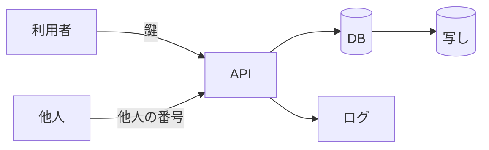

# 認可と流出経路の 6 つの出口

> **3 行でわかる要約**
> 1. API の認可と、データが外に出うる 6 つの出口を、攻撃者の目で決めるための参考資料です。
> 2. 認可はサーバー側で資源 1 件ごとに行い、他人の資源は 404 で隠します。設計書には、データの在りかと経路の図と、出口ごとの守りと確認方法を必ず付けます。
> 3. 計画の「流出経路と 6 つの出口」の節を書くときに、下の表を写して埋めてください。

## 認可の決め

認可は、誰がどの資源に何をしてよいかの判定です。画面で隠すだけでは守れないので、API が要求ごとに判定します。

| 決め | 中身 |
|---|---|
| 判定の場所 | サーバー。資源 1 件ごと。画面の表示とは別に判定する |
| 店や利用者の範囲 | 鍵から決める。要求の引数では受けない。全部の SQL に範囲の条件を入れる |
| 他人の資源 | 404 で返す。403 にすると、資源があることを教えてしまう |
| 役割の無い操作 | 自分の範囲の資源で、役割が足りないときだけ 403 |
| 鍵 | 乱数で発行し、利用者の id など応答に出る値から作れないようにする。期限と失効を決める。保存はハッシュだけ。見本の鍵は作り物と分かる名前にする |

## 6 つの出口

攻撃者の目で見ると、データが外に出る出口は 6 つあります。どの API の設計書にも、6 行すべてを書きます。

| 出口 | よくある経路 | 守りの例 | 確認方法の例 |
|---|---|---|---|
| 公開設定 | API や DB や保存先が外の網から見える。応答が途中で保存される。遅い要求で接続を止める | 待ち受けの網を絞る。`Cache-Control: no-store`。要求の全体（行・見出し・本文）と応答の全体に 1 つずつ時間切れを掛け、同時の接続に上限を置く。上限では、読み終えていない接続と応答を書き終えていない接続を古い順に切る。lock の待ちも打ち切りの時間に入れる。サーバーの部品が自分で返す誤りにも、エラーの 4 点とログの 1 行を通す | インフラの構成コードの静的検査。見出しの試験。遅く送る試験 |
| 権限の持たせすぎ | 閲覧者が書ける。API の DB の利用者が表を消せる、店の列を書き換える | 役割ごとの 403。DB の利用者の権限を表・操作・列ごとに JSON の一覧（例: `samples/api/db-access.json`）で持ち、正にする。インフラはこれに合わせる | 役割の試験。API の SQL を一覧と比べる試験。インフラが権限を一覧と比べる検査 |
| ログへの混入 | 検索の語、氏名、住所、鍵がログに残る。要求の行に入れた文字列をログに書かせる | 1 要求 1 行の要約に、型と id だけを書く。要求から来る語は決まった語に置き換える | 個人情報と鍵がログに出ないことの試験。長い要求の行でもログが短い試験 |
| 他人の ID での閲覧 | 番号を変えて他人の資源を読む、書く。API を乗っ取り、DB の範囲の設定を変えて読む | 範囲の条件を全部の SQL に入れ、無ければ 404。DB の行の制限（RLS）は書き漏らしへの守りで、乗っ取りへの境界ではない。乗っ取りには、注入を通さない作り、量の上限、通知で答える。量の上限は道ごとに数える（一覧、変化の取得の窓、詳細、起点の署名） | 他人の鍵で読む試験。要求の値が SQL の文字列に入らない試験 |
| 依存部品 | 部品の穴から鍵やデータが漏れる | 部品の版を固定し、依存の検査で HIGH 以上を 0 にする | 依存の検査（trivy など） |
| 放置された複製 | 冪等キーの表、移行の写し、検証の環境のデータ | 保持の期間を決めて消す。検証の環境には架空のデータだけ | 消すことの試験。写しの台帳 |

## 図の描き方

図は Mermaid（文字で書く図の書式）の flowchart で描きます。データの在りかを円筒、呼び手と攻撃者を四角にし、ノードは 12 個以内にします。図の直後に「図の読み方」を 1〜2 文書きます。

図の読み方: 左の 2 つが呼び手で、右の円筒がデータの在りかです。矢印の 1 本ごとに、6 つの出口のどれに当たるかを表で答えます。

## 出典

決めの根拠にした資料です。

| 資料 | 使った所 |
|---|---|
| OWASP API Security Top 10 2023（<https://owasp.org/API-Security/editions/2023/en/0x11-t10/>） | 他人の ID での閲覧（API1）、欄の権限（API3）、操作の権限（API5） |
| OWASP Logging Cheat Sheet（<https://cheatsheetseries.owasp.org/cheatsheets/Logging_Cheat_Sheet.html>） | ログに書かないもの |
