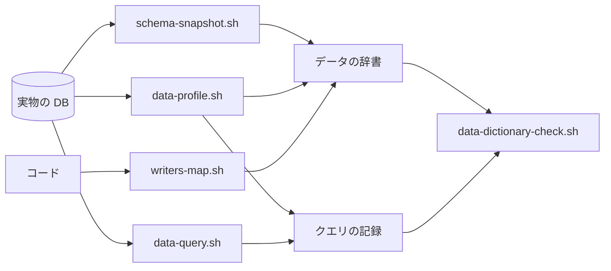

# 既存のデータを読む: 掴む順・裁き方・罠・DB を読む線

> **3 行でわかる要約**
> 1. 移した先の既存の DB を、調査とキャッチアップ（作業の前にプロジェクトを掴むこと）の前に掴むための参考資料です。
> 2. 実物の DB から読み、コードは最後に読みます。数はクエリの結果で言い、食い違いは問いの種類で裁きます。
> 3. 道具は読み取りだけで回し、結果は `templates/data-dictionary.md` の 6 つの記録に残してください。

## 全体の流れ

材料は実物の DB とコードの 2 つで、道具がそこから辞書の下書きとクエリの記録を作ります。AI が手で書くのは、コードの上の意味と食い違いの裁きだけです。辞書と記録の検査は文書とファイルだけを見るので、DB が止まっていても作業を終えられます。この検査は提出前に手で回します。作業の終わりに自動で回る検査には、まだ入っていません。



図の読み方: 左から右へ読みます。DB を読む 3 本の道具は読み取りだけで開き、数はすべてクエリの記録に残ります。右端の検査は DB につながず、辞書と記録だけを照らします。

この資料で繰り返し使う語の意味は、次の表のとおりです。

| 語 | 意味 |
|---|---|
| スキーマ | テーブル、列、型、制約、インデックス、トリガーの定義 |
| マイグレーション | スキーマを変える SQL か、コードのファイル |
| トリガー | 行の書き込みに合わせて、DB が自動で動かす処理 |
| ハッシュ値 | 文と結果から計算した短い値。手で書き換えると合わなくなる |
| 環境の名前 | 数がどの DB の値かを示す語。手元の作り物、本番の写し（時点）、検証環境、本番の集計の書き出しの 4 つ |
| 標本 | 大きいテーブルから選んだ一部の行。標本で数えた値は「実測（標本）」と書く |
| ORM | コードのクラスでテーブルを読み書きする部品。Laravel や Rails のモデルなど |

## 掴む順

掴む順は、事実に近い物からです。整理されていないコードは名前と中身が合わないので、先にコードを読むと、誤った前提でデータを見てしまいます。実物の DB を先に見れば、コードは「データで見えた事実を説明する物」として読めます。

| 順 | すること | 道具 | 残すもの | 終わりの印 |
|---|---|---|---|---|
| 0 | 読める DB を決める。接続の設定はキーの名前だけを見て、値は読まない | なし | 環境の名前と時刻 | 環境の名前が 1 つに決まる。無ければ「無い」と書く |
| 1 | 実物の DB からスキーマを書き出し、マイグレーションと比べる | `scripts/schema-snapshot.sh` | スキーマの写しとハッシュ値、ずれの一覧 | 全部のテーブルが写しにある |
| 2 | テーブルと列を集計で見る。件数、空の割合、値の種類、最小と最大、最後の書き込み | `scripts/data-profile.sh` | 辞書の実データと値の一覧 | 値が 20 種類以下の列は、全部の値と件数がある |
| 3 | 書き込む処理を全部挙げる。コードの文、定時の処理、トリガー、外からの通知 | `scripts/writers-map.sh` | 書き込む処理の表 | テーブルごとに 1 つ以上あるか、「不明」と書いてある |
| 4 | 基準の数字を再現する。依頼の文の数字か、画面の集計の文を回した値と比べる | `scripts/data-query.sh` | 語彙と基準の数字 | 1 つ以上が一致するか、差の理由が書いてある |
| 5 | 食い違いを一覧に書く。順 1〜4 で見つけた差を、次の節の裁きと一緒に残す | なし | 食い違いの一覧 | 辞書の食い違いの列の番号が、全部一覧にある |

深さは 2 段に分けます。移した直後は、順 0〜2 と順 3 の機械の部分（writers-map.sh の候補出し）を、全部のテーブルに回します。生きている証拠を確かめる順 3 の残りと、順 4〜5 は、依頼者が挙げた領域から深く読み、辞書に足していきます。調査の依頼では、触るテーブルの集計だけを回し直し、辞書との差を先に見ます。

基準の数字は、依頼者の手を借りずに取ります。依頼の文に数字があればそれを使い、無ければ画面の集計の文をコードから写して、読み取りだけで回します。足りないときだけ、1 問で聞きます。

読める DB が 1 つも無いプロジェクトでは、順 1〜2 を回せません。そのときはデータの主張を全部「コードからの推定」と書き、返答の最初の段落でそう伝えます。あわせて集計のクエリを 1 本にまとめて依頼者に渡し、結果をもらいます。

## 問いの種類で裁く

食い違いは、一律に「データが正」とは裁きません。データは「いま何が入っているか」の事実ですが、「これから何が書かれるか」と「どうあるべきか」には答えないからです。

| 問いの種類 | 例 | 正とするもの | 確かめ方 | 報告での書き方 |
|---|---|---|---|---|
| いまの状態 | 10 月のキャンセルは何件か | その環境の実データ。コードは仮説 | 読み取りだけのクエリ。環境の名前と時刻を残す | 実測 |
| これからの振る舞い | 次のキャンセルは、どの値で書かれるか | いま動いている経路のコード。データは過去の証拠 | 経路が生きている証拠（直近の書き込み、経路の登録）を添える | コードからの推定と、生きている証拠 |
| あるべき姿 | cancel と canceled のどちらが正しい値か | 依頼者の判断 | 両方の事実を並べ、1 問で聞く | 未決。一覧に残す |

場面ごとの決まりは次の表のとおりで、どれも食い違いを発見として扱います。裁いたあとも黙って片方に寄せず、一覧に行を足して、次の調査の条件はその行を引きます。

| 場面 | 決まり |
|---|---|
| スキーマが食い違う | いまの形は、実物の DB、モデルの定義、マイグレーション、名前とコメントの順に信じる |
| コードで書けない値がデータにある | 読んでいない書き込む処理があると見て探す。見つからなければ「書き込む処理は不明」と残し、1 問で聞く |
| コードが書くはずの値がデータに無い | その経路は動いていないと見る。参照の数と、経路の登録を確かめる |
| 画面の数と、テーブルを数えた数が合わない | 両方を事実として並べ、差を定義の違いで説明する。説明できない差は、そのまま報告する |
| 手元と本番で値が違いうる | 本番について言えるのは、本番の集計の書き出しか、本番の写しを数えたときだけ。写しは時点を環境の名前に書く。作り物のデータは、形の根拠にだけ使う |

## 罠の 10 の型

整理されていないコードで繰り返し出る食い違いは、10 の型に分けて探します。data-profile.sh は、型 2・3・7・8・9・10 の候補を CANDIDATE の行で出します。残りの型は、下の表のクエリを data-query.sh で回して確かめます。

| 番号 | 罠の型 | 例 | 機械での見つけ方 |
|---|---|---|---|
| 1 | 定数に無い値 | status に cancel と canceled が混ざる | 辞書の値の一覧（20 種類以下の列）と、コードの定数を並べる |
| 2 | 書かれない列、動いていない経路 | deleted_at は全部の行が空 | 空が 100% の列（CANDIDATE 型 2）と、writers-map.sh で書き込む処理が「不明」のテーブル |
| 3 | 同じ事実の二重の置き場 | deleted_at と is_deleted | 名前の似た列の組と、その組み合わせの件数（CANDIDATE 型 3） |
| 4 | 途中で意味が変わった列 | total が税抜きから税込みに変わる | 月ごとの件数と平均を data-query.sh で出し、段差の月と書き込む処理の commit の日付を並べる |
| 5 | 読んでいない書き込む処理 | 定時の処理や手作業の更新 | writers-map.sh のトリガーと定時の処理の候補。書き込みの時刻を時ごとに数え、偏りを見る |
| 6 | 同じ集計の重複 | キャンセルを数える文が 2 か所で、条件が違う | 同じテーブルを数える文を git grep で拾い、条件の差を並べる |
| 7 | 孤児の行と、重複する鍵 | 顧客の無い注文。結合すると件数が変わる | 外部キーと、名前から推定した組の孤児の数（CANDIDATE 型 7）。結合の前と後の件数を比べる |
| 8 | 時刻の境目 | 日本時間の文字列で保存し、月の境目がずれる | 列の型と保存の形（CANDIDATE 型 8）。境目の前後 9 時間の件数を数える |
| 9 | 試しのデータの混入 | 社内の試し注文 | 金額 0 の行（CANDIDATE 型 9）と作成者の偏りを数え、1 問で聞く |
| 10 | 型のゆれ | 文字の "0" と数の 0、空文字と NULL | 型ごとの件数と、空文字と NULL が混ざる列（CANDIDATE 型 10） |

候補は罠の確定ではありません。どれもコードと照らしてから、食い違いの一覧に書きます。移した先のコードを直すのは頼まれたときだけで、キャッチアップでは 1 行も変えません。

## DB を読む線

DB を読んでよい線は次の 6 つで、道具が機械で守る所と、決まりで守る所を分けて書きます。一式は、本番データの複製を検証環境へ置くことを禁じています（`.company/infra/CLAUDE.md` の禁止）。そのため、本番の行を新しくコピーすることは求めません。

| 線 | 中身 | 道具で守る所 | 決まりで守る所 |
|---|---|---|---|
| 読み取りだけ | ローカルの DB は読み取り専用の接続で読む | sqlite は mode=ro の URI と query_only。文は許す文の一覧で、回す前に確かめる。PostgreSQL の default_transaction_read_only と MySQL の transaction_read_only は、手元に psql と mysql が無く、回していない（未確認） | プロジェクトごとに 1 回、依頼者の許可をもらい、地図の入口の「DB の読み取りの許可」の欄に日と相手と範囲を書く |
| 集計だけ | 残すのは件数・値の種類・空の割合・最小と最大のような集計で、行そのものは残さない | data-profile.sh は集計の文だけを回す | data-query.sh に、行そのものを出す文を渡さない |
| 秘密の値を読まない | 接続の設定はキーの名前だけを見る。値は依頼者が環境変数か設定ファイルで渡す | 道具は接続の値を受け取らず、記録にも書かない。MySQL の設定ファイルから読むのは host の行だけ | 設定のファイルを開いて値を写さない |
| 本番の行をコピーしない | 本番の行を、新しくローカルに写さない | 道具には写す機能が無い | 写しを作る手順を提案しない |
| 個人が分かる値は件数だけ | 個人情報らしい名前の列（氏名、住所などの日本語の名前も含む）と、値が 20 種類を超える列は、値を残さず件数だけにする | data-query.sh は、個人情報らしい列を COUNT などの集計の外で出す文を止める。別名や関数で包んでも、元の列と表で判定する。メールと電話番号の形の値と、2000 字を超える値も記録しない | 名前で分からない列（自由記述など）は、件数で数える文にする |
| 本番の数は依頼者が回す | AI が集計のクエリを書き、依頼者が回して結果を渡す。AI は本番につながない | PostgreSQL と MySQL は、向き先が localhost・127.0.0.1・::1・ソケットのときだけ回す。「本番」を含む環境の名前（写しを除く）は --import の記録だけに許す。--import が、渡された結果を記録に書く | 向き先を手元へ転送して本番につながない（道具は転送を見分けられない） |

許す文は、1 文だけの SELECT と WITH … SELECT です。禁じる語の一覧ではなく許す一覧で確かめるのは、読み取りの文でも関数の呼び出しで外へ書き出せるからです。DB に送る前に落とすのは、許す関数の一覧の外と、注釈の /* */ です。逆斜線とドルの引用と FOR UPDATE も、同じく落とします。\r など \n でない改行、U& の引用、文字の値に続く括弧、英字でない名前の関数も落とします。手本は、マイグレーションの文を許す一覧で確かめる `skills/infra/scripts/migrate-gate.sh` です。

## 道具の使い方

道具は 5 本で、どれも `scripts/` にあり、同じ `scripts/data_tools.py` を呼びます。DB につなぐ道具は、文ごとに打ち切り（既定は 5000ms）を持ちます。写し・集計・クエリの 3 本と、--db を渡したときの writers-map.sh が当たります。PostgreSQL と MySQL は、psql と mysql が手元にあるときだけ呼びます。無ければ FAIL [道具が無い] を返します。この 2 つの経路は、手元に道具が無く、回していません（未確認）。

--from-migrations が受けるのは、sqlite で流せる素の SQL だけです。マイグレーションがコードのファイル（Laravel や Rails など）なら、この比べは使えません。そのときは、モデルとマイグレーションのファイルを読み、写しとの差を食い違いの一覧に書きます。

| 道具 | 回す時 | 出すもの |
|---|---|---|
| `scripts/schema-snapshot.sh` | 順 1。調査の前には --expect-hash で鮮度を見る | スキーマの写し（JSON）とハッシュ値、マイグレーションとのずれの DIFF の行 |
| `scripts/data-profile.sh` | 順 2。大きいテーブル（既定は 20 万行より多い）は標本で数える | クエリの記録、辞書の下書き、罠の候補の CANDIDATE の行 |
| `scripts/writers-map.sh` | 順 3 | 書き込む処理の表の下書き。見つからない表は「不明」 |
| `scripts/data-query.sh` | 順 4 と調査。本番の数は --import で取り込む | クエリの記録の 1 行（番号、環境の名前、時刻、SQL、結果、ハッシュ値） |
| `scripts/data-dictionary-check.sh` | 辞書と調査の文書を出す前。DB にはつながない | FAIL の行と RESULT の行。--evidence-hash は、git の無いプロジェクトの辞書の commit の欄に写す VALUE の行 |

回し方の例は次のとおりです。パスは移した先での例です。キャッチアップのセッションは、記録と写しを地図のデータの節と同じ場所（tmp/catchup/）に置きます。

```bash
bash tmp/skills/backend/scripts/schema-snapshot.sh --db db/development.sqlite3 --env 手元の作り物 --out tmp/catchup/schema.json
bash tmp/skills/backend/scripts/data-profile.sh --db db/development.sqlite3 --env 手元の作り物 --log tmp/catchup/queries.jsonl --draft tmp/catchup/data-draft.md
bash tmp/skills/backend/scripts/writers-map.sh --code . --schema tmp/catchup/schema.json
bash tmp/skills/backend/scripts/data-dictionary-check.sh tmp/catchup/data.md
```

調査のセッションは、地図を書き換えません。記録は調査の置き場（tmp/flow/<件名>/queries.jsonl）に分けます。そのパスは、調査の文書の冒頭にある表の「クエリの記録」に書きます。辞書は地図のものを読むだけで、条件の値の照らし合わせに使います。

```bash
bash tmp/skills/backend/scripts/data-query.sh --db db/development.sqlite3 --env 手元の作り物 --log tmp/flow/<件名>/queries.jsonl \
  --purpose "10 月のキャンセル" --sql "SELECT status, COUNT(*) AS n FROM orders WHERE created_at >= '2026-10-01' AND created_at < '2026-11-01' GROUP BY status"
bash tmp/skills/backend/scripts/data-dictionary-check.sh tmp/catchup/data.md tmp/flow/<件名>/analysis.md
```

動いている DB では、回し直すと数が動きます。クエリには時刻の上限を入れ、写しを数えたときは、その時点を環境の名前に書きます。

## 調査の決まりと検査

調査の決まりは 5 つで、data-dictionary-check.sh が見ます。この検査は、辞書と調査の文書を出す前に手で回します（作業の終わりに自動で回る検査には、まだ入っていません）。辞書には、鮮度・網羅・根拠・値の一覧・基準の数字・ハッシュ値・行のコピーの検査も掛けます。

| 決まり | 中身 | 検査が落とすもの |
|---|---|---|
| 数はクエリの結果で出す | SQL と結果は道具が記録に書く。AI は記録を手で書かない | 結論の数字が、挙げたクエリの結果にも計算の行にも無い（数字の出どころ）。日付と番号は数えない。結論では、バッククォートの中の数、「12 日」のような単位の付いた数、変わる条件の文の前の数も照らす。割合（%）は割合の列か計算の行とだけ比べ、漢数字は落とす |
| 実測か推定かを書く | 主張ごとに「実測」か「コードからの推定」かを書く | 裏づけが無い。読める DB があるのに、全部が推定（裏づけ） |
| 条件の値は辞書から取る | 絞り込みに使う値は、辞書の値の一覧にある値だけにする | 挙げたクエリが、辞書に無い値で絞っている（条件の値）。lower(status) のような列と、sqlite が文字の値と読む "…" も照らす。LIKE と日付と数は見ない |
| 別の経路で検算する | テーブルの件数と画面の表示のように、2 つの経路で同じ数を出す | 検算の行も、未確認の理由も無い（検算） |
| 読み取りだけにする | 記録の文は、1 文だけの SELECT と WITH … SELECT | 記録に書き込みの文がある。読み取り専用でない開き方の記録がある（読み取りだけ） |
| 辞書の網羅と根拠 | スキーマの写しの全テーブルを、辞書か対象外の一覧と、書き込む処理の表に載せる。表の行ごとに、根拠（ファイルと行か、クエリの番号）か「不明」と理由を書く | 載っていないテーブル（辞書の網羅、書き込む処理）。根拠の無い行（根拠）。無いファイル、直下の外、行数を超える行、記録に無い番号（根拠の実在） |
| 基準の数字 | 語彙と基準の数字の表に 1 行以上を置く。「一致」は、基準の値と数えた値が等しく、基準の値に出どころがあるときだけ書く | 行が無い。「一致」なのに値が違う。一致の行も差の理由（T か Q の番号）も無い（基準の数字） |
| 値の一覧とハッシュ値 | 20 種類以下の列の値は、記録の結果と一致させる。写しと記録は道具が書いたまま | 辞書と記録の値の違い（値の一覧）。書き換えた写しと記録（ハッシュ値） |
| 辞書の鮮度 | 冒頭の表に commit、スキーマのハッシュ値、集計の時刻、環境の名前を書く。git の無いプロジェクトの commit は、--evidence-hash が出す「git なし」と作った時刻と根拠のハッシュ値 | 欄が無い。commit が 16 進でも「git なし」の形でもない。「git なし」なのに、直下が git の作業ツリーか、根拠のファイルから作り直した値と合わない（鮮度） |
| 行のコピー | 文書と記録に、個人が分かる値を写さない | メールや電話番号の形の字。記録の文が、個人情報らしい列を集計の外で出している（行のコピー） |

計算で出した数は、集計の表に「計算」と書いた行を置き、元のクエリの番号を添えます。検査は、結果の数の和・差・比・割合と、列の合計で、その数が出るかを確かめます。

調査の文書は、検査が読める最小の形にします。分析の記録のテンプレートはまだ無いので、評価の正例 `skills/backend/evals/fixtures/data/oct-cancel.md` を手本にします。

| 部分 | 決まり |
|---|---|
| 冒頭の表 | 項目と内容の表に、クエリの記録のパス、データの辞書のパス、環境の名前を書く |
| 集計の表 | 数、何の数か、クエリ、裏づけの 4 列。計算で出した数は「計算」と元のクエリの番号を書く |
| 結論の節 | 見出しに「結論」を含む節。数は集計の表かクエリの結果にあるものだけを書く |
| 検算の行 | 別の経路で同じ数を出した行か、検算が未確認の理由 |

ハッシュ値は、手で書き換えた所を見つけるための値です。ただ、道具を通さずに作り直した偽の記録は、ハッシュ値では見分けられません。そこで、記録は道具だけが書く決まりと組で守ります。

## 落とし穴

道具と検査を入れても、使い方で外れる所が残ります。主なものと手当ては次のとおりです。

| 落とし穴 | 起きること | 手当て |
|---|---|---|
| 手元のデータが作り物 | 手元で数えた値を、本番の値として答える | 環境の名前を必須にし、作り物のデータは形の根拠にだけ使う |
| 接続の設定に秘密がある | 設定のファイルを開くと、パスワードが記録に入る | 設定はキーの名前だけを拾う。接続の値は、依頼者が環境変数で渡す |
| 集計の文が重い | 大きいテーブルの全件の集計で、DB が遅くなる | 文ごとの打ち切りと、大きいテーブルの標本。裏づけに「実測（標本）」と書く |
| 標本が珍しい値を落とす | 罠になる珍しい値ほど、標本から漏れる | 標本で数えた列は辞書にそう書き、要る列だけを全件で数え直す |
| 辞書が古くなる | 列が足されても、古い辞書で数える | 調査の前に schema-snapshot.sh の --expect-hash で鮮度を見て、触るテーブルの集計を回し直す |
| 全部を「推定」と書いて検査を通す | 検査は通るが、答えが使えない | 読める DB があるかぎり、いまの状態の問いは実測を必須にする |
| 最初に全部を読もうとする | 大きいプロジェクトで、最初の依頼が始まらない | 全部のテーブルに回すのは順 0〜2 だけ。順 3〜5 は依頼が触るテーブルから |

## やらないこと

キャッチアップと調査の範囲を広げすぎないよう、次の 4 つはしません。

- 移した先のコードを直すこと。食い違いの一覧は直す候補になるが、直すのは頼まれたときだけ。
- 本番の DB に AI がつなぐこと。本番の行そのものを、新しく手元に写すこと。
- 辞書を全部埋めてから、調査を始めること。触るテーブルから深く読む。
- 分析の記録のテンプレートを、このスキルで決めること。テンプレートは文書の型のスキルで、まだ承認されていない。
