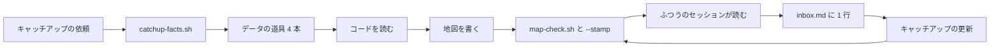

# キャッチアップの手順: 初回と更新

> **3 行でわかる要約**
> 1. 移した先のプロジェクトを掴み、ほかのセッションが読む地図を残す手順です。
> 2. 回すのは、依頼者が頼んだ専用のセッションだけです。事実は道具で拾い、DB は実物から読み、コードは最後に読みます。
> 3. 初回は 3 節、更新は 4 節の表を上から回し、最後に map-check.sh の --stamp で鮮度を記録してください。

## 1. 全体の流れ

キャッチアップ（作業の前に掴むこと）のセッションが地図を作り、ふつうのセッションはそれを読むだけです。ふつうのセッションが気づいた食い違いは追記の候補に溜まり、次の更新のセッションが地図に入れます。

図の読み方: 左から右へ読みます。地図を作るのはキャッチアップのセッションだけで、ふつうのセッションからの戻りは inbox.md の 1 行です。

この資料で繰り返し使う語の意味は、次の表のとおりです。

| 語 | 意味 |
|---|---|
| 地図 | キャッチアップで残す文書の全体。置き場は移した先の tmp/catchup/ |
| ルート | URL やコマンドの名前と、それを受ける処理の組。catchup-facts.sh が定義の書き方から拾う |
| 入口の 1 枚 | 地図の index.md。80 行以内で、全部の節への案内を持つ |
| 節 | 地図の 6 つの部分（構成と動かし方、開発の形、入口、データ、語彙、罠）。1 つの節が 1 つのファイル |
| 事実の記録 | catchup-facts.sh が書く facts.jsonl。F-001 の形の番号とハッシュ値を持つ |
| クエリの記録 | backend のデータの道具が書く queries.jsonl。Q-001 の形の番号を持つ |
| 鮮度 | 地図の根拠のファイルが、地図を作ったときから変わっていないか。stamp.json と比べて決める |
| 追記の候補 | ふつうのセッションが気づいた食い違いを 1 行ずつ足す inbox.md |

## 2. どのセッションで何をするか

キャッチアップを回すのは、依頼者が「キャッチアップして」「キャッチアップを更新して」と頼んだセッションだけです。ふつうの依頼のたびに回すと、全部のテーブルの集計が毎回走り、依頼が始まるまでが長くなるからです。

| セッション | いつ | すること | 地図 |
|---|---|---|---|
| キャッチアップ（初回） | 移した直後に、依頼者が 1 回頼む | 事実と DB を全部のテーブルに機械で回し、構成と入口も拾う | 作る |
| キャッチアップ（更新） | 依頼者が頼んだとき | 古い節と、追記の候補が触る節だけを読み直す | 直す |
| ふつうの依頼 | いつもの依頼 | 入口の 1 枚と、依頼が触る節だけを読む | 読むだけ |
| 調査の依頼 | 調査を頼まれたとき | 上に加えて、触るテーブルの集計だけを回し直し、辞書との差を見る | 読むだけ |

地図が無いプロジェクトでも、ふつうのセッションは勝手にキャッチアップを始めません。最初の返答で「キャッチアップがまだです」と 1 行伝え、依頼はそのまま進めます。触る節が古いときも、同じように 1 行で伝えます。

## 3. 初回の手順

初回は、事実、DB、コードの順に読みます。整理されていないコードは、名前と中身が合いません。先に事実と DB を見ておけば、コードは「データで見えた事実の説明」として読めます。

| 順 | すること | 道具とコマンド | 終わりの印 |
|---|---|---|---|
| 1 | 許可と、読まない所を 1 問で確かめる | なし | DB を読む許可（日と相手と範囲）と、試験を回してよいかと、--exclude に渡す所が決まる。許可は入口の「DB の読み取りの許可」の欄に書く |
| 2 | 事実を拾う | catchup-facts.sh --root . --out tmp/catchup/facts.jsonl | RESULT: PASS と F の番号の表 |
| 3 | 読める DB を決める（掴む順 0） | 事実の DB と設定の口の行を見る。接続の値は読まない | 環境の名前が 1 つに決まるか、「無い」と書く |
| 4 | スキーマを書き出し、マイグレーションと比べる（掴む順 1） | schema-snapshot.sh の --out tmp/catchup/schema.json と --from-migrations | 全部のテーブルが写しにある |
| 5 | 全部のテーブルを集計する（掴む順 2） | data-profile.sh の --log tmp/catchup/queries.jsonl と --draft | 値が 20 種類以下の列は、全部の値と件数がある |
| 6 | 書き込む処理の候補を挙げる（掴む順 3 の機械の部分） | writers-map.sh の --code . と --schema | テーブルごとに 1 つ以上の候補か、「不明」がある |
| 7 | コードを読む | 事実のルート、定時の処理、書き込む処理の候補から読む | データの節の外の 5 つの節の表が埋まり、辞書では「コードの上の意味」の列が埋まる |
| 8 | 基準の数字を再現する（掴む順 4） | data-query.sh で、画面の集計の文と、地図の定義の文を回す | 1 つ以上が一致するか、差の理由が書いてある |
| 9 | 食い違いの一覧を書く（掴む順 5） | なし | 辞書の食い違いの番号が、全部一覧にある |
| 10 | 地図を書く | templates/ と backend の data-dictionary.md を tmp/catchup/ に写す | テンプレートの穴が 0 |
| 11 | 検査して記録する | map-check.sh を回し、通ったら map-check.sh --stamp | RESULT: PASS と STAMP の行 |
| 12 | 依頼者に返す | 8 節の型 | 返答に、読んだ範囲と未確認がある |

道具は、移した先では `tmp/skills/catchup/scripts/` と `tmp/skills/backend/scripts/` の下にあります。掴む順 0〜5 の詳しい決まりは、backend のスキルの参考資料 `skills/backend/references/existing-data.md` にあります。

全部のテーブルに回すのは、順 2〜6 です。掴む順でいえば 0〜2 と、writers-map.sh で候補を出す順 3 の機械の部分にあたります。生きている証拠を確かめる順 3 の残りと、順 7〜9 は、依頼者が挙げた領域と、事実と DB で目立った所から先に読みます。読めなかった所は、データの節の読んだ範囲の表に理由と一緒に書きます。

マイグレーションがコードのファイル（Laravel や Rails など）のときは、--from-migrations を使えません。道具が受けるのは、sqlite で流せる素の SQL だけだからです。モデルとマイグレーションのファイルを読み、写しとの差をデータの節の食い違いに書きます。

基準の数字は、依頼者の手を借りずに取ります。依頼の文に数字があればそれを使い、無ければ画面の集計の文をコードから写して回します。足りないときだけ、1 問で聞きます。

git の無いプロジェクトでは、入口の commit を「無い」と書きます。データの節を書き終えたら、commit の欄に --evidence-hash の VALUE の行を写します。この値は data-dictionary-check.sh が出します。中身は「git なし」と作った時刻と根拠のハッシュ値で、決まりは map-rules.md の 7 節にあります。

## 4. 更新の手順

更新では、古い節と、追記の候補が触る節だけを読み直します。全部を読み直すと初回と同じ時間がかかり、新しい節まで書き換えてしまうからです。

| 順 | すること | 道具とコマンド | 終わりの印 |
|---|---|---|---|
| 1 | 古い節を挙げる | map-check.sh --fresh | SECTION の行で、古い節の一覧が出る |
| 2 | 追記の候補を読む | inbox.md の状態が未処理の行 | 読み直す節の一覧が決まる |
| 3 | DB の形が変わっていないかを見る | schema-snapshot.sh の --expect-hash に、データの節のハッシュ値を渡す | 同じなら PASS。違えばデータの節も読み直す |
| 4 | 事実を拾い直す | catchup-facts.sh を同じ --out で回す。番号は前の続きになる | 新しい F の番号 |
| 5 | 読み直す節の行を直す | 新しい根拠（ファイルと行、新しい Q と F の番号）を書く | 古い節の行が直る |
| 6 | 追記の候補の状態を変える | 反映済みか見送りにし、見送りには理由を添える | 未処理の行が 0 |
| 7 | 入口の commit を今の HEAD にし、検査して記録する。git の無いプロジェクトでは、データの節に書く根拠のハッシュ値を出し直す | map-check.sh と map-check.sh --stamp。git が無ければ、先に data-dictionary-check.sh --evidence-hash | RESULT: PASS と STAMP の行 |

## 5. ふつうのセッションと調査のセッション

ふつうのセッションは、入口の 1 枚と、依頼が触る節だけを読みます。地図は書き換えず、気づいた食い違いは inbox.md に 1 行足すだけです。

調査のセッションは、集計を回す前に、入口の「DB の読み取りの許可」の欄を見ます。欄が「無い」なら、DB は読まずに集計のクエリを依頼者に渡します。クエリの記録は tmp/flow/<件名>/queries.jsonl に置き、地図の queries.jsonl には足しません。

| 場面 | すること | 最初の返答に書く 1 行の例 |
|---|---|---|
| 地図が無い | 依頼をそのまま進める | このプロジェクトはキャッチアップがまだなので、地図なしで進めます。 |
| 触る節が古い | 古い節は参考にとどめ、根拠のファイルを読み直しながら進める | 地図の「データ」の節が古いので、触るテーブルを数え直しながら進めます。 |
| 地図と食い違う | inbox.md に 1 行足し、依頼を進める | 地図と違う点を追記の候補に 1 件足しました。 |
| 調査の依頼 | 触るテーブルの集計だけを回し直し、辞書との差を見てから答える | 地図の辞書と今の DB を比べてから数えます。 |

古いかどうかは、map-check.sh --fresh の SECTION の行で決めます。この 1 行は、依頼の答えより前に置きます。

## 6. 止めて聞く所

聞くのは、許可と、依頼者にしか決められないことだけです。聞くまでの間も、読める物は読み進めます。

| 場面 | 聞くこと | 聞くまでの扱い |
|---|---|---|
| ローカルの DB を読む前 | 読み取りの許可。プロジェクトごとに 1 回 | データの主張は全部「コードからの推定」と書く |
| 読める DB が無い | 集計のクエリを 1 本にまとめて渡し、結果をもらう | 同上。返答の最初の段落でそう伝える |
| 本番の数が要る | 依頼者が回した結果。AI は本番につながない | 結果は data-query.sh の --import で記録に取り込む |
| 読まないでほしい所 | 置き場の名前 | --exclude で渡し、読んだ範囲の表に理由を書く |
| あるべき姿が割れる | どちらの値か、どの定義か。1 問で聞く | 食い違いの一覧に「未決」と書く |
| 開発の形が不明 | 個人の開発かチームの開発か | 画面の型を選ぶ依頼が来たときに聞く |

## 7. 時間の目安

地図ができるまでに 30 分（仮置きの線。測った値ではない）を超えそうなら、深く読む範囲を狭めます。道具は機械で回るので、時間の多くはコードを読む順 7 と、地図を書く順 10 にかかります。

| 場面 | 手当て |
|---|---|
| テーブルが多い | 順 2〜6 は全部に回し、順 7〜9 は依頼者が挙げた領域から読む |
| 大きいテーブル | data-profile.sh が標本で数え、裏づけに「実測（標本）」と書く |
| コードが多い | ルートと書き込む処理の候補から読み、読んでいない所は読んだ範囲の表に書く |

DB を読む 4 本の道具は、完成例の messy-shop で 0.08〜0.18 秒でした（2026-11-26 に手元で測った値）。回したコマンドと時間は examples/messy-shop-run.md の 2 節にあります。

## 8. 最後の返答

最後の返答は、手紙の型で 1〜2 段落にします。地図の置き場と、ほかのセッションがすることを先に書き、数と未確認を後ろに置きます。

例の列にある数は、キャッチアップの効き目の試験（C-3）の題材 messy-shop で数えた値と同じです。C-3 の試験の前には、別の題材の例に替えるか、数を伏せてください。

| 順 | 書くこと | messy-shop の例（実際に回した結果） |
|---|---|---|
| 1 | 結論 | 地図を tmp/catchup/ に作り、6 つの節の全部の行に根拠を付けました。 |
| 2 | 規模と主な罠 | テーブル 7 つとルート 14 本を読み、食い違いを 11 件見つけました。状態の値と削除の印と時刻の罠が大きいです。 |
| 3 | 基準の数字 | トップの画面の 2026-09 の注文 223 件と売上 535,403 円を、地図の定義で再現しました。 |
| 4 | 未確認 | 開発の形と、売上の定義は未確認で、依頼者に 1 問ずつ伺います。 |
| 5 | 次にすること | ほかのセッションは入口の 1 枚と、触る節だけを読みます。 |

## 9. やらないこと

キャッチアップの範囲を広げすぎないよう、次のことはしません。

- プロジェクトのコードとデータと設定を書き換えること。食い違いは直す候補になるが、直すのは頼まれたとき。
- 本番の DB に AI がつなぐこと。本番の行を、新しく手元に写すこと。
- 調べる予定の問いを見てから地図を書くこと。問いに合わせた地図は、ほかの依頼で外れる。
- ふつうのセッションで、地図を作り直すこと。
