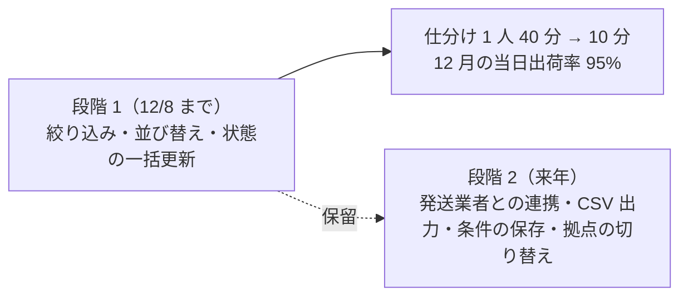

# 事業判断メモ: 管理画面の注文一覧の作り直し

> **3 行でわかる要約**
> 1. 「管理画面の注文一覧を作り直したい」という社長の依頼に、やるかどうかと範囲を決めた事業判断メモです。数値はすべて架空とします。
> 2. 判断は「段階 1 だけやる」です。運営担当の朝の仕分けを 1 人 40 分から 10 分以下に減らします。12 月の繁忙期に、当日出荷率を 85% から 95% に上げるためです。費用は 25〜30 人日（150〜180 万円）、回収は 10〜12 か月です。
> 3. 状態は承認待ち（提出日 2026-11-06）です。11/9 までに「段階 1 だけやる」の承認を、秘書を通して 1 点だけ伺います。

## 目的

運営担当 3 人の朝の仕分けを 1 人 40 分から 10 分以下にし、12 月の繁忙期でも当日出荷を守ることです。

## 顧客と片付けたい用事

顧客は購入者ではなく、注文を出荷に回す運営担当です。用事は画面の新しさではなく、朝の仕分けと見落としの防止です。

| 誰が | 用事（〜のとき、〜したい、〜のために） | 今の困りごと（架空の数値） |
|---|---|---|
| 運営担当（3 人、毎朝 9 時） | 未発送の注文を確かめるとき、今日出す分を漏れなく仕分けたい、当日出荷の約束を守るために | 一覧は注文番号と日付でしか絞れず、表計算に写して仕分けている。1 人 40 分、3 人で月 45 時間（稼働 22.5 日）。見落としが月 30 件あり、遅配の補償が月 6 万円、問い合わせが CS（顧客対応の担当）に月 20 件来る |

## 5 つの観点

判定は強い・中・弱いの 3 段です。4 つが「やる」を支え、差別化だけが弱く、差は当日出荷率を通した購入者の体験で出ます。

| 観点 | 判定 | 根拠（架空の数値） |
|---|---|---|
| 市場性 | 強い | 運営担当 3 人と CS 2 人の全員が毎日使う。12 月は注文が 2.5 倍になり、今の作りでは仕分けが 1 人 100 分になる |
| 収益性 | 中 | 効果は月 15.1 万円（仕分け 30 分 × 3 人 × 22.5 日 = 33.75 時間 × 時給 3,000 円 = 10.1 万円。補償は見落とし月 30 件 → 5 件の想定で 6 万円 → 1 万円、差 5 万円）。回収は 150〜180 万円 ÷ 15.1 万円 = 10〜12 か月で、目安の 12 か月以内に収まる |
| 実現性 | 強い | 注文 API（注文データを取り出す窓口）と状態の区分は既にあり、画面の作り直しで済む。3〜4 週で 12/8 までに出せる |
| 差別化 | 弱い | 社内の画面なので競合との差はなく、上振れもない。当日出荷率 85% を 95% に上げれば、購入者の体験で差が出る |
| 拡張性 | 中 | 来年の 2 拠点目と担当の増員で、拠点と権限の区分が要る。区分の持ち方は設計書で決める |

## 判断

判断は「段階 1 だけやる」で、今期の候補 3 件の中で最優先にします。12/8 を過ぎると、12 月中旬の繁忙期に間に合いません。ほかの 2 件は、1 月でも損失が増えません。

| 項目 | 内容 |
|---|---|
| 判断 | やる（段階 1: 絞り込み、並び替え、状態の一括更新）。発送業者との連携（推定 10 人日。11/11 に見積もる）は上限 30 人日に収まらないので段階 2 に送る。責任者は運営担当のリーダー 1 人。段階 2（発送業者との連携、CSV 出力＝表計算で開ける形の書き出し、条件の保存、拠点の切り替え）は保留 |
| 優先度 | 1 位。2 位は会員ランクの表示（15〜20 人日、1 月以降）、3 位は商品レビューへの返信（10〜15 人日、効果は問い合わせ月 5 件）。比べた表は優先順位表（同じ題材の完成例 `priority-board-order-list.md`）にある |
| 決定の可逆性 | 画面の切り替えは戻せる（旧画面を 1 か月残す）ので、情報が 7 割でも今決める。注文の状態に「仕分け済み」を足すのは戻せないので、設計書でデータの移行計画と一緒に決める。一括更新はこの決め方に依るので、設計書が先 |
| 費用と期間 | 見積もりは最短 25 人日・3 週（12/1 本番）、最長 30 人日・4 週（12/8）。1 人日 6 万円で 150〜180 万円。上限は 4 週・30 人日（180 万円）で、超えそうなら期間ではなく範囲を削る（並び替えの条件を 2 つに減らす）。幅は索引（検索を速くする仕組み）の試験で 1 秒以内に収まらないときの手戻りで出る |

図の読み方: 実線が今回やる範囲と、それで変わる数字です。点線は保留で、拡張点だけ残して来年に判断します。

## KPI

KPI（進み具合を測る指標）は 4 つで、主指標は仕分けの時間です。入力指標は担当者が自分で動かせるものを選びます。4 つとも約束の指標で、目標の値に届くことを 100% 期待します。12 月末に測って届かなければ、段階 2 を前倒しにします。

| 指標 | 種類 | 今の値 | 目標 | 期限 | 測り方（測る人） |
|---|---|---|---|---|---|
| 朝の仕分けの時間（1 人） | 主指標・約束 | 40 分 | 10 分以下 | 12 月末 | 運営担当のリーダーが作業記録を週 1 回集計する |
| 一覧の絞り込みだけで仕分けた注文の割合 | 入力指標・約束 | 0% | 90% 以上 | 12 月末 | 画面の操作ログで、表計算に写さず状態を更新した注文をバックエンドが数える |
| 当日出荷率 | 出力指標・約束 | 85% | 95% 以上 | 12 月末 | 出荷管理の月次集計を運営担当のリーダーが読む |
| 見落とした注文の件数 | 出力指標・約束 | 月 30 件 | 月 5 件以下 | 12 月末 | 遅配の補償の記録を運営担当のリーダーが月 1 回数える |

## やらないこと

やらないことは 3 つで、どれも理由と再検討の条件を付けます。

| やらないこと | 理由 | 再検討の条件 |
|---|---|---|
| 分析ダッシュボード | 目的は仕分けで、集計は月次レポートで足りる | 月次レポートの作成が月 10 時間を超えたら |
| 注文詳細の作り直し | 仕分けは一覧で終わり、詳細は今の画面で足りる | 詳細からの状態の変更が月 100 件を超えたら |
| 外部の注文管理サービスの導入 | 注文 DB（注文のデータベース）との連携に 20 人日かかり、作る費用と変わらない | 2 拠点目で在庫と出荷を一体で管理する必要が出たら |

## 未確定

未確定は 2 つで、どちらも判断を止めずに期限つきで決めます。

| # | 内容 | 決め方 | 期限 |
|---|---|---|---|
| 1 | 段階 2 の発送業者との連携の費用（失敗の想定: 連携が無いと転記が残る） | バックエンドが連携 API の有無を確かめ、段階 2 の見積もりに使う | 11/11 |
| 2 | 2 拠点目の開始時期（失敗の想定: 12 月に始まると区分なしの画面が使えない） | 秘書が承認伺いの「仮置きの前提」に来年 4 月と書く。社長が違う時期を言わなければ、そのまま進める | 11/13 |

## 次の一歩

秘書が承認伺いに写し、11/9 までに「段階 1 だけやる」の承認を伺います。伺うのはこの 1 点だけで、2 拠点目の時期は仮置きの前提として添えます。承認後はデザイナーの聞き取りと、バックエンドの設計に進みます。承認記録には理由と、保留にしたこととやらないことを残します。commit（変更の記録）と PR（取り込み依頼）の作成は、そのたびに社長の承認を得ます。
