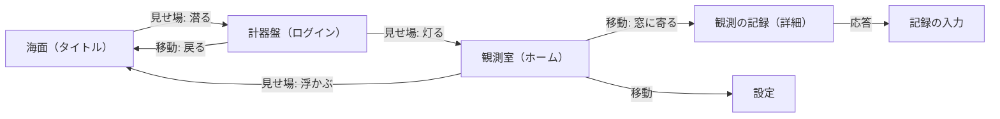

# デザイン計画書: 深海の探査日誌のスタートとログイン

> **3 行でわかる要約**
> 1. 架空の個人開発アプリ「深海の探査日誌」で、スタートの画面からログインまでの見た目を決めた計画書です。画面の型は没入の型で、数値と日付はすべて架空です。
> 2. 方向は「潜水艇の計器盤」で、深さで暗くなる水と琥珀の灯 1 つを土台にします。見せ場は「潜る」で、スタートを押すと世界が上へ流れて計器盤に着きます。
> 3. フロントエンドはトークンと演出計画書（`motion-plan-dive-log.md`）のとおりに作り、100ms ごとのフレームを撮って監修に出してください。

| 項目 | 内容 |
|---|---|
| 画面の型 | 没入の型。材料は、直近 1 年の commit の作者が 1 人で、既存の UI のトークンが無いこと。依頼者が受付で決めた（架空） |
| 作成日 | 2026-11-26 |
| 状態 | 完成例。2 回目の伺いで、依頼者がサンプルを見て方向 A を選び、見せ場「潜る」を承認した（架空）あとの版。2026-11-26 の監修の指摘（色の式・書体・灯・スタートの札・隅の札・新規登録・マリンスノー・計画に無い動き）と、2 回目の監修の指摘 N1（戻るの入れ替えの順）と N3（深い水の上）を入れた |
| 入力 | 受付票（架空）、演出計画書 `motion-plan-dive-log.md`、監修記録 `design-review-dive-log.md` |
| 置き場 | 本番の案件では tmp/flow/dive-log/design-plan.md |

画面の型は受付票の欄を写したもので、デザイナーは選び直していません。実際に計算した値は、`contrast-check.sh` で出した色のコントラスト比と、導出の色の 16 進だけで、ほかの数値は架空です。

## 目的と対象

依頼は「スタートを押したら、ゲームのように世界に入ってからログインしたい」の 1 行から始まりました。利用者は、深海の記録映像を見ながら、毎晩 1 件ずつ観測の記録を付ける人です。

| 項目 | 内容（数値は架空） |
|---|---|
| 依頼 | スタートを押したら、ゲームのように世界に入ってからログインしたい（依頼者、2026-11-26） |
| 利用者 | 深海の記録映像を見るのが趣味の 1 人。夜に PC の前で、1 晩に 1 件を 5 分ほどで書く |
| 片付けたい用事 | 夜に日誌を開いたとき、すぐ書き始めたい。ただ、毎晩の入り口は海に潜る気分で始めたい |
| 今の画面の困りごと | 白地のフォームだけの試作で、開くたびに業務の道具に見える |
| 画面の仕事（1 文） | 海面から計器盤へ潜り、1 つ目の入力欄にフォーカスを置いて、記録を書く前の気分を作ること |

画面の仕事には、世界に入る気分と、すぐ打てる速さの 2 つがあります。そのため見せ場は初回だけ長くし、2 回目からは短い版にして、どのキーでも飛ばせるようにします。

## 用語

この計画書で繰り返し使う語の意味です。型と区分の決まりの本文は、`skills/designer/references/systems.md` の 4 節にあります。

| 用語 | 意味 |
|---|---|
| 没入の型 | 個人開発の画面の型。世界観と、場面をつなぐ演出を先に決める |
| 見せ場 | 世界に入る場面や節目で使う、長めの演出。この計画書では「潜る」 |
| 共有要素 | 前の場面から次の場面まで、消えずに付いて来る 1 つの部品。ここでは灯 |
| 区分 | 動きの重さの分け方。応答・移動・見せ場・環境の 4 つで、長さの枠が違う |
| 段 | 見せ場の中の区切り。入り・見せ場・収まりの 3 つ。段の「見せ場」は、区分の見せ場の中の山の部分を指す |
| 演出計画書 | 見せ場を、時刻ごとの表と守りの表とトークンで書いた文書 |
| フレーム | 動きを 100ms ごとに止めて撮った 1 枚。監修で計画と見比べる |
| 導出の色 | 名前つきの色から color-mix（2 色を割合で混ぜる CSS の式）で作る色。手で選んだ値を残さない |

## 方向: 世界観の設定

方向は、色と書体より先に、世界の側から決めます。3 案を静止画で並べ、依頼者が A の「潜水艇の計器盤」を選びました（架空の選択）。

### 方向の 3 案

3 案は、同じ主題（深海の観測の日誌）から、利用者が何者になるかを変えて作りました。静止画は、題字の場面を 1 枚ずつ描いたものです。

| 案 | 方向の名前 | 物語の 1 文 | 静止画 | 依頼者の選択 |
|---|---|---|---|---|
| A | 潜水艇の計器盤 | 利用者は潜水艇の観測員で、計器盤の前に座って今日の記録を付ける | tmp/flow/dive-log/directions/a.png（架空） | 選んだ（架空） |
| B | 海図台の航海日誌 | 利用者は観測船の航海士で、紙の海図の上に今夜の潜航地点の印を付ける | tmp/flow/dive-log/directions/b.png（架空） | 選ばない |
| C | 夜明けの甲板 | 利用者は調査船の甲板員で、夜明けの海へ探査機を下ろし、今日の観測を記録する | tmp/flow/dive-log/directions/c.png（架空） | 選ばない |

3 案の名前と物語は、samples/immersive/directions/ に置いたサンプルの静止画と同じです。A が選ばれたのは、潜る動きがそのまま「世界に入る」合図になるからです。B は紙の海図の上に留まるので、世界に入る向きがありません。C は甲板から海を見下ろすので、潜る向きと視点が合いませんでした。

### 世界観の設定

選んだ A の世界を 10 行で決めます。どの行も、このあとの色・書体・動きの決めごとの出どころになります。

| 項目 | 決めたこと |
|---|---|
| 主題 | 深海の観測を、毎晩 1 件ずつ日誌に残す |
| 方向の名前 | 潜水艇の計器盤 |
| 物語の 1 文 | 利用者は潜水艇の観測員で、計器盤の前に座って今日の記録を付ける |
| 感情の流れ | 海面で静けさ、潜航で高まり、計器盤で落ち着き |
| 素材と光 | 厚い窓と、つや消しの計器盤。光は真上から弱く差し、深いほど暗い。最後に残るのは計器の灯 |
| 奥行の層 | 奥から、水、マリンスノー（白い粒子。深さと潜る速さを伝える）、題字、計器盤、灯の 5 層 |
| 動きの語彙 | 潜る（世界が上へ流れる）、灯る（下から順に点く）、浮かぶ（世界が下へ流れる） |
| 参照と取る所 | 潜水艇の計器盤から、灯と目盛り。海の記録映像から、マリンスノーの速さ。家庭用ゲーム機の起動から、押すと世界が動く順 |
| 取らない方向 | 暗い地にネオンの光、ガラスの板、意味の無い粒子、何でも下から浮き上がる動き |
| 取る危険 1 つ | 初回の潜航に 1,400ms を使う。待たせる危険はあるが、世界に入る合図になる。2 回目からは 600ms |

依頼の「ゲームのような」動きは、次の 4 つの性質と読みました。参照の作品は受け取っていないので、この読みは最初のサンプルで確かめます。

| 性質 | 中身 | この計画で受け持つ物 |
|---|---|---|
| つながる | 押した物が、次の場面まで付いて来る | 灯（共有要素） |
| 奥行がある | 奥と手前が、違う速さで動く | 水、マリンスノー、題字、計器盤、灯の 5 層 |
| 緩急がある | 入りと見せ場と収まりがある | 「潜る」の 3 つの段 |
| 生きている | 何もしない間も、画面が小さく動く | マリンスノー（環境の動き） |

## 場面の一覧

場面は 6 つで、この計画書で扱うのは海面と計器盤の 2 つです。矢印の字は区分と動きの語彙で、見せ場は 3 本、移動は 3 本あります。

図の読み方: 左から右へ読み、矢印の字は区分と動きの語彙です。海面から計器盤への「潜る」が、演出計画書に書いた見せ場です。計器盤から海面への「戻る」は、ブラウザの戻ると同じ移動です。

| 移る先 | 前の場面 | 区分 | 動きの語彙 | 演出 ID |
|---|---|---|---|---|
| 計器盤（ログイン） | 海面（タイトル） | 見せ場 | 潜る | `scene-start-login` |
| 海面（タイトル） | 計器盤 | 移動 | 戻る（灯を電源ランプからスタートへ返す） | なし。View Transitions（場面の前後を撮って間を補うブラウザの仕組み）で 400ms。入れ替えの順は演出計画書の「戻るの入れ替えの順」 |
| 観測室（ホーム） | 計器盤 | 見せ場 | 灯る | `scene-login-home`（この計画の外） |
| 海面（タイトル） | 観測室 | 見せ場 | 浮かぶ | `scene-home-title`（この計画の外） |
| 観測の記録（詳細） | 観測室 | 移動 | 窓に寄る | なし |
| 設定 | 観測室 | 移動 | なし | なし |
| 記録の入力 | 観測の記録 | 応答 | なし | なし |

## 色

色は 6 つで、どれも世界観の設定の素材と光から名前を付けました。暗さは主題の深さから来るもので、光は灯の 1 つに絞ります。下限は、文字で 4.5 対 1、部品で 3 対 1 です。

| 名前 | 16 進 | 役割と使う場所 | 組み合わせと比 |
|---|---|---|---|
| 海面 | #2F5A66 | 題字の場面の地。上から光が差す浅い水 | 目盛りの文字で 5.79 対 1 |
| 深海 | #0D1B22 | ログインの場面の地。灯の地に乗る字（「乗船する」） | 目盛りの文字で 13.43 対 1、灯の上で 9.40 対 1 |
| 計器盤 | #222B2A | 計器盤の面（ログインの枠）とスタートの札の地。つや消し | 目盛りの文字で 11.11 対 1、深海で 1.21 対 1（面の差。装飾の扱い） |
| 目盛り | #DCE3DD | 本文、題字、入力した字、ラベル。光の帯とマリンスノーも、この色を薄めて描く | 計器盤で 11.11 対 1、深海で 13.43 対 1、海面で 5.79 対 1 |
| 灯 | #F0B34A | 灯（スタートの札と、計器盤の電源の灯）、主ボタンの地、焦点の枠（部品） | 海面で 4.05 対 1、計器盤で 7.78 対 1、深海で 9.40 対 1 |
| 警告灯 | #FF8A70 | 誤りの文と、誤りの欄の枠（部品） | 計器盤で 6.30 対 1、深海で 7.62 対 1 |

導出する色は 10 個で、どれも 6 色からの color-mix の式です。手で選んだ値は残していません。16 進は、式の割合で 0〜255 の値を混ぜて四捨五入した値です。canvas（JavaScript で絵を描く板）が読めるように、トークンにも 16 進で書きます。

| 導出する色 | 16 進 | 式と使う場所 | 組み合わせと比 |
|---|---|---|---|
| 補助 | #A4ACA7 | color-mix(in srgb, 目盛り 70%, 計器盤)。入力欄の説明、電源と深度の字、隅の「背景の動きを止める」の字 | 計器盤で 6.25 対 1、深海で 7.55 対 1、入力欄で 7.08 対 1 |
| 入力欄 | #152125 | color-mix(in srgb, 深海 60%, 計器盤)。入力欄の地。計器盤の面から 1 段沈める | 目盛りの文字で 12.60 対 1、灯で 8.82 対 1、計器盤で 1.13 対 1（面の差。装飾の扱い） |
| 入力枠 | #767E7B | color-mix(in srgb, 目盛り 45%, 計器盤)。入力欄の枠と、スタートの札と隅の札のホバーの縁（部品） | 計器盤で 3.48 対 1、入力欄で 3.95 対 1 |
| 浅い水 | #869FA2 | color-mix(in srgb, 目盛り 50%, 海面)。海面の画面の上端の水（canvas）。字を置かない（装飾） | 海面で 2.70 対 1 |
| 中ほどの水 | #1B343D | color-mix(in srgb, 海面 40%, 深海)。海面の画面の下 4 割の水（canvas） | 目盛りの文字で 10.01 対 1、灯で 7.01 対 1 |
| 盤の縁 | #3E4745 | color-mix(in srgb, 目盛り 15%, 計器盤)。計器盤とスタートの札と隅の札の縁、ねじ（装飾） | 計器盤で 1.51 対 1 |
| 盤の明るい縁 | #313A38 | color-mix(in srgb, 目盛り 8%, 計器盤)。計器盤の上の縁の 1px の光（装飾） | 計器盤で 1.24 対 1 |
| 目盛り線 | #5A6260 | color-mix(in srgb, 目盛り 30%, 計器盤)。計器盤の細かい目盛り。太い目盛りは補助（装飾） | 計器盤で 2.32 対 1 |
| 主ボタンのホバー | #ECBD67 | color-mix(in srgb, 灯 80%, 目盛り)。「乗船する」にポインターが乗ったときの地 | 深海の文字で 10.06 対 1 |
| 主ボタンの押し込み | #CE9C44 | color-mix(in srgb, 灯 85%, 深海)。「乗船する」を押している間の地 | 深海の文字で 7.07 対 1 |

字の地は、潜る間に海面から深海へ移ります。目盛りの字はどちらの地の上でも 5.79 対 1 以上を保つので、題字が去る前でも、計器盤が起きたあとでも読めます。浅い水は画面の上端だけに置き、題字と説明は浅い水より下の、海面から中ほどの水の間に置きます。

計器盤の場面の水は、上端まで深海 1 色にします。前の版にあった導出の色「深い水の上」（#142830）は、計画から外しました。外す理由は、世界観の設定の「深いほど暗い」に合わせ、着いた深さの水を灯より目立たせないためです。2 回目の監修では、この色は計器盤の場面のどのフレームにも出ていませんでした（指摘 N3）。canvas の深い所の版は、4 段とも深海で描きます。

## 書体

書体は、この Mac に入っている書体だけで組みます。外から書体を読まず、リポジトリにも書体のファイルを置きません。題字と本文は Hiragino Sans（ヒラギノ角ゴシック）の 1 家族で、数字だけを等幅の Menlo にします。

| 役 | 書体 | 大きさと太さ | 使う場所 | 理由 |
|---|---|---|---|---|
| 題字役 | Hiragino Sans。並びは "Hiragino Sans", "Hiragino Kaku Gothic ProN", sans-serif | 56px（幅が 560px より狭い画面では 10vw、下限 32px）と 24px、太さ 700、字間 0.2em | 海面の題字「深海の探査日誌」（56px）と、計器盤の題「ログイン」（24px） | 計器の刻印の字に寄せる。細い未来風の字は、暗い地で読めなくなる |
| 本文役 | Hiragino Sans。並びは題字役と同じ | 16px と 14px、太さ 400。「乗船する」だけ太さ 600 | ラベル、入力した字、説明、ボタンの字、電源と深度の字 | 夜に読む字なので、14px を下限にし、太さを落とさない |
| 数字役 | Menlo。並びは Menlo, monospace | 14px、太さ 400、等幅 | 計器盤の深さの表示 | 桁がそろい、計器の目盛りに見える |

行の高さは、本文が字の大きさの 1.5 倍、題字が 1.25 倍です。どちらも 14px・16px・24px・56px に掛けて整数の px になるので、計器盤の部品の位置が端数になりません。Hiragino Sans と Menlo が無い環境（Windows など）では、総称の書体に落ちます。その環境の書体を並びに足すかは、未確定の表に置きました。

## レイアウトと密度

どの場面も、情報の塊は 3 つ以内にします。計器盤は画面の中央に置き、窓の外の水に囲まれた 1 枚の盤に見せます。

| 項目 | 値 | 理由 |
|---|---|---|
| 計器盤の幅 | 400px。狭い幅では左右に 16px をあける | 入力欄 2 つとボタンが 1 列に並ぶ幅 |
| 入力欄とボタン | 高さ 44px。入力欄の角は直角（計器の窓） | 片手でも押せる大きさ。2.5.8 の 24px を超える |
| 情報の塊 | 海面で 2 つ（題字、スタート）、計器盤で 3 つ（題、入力欄、乗船する） | 1 つの場面に、1 つの用事を置く |
| 固定の帯 | なし。隅の「背景の動きを止める」は右下、高さ 44px の字の札 | フォーカスを隠す帯を作らない。字の札にして、押す前に何が止まるかを読めるようにする |

## シグネチャ: 灯

この画面を記憶に残す要素は、灯 1 つです。スタートの札の灯が、潜ったあとに計器盤の電源の灯になり、2 つの場面をつなぎます。

| 項目 | 決めたこと |
|---|---|
| 形 | 直径 12px の琥珀の円。周りに、同じ色の光の輪（直径 48px、不透明度 0.35） |
| 伝える情報 | 計器盤の電源が入り、入力を受け付けていること。送信中は輪を消し、受け付けを止めたことを示す |
| 出る場所 | 海面ではスタートの札の左端。札は計器盤の地に、目盛りの字で「潜航を始める」。計器盤では左上の電源の位置 |
| 描き方 | DOM の 1 要素と CSS。光の輪は radial-gradient で描き、ぼかしの影を使わない。クラス名は lamp |
| 色に頼らない | 電源の位置と、横の「受付中」の字で分かる。送信中は字が「送信中」に替わる |

スタートの札を灯の地にしないのは、2 つの決めが同じ所に重なるからです。灯を札の中央に置く決めと、札の字を灯の地に乗せる決めは、両方は立ちません。札は計器盤の部品として描き、灯はその左端の小さな光にしました（監修記録の指摘 9）。

## 動き

動きは区分で長さを分けます。応答は 200ms まで、移動は 500ms まで、見せ場は初回 1,400ms で 2 回目から 600ms です。見せ場「潜る」の時刻ごとの値は演出計画書に書き、ここには場面ごとの 1 行だけを置きます。

| 区分 | 場面 | 時間と曲線 | 何を伝えるか | 動きを減らす設定のとき | キーボード起点のとき |
|---|---|---|---|---|---|
| 応答 | ボタンと入力欄のホバーと押し込み。札とボタンと入力欄の縁や地の色が替わる | 80ms、標準 | 押せる物と、押せたこと | 0ms | 0ms |
| 応答 | フォーカスの移り。灯の色の枠が次の欄に灯る | 120ms、標準（ポインターで欄に入ったとき） | 次に打つ所 | 0ms | 0ms |
| 応答 | 誤りの文が入力欄の下に出る | 180ms、着く | どの欄を直すか | 0ms | 0ms |
| 移動 | 戻る。計器盤から海面へ、灯を電源ランプからスタートの札へ返す。盤の層が 0〜200ms で去り、海面の層が 200〜400ms で出て、2 つの場面の字を同じフレームに重ねない | 400ms、標準。盤は 200ms、去る。海面は 200ms、着く | 海面へ戻った | 150ms の溶け込み。盤が 0〜75ms、海面が 75〜150ms | キーで戻っても流す |
| 見せ場 | 潜る。海面から計器盤へ（`scene-start-login`） | 初回 1,400ms、2 回目から 600ms。時刻ごとの値は演出計画書 | 海面を離れ、計器盤に着いた | 150ms の溶け込みだけ | キーで押しても流す。どのキーでも飛ばせる |
| 環境 | マリンスノーが上へ流れ続け、光の帯が左右に揺れる | 粒の揺れの周期 4.2 秒以上（4.2〜9 秒）、光の帯は周期 9〜13 秒。粒は海面で 1 画面（800px）を 32〜67 秒で上へ流れ、計器盤ではその半分の速さ | 深い所にいること | 止まった 1 枚 | 隅の「動きを止める」で止める |

曲線は、標準・去る・着く・収まるの 4 つです。行き過ぎて戻る「収まる」は、計器盤が起きる 1 か所だけに使います。見せ場に限り、題字のぼかし（filter）と、水とマリンスノーの canvas 1 枚を使います。同時に動くレイヤーは 4 つまでにし、フレームが落ちたら短い版に替えます。

マリンスノーの速さは、1 画面を 8 秒で流す案をやめ、今の遅い流れに決めました（監修記録の指摘 15）。粒が 8 秒で画面を横切ると、ログインの間ずっと視線を引くからです。環境の動きは小さく保ち、深さは粒の大きさと速さの差で伝えます。

## キーボードと操作の型

用事は、マウスを使わずに終わります。見せ場の途中でも、どのキーでも飛ばせ、先に打った字は 1 つ目の入力欄に入ります。

| 操作 | キー | マウス | 型の出どころ |
|---|---|---|---|
| スタートを押す | Enter か Space | スタートの札を押す | APG の Button |
| 見せ場を飛ばす | どのキーでも | どこを押しても | 社内の決め（守り） |
| 入力欄を移る | Tab と Shift+Tab | 欄を押す | ブラウザの既定 |
| 乗船する（ログイン） | Enter | 「乗船する」を押す | フォームの既定 |
| 戻る | ブラウザの戻る（Alt+← か Cmd+[） | ブラウザの戻る | ブラウザの既定 |
| 動きを止める | Tab で隅のボタンへ移り、Enter | 隅のボタンを押す | WCAG 2.2 の 2.2.2 |

ログインと新規登録の切り替えは、最初のサンプルでは作りません（やらないことの表）。左右の矢印で移る部品も、そのため今はありません。どのキーでも飛ばす操作は見せ場の 1,400ms の間だけ効き、打った字は 1 つ目の入力欄に入ります。オフにする設定の要否は、未確定の表に置きました。

## 既定との差（自己批評）

既定との差を 5 軸で言い、外した装飾を 1 つ書きます。没入の型なので、既定の列には没入の既定も並べました。

| 軸 | 既定 | この計画 | なぜこの依頼に効くか |
|---|---|---|---|
| 色 | 暗い地に、紫かシアンのネオンの光 | 深さで暗くなる水と、琥珀の灯 1 つ。発光の影を使わない | 暗さは主題の深さから来る。光を 1 つに絞ると、灯を共有要素として目で追える |
| 書体 | Inter だけか、細い未来風の書体 | Hiragino Sans の太さ 700 で題字の字間を開け、数字だけ等幅の Menlo にする | 計器の刻印の字に寄せ、暗い地でも細さで読めなくならない |
| レイアウト | 中央に置いた、ガラスの板のログインの枠 | つや消しの計器盤。地から 1 段明るい面で、ぼかしを使わない。入力欄は直角の窓 | 潜水艇の中の物に見せる。ぼかしの重ねは重く、字の地がまだらになる |
| シグネチャ | 意味の無い粒子と、回り続ける立体 | 灯。押した光が計器盤の電源の灯になる | 場面をつなぐ 1 つの物として、次の場面まで目で追える |
| 動き | 何でも下から浮き上がる、一律の 300ms | 区分で長さを分け、見せ場は世界が上へ流れる「潜る」 | 潜る向きにそろえると、どのレイヤーも同じ物語で動く |
| 外した装飾 | なし | 計器盤の表面の傷と、窓の水滴 | 字の地がまだらになり、入力した字が読みにくくなる |

## WCAG 2.2 AA の点検（見た目側）

見た目で決まる達成基準と、没入の型で足すレベル A の 2 つを、設計の値で書きます。実装のあとで測り直します。

| 達成基準 | この計画 | 値 | 確認方法 |
|---|---|---|---|
| 1.4.1 色の使用 | 隅の札の押した状態は、印の形（丸から四角）と字の色で示す。誤りの欄は、枠の色と欄の下の文で示す | 色だけで伝える状態 0 | 押す前後と誤りの状態のフレームを比べる |
| 1.4.3 コントラスト（最低限） | 文字の全組を計算 | 最小 5.79 対 1（目盛りの字と海面） | `contrast-check.sh` |
| 1.4.11 非テキストのコントラスト | 入力枠と焦点の枠 | 最小 3.48 対 1（入力枠と計器盤） | `contrast-check.sh` |
| 2.4.7 フォーカスの可視化 | 灯の色の outline、2px | 見えない要素 0 | Tab で全要素を通す |
| 2.4.11 フォーカスの非遮蔽（最低限） | 固定の帯なし | 隠れる要素 0 | 隅のボタンの近くの欄に Tab で入る |
| 2.5.8 ターゲットのサイズ（最低限） | 入力欄とボタンと隅のボタン | 最小 44px | DOM の寸法を測る |
| 2.2.2 一時停止、停止、非表示 | マリンスノーは隅の「背景の動きを止める」で止まる | 止める手段 1 つ | 5 秒待って止め、前後のフレームを比べる |
| 2.3.1 3 回の閃光、又は閾値以下 | 明るさの大きな切り替わり | 0 回 | フレームの一覧で明るさを見る |
| 2.3.3 動きの抑制（AAA。社内で採る） | 動きを減らす設定では位置を動かさない | 150ms の溶け込み 1 本 | 設定を有効にして同じ操作をする |

## 引き渡し

フロントエンドには、トークンと演出計画書の 2 つを渡します。依頼者には、方向の 3 案の静止画と、見せ場の動くサンプルを見てもらいます。

| 渡す先 | 渡すもの | 受け取る側の確認 |
|---|---|---|
| フロントエンド | tokens.css（名前つきの色 6 つと導出の色 10 個、書体、動きの時間と曲線） | 生の値が無い。`fidelity-check.sh` に演出計画書を `--motion` で渡して PASS |
| フロントエンド | 演出計画書 `motion-plan-dive-log.md` | 時刻ごとの表とトークンのとおりに作り、100ms ごとのフレームを撮る |
| 依頼者 | 方向の 3 案の静止画と、「潜る」の動くサンプル | 方向を 1 つ選び、サンプルを見て見せ場を承認する |

## やらないこと

最初のサンプルは 1 場面に絞り、音と外のアセットは入れません。

| やらないこと | 理由 |
|---|---|
| 音 | 最初の版は音なし。入れるときは、消音の操作を常に画面に置く |
| 外から読む書体・画像・音 | 外部への要求を 0 件に保つ。書体は OS に入っている物だけを使い、水と粒子は手続きで描く |
| ログインと新規登録の切り替え | 最初のサンプルは「潜る」とログインに限る。新規登録の面と、左右の矢印で切り替えるタブ（移動 400ms）は、観測室の場面と一緒に計画する（監修記録の指摘 11） |
| 観測室から先の場面と、「灯る」「浮かぶ」の見せ場 | 最初のサンプルは「潜る」の 1 場面に限る |
| アプリ（iOS など）の画面 | 没入の型は Web から始める |

## 未確定

次の 4 つは、最初のサンプルを見てから決めます。どれも、決まったらこの計画書と演出計画書の両方を直します。

| # | 決まっていないこと | 決め方 |
|---|---|---|
| 1 | 曲線 4 つの値 | 100ms ごとのフレームを見て、デザイナーが決め直す。灯の弧の曲線は、道のりで拾い直したフレームを見て標準のままにした（演出計画書の未確定の表） |
| 2 | 見せ場の長さ（初回 1,400ms と 2 回目の 600ms） | 依頼者が動くサンプルを見て決める |
| 3 | 「ゲームのような」の読み（4 つの性質）が合っているか | 依頼者がサンプルを見る。合わなければ、参照の作品と場面を 1 つもらう |
| 4 | どのキーでも飛ばす操作をオフにする設定と、Mac の外の書体 | 依頼者が対象の環境を決めたら、デザイナーが設定の置き場と、その OS の書体を並びに足すかを決める |
