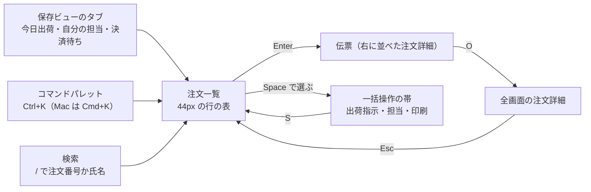

# デザイン計画書: 管理画面の注文一覧

> **3 行でわかる要約**
> 1. 架空の EC サイトの管理画面について、注文一覧と注文詳細の見た目を決めた計画書です。件数や時間の数値はすべて架空とします。
> 2. 方向は「出荷の帳場」です。緑灰の台紙と墨の文字を土台に、朱の検印を 1 つ置きます。44px の行と J と K のキーで、朝の未出荷 400 件を、1 時間で漏れなく片付けます。
> 3. フロントエンドはトークンの表のとおりに作ってください。実装のあとは、監修記録（`design-review-order-list.md`）の型で計画との差を確かめます。

| 項目 | 内容 |
|---|---|
| 作成日 | 2026-11-06 |
| 改訂日 | 2026-11-07 |
| 状態 | 承認待ち。方向・色・書体・検印の 4 点を依頼者に伺う |
| 入力 | 依頼（2026-11-05）、受付票、CEO の事業判断メモ |
| 置き場 | 本番の案件では tmp/flow/admin-orders/design-plan.md |

色のコントラスト比だけは、`contrast-check.sh` で実際に計算した値です。それ以外の数値は架空で、行数のような値は架空の寸法からの計算です。

## 目的と対象

依頼は「管理画面の注文一覧を作り直したい」の 1 行から始まりました。受付票の事実と利用者の像から対象を写し、画面の仕事を 1 文に決めます。利用者の像はペルソナ（根拠をもって描いた利用者像）として、運営担当者の 1 体に絞ります。

| 項目 | 内容（数値は架空） |
|---|---|
| 依頼 | 管理画面の注文一覧を作り直したい（依頼者、2026-11-05） |
| ペルソナ | 運営担当者 5 人。平日の日中、事務所の PC でキーボードを使う。1 人が 1 日 240 件を出荷指示にする。朝の 1 時間で 80 件 |
| 片付けたい用事 1 | 朝 9 時から 10 時の間に、未出荷の注文 400 件を漏れなく出荷指示にしたい。配送の締め切りに間に合わせるために |
| 片付けたい用事 2 | 問い合わせの電話中に、注文番号か氏名で注文を 5 秒以内に開きたい。相手を待たせないために |
| 片付けたい用事 3 | 決済の失敗と住所の不備を朝のうちに見つけて、担当を割り当てたい。放置を防ぐために |
| 5 人の分け方 | 朝 8 時半にリーダーが今日出荷の行に担当を付け、各自は自分の担当の行から片付ける。担当の無い行は誰が出荷指示してもよく、先に押した人の検印が残る |
| 規模 | 注文は 1 日 1,200 件、ピークは 11 時台の 180 件。問い合わせは 1 日 30 件で、7 割が注文番号での照会 |
| 今の画面の困りごと | 20 件ずつのページ送りで 400 件を見るのに 20 ページ。絞り込みは毎朝入れ直し。状態が色だけで、色弱の担当者 1 人が見分けにくい |
| 画面の仕事（1 文） | 未出荷の注文を、今日中に漏れなく出荷指示にすること |

画面の仕事は 1 つです。問い合わせの照会と異常の発見は、同じ一覧の上で保存ビューを切り替えて片付けます。色弱の担当者がいるので、色に頼らない表示を前提に置きます。

## 全体像

2 画面と、画面の上で使う 4 つの型（保存ビュー、コマンドパレット、伝票、一括操作）の関係を図にします。注文一覧が中心で、注文詳細は一覧の右に伝票として開き、要るときだけ全画面になります。



図の読み方: 矢印の文字はキーです。どの操作も注文一覧に戻ってくるので、担当者は一覧から離れずに 3 つの用事を片付けます。

## 用語

この計画書で 3 回以上使う語の意味です。読み進める前に目を通してください。

| 用語 | 意味 |
|---|---|
| デザイントークン | 色、大きさ、余白、時間の値に名前を付け、1 か所（tokens.css）で管理する仕組み |
| シグネチャ | その画面を記憶に残す、ただ 1 つの要素。情報を持つ装飾 |
| コマンドパレット | Ctrl+K で開く入力欄。操作の名前を打って実行する。横にキーが出る |
| 保存ビュー | 絞り込み・並び順・列・まとめ方の組に名前を付けて保存したもの。URL で共有できる |
| 伝票 | 一覧の右に並べて開く、1 件の詳細の面。台紙の上に置いた 1 枚の伝票の形で、中身の高さで終わる。一覧を隠さない |
| 群 | 次にすることの順（要対応、出荷遅れ、出荷可、決済待ち、出荷指示の直後、済）で分けた行のまとまり。頭に群の見出しの行を置く |
| 上の帯 | 画面のいちばん上の高さ 44px の帯。店の名前、メニューの項目 7 つ、利用者を 1 段に並べる。固定しない |
| 二重罫 | 帳簿で列の見出しと合計を締める線。墨の 1px の線 2 本を、2px あけて引く |
| 固定 | スクロールしても画面の上か下に残す置き方。CSS の position: sticky で描く |
| 等幅数字 | どの数字も同じ幅で、桁が縦にそろう字形 |
| コントラスト比 | 文字色と背景色の明るさの比。本文は 4.5 対 1 以上が WCAG 2.2 の AA |
| スケルトン表示 | 読み込み中に、これから出る形を薄い枠で先に描く表示 |
| ホバー | ポインター（マウスの矢印）を要素の上に重ねること |
| タブ | 保存ビューを切り替える見出しの部品。帳簿の紙面の上の縁に差した付箋の形で、下の端は開いている。今でないタブは付箋のタブの色で沈め、今のタブは紙面の地で紙面とつなげる |
| チップ | 絞り込みの帯に並ぶ選択の部品。伝票の記入欄と同じく、下線だけの欄に項目名と今の値を書く |
| WCAG 2.2 | W3C が定めるウェブのアクセシビリティ基準。2023 年 10 月の勧告、2024 年 12 月の改訂版 |

## 方向

見た目の方向は、既定ではなく主題の世界から決めます。主題は「出荷の帳場」です。毎朝、伝票を束ねて出荷の判を押す場所を指します。

| 項目 | 決めたこと |
|---|---|
| 主題 | 運営担当者が毎朝、注文の伝票を束ねて出荷の判を押す帳場 |
| 読み手 | 運営担当者 5 人。慣れた人は 1 日 240 件をさばき、新人は月に 1 人入る |
| 画面の仕事 | 未出荷の注文を今日中に漏れなく出荷指示にする |
| 方向の名前 | 出荷の帳場 |
| 素材と語彙 | 複写伝票の緑灰の罫線、帳簿の縦横の罫と二重罫、帳簿の見出しの付箋、荷札、検印の朱、帳簿の等幅の数字 |
| 取らない方向 | 黒地に蛍光緑の「監視室」、紫のグラデーションの「SaaS の着地ページ」、クリーム地にセリフの「雑誌」 |
| 取る危険 1 つ | 状態を文字の判（検印）で見せる。バッジより場所を取るが、色に頼らず、誰が押したかまで伝わる |

「帳場」は担当者が使う言葉ではなく、社内の方向の名前です。画面には出しません。

## 色

色は帳場の素材から 6 つを選び、名前もそこから付けました。表には 16 進と使う場所、計算したコントラスト比を並べます。比はどれも `contrast-check.sh` で計算しました。下限は、文字で 4.5 対 1、部品で 3 対 1 です。

| 名前 | 16 進 | 役割と使う場所 | 組み合わせと比 |
|---|---|---|---|
| 台紙 | #E5F0ED | 画面の地、上の帯、縞、一括操作の帯。緑灰の複写伝票 | 墨の文字で 13.74 対 1 |
| 紙面 | #FFFFFF | 帳簿の紙面（表の行、絞り込みの帯、列の見出し）、今の保存ビューのタブ、伝票、ボタンの地。検印の円の中。要対応の白抜きの字 | 墨の文字で 16.01 対 1 |
| 墨 | #1C2321 | 字は、本文、行の字、群の名前と件数、表の見出し。面は、主ボタンの地と要対応の札の塗り。線は、出荷遅れの札の枠、群の見出しの下の線、二重罫（列の見出しの下と明細の合計の上）、伝票の上の端、開いている行の囲み | 台紙の文字で 13.74 対 1、紙面の文字で 16.01 対 1 |
| 罫 | #4F6F67 | 補助の文字（入力の例文とチップの項目名は 14px・700）、選択の矢印、チェックの枠（部品、2px）、伝票の空の検印の欄の破線の円 | 台紙で 4.74 対 1、紙面で 5.52 対 1 |
| 朱 | #B9321A | 押した検印だけ。まだ押していない欄の円は罫で刷り、朱は判を押したときにだけ出る。取り消しの操作には使わない。字はいつも紙面の上に置く | 紙面で 5.94 対 1、台紙で 5.10 対 1 |
| 藍 | #2F5C9E | リンク、焦点の枠（部品）、チェックした枠の地（中の印は紙面の色）、選択行の地の元の色 | 紙面で 6.68 対 1、台紙で 5.73 対 1 |

6 色から導く色は、明るい版で 9 色、ダーク版で 12 色です。縞はどちらの版も台紙そのもので、ほかは color-mix の式です。手で選んだ値は残していません。生の 16 進は、検査で比を計算するために添えます。

表の罫線と縞は装飾なので、WCAG 2.2 の 1.4.11 の対象外です。それでも罫線は紙面と 2.47 対 1 まで濃くします。列のあいだには縦罫を引き、群の中の偶数行には縞を敷きます。幅 902px の行を受注日時まで目でたどっても、隣の行へずれないためです。

| 導出する色 | 16 進 | 式と使う場所 | 組み合わせと比 |
|---|---|---|---|
| 群の見出し | #B8C9C5 | color-mix(in srgb, 罫 30%, 台紙)。群の見出しと済の群の見出しの地。白い行と縞のどちらより沈め、下の端に墨の 2px の線を 1 本だけ引く | 墨の文字で 9.30 対 1、紙面で 1.72 対 1、#E5F0ED で 1.48 対 1（面の差。装飾の扱い） |
| 選択行 | #CDD8E8 | color-mix(in srgb, 藍 24%, 紙面)。選んだ行の地。地だけで選んだ行と分かり、墨の数字が沈まない濃さにする | 墨の文字で 11.12 対 1、藍で 4.64 対 1、紙面で 1.44 対 1（面の差。装飾の扱い） |
| ホバーした行 | #F5F7FA | color-mix(in srgb, 藍 5%, 紙面)。ホバーした行の地。選択行より薄くして見分ける | 墨の文字で 14.92 対 1、紙面で 1.07 対 1（面の差。装飾の扱い） |
| 縞 | #E5F0ED | 台紙そのもの（var(--paper)）。群の中の偶数行の地（装飾）。縮めた画像でも行の段が見える差にする | 墨の文字で 13.74 対 1、罫の文字で 4.74 対 1、紙面で 1.17 対 1（面の差。装飾の扱い） |
| 入力枠 | #69857E | color-mix(in srgb, 罫 85%, 紙面)。検索欄とチップの下線、ボタンと付箋のタブの枠、帳簿の紙面と伝票の縁（部品） | 紙面で 3.99 対 1、台紙で 3.43 対 1、#E3E8E7 で 3.23 対 1 |
| 表の罫線 | #95A9A4 | color-mix(in srgb, 罫 60%, 紙面)。緑灰の線。行の区切りと列の縦罫、伝票の見出しの下の切り取り線、伝票の欄の区切りと明細の線（装飾） | 紙面で 2.47 対 1、#E5F0ED で 2.12 対 1 |
| 付箋のタブ | #E3E8E7 | color-mix(in srgb, 罫 16%, 紙面)。今でない保存ビューのタブの地。紙面より 1 段沈め、紙面の裏に差した付箋に見せる | 墨の文字で 12.93 対 1、紙面で 1.24 対 1（面の差。装飾の扱い） |
| 遅れの札の地 | #E4E5E4 | color-mix(in srgb, 墨 12%, 紙面)。出荷遅れの札の地。墨の 2px の枠の中を薄い墨で埋め、朱の線だけの検印より重く見せる | 墨の文字で 12.68 対 1、紙面で 1.26 対 1（面の差。装飾の扱い） |
| 担当なしの字 | #3B514B | color-mix(in srgb, 罫 60%, 墨)。担当の列の「担当なし」。名前の墨より一段弱く、薄すぎない字。選んだ行の上も同じ色。伝票では 1 回しか出ないので墨で書く | #E5F0ED で 7.31 対 1、選択行で 5.92 対 1、紙面で 8.52 対 1 |

入力欄の placeholder（入力前の薄い例文）は、罫の色の 14px・700 で描きます。ブラウザの既定の灰色は使いません。チップの項目名も同じ字にします。選択（select）の矢印も罫の色で描きます。大きさは --space-1、右の余白は --space-3 です。強制カラーでは appearance: auto に戻し、OS の矢印を使います。

行の字は、どの状態でも墨で描きます。決済待ちの行と出荷指示した直後の行も、字を薄くしません。状態はどの行も状態の列の語か札か検印で読めるので、字の濃さで二重に示す必要がありません。例外は「担当なし」だけです。罫に墨を混ぜた、名前より一段弱い色で書き、同じ語の繰り返しを目立たせません。

朱は検印だけに使います。取り消しは、墨の字で描く普通のボタンにします。ほかの操作から離して置き、誤って押す危険は確かめの窓で防ぎます（画面仕様の操作と遷移）。朱の字は、いつも紙面の上に置きます。検印の円の中を紙面の色で塗るので、選択行や群の帯の上でも比は変わりません。

要対応の語は、強い面の地に白抜きの札にします。強い面はどちらの版も墨で、例外の行を最初に目に入れます。版を変えても、急ぐ順の強弱は入れ替わりません。主ボタンも、明るい版は同じ墨の地です。

ダーク版は、変数の値を暗くするだけでは作りません。そのまま暗くすると、群の帯が溝に見え、選んだ行も地に沈むからです。群の帯と伝票は紙面より明るく浮かせ、縞は台紙まで沈めます。帯は上と下の両方の行から明るさで離れ、線を足さずに群の切れ目が見えます。暗い地では明るい線がにじんで太く見えるので、列の縦罫は横の罫線より弱くします。台紙と紙面には緑を含め、灰だけの既定のダークに寄せません。

面ごとの違いは次の表にまとめます。入力枠は罫を 75% に濃くし、伝票の上でも 3.30 対 1 を保ちます。

| 面の役 | 明るい版 | ダーク版 | 理由 |
|---|---|---|---|
| 列の見出し | 紙面と下の墨の二重罫 | 紙面と下の墨の二重罫 | 帳簿の見出しの締め。暗い地で沈んだ帯を重ねると、表の頭が穴に見える |
| 群の見出し | 群の見出しの色（紙面と縞より沈む）と下の墨の 2px の線 | 群の見出しの色（紙面と縞より浮く）と下の墨の 2px の線 | 暗い地では、沈んだ帯は溝に、浮いた帯は付箋に見える。線は 1 本にし、列の見出しの二重罫と重ねない |
| 縞 | 台紙（紙面より沈む） | 台紙（紙面より沈む） | どちらの版も縞は群の見出しの逆側に置き、帯と縞を取り違えない |
| 列の縦罫 | 表の罫線（横の罫線と同じ） | 縦罫の色（横の罫線より弱い） | 暗い地の明るい線は太く見える。縦の線を間引き、行をたどる横の線を残す |
| 伝票 | 紙面（影なし）と墨の 4px の上の線 | 群の帯（影なし）と墨の 4px の上の線 | 台紙に置いた紙なので浮かせない。暗い地では明るさの段で手前と分かる |
| 付箋のタブ（今でないタブ） | 付箋のタブの色（紙面より沈む） | 付箋のタブの色（台紙より浮く） | どちらの版も、今のタブだけが紙面と続いて見える |
| 伝票の見出しの下の切り取り線 | 表の罫線の 2px の点線 | 入力枠の 2px の点線 | ダーク版は伝票の地が群の帯と同じ。弱い罫線では見出しと本文が続いて見える |
| 一括操作の帯 | 台紙 | 台紙 | 帯の上のボタンは部品の地で浮くので、帯は沈めたままでよい |
| 強い面（要対応の札の地） | 墨（字は紙面） | 墨（字は台紙） | 要対応の札を、どちらの版でも画面でいちばん強い印にする。罫の地では小見出しと同じ灰緑に沈み、検印に負けた |
| 主ボタンの地 | 墨（字は紙面） | 藍（字は台紙） | 罫の地では、押せないボタンに見える。藍は焦点の枠と同じく操作の色 |
| ボタンの地 | 紙面 | 群の帯 | 紙面の地のままでは、伝票の上で凹んで見える。伝票の上では平らに、紙面と台紙の上では浮く |
| 検索欄とチップ | 地を持たず、下の端に入力枠の線 | 地を持たず、下の端に入力枠の線 | 伝票の記入欄の形。箱はボタンだけにし、押す物と書く物を形で分ける |

| 名前（ダーク版） | 16 進 | 役割と使う場所 | 組み合わせと比 |
|---|---|---|---|
| 台紙 | #0E1714 | 画面の地、上の帯、一括操作の帯。緑を含んだ暗い地 | 墨の文字で 13.65 対 1 |
| 紙面 | #17221E | 表の行、絞り込みの帯、列の見出し、今のタブ、検印の円の中 | 墨の文字で 12.24 対 1、台紙で 1.12 対 1（面の差。装飾の扱い） |
| 墨 | #D4E2DC | 本文と行のすべての字、強い面（要対応の札の塗り。字は台紙）。太字のぎらつきを抑えるため、白より少し落とし、緑を含める | 台紙の文字で 13.65 対 1、紙面の文字で 12.24 対 1 |
| 罫 | #8FA8A0 | 導出の元の色（入力枠、罫線、群の帯、群の見出し、補助の字）。字や面にはそのまま使わない | 台紙で 7.19 対 1、紙面で 6.45 対 1 |
| 朱 | #E2694F | 検印だけ。字はいつも紙面の上に置く | 紙面で 4.96 対 1、台紙で 5.53 対 1 |
| 藍 | #86AEE6 | リンク、焦点の枠（部品）、チェックした枠の地、主ボタンの地（字は台紙） | 紙面で 7.17 対 1、台紙で 8.00 対 1 |

ダーク版の導出の割合は、明るい版と変えています。選択行には藍を 36% 混ぜ、紙面との差を 2.08 対 1 にします。群の見出しは罫を 20% にとどめ、選択行と明るさで 1.45 対 1 離します。色相の差だけでは、群の帯と選んだ行がひと続きの帯に見えるからです。縞は台紙なので、群の見出しとは 1.60 対 1 離れます。行の字はすべて墨です。補助の字は罫に墨を半分混ぜ、暗い地でも沈めません。「担当なし」は補助の字で書き、選んだ行の上だけ罫を 30% に減らした字にします。

| 導出する色（ダーク版） | 16 進 | 式と使う場所 | 組み合わせと比 |
|---|---|---|---|
| 群の帯 | #283530 | color-mix(in srgb, 罫 14%, 紙面)。伝票とボタンの地。紙面より明るい | #D4E2DC の文字で 9.57 対 1、#8FA8A0 の文字で 5.04 対 1、#86AEE6 の文字で 5.61 対 1、#17221E で 1.28 対 1（面の差。装飾の扱い） |
| 群の見出し | #2F3D38 | color-mix(in srgb, 罫 20%, 紙面)。群の見出しと済の群の見出しの地。下の端に墨の 2px の線を 1 本 | #D4E2DC の文字で 8.51 対 1、#17221E で 1.44 対 1、#3F5466 で 1.45 対 1、#0E1714 で 1.60 対 1（面の差。装飾の扱い） |
| 選択行 | #3F5466 | color-mix(in srgb, 藍 36%, 紙面)。選んだ行の地。群の見出しより明るく、青みで選んだ行と分かる。藍は上に載るチェックの印（部品）との比 | #D4E2DC の文字で 5.88 対 1、#86AEE6 で 3.45 対 1、#17221E で 2.08 対 1（面の差。装飾の扱い） |
| ホバーした行 | #1E2A2A | color-mix(in srgb, 藍 6%, 紙面) | #D4E2DC の文字で 11.07 対 1、#17221E で 1.11 対 1（面の差。装飾の扱い） |
| 縞 | #0E1714 | 台紙そのもの（var(--paper)）。群の中の偶数行の地（装飾）。紙面より沈め、浮かせた群の見出しと取り違えない | #D4E2DC の文字で 13.65 対 1、#B2C5BE の文字で 10.10 対 1、#17221E で 1.12 対 1（面の差。装飾の扱い） |
| 補助の字 | #B2C5BE | color-mix(in srgb, 罫 50%, 墨)。入力欄の例文、チップの項目名、チェックの枠、空の案内、担当なしの字（選んだ行を除く）、伝票の空の検印の欄の破線の円 | #17221E の文字で 9.05 対 1、#0E1714 の文字で 10.10 対 1、#283530 の文字で 7.08 対 1 |
| 担当なしの字（選んだ行） | #BFD1CA | color-mix(in srgb, 罫 30%, 墨)。選んだ行の上の「担当なし」 | #3F5466 の文字で 4.94 対 1、#17221E の文字で 10.27 対 1 |
| 入力枠 | #718680 | color-mix(in srgb, 罫 75%, 紙面)。検索欄とチップの下線、ボタンと付箋のタブの枠、帳簿の紙面と伝票の縁、伝票の見出しの下の切り取り線（部品） | #17221E で 4.22 対 1、#0E1714 で 4.71 対 1、#283530 で 3.30 対 1、#2A3733 で 3.20 対 1 |
| 表の罫線 | #53655F | color-mix(in srgb, 罫 50%, 紙面)。行の区切り（装飾） | #17221E で 2.64 対 1、#0E1714 で 2.96 対 1 |
| 縦罫 | #3B4A45 | color-mix(in srgb, 罫 30%, 紙面)。列の縦罫（装飾）。横の罫線より弱い | #17221E で 1.75 対 1、#0E1714 で 1.96 対 1 |
| 付箋のタブ | #2A3733 | color-mix(in srgb, 罫 22%, 台紙)。今でない保存ビューのタブの地。台紙より浮かせる | #D4E2DC の文字で 9.28 対 1、#17221E で 1.32 対 1（面の差。装飾の扱い） |
| 遅れの札の地 | #35413C | color-mix(in srgb, 墨 16%, 紙面)。出荷遅れの札の地 | #D4E2DC の文字で 7.96 対 1、#17221E で 1.54 対 1（面の差。装飾の扱い） |

トークンは `tokens-order-list.css` の形で渡します。生の 16 進は、名前つきの 12 色だけです。明るい版とダーク版で 6 色ずつあり、残りは名前の参照か color-mix の式です。

## 書体

書体は BIZ UDPGothic の 1 家族に絞り、3 つの役に割り当てます。数字は同じ書体の等幅数字（tabular-nums）で描き、表の数字の字形を 1 種類にそろえます。読みやすさを目的に設計された書体で、OFL 1.1（自由に使える書体の許諾）で配布されています。

| 役 | 書体 | 大きさと太さ | 使う場所 | 理由 |
|---|---|---|---|---|
| 本文役 | BIZ UDPGothic | 14px、太さ 400（札、入力の例文、チップの項目名、検印の「済」、荷物の大きさは 700）、行間 1.5 | 表の文字、伝票の本文、ボタン、入力の例文、チップの項目名 | 1 日中読む字。太さは 400 と 700 の 2 段しか無いので、500 や 600 は使わない |
| 見出し役 | BIZ UDPGothic | 画面の題名 20px、群の見出しと伝票の見出しと状態と出荷遅れの札の日数 16px、伝票の欄の見出し 14px、太さ 700 | 画面の題名、群の見出し、伝票の見出しと状態、欄の見出し、出荷遅れの札、店の名前 | 家族を増やさず、太さだけで階層を作る。見出しの大きさは 2 段 |
| 数字役 | BIZ UDPGothic の等幅数字（tabular-nums） | 14px、太さ 400（注文番号と件数は 700）。検印の横の時刻も 14px・墨。伝票の見出しの注文番号は見出しと同じ 16px | 注文番号、金額、日時、件数、検印の横の時刻 | 桁が縦にそろい、更新で幅が揺れない。隣り合う列で数字の字形を 1 種類にする。注文番号は 1 列目の識別子なので 700 |

補助の文字は 12px を下限にします。12px は「管理画面」「運営」と検印の欄の名前だけで、どれも 700 です。入力の例文とチップの項目名は 14px・700 にし、薄く細い字にしません。Apple の指針の最小値（iOS は 11pt、macOS は 10pt）より大きく取ります。色は罫で、紙面の上で 5.52 対 1 を保ちます。BIZ UD は長時間の読みやすさを目的に設計された字形で、1 日中読むこの用事に合います。

## レイアウトと密度

配置は「上の帯と帳簿の紙面と伝票」で、幅 1,280px の画面を基準にします。押せる領域は 44px にそろえます。出どころは仕様書 `docs/SPEC_20261106_company-skills.md` の 7.3 節です。次の配置図は、幅 1,280px で 1 件を伝票に開き、3 行を選んだ姿です。

```text
幅 1,280px（伝票を開き、3 行を選んだとき）
+- 上の帯 44（固定しない）-------------------------------------------------------------------+
| 北浜商店 管理画面  注文  商品  在庫  顧客  問い合わせ 4  売上の集計  設定   高木 さやか ヘルプ |
|                    ━━                                                                      |
+--------------------------------------------------------------------------------------------+
 注文一覧 [┏今日出荷 18┓](自分の担当 4)(決済待ち 12)(返品 3)(すべて)   ← 付箋のタブ 56
+- 帳簿の紙面（表の面 902）-----------------------------+ 台紙 +- 伝票 328 ---------------+
| [番号か氏名] [状態][担当][配送][支払い]     [操作を探す] |  16  |━━━━━━━━━━━━━━━━━━━━━━━━━━━━━|
| □│注文番号│状態  │氏名    │金額（円）│配送│支払い│担当│受注日時 |      | 注文 584205         [閉じる] |
| ═══════════════════════════ 列の見出しの下の二重罫 ═══ |      | - - - - 切り取り線 - - - - - |
|▁ 要対応 3件 受注の古い順 ▁▁▁▁▁ 沈めた帯（下に墨の線）▁|      | 出荷可          +- 検印 -+ |
| □│583993│▲決済失敗│大塚 美咲│ 3,366│日本郵便│カード│担当なし│11/05 22:18 |      | 受注 今日 09:17・担当なし ( ) | |
| □│582473│▲住所不備│北川 修 │  8,663│ヤマト│代引き│高木│11/04 16:21 |      | [宛先] 松本 清・郵便番号・住所 |
|▁ 出荷遅れ 2件 ▁▁▁▁▁▁▁▁▁▁▁▁▁▁▁▁▁▁▁▁▁▁▁▁▁▁▁▁▁▁▁|      | [お届けの希望]（700）          |
| □│581950│[2日遅れ]│佐藤 恵子│ 6,138│佐川│代引き│森  │11/04 10:47 |      | [明細] … 二重罫 合計 12,022円|
|▁ 出荷可 10件 ▁▁▁▁▁▁▁▁▁▁▁▁▁▁▁▁▁▁▁▁▁▁▁▁▁▁▁▁▁▁▁▁|      | [配送と支払い] 100サイズ・割れ物 |
| ■│583861│出荷可  │ミナモト企画│28,160│佐川│後払い│高木│11/05 20:05 |      | [過去の注文] 2 件              |
|┃□│584205│出荷可  │松本 清 │ 12,022│ヤマト│代引き│担当なし│今日 09:17 |      | [履歴] 3 件                    |
|▁ 出荷指示の直後 5件 ▁▁▁▁▁▁▁▁▁▁▁▁▁▁▁▁▁▁▁▁▁▁▁▁▁▁▁▁|      | [ この1件を出荷指示（普通）  ] |
| □│583961│(済)09:52│清水 久美子│ 5,377│日本郵便│カード│坂口│11/05 21:40 |      | [担当][印刷]      [取り消し] |
+- 一括操作の帯 56（選んだときだけ。下に固定）--------------+      +-----------------------------+
| 3件を選択 [■3件を出荷指示■] [担当] [印刷]     [取り消し] |
+-----------------------------------------------------------+
```

図の読み方: いちばん上が上の帯で、店の名前とメニューと利用者を 1 段に並べます。━━ は今いる項目の墨の線です。その下に題名と付箋のタブが並び、今のタブ（┏┓）だけが帳簿の紙面とつながります。紙面には上から、絞り込みの帯、列の見出し、群ごとの行が重なります。紙面の下の縁に一括操作の帯が続きます。═ は帳簿の二重罫です。▁ の行は群の見出しの帯で、▁ は帯の下に引く墨の線です。┃ は伝票に開いている行の墨の囲み、■ は選んだ行、(済) は検印です。

伝票は紙面の右に、台紙を 16px 空けて並べます。幅 1,280px では 9 列がすべて並び、隠れる列はありません。墨の地の主ボタンは画面に 1 つです。行を選んでいる今は帯の `3件を出荷指示` が主ボタンで、伝票の `この1件を出荷指示` は普通のボタンです。選んだ行が 0 件になると帯は隠れ、伝票の `この1件を出荷指示` が主ボタンになります。

| 項目 | 値 | 理由 |
|---|---|---|
| 上の帯 | 高さ 44px（下の罫線を足して 45px）で、固定しない。台紙の地で、下の端に表の罫線。左に店の名前（16px・700）と「管理画面」（12px・700・墨）。続けて 44px の項目を 7 つ、字だけで並べる。右の端に利用者の名前と役、ヘルプ。今いる項目は 700 にし、下の端に墨の 4px の線を引く。幅 1,023px 以下は項目と利用者を畳み、「メニュー」のボタンで開く | 店のどの画面にいるかを常に見せる。縦の左ナビの 160px を帳簿の列に回し、幅 1,280px で 9 列を並べる。アイコンと店の印は付けない |
| 題名と保存ビュー | 高さ 56px。題名「注文一覧」（20px・700）の右に、付箋のタブを 44px で 5 つまで、紙面の上の縁に並べる。形と件数は次の表に分けて書く | 帳簿の付箋の形。枠で押せる物と分かり、地の差だけに頼らず、墨の線と紙面とのつながりで今の場所を示す |
| 絞り込みと検索の帯 | 高さ 56px。紙面の地で上に固定する。検索欄は高さ 44px で、幅は 220px まで。帯に入らないときは縮む（幅 1,280px では 192px）。絞り込むと、欄の右に当たった件数が出る。チップは状態と担当。表の面が 892px 以上なら配送と支払いも出す（幅 1,280px の表の面は 902px なので 4 つとも出る）。右の端に「操作を探す」（コマンドパレットを開く） | チップの中に項目名を入れ、保存ビューの紙面の一部として描く。配送会社ごと、代引きごとにまとめて出荷指示できる。検索欄が縮むので、帯は 1 段の 56px のまま。固定するので scroll-padding で焦点を隠さない |
| 列の見出し | 高さ 44px。紙面の地に 14px・700・墨。下の端に墨の二重罫を引く。帯の下に固定する（top 56px）。幅 1,280px ではどの見出しも 1 段。文字の間隔を広げたときだけ 2 段まで折り返す | 送っても列の名前が残る。行と同じ 14px にして、見出しを薄く見せない。二重罫は帳簿の見出しの締め |
| 群の見出し | 高さ 40px。地は群の見出しの色で、下の端に墨の 2px の線を 1 本だけ引く。名前と件数は 16px・700・墨。要対応には「受注の古い順」、決済待ちには `今日出荷の分・全体 12件` を 14px・標準の太さ・墨で添える。列の見出しの下に固定し（top 100px）、次の群の見出しが来たら上に重なる | 帯の地と下の線 1 本で、群の切れ目を一目で拾える。固定したときも、列の見出しの二重罫と線が重ならない。行の状態は状態の列で全行に出るので、見出しは群の境と並び順と件数の意味を受け持つ |
| 済の群 | 他の群と同じ見出しの行を置き、既定で畳む。見出しは 44px のボタンで、地と上下の線と字の大きさはほかの群の見出しと同じ。検印、`済`、件数、墨の下線つきの「開く」を並べる | 済にも見出しがあり、群の並びが最後までそろう。Enter・Space・押すで開閉する |
| 表の行 | 高さ 44px（罫線を足した送りは 45px）、文字 14px、列 9 本。列のあいだに表の罫線の縦罫を引く。群の中の偶数行に縞（台紙）を敷く | 行も押して伝票を開くので、押せる領域の 44px を行にもかける。縦罫と縞と横の罫線で、横にたどっても隣の行へずれない |
| 1 ページの件数と 1 画面の行数 | 1 ページは「次へ」で 24 件。高さ 1,080px の画面では、表示域が 970px（ブラウザの枠 110px を引く）。送ったあと 18 行、最初の画面で 16 行が入る。高さ 1,200px（表示域 1,090px）では 21 行と 18 行 | 固定の帯の 140px（帯 56、列の見出し 44、群の見出し 40）を引き、45px で割った。最初の画面は上の帯の 45px と題名の 56px も引く。一括操作の帯が出ると 1 行減る |
| 伝票 | 帳簿の紙面の右に、台紙を 16px 空けて並べる。画面の上に固定し（top 8px）、画面より高いときは伝票の中で送る。形と中身は次の次の表に分けて書く | 一覧を隠さずに 1 行の詳細を見る（NN/g の非モーダルのペイン）。表のどの行を開いても、伝票の見出しは画面に残る |
| 一括操作の帯 | 高さ 56px。帳簿の紙面の下の縁に続け、台紙の地で上の端に墨の 2px の線。下に固定し、選んだときだけ出す。`3件を選択`（700）、`3件を出荷指示`（墨の地の主ボタン）、担当、印刷、右の端に離して取り消し（墨の字。押すと確かめの窓） | どの操作が何件に効くかを、ボタンの語で読ませる。帯は表の後ろに続くので、最後の行を隠さない |
| 情報の塊 | 一覧は 5 つ（上の帯、題名と保存ビュー、絞り込みの帯、表、伝票）。選んだときは 6 つ | 7 つ以内に収める |
| 余白 | 4px の倍数。行の左右 12px、右ぞろえの金額の右 24px、伝票の内側 16px、検索欄とチップの左 4px、紙面の左 16px、紙面と伝票のあいだ 16px、紙面と伝票の下 16px | 表は詰め、伝票は横の罫で区切った欄で読ませる |
| 角丸 | 2 段だけ。ボタンとタブは 4px。通知とコマンドパレットは 8px。帳簿の紙面と伝票、検索欄とチップの下線は角を持たない | 均一な角丸にしない。箱の形はボタンだけにし、書く欄は下線、帳簿と伝票は角が立っている |
| 影 | 明るい版の通知とコマンドパレットだけ。x と y の比は 0 対 2 と 0 対 8 の 2 層、色は墨を 12% と 6%。ダーク版は影を使わない | 1 光源で同じ比率。伝票は台紙に置いた紙なので、影で浮かせない。表と行にも影を使わない |

保存ビューのタブは、次のように描きます。

| 項目 | 決めたこと |
|---|---|
| 中身 | 名前と件数（数字役・700・墨）。上の角は 4px 丸める |
| 件数の数え方 | ビューの条件に当たり、まだ出荷指示していない注文の数。出荷指示の直後の群と済の群は数えない。今日出荷は 18 |
| 自分の担当の件数 | 利用者（高木）の未出荷の行の数で 4（582473、583861、583865、584015）。直後の群の 583776 と 583754 は数えない |
| 決済待ちの件数 | 出荷予定日を問わない 12。今日出荷の中の決済待ちの群（3 件）とは範囲が違うので、群の見出しに字で書く |
| 今でないタブ | 入力枠の 1px の枠で囲み、付箋のタブの地で紙面の裏に差した形に沈める |
| 今のタブ | 紙面の地と墨の枠と 700。上の端に墨の 4px の線。高さを 5px 足して紙面の縁とつなげる |

伝票の形と中身は、次のとおりです。

| 項目 | 決めたこと |
|---|---|
| 幅 | 幅 1,464px 以上は 480px、1,280〜1,463px は 360px（どちらも左右の台紙 16px ずつを含む）。幅 1,280px 未満では表の下に回る |
| 形 | 台紙に置いた 1 枚の紙。上の端に墨の 4px の線、縁は入力枠の 1px。影は付けず、高さは中身で終わる |
| 開閉 | Enter で開き、Esc で閉じる |
| 見出し | 注文番号と「閉じる」。下に 2px の切り取りの点線 |
| 1〜2 行目 | 1 行目に状態（16px・700）、2 行目に受注と担当 |
| 検印の欄 | 右に 12px・700 の「検印」と 40px の円。まだ押していない注文は、罫の色で刷った破線の空の円。読み上げは「まだ押していない」 |
| 欄 | 宛先、お届けの希望（700）、明細、配送と支払い、過去の注文、履歴の順。欄は升で囲まず、上の端の表の罫線で区切る。欄の見出しは帯を敷かず、14px・700・墨の字だけ |
| 履歴 | 起きたことを時刻順に直近 5 件。見本の注文は代引きなので、決済の行は届けたあとに付く。見本は受注、在庫の引き当て、注文確認のメールの 3 件 |
| 明細と金額 | 1 行ずつ罫線で区切り、合計の上に墨の二重罫。金額は `7,480円` のように 1 行ずつ円を付ける。過去の注文も同じ書き方 |
| 荷物の大きさ | 配送と支払いの 2 行目に 700 で書く。割れ物の指定を出荷指示の前に拾える |
| 操作 | 2 段に組む。1 段目は `この1件を出荷指示` を幅いっぱいに置き、2 段目に担当と印刷、右の端に取り消し |

表の列は 9 本で、左から、出荷の判断に要る順に並べます。金額のすぐ右に、出荷の伝票に要る配送と支払いを置きます。担当と受注日時はその右です。右ぞろえの数字の列は金額と受注日時の 2 本だけです。金額の右の間は 24px にして、次の配送の字との間を 36px 空けます。左ぞろえと右ぞろえの字が 24px で接すると、別の列の字が 1 つの塊に読めてしまうからです。

列の幅は下限です。下限は、WCAG 2.2 の 1.4.12 の文字の間隔（字間 0.12em など）を当てても字が欠けない幅にします。状態・金額・列の見出しは省略しません。省略するのは氏名だけで、長い名前の末尾を「…」にします。余った幅は氏名の列だけが受けます。9 本の合計は 848px で、氏名の列の下限は 120px にします。表の面の幅が足りないときは、右の端の列から隠し、隠した列の幅は氏名の列に回ります。列を隠せば下限の合計は表の面に入るので、表を横に送ることはしません。横に送る面を作ると、列の見出しと群の見出しの固定が効かなくなるからです。幅 1,280px（表の面 902px）では 9 本が並び、受注日時まで一覧で読めます。余りを受けた氏名の列は 174px です。

隠した列の中身は、伝票で読めます。見出しに隠した数の印は出しません。押せない印は、押せる部品と読み違えられるからです。

| 列 | 幅 | 書体の役と揃え | 隠す順 | 備考 |
|---|---|---|---|---|
| 選択 | 44px | なし | 隠さない | 押せる領域 44px。チェックの印は 16px で藍。Space でも選べる |
| 注文番号 | 88px | 数字役（700）、左ぞろえ | 隠さない | 受注の順の 6 桁。1 列目は人が読める識別子（NN/g）。押すと全画面 |
| 状態 | 104px | 本文役と検印、押した時刻（14px・墨）。左右の内側 8px。省略しない | 隠さない | 全行に語を出す。要対応の札（▲ つき、700、墨の塗りに白抜き）、出荷遅れの札（`2日遅れ`、16px・700、墨の 2px の枠に遅れの札の地）、出荷可と決済待ち（標準の太さの墨の字だけ）、検印と時刻、取消済み（罫）。強さは塗り、枠、字、検印の順で、急ぐ順にそろえる |
| 氏名 | 120px 以上 | 本文役 | 隠さない | 見本の 23 行は省略なしで収まる。長い名前は折り返さず省略し、焦点を当てると全文が出る |
| 金額 | 100px | 本文役（tabular-nums）、右ぞろえ、右の間 24px。省略しない | 隠さない | 表では単位を列の見出し `金額（円）` に 1 回だけ書く。伝票は 1 行ずつ `7,480円` と書く。税込みかどうかは伝票の明細に書く |
| 配送 | 88px | 本文役 | 隠さない（表の面 544px 未満は 2 段の一覧） | 配送会社の名前。出荷の伝票を分ける単位 |
| 支払い | 96px | 本文役 | 3 番目（表の面 640px 未満） | カード、代引き、PayPay、後払い、コンビニ、振込。代引きと後払いも標準の太さで書き、まとめて拾うときは支払いのチップで絞る。支払いの状態は状態の列だけに出す |
| 担当 | 88px | 本文役 | 2 番目（728px 未満） | 5 人の名字。未割り当ては、どの群でも、伝票でも「担当なし」と書く。空欄は使わない。「担当なし」は罫に墨を混ぜた一段弱い字（縞で 7.31、選んだ行で 5.92 対 1）で書く。ダーク版は補助の字で、選んだ行の上だけ罫 30% の字（4.94 対 1）。今日出荷以外の保存ビューでは、ここに出荷予定（数字役。E でその場で直す）を出す |
| 受注日時 | 120px | 数字役、右ぞろえ | 最初（848px 未満） | 今日の受注は `今日 09:03`、それ以外は `11/05 22:18` の形。時刻の 5 字を右で縦にそろえる |

表の面が 544px 未満になると、表は 1 件 2 段の一覧に変わります（狭い幅の図を参照）。出荷遅れの日数は、今日から出荷予定日を引いた暦の日数です。

行の状態は、地の色だけに頼らず印を 1 つ添えます。選んだ行にはチェックの印、開いている行には墨の囲み、出荷指示した直後の行には検印を添えます。選んだ行は藍、開いている行は墨と、色の系統も分けます。

| 行の状態 | 見え方 | 色に頼らない印 |
|---|---|---|
| 縞の行 | 群の中の偶数行の地を縞の色（台紙）にする | なし（行をたどる助け） |
| ホバーした行 | 地を「ホバーした行」の色にする | なし（押せる行の合図だけ） |
| 選んだ行 | 地を選択行の色にする | チェックの印 |
| 伝票に開いている行 | 左端に墨の線 6px、上下に墨の線 2px。選んだ行の藍とは色で分け、藍の行の数が `3件を選択` と合う | 囲みの形。強制カラーでは Highlight の線 |
| 焦点の行（J と K で移る） | 藍の 2px の枠 | 枠の形 |
| 出荷指示した直後の行 | 出荷可の群から抜き、「出荷指示の直後」の群に移す。検印と押した時刻を出し、字は墨のまま。次に読み込むと済の群に入る | 検印の「済」と時刻 |
| 決済待ちの行 | 字は墨のまま | 状態の列の「決済待ち」の語 |

幅 1,280px 未満の置き方も決めます。幅 640px は 1,280px の画面の 200% の拡大、320px は 400% の拡大です。どちらも WCAG 2.2 の 1.4.4 と 1.4.10 の確かめに使います。幅 412px（実装計画の性能の測定条件）も、320px と同じ 2 段の一覧になります。

| 幅 | 上の帯 | 伝票 | 表 |
|---|---|---|---|
| 1,464px 以上 | 1 段 | 横に 480px | 9 本（1,464px で表の面 966px） |
| 1,280〜1,463px | 1 段 | 横に 360px | 9 本（1,280px で表の面 902px） |
| 1,024〜1,279px | 1 段 | 表の下に回る | 9 本（1,024px で表の面 990px） |
| 1,023px 以下 | 項目と利用者を畳み、「メニュー」のボタンで開く | 表の下に回る | 右の端から隠す（640px で 6 本）。表の面が 544px 未満で 2 段の一覧 |

```text
幅 640px（1,280px の 200%）
+- 北浜商店 管理画面 ------------------------------ [メニュー] -+
| 注文一覧 [今日出荷 18] 自分の担当 4 決済待ち 12 返品 3 すべて |
| [番号か氏名] [状態 すべて] [担当 すべて]                     |
|                                              [操作を探す]  |
| □ 注文番号 状態    氏名         金額（円） 配送       ← 上に固定 |
| 要対応 3件                         ← 列の見出しの下に固定      |
| □ 582473  ▲住所不備 北川 修          8,663 ヤマト            |
| □ 583993  ▲決済失敗 大塚 美咲        3,366 日本郵便          |
| 伝票（開いたときは表の下）                              |
+- 一括操作の帯（下に固定。入らなければ 2 段に折り返す）------+

幅 320px（400%）と 412px
+- 北浜商店 ------------ [メニュー] -+
| 注文一覧                         |
| [今日出荷 18] [自分の担当 4]      |
| [番号か氏名                    ]  |
| [状態 すべて]                    |
| [担当 すべて]     [操作を探す]  |
| 要対応 3件          ← 上に固定   |
| □ 582473            ▲住所不備    |
|   北川 修               8,663    |  1 件 64px の 2 段
| □ 581950              2日遅れ    |
|   佐藤 恵子             6,138    |
+----------------------------------+
```

図の読み方: 640px では絞り込みの帯が固定をやめて折り返し、列の見出しと群の見出しだけを固定します。320px では 1 件を 2 段にし、上の段に注文番号と状態、下の段に氏名と金額を置きます。担当、配送、支払い、受注日時は伝票で読みます。

## シグネチャ: 検印

この画面を記憶に残す要素は、出荷指示の検印 1 つです。装飾ではなく、状態と日付と担当を伝えます。

| 項目 | 決めたこと |
|---|---|
| 形 | 直径 28px の朱の円枠（線 2px）。中に「済」の 1 文字（14px、太さ 700）。円の中は紙面の色で塗る。傾けず、どの行も同じ位置と大きさにする。2 段の一覧でも同じ |
| 伝える情報 | 出荷指示済みであること。横に押した時刻（14px・墨）を添える。枠に焦点を当てると、日付と押した人の名前が出る |
| 出る場所 | 状態の列、済の群の見出し、伝票の検印の欄。まだ押していない注文の欄は、罫の色の 2px の破線の空の円（直径 40px）にし、押す場所を見せる。朱は判を押した印にだけ出す。出荷指示した行はその場で検印が付き、「出荷指示の直後」の群に移る。次に読み込むと済の群に入る |
| 出ない場面 | 出荷可、出荷遅れ、決済待ち、決済失敗、住所不備、返品依頼、取消済みの行には何も押さない。例外の札と遅れの札、出荷可と決済待ちの語が出る |
| 描き方 | CSS の border と background だけ。画像もグラデーションも使わない。クラス名は seal |
| 色に頼らない | 「済」の字と枠の形で分かる。色弱の担当者も判の有無で読める |

検印は直径 28px で、塗りを持ちません。要対応の札は墨の塗り、出荷遅れの札は墨の枠に薄い墨の地と 16px の太字なので、どちらも検印より重く見えます。済の行は終わった行なので、要対応の行より先に目に入ってはいけないからです。傾きと位置のぶれは付けません。傾いた「済」は読みにくく、行ごとのずれは並びの乱れに見えるからです。済の群を開くと、検印が一覧に 400 個並ぶ場面があります。円の中は紙面の色にし、線だけを朱にします。朱で塗りつぶすと、400 個が目を奪い、主役の注文番号と氏名が沈むからです。表の行の中で太字にするのは、注文番号と、要対応と遅れの札と、検印の「済」だけです。目の行く順は、要対応の塗りの札、遅れの枠の札、検印の順にします。

## 動き

動きの表は 6 場面で、そのうち動かすのは 5 場面です。どれも 300ms 未満にします。動かす属性は transform と opacity と、ホバーした行の background-color だけです。キーボードで起こした操作は動かしません。例外は S で 1 件を出荷指示したときの検印だけで、押した事実を伝えるためです。ホバーの場面は繰り返しが多いので、80ms に抑えます。

| 場面 | 時間と曲線 | 何を伝えるか | 動きを減らす設定のとき | キーボード起点のとき |
|---|---|---|---|---|
| 行をホバーしたときと選んだとき | 80ms、cubic-bezier(0.2, 0, 0, 1) | 押せる行と選んだ行がどれか | 0ms | 0ms |
| 伝票を開く | 180ms、cubic-bezier(0.2, 0, 0, 1)。右から 24px 滑り込む。閉じるときは 120ms | 伝票が一覧の右から来て、戻ること | 0ms | Enter で開くときは 0ms。クリックのときだけ動く |
| 検印を押す | 120ms、同じ曲線。1.15 倍から 1 倍へ縮む | いま押されたこと | 0ms | S で 1 件なら動く。一括で 2 件以上は動かさない |
| スケルトン表示 | 150ms 待ってから出し、出したら 300ms は消さない。明滅しない | 読み込み中であること | 同じ | 同じ |
| 通知「出荷指示しました（12 件）」 | 120ms で現れる。「元に戻す」の操作つき | 完了と、元に戻せること | 0ms で現れる | 0ms（S で出した通知は動かない） |
| コマンドパレット | 0ms | なし | なし | なし |

時間と曲線はトークンで持ちます。時間は 3 段で、`--duration-1` が 80ms、`--duration-2` が 120ms です。`--duration-3` は 180ms です。曲線は Material 3 の standard だけです。出る動きは入りより短くします。閉じる動きが長いと、利用者を待たせるだけになります。transition に all は使いません。

## キーボードと操作の型

3 つの用事を、マウスなしで最後まで片付けられるようにします。型は、Linear、Raycast、Superhuman、Notion の公開された作法から取ります。W3C の APG（部品ごとのキーボード操作の作法集）も使います。キーは 1 文字か 2 文字です。

| 操作 | キー | マウス | 型の出どころ |
|---|---|---|---|
| 行を上下に移る | J と K（↑ と ↓ でも） | 行を押す | Superhuman の 1 文字キー、APG の grid |
| 行の端へ | Home と End、Page Up と Page Down | スクロール | APG の grid |
| 並び替えを変える | 見出しの行で Enter。もう一度で逆順 | 列の見出しを押す | APG の grid（columnheader と aria-sort） |
| 次と前のページ | ] と [ | 表の下の「次へ」「前へ」 | Linear の custom views |
| 注文を伝票で開く | Enter | 行を押す | NN/g の非モーダルのペイン |
| 全画面で開く | O（Shift+Enter でも） | 注文番号を押す | Superhuman の 1 文字キー |
| 行を選ぶ、全部選ぶ | Space、Ctrl+A（Mac は Cmd+A） | チェック列 | NN/g の一括操作 |
| 出荷指示 | S | 帯の「出荷指示」 | Superhuman の 1 文字キー |
| 担当を割り当てる | A | 帯の「担当」 | Superhuman の 1 文字キー |
| 出荷予定日を直す | E。その場で入力し、Enter で確定、Esc で戻す | 日付の欄を押す | NN/g（その場の編集は狭い範囲に限る） |
| コマンドパレット | Ctrl+K（Mac は Cmd+K） | 帯の「操作を探す」 | Linear、Raycast、Superhuman |
| 検索 | / | 帯の検索欄 | Linear |
| 保存ビューを切り替える | 1 から 5 | タブを押す | Linear の custom views |
| ショートカットの一覧 | ? | 上の帯の「ヘルプ」 | Linear、Figma、Stripe |
| 印刷（納品書） | P | 帯の「印刷」 | Superhuman の 1 文字キー |
| メニューを開く（幅 1,023px 以下で畳んだとき） | Ctrl+B（Mac は Cmd+B） | 上の帯の「メニュー」 | VS Code の横の帯の切り替え |
| 注文番号を写す | Ctrl+C（Mac は Cmd+C）。詳細の見出しで | 番号を選んで複写 | OS の作法 |
| 直前の一括操作を元に戻す | Ctrl+Z（Mac は Cmd+Z）。通知が消えたあとは「操作の履歴」から。残す日数は未確定 3 | 通知の「元に戻す」 | NN/g の 10 ヒューリスティクスの 3（利用者の制御と自由） |
| 1 文字キーの扱い | 表の操作キー（J・K・S・A・E・O・P・] [）は、表に焦点があるときだけ有効。画面全体のキー（/・?・1〜5）は、入力欄の外でだけ有効。設定で全部オフにできる | 設定画面 | WCAG 2.2 の 2.1.4 |

Tab の止まり先は表全体で 1 つにし、表の中は矢印と J・K で移ります。コマンドパレットには、この画面の 18 操作がすべて並び、右にキーが出ます。あいまい一致と別名を持ち、「出荷」でも「しゅっか」でも同じ操作に当たります。S・A・P は、選んだ行があれば選んだ行に効き、無ければ伝票に開いた 1 件に効きます。

ボタンにはキーの印を添えません。キーは、? で開くショートカットの一覧と、コマンドパレットの右の列で覚えてもらいます。墨の地の主ボタンは、画面に 1 つだけです。行を選んでいるときは、一括操作の帯の `N件を出荷指示` が主ボタンです。選んでいないときは、伝票の `この1件を出荷指示` が主ボタンです。もう一方は普通のボタンにし、0 件のときは帯ごと隠します。押し違えを防ぐため、どちらも効く件数を語に入れます。S は、選んだ行があれば帯と同じく選んだ行に効きます。

直前の一括操作を戻す操作は、「元に戻す」と呼びます。注文の取り消しは帯でも伝票でも「取り消し」と呼び、2 つの語を分けます。取り消しにはキーを割り当てず、1 文字キーで注文を消せないようにします。

## 既定との差（自己批評）

比べる相手は、管理画面のテンプレートと UI キットに多い既定の型です。左の縦ナビと指標のカード、カードに入れた表、色の丸い札がその型です。書体は Inter で、角丸と影はどこも同じです。今の画面の困りごとは、受付票にある 3 つ（色だけの状態、20 件のページ送り、毎朝の入れ直し）を理由の列に書きます。

| 軸 | よくある管理画面の既定 | この計画 | なぜこの依頼に効くか |
|---|---|---|---|
| 色 | 白と灰の地に、紫か青の差し色。状態は緑・黄・赤の丸い札 | 台紙、紙面、墨、罫、朱、藍の 6 色。朱は押した検印だけ。ダーク版は面の重ね方を変える | 今の画面は状態を色だけで示し、色弱の担当者 1 人が見分けにくい。札は墨の濃淡と形で分ける |
| 書体 | Inter か Noto Sans JP の 1 役。数字は等幅でない | BIZ UDPGothic の 1 家族を 3 つの役に。数字は同じ書体の等幅数字 | 表の数字の字形を 1 種類にそろえ、桁を縦に読ませる。8 時間読む字なので読みやすさを目的にした書体にする |
| レイアウト | 左の縦ナビ、指標カード 4 枚、カードに入れた表、右から重なる詳細の引き出し | 上の細い帯、付箋のタブ、縦横の罫線の帳簿、台紙に並べた伝票。左ナビとカードは 0 | 左ナビの幅を帳簿に回し、幅 1,280px で受注日時まで 9 列を並べる。一覧と詳細を左右に置く点は定番と同じで、違いは詳細を重ねず伝票の形にした点 |
| シグネチャ | 色の丸い札と、ホバーで出る吹き出し | 検印 1 つ。状態、日付、担当を持つ | 色に頼らず状態が読める。色弱の担当者の困りごとに直接効く |
| 動き | 明滅する読み込み、ホバーで拡大、滑らかな絞り込み | 動かすのは 5 場面、300ms 未満、キーボード起点は 0ms（例外は 1 件の検印）、スケルトンは明滅しない | 1 人が 1 日 240 件をさばく操作では、動きが負担になる |
| 密度 | 56px の行、1 ページ 10 件か 20 件 | 44px の行、9 列、1 ページ 24 件。1 画面に 16〜21 行 | 今の画面は 20 件ずつで、400 件に 20 ページ。80 件なら 24 件のページで 4 ページ（次へは 3 回）に減る |
| 部品の形 | 検索欄、選択、ボタン、タブを同じ角丸の箱で並べる | 箱はボタンだけ。検索欄とチップは下線の記入欄、タブは下の開いた付箋、伝票の欄は罫で区切る | 押す物と書く物と切り替える物を、枠の形で見分けられる |
| 絞り込み | 検索欄と選択を横に並べ、開くたびに選び直す | 保存ビュー 5 つまで。条件・並び順・列・まとめ方に名前を付け、1〜5 のキーと URL で呼ぶ | 今の画面は毎朝入れ直す。朝の用事ごとの条件を 1 押しで呼べる |
| 言葉 | 「ダッシュボード」「ステータス」「アクション」 | 「注文一覧」「状態」「出荷指示」 | 担当者の言葉で迷わない |
| 外した装飾 | 店のロゴ、メニューのアイコン、カードの影 | 行の区切りのミシン目（点線）、伝票の重ねと影、左ナビのアイコン、店の角印、ボタンのキーの印、検印の傾きとぶれ | 400 行の点線は目に残る。アイコンとキーの印は、どの管理画面にもある組み方に見える |

## WCAG 2.2 AA の点検（見た目側）

見た目で決まる達成基準を 10 項目に絞り、この計画の値と確認方法を書きます。振る舞い側の項目（拡大、リフロー、読み上げ、時間切れ）は画面仕様の点検表にあります。

| 達成基準 | この計画 | 値 | 確認方法 |
|---|---|---|---|
| 1.4.1 色の使用 | 要対応は ▲ の印と塗りの札、遅れは日数と枠の札、出荷可と決済待ちは語、済みは検印の形で示す。選んだ行はチェックの印、開いている行は線の形 | 色だけで伝える要素 0 | 状態の列を白黒で印刷して読める |
| 1.4.3 コントラスト（最低限） | 本文と補助の文字の全組を計算 | 最小 5.52 対 1（罫の文字と紙面）。ダーク版は 4.94 対 1（選んだ行の上の担当なし） | `contrast-check.sh` を色の表に回す |
| 1.4.11 非テキストのコントラスト | 入力枠は罫からの式、焦点の枠とチェックの印は藍 | 入力枠は紙面で 3.99、台紙で 3.43、付箋のタブで 3.23 対 1（ダーク版は紙面で 4.22、台紙で 4.71、伝票と部品の地で 3.30、付箋のタブで 3.20）。チェックした枠の藍は選択行で 4.64 対 1（ダーク版 3.45）、台紙で 5.73 対 1 | `contrast-check.sh` |
| 1.4.12 テキストの間隔 | 行間 1.5、字間 0.12em、段落間 2 倍にしても欠けない。列の幅はこの間隔での字の幅を下限にする（状態 104px、金額 100px）。見出しは 2 段に折り返す | 欠ける要素 0（省略を決めた長い氏名は除く） | 間隔を変える CSS を当てる |
| 1.4.13 ホバーまたはフォーカスで表示されるコンテンツ | 氏名の全文と検印の日時は、Esc で消せ、ホバーしても消えず、焦点を外すまで残る | 3 条件を満たす要素 2 | 検印と氏名で 3 条件を試す |
| 2.1.4 文字キーのショートカット | 表の操作キーは表に焦点があるときだけ、画面全体のキーは入力欄の外でだけ有効。設定で全部オフにできる | オフにできる 1 文字キー 16 | 設定を切って S を押しても出荷指示が出ない |
| 2.4.7 フォーカスの可視化 | 藍の 2px の outline を全要素に。outline-offset 2px | 枠の見えない要素 0 | Tab で全要素を通す。強制カラーでも見える |
| 2.4.11 フォーカスの非遮蔽（最低限） | 上の帯は固定しない。上は固定する帯と見出しの下の端まで、下は一括操作の帯の高さを scroll-padding に取る。値は表の下に書く | 隠れる要素 0 | 幅 1,280px・640px・320px で、Tab と Shift+Tab で全部の止まり先を通す。済の群を開いた姿でも通す |
| 2.5.8 ターゲットのサイズ（最低限） | 押せる領域は 44px を下限にする。出どころは仕様書 `docs/SPEC_20261106_company-skills.md` の 7.3 節。行、ボタン、入力欄、タブ、チップ、上の帯の項目、選択の列とも 44px | 最小 44px | DOM の寸法を測る |
| 2.3.3 動きの抑制（AAA だが社内で採る） | 動きを減らす設定で全動きが 0ms | 残る動き 0 | 設定を有効にして 6 場面を見る |

値の列はすべて設計上の値です。実装の後に監修が同じ項目を測り直します。焦点の枠は box-shadow ではなく outline で描きます。Windows の強制カラーでは box-shadow が消えます。そこで、開いている行の線と今いる場所の線は、強制カラーでは Highlight の border に替えます。

2.4.11 の scroll-padding の値は次のとおりです。幅 1,280px の上は 144px です。帯 56px、列の見出し 44px、済の群の見出し 44px を足しました。ほかの群の見出しは 40px です。幅 640px 以下は帯の固定を外すので、上は列の見出しと済の群の見出しの 88px です。下は一括操作の帯の高さで、幅 1,280px で 56px、2 段に折れる幅では 2 段の高さです。

## 見本の範囲

見本（`samples/app`）が計画のどこまでを描くかを決めます。見本は幅 1,280px の 1 画面で、画像にして計画と見比べる対象です。動く部品と見た目だけの部品を分けて書き、見本に無いものを計画の欠けと読まれないようにします。

| 部品 | 見本での形 | 動くか |
|---|---|---|
| 上の帯 | 店の名前「北浜商店」と項目 7 つ（字だけ）、利用者「高木 さやか」とヘルプ。幅 1,023px 以下は「メニュー」のボタン | 見た目だけ |
| 保存ビューのタブ | 今日出荷 18、自分の担当 4（高木の未出荷の行）、決済待ち 12、返品 3、すべて。決済待ちの群の見出しに `今日出荷の分・全体 12件` | 見た目だけ |
| 絞り込みの帯 | 検索欄、状態・担当・配送・支払いのチップ、操作を探す | 検索と状態の絞り込みが動く |
| 表 | 群 5 つの 23 行（未出荷の 18 行と、出荷指示の直後の 5 行）と、畳んだ済の群（377 件。開くと新しい 6 行） | 済の群の開閉が動く |
| 行の状態 | 選んだ 3 行（2 行は隣り合い、1 行は離れている）、伝票に開いた 1 行、出荷指示の直後の群の 5 行 | チェックを押すか Space で、行の地、`N件を選択`、主ボタンの置き場が変わる |
| 伝票 | 注文 584205 の状態、受注と担当、検印の欄（空の円）、宛先、お届けの希望、明細（合計の上に二重罫）、配送と支払い（荷物の大きさ）、過去の注文 2 件、履歴 3 件、操作 4 つ | 見た目だけ。主ボタンは画面に 1 つで、選んだ行が 0 件のときだけ伝票の `この1件を出荷指示` が主ボタンになる |
| 一括操作の帯 | `3件を選択` と操作 4 つ。見本の場面では帯の `3件を出荷指示` が主ボタン | 選んだ行が 0 件になると隠れる |
| キーボード | Tab と Shift+Tab で、全部の止まり先に届く。ブラウザの標準の部品が受けるキーは、そのまま効く。「表へ移る」の Enter、済の群の見出しの Enter と Space、チェックの Space、検索欄の入力、チップの選択がそれに当たる | Tab と標準の部品のキーだけが動く |
| 見本に無いもの | コマンドパレット、スケルトン表示、通知、ページ送り（23 行で 1 ページに収まる）。キーボードの表のキーも受けない（受けないキーは表の下に書く） | 第 2 段階から |

見本は keydown（キー入力の合図）を受けないので、標準の部品のキーのほかは効きません。効かないキーは 4 組に分かれます。1 組目は、行を移るキー（J・K・↑・↓・Home・End・Page Up・Page Down）です。矢印などを押しても、ブラウザの標準の送りでページが動くだけです。2 組目は、開く・選ぶ・並べ替えるキーです。行の Enter、O、Shift+Enter、Ctrl+A、見出しの Enter がそれに当たります。3 組目は操作のキーです（S・A・E・P・]・[・Ctrl+K・Ctrl+Z・Esc、詳細の見出しの Ctrl+C）。4 組目は、画面全体のキー（/・?・1〜5・Ctrl+B）です。

見本の場面は、2026 年 11 月 6 日（金）の 9 時 52 分です。今日出荷の 400 件のうち 377 件が済み、未出荷は 18 件です。ほかに、9 時 49 分から 52 分に 4 人が出荷指示した直後の 5 件があります。高木さんが 2 件、森さん、坂口さん、石井さんが 1 件ずつです。データは次の決まりで作り、運用で生まれる偏りをそのまま残します。

| 項目 | 決まり |
|---|---|
| 注文番号 | 受注の順の 6 桁の連番。1 日 1,200 件で、11 月 3 日 0 時の番号を 580437 とする。時間帯ごとの件数で割り振る（11 時台が 180 件で最多、3 時台と 4 時台は 5 件） |
| 金額 | 税込みの合計。税抜の値段は十の位までばらつく（790 円、1,490 円、2,390 円など）。10%（食品は 8%）を掛け、1 円未満を切り捨てる。送料 550 円（5,500 円未満）と代引き手数料 330 円を足す。大型の家具の送料は 2,200 円 |
| 氏名 | 女性 6 割、男性 4 割。土鍋や蜂蜜を通販で買う大人なので、生まれは 1950 年代から 1990 年代に散らし、その年代に多い名前を使う。2000 年代以降の赤ちゃんの名前の上位（蓮、颯太、陽菜など）は使わない。氏名は購入者の入力のままで、間の空白が無い入力が 2 割弱（23 行で 4 件）。会社の注文は 1 件で、列に収まる長さ。珍しい名前を 1 件ずつ仕込むことはしない |
| 担当 | 5 人（高木・森・石井・坂口・野村）。8 時半に割り振り済みで、23 行のうち 12 行に名前が入る。人ごとの数はそろえない。8 時半より後の注文と決済待ちは未割り当てで、どの群でも「担当なし」と書く |
| 配送と支払い | 配送はヤマトが半分、日本郵便が 4 分の 1、残りが佐川で、大型だけ西濃。支払いはカードが半分弱で、代引き、PayPay、後払いが続く。決済待ちはコンビニと振込だけ |
| 並び | 群の中は受注の古い順を崩さない（済の群だけ出荷指示の新しい順）。ゆらぎは時刻の間隔で出し、夜中は疎らに、20 時台と 9 時台は固める |
| 同じ人 | 23 行の中で同じ人を 2 回出さない。同じ姓の別人は出してよい |
| 宛先とお届けの希望 | 購入者の入力のまま。郵便番号と住所の書き方や、希望の言い回しを整えない |
| 過去の注文 | 同じ宛先の前の注文を新しい順に 2 件。番号は注文番号と同じ決まりで日付から逆に数える（10 月 12 日の 20 時台は 554968、9 月 8 日の 11 時台は 513662）。金額は明細の決まりどおり（蜂蜜 2 個に送料と代引き手数料で 5,092 円、土鍋 7 号と代引き手数料で 6,919 円） |
| 荷物の大きさ | 土鍋と蜂蜜の注文なので `100サイズ・割れ物の指定`。配送と支払いの欄の 2 行目に置く |
| 1 画面の状態 | 要対応、遅れ、出荷指示の直後、選んだ行は、9 時 52 分の帳場で同時に起きるものだけを置く。長い名前の省略のように、見せるためだけの状態は置かない。配送と支払いの種類も 23 行にそろえない。この朝は大型の注文が無く西濃は 0 件、決済待ちはコンビニの 3 件で、23 行に出る配送は 3 社、支払いは 5 種 |

## 引き渡し

この文書は 4 つの工程に渡します。受け取る側の確認を右の列に書きます。

| 渡す先 | 渡すもの | 受け取る側の確認 |
|---|---|---|
| 画面仕様（デザイナーが続けて書く） | キーボードの表、状態ごとの見た目（スケルトン、選択行、焦点、エラーの色）、狭い幅の置き方 | 要素表と 5 状態表に取り込まれている |
| フロントエンド | `tokens-order-list.css`、書体の表、レイアウトの表、列の表、検印の描き方、動きの表 | 生の 16 進と ms が tokens.css 以外にない |
| 見本（取りまとめ役が作る） | 見本の範囲の節、配置図、トークン | 部品と行の状態とデータが、範囲の表と決まりのとおり |
| 監修（デザイナー） | この文書の全部 | 忠実度の差 0、既定の見た目の検査が 0 件、AA の 10 項目に実測値 |

## やらないこと

この計画で意図して外したものを先に書き、読み手が勝手に補わないようにします。

| やらないこと | 理由 |
|---|---|
| 指標カードや図表の追加 | 朝の出荷の用事に要らない。着地ページの既定に戻る |
| 密度の切り替え（ゆったり表示） | 44px の行で 400 件を見渡す設計。切り替えは状態の置き場を増やす。要望が出たら別の計画で扱う |
| スマートフォン向けの配置 | 運営担当者は PC で使う。幅 320px と 412px の 2 段の一覧は AA のリフローのために保つが、片手で使いやすくする調整はしない |
| 配色の個別の調整 | トークンから外れた色を画面ごとに持たない |

## 未確定

次の 4 つはまだ決めていません。どれも実装を止めずに、期限を切って決めます。

| # | 決まっていないこと | 決め方 |
|---|---|---|
| 1 | 保存ビューを担当者ごとに持つか、5 人で共有するか | 運営チームに聞き取り、2026-11-12 までに決める。既定は共有 |
| 2 | 印刷（納品書）の書式をこの計画に含めるか | 経理に確かめる。含めるなら印刷用の色の表を足す |
| 3 | 元に戻すための操作の履歴を、サーバーに何日残すか | バックエンドの実装ノートで応答時間と容量を見て決める |
| 4 | 朝の割り振りの単位（配送会社ごとか、件数で等分か） | 運営チームが 2026-11-12 までに選ぶ。画面は担当の列と A のキーで割り振るので、どちらでも同じ操作で済む |

## 付録: 出典と検査

出典は、調査ブリーフの検証役が 2026-11-05 に本文を開いて確かめたものです。

| 出典 | 使った節 |
|---|---|
| WCAG 2.2（https://www.w3.org/TR/WCAG22/ ）と 2.1.4、2.4.11、2.5.8 の Understanding | 色、WCAG の点検 |
| NN/g「Data Tables: Four Major User Tasks」と「10 Usability Heuristics」 | レイアウト、キーボードと操作の型 |
| Linear「How we redesigned the Linear UI」「Navigating Linear」「Custom views」 | レイアウト、キーボード、既定との差 |
| W3C APG「Grid」「Dialog」「Combobox」 | キーボードと操作の型 |
| Emil Kowalski「Great animations」、Rauno Freiberg「Invisible Details of Interaction Design」 | 動き |
| Vercel「web-interface-guidelines」 | 動き（スケルトンの遅延）、書体（等幅数字）、2.5.8 |
| Apple HIG「Typography」「Motion」、Material 3 の Motion と Typography | 書体、動き |
| Josh Comeau「Designing Beautiful Shadows in CSS」 | レイアウト（影） |
| Superhuman「How to build a remarkable command palette」、Raycast Manual、Notion「Keyboard shortcuts」 | キーボードと操作の型 |
| Morisawa「BIZ UDGothic」と「BIZ UDPGothic」（https://github.com/googlefonts/morisawa-biz-ud-gothic ） | 書体 |

## 付録: 変更履歴

本文は今の決めだけを書きます。各版で変えた主な所と理由を、日付ごとに 1 行で残します。

| 日付 | 変えた所 | 理由 |
|---|---|---|
| 2026-11-06 | 初版。色 6 つ、書体 1 家族 3 役、検印、44px の行、キーボードの表を決めた | 依頼（2026-11-05）と受付票 |
| 2026-11-07 | 左ナビと表と右ペインの 3 面をやめ、上の帯、付箋のタブ、罫線の帳簿、右に並べる伝票にした | 3 面では幅 1,280px で列が隠れ、受注日時まで読めなかった |
| 2026-11-07 | 群の見出しに沈めた地と上の墨の線を足し、伝票を重ねず影を外した | 群の切れ目が拾いにくく、伝票の重なりが崩れに見えた |
| 2026-11-07 | 伝票を画面の上に固定し、金額に円を付けた。自分の担当の件数を 4 に直した | 下の行を開くと伝票の見出しが画面の外に出た。円の有無と件数が欄ごとにそろっていなかった |
| 2026-11-07 | 担当なしの字を罫に墨を混ぜた色にし、代引きと後払いの太字をやめた。ダーク版の群の見出しを罫 20%、選択行を藍 36% にした | 担当の列が薄く、行の中の太字が散って強弱の順が弱まった。ダーク版で選んだ行と群の帯がひと続きに見えた |
| 2026-11-07 | 群の見出しの線を下の 1 本にし、ダーク版の縞を台紙に、縦罫を弱くした。検索欄とチップを下線の欄に、伝票の欄を罫の区切りにした。空の検印の欄を罫の色にした | ダーク版で群の帯と縞が 1.15 対 1 で溶け、群の切れ目に線が 3 本並んだ。部品がどれも同じ箱に見えた |
