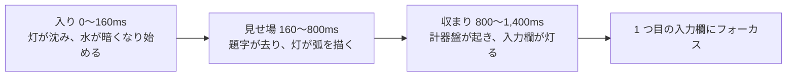

# 演出計画書: 深海の探査日誌の「潜る」

> **3 行でわかる要約**
> 1. 架空の個人開発アプリ「深海の探査日誌」で、海面（タイトル）から計器盤（ログイン）へ移る見せ場「潜る」の演出計画書です。数値はすべて架空です。
> 2. 初回は 1,400ms、2 回目以降は 600ms です。共有要素は灯で、スタートのボタンの光が計器盤の電源の灯になります。
> 3. フロントエンドは時刻ごとの表とトークンのとおりに作り、100ms ごとのフレームを撮って監修に出してください。

| 項目 | 内容 |
|---|---|
| 画面の型 | 没入の型 |
| 演出 ID | `scene-start-login` |
| 区分 | 見せ場 |
| 場面 | 海面（タイトル）から計器盤（ログイン）へ |
| 長さ | 初回 1,400ms、2 回目以降 600ms |
| 共有要素 | 灯。スタートのボタンの光が、計器盤の電源の灯になる |
| 動きの語彙 | 潜る（世界が上へ流れる） |
| デザイン計画書 | `design-plan-dive-log.md` |

世界は上へ流れ、どのレイヤーも同じ向きに動きます。題字も上へ去り、計器盤だけが下から上がって迎えるので、潜る向きが 1 つにそろいます。

## 用語

この文書で繰り返し使う語の意味です。決まりの本文は、`skills/designer/references/systems.md` の 4 節にあります。

| 用語 | 意味 |
|---|---|
| 没入の型 | 個人開発の画面の型。世界観と、場面をつなぐ演出を先に決める |
| 見せ場 | 世界に入る場面や節目で使う、長めの演出。ここでは「潜る」 |
| 演出計画書 | 見せ場を、時刻ごとの表と守りの表とトークンで書いた文書。この文書のこと |
| 共有要素 | 前の場面から次の場面まで、消えずに付いて来る 1 つの部品。ここでは灯 |
| 段 | 見せ場の中の区切り。入り・見せ場・収まりの 3 つ。段の「見せ場」は、区分の見せ場の中の山の部分を指す |
| レイヤー | 奥行の層。奥の水から手前の灯まで、違う時刻と速さで動く |
| フレーム | 動きを 100ms ごとに止めて撮った 1 枚。監修で計画と見比べる |

## 全体像

見せ場は、入り・見せ場・収まりの 3 つの段で進みます。灯が 3 つの段を通して動き、海面の場面と計器盤の場面をつなぎます。

図の読み方: 左から右へ、段の順に読みます。箱の字は段の時刻と、その間に起きる主な動きです。

## レイヤー

レイヤーは奥から手前へ 5 つで、水とマリンスノーは canvas 1 枚に描きます。文字と入力は DOM に置くので、演出が重くても字は読めて、入力欄には打てます。canvas は画面の半分の解像度で描き、粒はわずかにやわらかくなります。全画素で描くと、CPU が 4 倍遅い条件では、押した直後のフレームが 50ms を超えたからです。

| レイヤー | 奥行 | 対象 | 作り方 |
|---|---|---|---|
| 水 | 奥 | 背景の水と、上から差す光の帯 | canvas 1 枚。画面の半分の解像度で描き、画面いっぱいに引き伸ばす |
| マリンスノー | 奥と中のあいだ | 上へ流れる白い粒子。深さと潜る速さを伝える | 水と同じ canvas |
| 題字 | 中 | 海面の題字「深海の探査日誌」 | DOM |
| 計器盤 | 手前 | ログインの枠、入力欄 2 つ、「乗船する」 | DOM |
| 灯 | いちばん手前 | スタートのボタンの光。計器盤の電源の灯になる | DOM の 1 要素 |

## 時刻ごとの表

押した時刻を 0ms とし、動きを始まりの順に 1 行ずつ書きます。長さと曲線は、トークンの表の値だけを使います。

| 時刻 | 段 | レイヤーと対象 | 変化 | 長さと曲線 | 伝えること |
|---|---|---|---|---|---|
| 0ms | 入り | 灯（スタートの札） | 0.96 倍に沈み、周りの光が灯に集まる | 120ms、標準 | 押せた |
| 120ms | 入り | 水（背景） | 明るい帯が上へ動き始め、全体が暗くなる | 880ms、標準 | 沈み始めた |
| 160ms | 見せ場 | マリンスノー | 上へ流れる速さが、1 倍から 3 倍になる | 640ms、去る | 潜る速さ |
| 200ms | 見せ場 | 題字 | 上へ 120px 流れ、薄れて 8px ぼける | 400ms、去る | 海面を離れた |
| 200ms | 見せ場 | 灯 | スタートの札の左端から計器盤の左上へ、弧を描いて動く | 700ms、標準 | 同じ灯が、次の場面まで付いて来る |
| 800ms | 収まり | 水とマリンスノー | 速さが 3 倍から 0.5 倍に落ちる | 400ms、着く | 着いた |
| 900ms | 収まり | 計器盤 | 下から 48px 上がり、6px 行き過ぎて戻る | 400ms、収まる | 計器盤が起きた |
| 1,100ms | 収まり | 計器盤の入力欄 2 つと「乗船する」 | 60ms ずつずれて灯る | 各 180ms、着く | 入力の順 |
| 1,400ms | 収まり | 計器盤の 1 つ目の入力欄 | フォーカスが入り、すぐ打てる | 0ms | 次の操作 |

灯の弧をまっすぐにしないのは、まっすぐだと差し替えに見え、同じ灯だと読めないからです。弧の点は道のりの長さで等間隔に拾い、曲線は弧の全体に掛けます。行き過ぎて戻る「収まる」は、計器盤の 1 か所だけに使います。

## 守りの表

代わりの版と手段は、演出ごとに必ず書きます。上の 5 行が見せ場の条件で、下の 3 行は没入の型で足した守りです。

| 条件 | 版と手段 |
|---|---|
| 動きを減らす設定 | 位置と大きさは動かさない。150ms の溶け込みで計器盤に替え、フォーカスは同じ入力欄に入れる。マリンスノーは止める |
| 飛ばす手段 | 途中でどのキーを押しても、300ms 以内に最後の状態へ進む。先に打った字は、1 つ目の入力欄に入る |
| 2 回目以降 | 同じ利用の中では、600ms の短い版にする。題字の退場と、計器盤の収まりだけを残す。題字の退場は 0〜200ms にして、盤の地（200〜300ms）と重ねない。背景は位置を動かさずに、600ms で深い水へ溶け込む |
| アセットが間に合わないとき | 押してから 100ms 以内に、灯だけは必ず動く。canvas を描けないときは、短い版に替える。canvas の代わりに、深海の色の地の板の不透明度を、水と同じ時刻で上げる |
| 終わりのフォーカス | 1 つ目の入力欄。読み上げには「ログイン」の題を伝える |
| 5 秒を超える動き | マリンスノーは場面のあとも流れ続けるので、画面の隅に「動きを止める」を置く |
| 点滅 | 明るさの大きな切り替わりは 0 回。上限は 1 秒に 3 回 |
| 音 | 最初の版は音なし。入れるときは、消音の操作を常に画面に置く |

## 戻るの入れ替えの順

計器盤から海面へ戻る動きは見せ場ではなく、区分は移動で、長さは 400ms です。この節には、2 つの場面の入れ替えの順を書きます。盤の層が去りきるまで、海面の層は出ないので、2 つの場面の字は重なりません。灯と水は、その間も途切れずに動きます。

前の版は、2 つの場面を同じ 400ms で同時に溶け合わせていました。そのため 100〜200ms のフレームで、薄れる盤の字と、現れる題字が重なりました（2 回目の監修の指摘 N1）。

| 時刻 | 対象 | 変化 | 長さと曲線 | 不透明度 | 伝えること |
|---|---|---|---|---|---|
| 0ms | 灯 | 電源ランプからスタートの札の左端へ動く。今の版のまま | 400ms、標準（`--duration-move`） | 1 のまま | 同じ灯が海面へ帰る |
| 0ms | 水とマリンスノー | 深い所の水から海面の水へ溶け込む。位置は動かさない | 400ms、標準（`--duration-move`） | 2 つの水を混ぜ、地は 1 のまま | 浅い所へ戻った |
| 0ms | 計器盤の層（枠、題、ラベル、入力欄と入力した字、乗船する、受付中の字） | 薄れて消える。位置は動かさない | 200ms、去る（`--duration-move` の半分） | 1 から 0。100ms で 0.85（曲線の計算値） | 計器盤を離れた |
| 200ms | 海面の層（題字、説明、スタートの札とその字） | 現れる。位置は動かさない | 200ms、着く（`--duration-move` の半分） | 0 から 1。300ms で 0.95（曲線の計算値） | 海面に着いた |
| 400ms | 灯とスタートの札 | 灯が札の左端に着き、海面の画面が止まる | 0ms | 1 | 戻りきった |

半分の 200ms は、新しいトークンを作らずに `calc(var(--duration-move) / 2)` で書きます。全体の長さを変えても、入れ替えの境は真ん中に付いて来ます。

次の表は、戻るに付ける守りと、確かめ方です。

| 条件 | 版と手段 |
|---|---|
| 字を重ねない | 2 つの場面の字を、同じフレームに出さない。0〜200ms に見える字は盤の字だけで、200〜400ms は海面の字だけにする。200ms のフレームは、水と灯だけになる |
| 水を消さない | 水とマリンスノーは、盤や題字と一緒に薄れさせない。どのフレームにも水が映り、黒い地や空のフレームを出さない |
| 動きを減らす設定 | 長さは 150ms（`--duration-scene-reduced`）。盤の層は 0〜75ms で 1 から 0、海面の層は 75〜150ms で 0 から 1、曲線は標準。75ms は `calc(var(--duration-scene-reduced) / 2)`。灯は位置を動かさず、盤と一緒に消え、札と一緒に灯る。水は位置を動かさずに 150ms で溶け込む |
| 明るさ | 上の帯の明るさは 1 回上がるだけで、下がり返さない（WCAG 2.2 の 2.3.1） |
| 確かめ方 | フロントエンドが 0〜400ms を 100ms ごとに撮る。100ms のフレームに題字の画素が 0、300ms のフレームに盤の字の画素が 0 で合格。縮小版は 0・50・100・150ms を撮り、50ms に題字、100ms に盤の字の画素が無いことを見る |

## トークン

時刻ごとの表の長さと曲線を、トークンの名前と値で持ちます。フロントエンドは、この名前と値のまま tokens.css に写します。

| トークン | 値 | 使う所 |
|---|---|---|
| `--duration-2` | `120ms` | 灯が沈む。応答の 120ms と同じ値 |
| `--duration-3` | `180ms` | 入力欄と「乗船する」が灯る |
| `--duration-move` | `400ms` | 題字の退場、水とマリンスノーの減速、計器盤の収まり、戻る（半分の 200ms で層を入れ替える） |
| `--dive-snow` | `640ms` | マリンスノーの加速 |
| `--dive-light-arc` | `700ms` | 灯の弧 |
| `--dive-water` | `880ms` | 水の帯と暗さ |
| `--stagger` | `60ms` | 入力欄と「乗船する」のずれ |
| `--duration-scene` | `1400ms` | 初回の全体 |
| `--duration-scene-repeat` | `600ms` | 2 回目以降の短い版 |
| `--duration-scene-reduced` | `150ms` | 動きを減らす設定の溶け込み。戻るの縮小版も同じ長さ（半分の 75ms で層を入れ替える） |
| `--ease-standard` | `cubic-bezier(0.2, 0, 0, 1)` | 標準 |
| `--ease-leave` | `cubic-bezier(0.3, 0, 0.8, 0.15)` | 去る |
| `--ease-arrive` | `cubic-bezier(0.05, 0.7, 0.1, 1)` | 着く |
| `--ease-settle` | `cubic-bezier(0.34, 1.56, 0.64, 1)` | 収まる。計器盤の 1 か所だけ |

## 5 つの条件の確かめ

見せ場の 5 つの条件は、次の表のとおりに満たします。機械の検査は `motion-plan-check.sh` で、表の値を読んで同じことを確かめます。

| 条件 | この演出 |
|---|---|
| 段が 3 つ | 入りが 2 行、見せ場が 3 行、収まりが 4 行 |
| レイヤーが 3 つ以上 | 水、マリンスノー、題字、計器盤、灯の 5 つが、違う時刻と長さで動く。同時に動くのは最大 4 つ |
| 共有要素が 1 つ | 灯。0ms の入りと 200ms の見せ場の 2 行で動く |
| 動きが重なる | 水が暗くなる間に、マリンスノーと題字と灯が動き始める |
| 守りが 5 行 | 守りの表の上の 5 行 |

## 引き渡し

フロントエンドは、時刻ごとの表を拍の台帳に写し、同じ表でフレームを撮ります。監修では、100ms ごとのフレームを計画と比べ、差をフレームと値で書きます。

| 渡す先 | 渡すもの | 受け取る側の確認 |
|---|---|---|
| フロントエンド | 時刻ごとの表、守りの表、トークン | トークンの名前のまま tokens.css に写す。`fidelity-check.sh` に `--motion` でこの文書を渡して PASS |
| デザイナー（監修） | 100ms ごとのフレームの一覧（初回、2 回目、動きを減らす設定、飛ばしたとき、戻る、戻るの縮小版、アセットが間に合わないとき） | 時刻ごとの表と見比べ、監修記録のフレームの所見に書く |

## 未確定

次の 3 つは、最初のサンプルを見てから決めます。決まったら、この文書とデザイン計画書の両方を直します。

| # | 決まっていないこと | 決め方 |
|---|---|---|
| 1 | 曲線 4 つの値。収まるは 3 点のキーフレーム（48、-6、0px。区間の曲線は着くと標準）で描く。2026-11-26 の監修で、1,100ms のフレームの行き過ぎ 6px を確かめた。灯の弧の曲線は、弧を道のりの長さで拾い直したフレームを見て決め直す（監修記録の指摘 12） | 拾い直したフレームでは、灯は 300〜400ms に題字の左寄りを下から上へ横切り（そのときの題字の不透明度は 0.96〜0.85）、題字が消える 600ms には弧の 9 割に来る。押した灯がすぐ付いて来ることを優先し、標準のままにした。依頼者がサンプルを見て、灯が字を横切るのを嫌うなら去るに替える（灯は 500ms まで札の近くに留まり、題字が消えてから動く） |
| 2 | 初回の 1,400ms と、2 回目の 600ms | 依頼者が動くサンプルを見て決める |
| 3 | 遅い PC でのフレーム落ち | フロントエンドが CPU を 4 倍遅くして測る。落ちたら短い版に替える |
