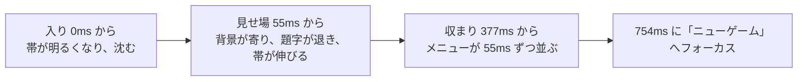

# 演出計画書: 起動からメニューへの「帯が開く」

> **3 行でわかる要約**
> 1. 架空のゲームで、タイトル（起動の画面）からメニューへ移る見せ場「帯が開く」の演出計画書です。数値はすべて架空とします。
> 2. 初回は 754ms、2 回目以降は 377ms です。共有要素は「PRESS START」の帯で、タイトルからメニューまで付いて来ます。
> 3. フロントエンドは時刻ごとの表とトークンのとおりに作り、100ms ごとのフレームを撮って監修に出してください。

| 項目 | 内容 |
|---|---|
| 画面の型 | 没入の型 |
| 演出 ID | `scene-title-menu` |
| 区分 | 見せ場 |
| 場面 | タイトル（起動の画面）からメニューへ |
| 長さ | 初回 754ms、2 回目以降 377ms |
| 共有要素 | 「PRESS START」の帯。タイトルで押す合図の帯が、横に伸びてメニューの選択の帯になる |
| 動きの語彙 | 開く（帯が伸びて、選べる物が並ぶ） |
| デザイン計画書 | この完成例には無い。数列で組む演出計画書の形を示す 1 本 |
| トークン | `tokens-title-menu.css`（この文書のトークンの表と同じ名前と値） |

「PRESS START」は、タイトルの画面で押して始める合図の帯です。押すと帯が横に伸び、そのままメニューの選択の帯になります。題字は上へ退き、メニューは左から寄るので、全部が同じ向きに出る既定を避けられます。

## 用語

この文書で繰り返し使う語の意味です。決まりの本文は、`skills/designer/references/systems.md` の 4 節と 7 節にあります。

| 用語 | 意味 |
|---|---|
| 没入の型 | 個人開発の画面の型。世界観と、場面をつなぐ演出を先に決める |
| 見せ場 | 世界に入る場面や節目で使う、長めの演出。ここでは「帯が開く」 |
| 共有要素 | 前の場面から次の場面まで、消えずに付いて来る 1 つの部品。ここでは「PRESS START」の帯 |
| 段 | 見せ場の中の区切り。入り・見せ場・収まりの 3 つ |
| レイヤー | 奥行の層。奥の背景から手前の帯とメニューまで、違う時刻と速さで動く |
| フィボナッチの数列 | 前の 2 つを足して次を作る数の並び。部品ごとの長さとずらしは、この数列の値だけを使う |
| フレーム | 動きを 100ms ごとに止めて撮った 1 枚。監修で計画と見比べる |

## 全体像

見せ場は、入り・見せ場・収まりの 3 つの段で進みます。帯が入りと見せ場を通して動き、タイトルの場面とメニューの場面をつなぎます。

図の読み方: 左から右へ、段の順に読みます。箱の字は段の始まりの時刻と、その間に起きる主な動きです。

## レイヤー

レイヤーは奥から手前へ 3 つです。文字と入力は DOM（ブラウザが組み立てる画面の部品の木）に置くので、演出が重くても字は読めて、キーで選べます。

| レイヤー | 奥行 | 対象 | 作り方 |
|---|---|---|---|
| 背景 | 奥 | タイトルの絵 | DOM の画像 1 枚。transform と opacity だけで動かす |
| 題字 | 中 | ゲームの題名 | DOM |
| 帯とメニュー | 手前 | 「PRESS START」の帯、メニューの 3 項目（ニューゲーム、コンティニュー、設定） | DOM。帯は 1 要素で、伸びて選択の帯になる |

## 時刻ごとの表

押した時刻を 0ms とし、動きを始まりの順に 1 行ずつ書きます。長さとずらしは、トークンの表の値（数列の段）だけを使います。始まりの時刻と合計は足し算で決まるので、数列に当てません（`systems.md` の 7.3 節）。

| 時刻 | 段 | レイヤーと対象 | 変化 | 長さと曲線 | 伝えること |
|---|---|---|---|---|---|
| 0ms | 入り | 帯とメニュー（手前）: 「PRESS START」の帯 | 明るくなり、わずかに沈む | 89ms、標準 | 押せた |
| 55ms | 見せ場 | 背景（奥） | 暗くなり、少し寄る | 610ms、着く | 場面が変わる |
| 89ms | 見せ場 | 題字（中） | 上へ退き、0.618 倍に縮む | 610ms、標準 | 題名は脇へ |
| 144ms | 見せ場 | 帯とメニュー（手前）: 「PRESS START」の帯 | 横に伸び、メニューの選択の帯になる | 377ms、標準 | 押した物が続く |
| 377ms | 収まり | 帯とメニュー（手前）: 「ニューゲーム」 | 左から 13px 寄って現れる | 233ms、着く | 選べる物 1 |
| 432ms | 収まり | 帯とメニュー（手前）: 「コンティニュー」 | 同じ動きを 55ms ずらす | 233ms、着く | 選べる物 2 |
| 487ms | 収まり | 帯とメニュー（手前）: 「設定」 | 同じ動きを 55ms ずらす | 233ms、着く | 選べる物 3 |
| 610ms | 収まり | 帯とメニュー（手前）: 選択の帯 | 1.02 倍まで行き過ぎて戻る | 144ms、収まる | 着いた |
| 754ms | 収まり | 帯とメニュー（手前）: 「ニューゲーム」 | フォーカスが入る | 0ms | 次の操作 |

初回は 754ms で、見せ場の枠（600〜1,400ms）に収まります。754 は数列にありませんが、部品の長さとずらしの足し算で決まる合計なので、そのままにします。行き過ぎて戻る「収まる」は、選択の帯の 1 か所だけに使います。

## 守りの表

代わりの版と手段は、演出ごとに必ず書きます。上の 5 行が見せ場の条件で、下の 3 行は没入の型で足した守りです。

| 条件 | 版と手段 |
|---|---|
| 動きを減らす設定 | 位置と大きさは動かさない。144ms の溶け込みでメニューに替え、フォーカスは「ニューゲーム」に入れる。終わりの状態は初回と同じ |
| 飛ばす手段 | 途中でどのキーを押しても、どこを押しても、すぐ最後の状態へ進む。飛ばすために押したキーでは、メニューの項目を選ばない |
| 2 回目以降 | 同じ利用の中では、377ms の短い版にする。題字の退きと帯の伸びだけを残し、メニューの 3 項目はずらさずに 233ms で現れる |
| アセットが間に合わないとき | 押してから 100ms 以内に、「PRESS START」の帯だけは必ず動く。背景の絵が読めていないときは、地の色のまま短い版に替える |
| 終わりのフォーカス | 「ニューゲーム」。読み上げには「メニュー」の題を伝える |
| 5 秒を超える動き | 無い。背景はメニューが出たあと静止する |
| 点滅 | 明るさの大きな切り替わりは 0 回。上限は 1 秒に 3 回 |
| 音 | 最初の版は音なし。入れるときは、消音の操作を常に画面に置く |

## トークン

時刻ごとの表の長さと曲線を、トークンの名前と値で持ちます。長さとずらしは、全部フィボナッチの数列の値です。フロントエンドは、この名前と値のまま tokens.css に写します（完成例は `tokens-title-menu.css`）。

| トークン | 値 | 使う所 |
|---|---|---|
| `--duration-89` | `89ms` | 帯が明るくなり、沈む（入り） |
| `--duration-144` | `144ms` | 選択の帯の収まり |
| `--duration-233` | `233ms` | メニューの 3 項目が現れる |
| `--duration-377` | `377ms` | 帯が伸びて、選択の帯になる |
| `--duration-610` | `610ms` | 背景が暗くなり寄る。題字が退く |
| `--stagger` | `55ms` | メニューの 3 項目のずらし |
| `--duration-scene-repeat` | `377ms` | 2 回目以降の短い版 |
| `--duration-scene-reduced` | `144ms` | 動きを減らす設定の溶け込み |
| `--ease-standard` | `cubic-bezier(0.2, 0, 0, 1)` | 標準 |
| `--ease-leave` | `cubic-bezier(0.3, 0, 0.8, 0.15)` | 去る。この見せ場の初回では使わず、4 つをそろえて持つ |
| `--ease-arrive` | `cubic-bezier(0.05, 0.7, 0.1, 1)` | 着く |
| `--ease-settle` | `cubic-bezier(0.34, 1.56, 0.64, 1)` | 収まる。選択の帯の 1 か所だけ |

## 5 つの条件の確かめ

見せ場の 5 つの条件は、次の表のとおりに満たします。機械の検査は `motion-plan-check.sh` で、表の値を読んで同じことを確かめます。

| 条件 | この演出 |
|---|---|
| 段が 3 つ | 入りが 1 行、見せ場が 3 行、収まりが 5 行 |
| レイヤーが 3 つ以上 | 背景、題字、帯とメニューの 3 つが、違う時刻と長さで動く。同時に動くのは最大 3 つ |
| 共有要素が 1 つ | 「PRESS START」の帯。0ms の入りと 144ms の見せ場の 2 行で動き、選択の帯として収まる |
| 動きが重なる | 背景が暗くなる間に、題字と帯が動き始める |
| 守りが 5 行 | 守りの表の上の 5 行 |

## 引き渡し

フロントエンドは、時刻ごとの表を拍の台帳に写し、同じ表でフレームを撮ります。監修では、100ms ごとのフレームを計画と比べ、差をフレームと値で書きます。

| 渡す先 | 渡すもの | 受け取る側の確認 |
|---|---|---|
| フロントエンド | 時刻ごとの表、守りの表、トークン | トークンの名前のまま tokens.css に写す。`fib-check.sh` と、`fidelity-check.sh` に `--motion` でこの文書を渡して PASS |
| デザイナー（監修） | 100ms ごとのフレームの一覧（初回、2 回目、動きを減らす設定、飛ばしたとき、アセットが間に合わないとき） | 時刻ごとの表と見比べ、監修記録のフレームの所見に書く |

## 未確定

次の 3 つは、最初のサンプルを見てから決めます。決まったら、この文書とトークンの両方を直します。

| # | 決まっていないこと | 決め方 |
|---|---|---|
| 1 | 曲線 4 つの値と、題字の縮む倍率（0.618 倍） | 依頼者が動くサンプルを見て決める |
| 2 | 初回の 754ms と、2 回目の 377ms | 依頼者が動くサンプルを見て決める。部品の長さは数列の段の中で替える |
| 3 | 遅い PC でのフレーム落ち | フロントエンドが CPU を 4 倍遅くして測る。落ちたら短い版に替える |
