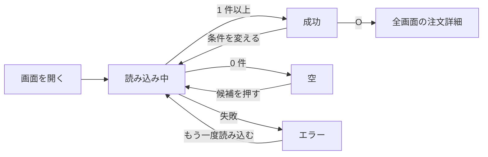

# 画面仕様: 管理画面の注文一覧と注文詳細

> **3 行でわかる要約**
> 1. デザイン計画書「管理画面の注文一覧」を受けて書いた、2 画面の画面仕様です。要素・5 状態・操作と遷移・エラー表示・5 人での分け方・狭い幅・権限を決めます。数値は架空とします。
> 2. 要素は 13 個、エラーは 8 コード、権限は 2 役割です。5 状態のどれにも次に押せる操作があり、エラーは「何が起きたか」と「どうすればよいか」の 2 文で出します。
> 3. フロントエンドは、要素表と 5 状態表のとおりに作ってください。バックエンドは、エラーコードの表を契約と 1 対 1 で結んでください。

| 項目 | 内容 |
|---|---|
| 作成日 | 2026-11-06 |
| 改訂日 | 2026-11-07 |
| 状態 | 承認待ち（デザイン計画書と一緒に伺う） |
| 入力 | デザイン計画書「管理画面の注文一覧」（`design-plan-order-list.md`） |
| 画面の仕事 | 未出荷の注文を、今日中に漏れなく出荷指示にすること |

## 要素

注文一覧に置く要素は、朝の用事に要る 13 個だけです。一括操作の帯は選んだときだけ出し、ふだんは表の縦を空けます。画面に出す文言では、数字と助数詞や月日を詰めて書きます（`24件`、`11月6日`）。この仕様書の地の文は、文書の決まりで空白を入れます。注文を取り消す操作は、一括操作の帯でも伝票でも「取り消し」と書きます。直前の一括操作を戻す通知の操作は「元に戻す」と書き、2 つの操作に同じ語を使いません。

| 要素 | 役割 | 初期値 | 備考 |
|---|---|---|---|
| 上の帯 | 店の中の画面を行き来する | 注文 | 高さ 44px で固定しない。店の名前、字だけの項目 7 つ（問い合わせは未読の件数つき）、利用者の名前とヘルプを 1 段に並べる。今いる項目は太字にし、下の端に墨の 4px の線を引く。幅 1,023px 以下は項目と利用者を畳み、「メニュー」のボタン（Ctrl+B）で開く |
| 保存ビューのタブ | 朝の用事ごとの条件を 1 押しで呼ぶ | 今日出荷（出荷予定が今日までの注文。前の日からの積み残しを含む。出荷指示した行は、直後の群と済の群として下に残る） | 題名の右に 5 つまで。タブ（ビューを切り替える見出しの部品）は名前と件数で、帳簿の紙面の上の縁に差した付箋の形で、どれも細い枠で囲む。今でないタブは付箋のタブの地で沈める。今のタブは紙面の地と墨の枠と太字にし、上の端に墨の 4px の線を引いて紙面とつなげる。条件・並び順・列・まとめ方（状態ごとか担当ごとか）は URL に残る |
| 絞り込みと検索の帯 | 状態、担当、配送、支払いで絞り、/ で検索 | 保存ビューの条件 | 条件は選ぶと即座に再検索。検索語は Enter か 300ms の停止で確定。検索欄とチップ（項目名と今の値を書いた選択の部品）は、箱にせず下線だけの記入欄にする。表の面が 892px 未満では、配送と支払いのチップを「操作」の中に移す。幅 1,280px の表の面は 902px なので、4 つのチップがすべて帯に出る。期間はコマンドパレットと保存ビューの条件で決める |
| 件数 | 何の一覧が何件あるか | 保存ビューのタブの件数 | タブの件数（数字役・太字・墨）は、そのビューの条件に当たり、まだ済でない注文の数。済の群と、出荷指示の直後の群は数えない。見本の自分の担当は、高木の未出荷の 4 件。決済待ちのタブは出荷予定日を問わない数で、今日出荷の中の決済待ちの群（今日が出荷予定の分だけ）とは範囲が違う。違いは群の見出しに、`今日出荷の分・全体 12件` と字で書く。絞り込むと、当たった件数 `2件` を検索欄の右に出す |
| 表の名前 | 読み上げで、表が何の一覧かを伝える | `今日出荷の注文` | 表の caption を見えない字で置き、画面には説明文を出さない。今日の受注は `今日 09:03` と書くので、日時の説明は要らない。税込みは伝票の明細に書く |
| 表 | 注文を 24 行ずつ見せる | 次にすることの順（要対応、出荷遅れ、出荷可、決済待ち、出荷指示の直後、済）。同じ中は受注の古い順で、直後の群と済の群は出荷指示の新しい順 | 行の数え方、送り、状態の欄、列は、要素表の下の表に分けて書く |
| 群の見出し | 次にすることの順の境と件数 | 要対応・出荷遅れ・出荷可・決済待ち・出荷指示の直後の頭 | 押す対象ではない。高さ 40px、16px の太字。地は群の見出しの色で、下の端に墨の 2px の線を 1 本だけ引く。要対応には「受注の古い順」を添える。列の見出しの下に固定し、送っても今の群が見える |
| 出荷指示の直後 | いま出荷指示した行を、未出荷の群から分ける | 開いている | 出荷指示した行はその場で検印と時刻が付き、この群に移る。次に読み込むと済の群に入る。出荷可の群には未出荷の行だけが残る |
| 済の群 | 出荷指示済みの行をまとめる | 畳んでいる | 他の群と同じ見出しの行が、開閉のボタンを兼ねる（44px）。検印の「済」が群の名前を兼ね、続けて件数と「開く」を並べる。「済」の字を検印の横に重ねて書かない。Enter・Space・押すで開閉する |
| 状態の語と札 | 行ごとの状態 | なし | 全行の状態の列に出す。要対応は墨の塗りの札、出荷遅れは墨の枠に薄い墨の地の札で日数を 16px の太字、出荷可と決済待ちは字だけ。目に入る順は要対応、出荷遅れ、検印。担当の列も空欄にせず、未割り当ては「担当なし」を、罫に墨を混ぜた名前より一段弱い色で書く。どの行の地の上でも 4.5 対 1 を保つ。伝票では 1 回しか出ないので墨で書く |
| 検印 | 出荷指示済みの印（「済」の 1 字） | なし | 状態の列、済の群の見出し、伝票の検印の欄。直径 28px で傾けず、「済」は 14px、横に時刻（14px・墨）。まだ押していない注文の伝票の欄は、罫の色で刷った破線の空の円。朱は押した検印だけ。シグネチャ |
| 伝票 | 開いた 1 件の詳細 | 閉じている | 帳簿の紙面の右に、台紙を 16px 空けて並べる 1 枚の伝票。影は付けず、高さは中身で終わる。Enter で開く。中身は注文詳細の節のとおり |
| 一括操作の帯 | 選んだ件数と 4 つの操作 | 出ていない | 1 件以上選ぶと帳簿の紙面の下の縁に出て、0 件に戻ると隠れる。`3件を選択`、`3件を出荷指示`、担当、印刷、右の端に離して取り消し。帯が出ているあいだ、S・A・P は選んだ行に効き、墨の地の主ボタンは帯の `N件を出荷指示` の 1 つだけになる。ボタンにキーの印は添えない |

表の決めは次のとおりです。

| 項目 | 決めたこと |
|---|---|
| 1 回の行数 | 24 行。数えるのは、まだ出荷指示していない行だけ。済の行は畳んだ済の群の見出しに件数だけを出し、開いたときに足す |
| 次の 24 件 | 表の下の「次へ」（] キー）で開く。送りの起点は最後の行の群・受注日時・番号で、その次に入った注文から続ける。起点は URL に残る |
| 見本の行 | 9 時 52 分の場面で、未出荷の 18 行と直後の 5 行なので 1 回に収まり、「次へ」は出ない。済の 377 件は見出しの件数だけで、開くと新しい順の 6 行を足して 29 行になる |
| 状態の欄 | 全行に語を出す。要対応は墨の塗りの札、出荷遅れは日数の札、出荷可と決済待ちは字、出荷指示済みは検印と押した時刻 |
| 行の字 | どの状態でも墨。例外は一段弱い色の「担当なし」だけ。行の中の太字は、注文番号と、要対応と遅れの札と、検印の「済」だけ |
| 罫 | 列のあいだに縦罫を引き、列の見出しの下に墨の二重罫を引く。ダーク版の縦罫は横の罫線より弱い色にする |
| 列 | 配送と支払いを金額の右に置き、幅が足りなければ右の端から隠す。幅 1,280px では 9 列すべてが並ぶ。隠した列は伝票で読む |
| 金額 | 表では単位を列の見出し `金額（円）` に 1 回だけ書く。伝票では 1 行ずつ `7,480円` と書く |

## 5 状態

5 つの状態のどれにも、次に押せる操作があります。空とエラーのときも行き止まりにせず、条件を変える操作を残します。

| 状態 | 出すもの | 操作 |
|---|---|---|
| 初期 | 保存ビュー「今日出荷」の条件と、空の表の枠。開いた直後に検索を始める | 条件を変える |
| 読み込み中 | 初回は 150ms 待ってから 24 行分のスケルトン（これから出る形を薄い枠で先に描く表示）。条件を変えたときは古い表を薄く残す。2.5 秒を過ぎたら、スケルトンか古い表の上に知らせの 2 文を出し、role=status で 1 回だけ読む。文は「時間がかかっています。このまま待つか、条件を変えてください」。打ち切りの時間は実装計画のデータ取得の節に従い、打ち切ったらエラーの状態へ | 条件を変える |
| 空 | 保存ビューが 0 件なら「今日出荷の注文はありません。」と、条件を 1 つ外した件数の候補（例: 「出荷予定を外す（12 件）」）。絞り込みで 0 件なら「条件に合う注文はありません。絞り込みを緩めてください。」 | 候補を押す、絞り込みを緩める、別の保存ビューへ |
| エラー | 画面上部に 2 文とお問い合わせ番号、「もう一度読み込む」 | もう一度読み込む、別の保存ビューへ |
| 成功 | 件数、表、選んだ行の印。選んだときは一括操作の帯 | 開く、選ぶ、出荷指示、担当、印刷 |

## 操作と遷移

操作は 18 で、計画書のキーの表（1 文字キーの扱いの行を除く）と同じです。ここでは状態か画面が変わるものだけを書きます。

| 操作 | 結果 | 遷移先 |
|---|---|---|
| 行のチェックを押すか Space | 行を選び、地を選択行の色にする。1 件以上なら一括操作の帯を出し、帯の `N件を出荷指示` を墨の地の主ボタンにする。伝票の `この1件を出荷指示` は普通のボタンに戻す。0 件に戻ると帯を隠し、伝票の `この1件を出荷指示` を主ボタンにする。主ボタンは画面にいつも 1 つ | 注文一覧 |
| Enter か行を押す | 伝票に詳細を出す。一覧の焦点は保ち、開いている行を墨の線で囲む（左 6px、上下 2px）。選んだ行の藍の地とは色で分ける | 注文一覧（伝票開） |
| O か注文番号を押す | 全画面の詳細を開く | 注文詳細 |
| S か「出荷指示」 | 選んだ件を出荷指示にし（選んだ行が無ければ伝票の 1 件）、検印を押し、通知を出す。行は次に読み込むまで一覧に残し、検印で済みと分かる。ほかの人が先に押していた行には、その人の検印を付ける | 注文一覧（成功） |
| A か「担当」 | 選んだ件に担当を付ける。名前の一覧は自分が先頭で、次に 4 人、最後に「担当なしに戻す」 | 注文一覧 |
| 保存ビューを押す | 条件を入れ替えて再検索 | 注文一覧（読み込み中） |
| 見出しの行で Enter | 並び順を入れ替えて再検索 | 注文一覧（読み込み中） |
| 済の群の見出しで Enter か Space、または押す | 済の行を開く。もう一度で閉じる。状態で「済」に絞ったときは、開いて出す | 注文一覧 |
| ] か「次へ」 | 次の 24 件を開く。起点は最後の行なので、出荷指示で行が減っても飛ばさない | 注文一覧（読み込み中） |
| Esc | 伝票を閉じる。選択は保つ | 注文一覧 |
| 「取り消し」（キーなし） | 確かめの窓を出す。「取り消す」で、選んだ件（選んだ行が無ければ伝票の 1 件）を取り消す。行は次に読み込むまで残し、状態の欄に `取消済み`（罫）と出す | 確かめの窓、注文一覧 |

取り消しは、1 文字キーを割り当てない唯一の操作です。押すと APG の alertdialog（応答を求める窓）を出します。題は `注文を取り消しますか`、本文は `3件の注文を取り消します。取り消した注文は元に戻せません。` です。ボタンは「やめる」と「取り消す」で、最初の焦点は「やめる」に置きます。Esc は「やめる」と同じで、閉じたら焦点を押したボタンに戻します。

取り消しは、通知の「元に戻す」と Ctrl+Z の対象にしません。戻せないので、確かめの窓を挟みます。逆に、出荷指示の直後なら「元に戻す」で出荷指示を戻し、それから取り消せます。

## エラー表示

一覧のエラーは 6 種類で、注文詳細の 2 種類と合わせて 8 コードです。どれも「何が起きたか」と「どうすればよいか」の 2 文で出します。一括操作の失敗だけは、成功した件数も添えます。エラーコードはバックエンドの契約の表と 1 対 1 で結びます。

| エラーコード | 何が起きたか | どうすればよいか | 追跡番号の表示 | 置き場 |
|---|---|---|---|---|
| ORDER_LIST_UPSTREAM_SLOW | 注文一覧を読み込めませんでした | しばらく待ってから、もう一度読み込んでください | あり | 画面上部 |
| ORDER_LIST_INTERNAL | 問題が発生し、注文一覧を表示できませんでした | お問い合わせ番号を添えて、お問い合わせください | あり | 画面上部 |
| ORDER_SHIP_PARTIAL | N 件のうち M 件を出荷指示にできませんでした | 残った M 件を選び直して、もう一度出荷指示してください | あり | 一括操作の帯の上 |
| ORDER_ALREADY_SHIPPED | N 件のうち M 件は、ほかの担当者が先に出荷指示していました | 先に押した人の検印を付けたので、出荷指示をやり直す必要はありません | なし | 一括操作の帯の上。1 件だけのときは通知 |
| ORDER_CANCEL_NOT_ALLOWED | N 件のうち M 件は出荷指示済みのため、取り消せませんでした | 出荷指示の直後なら、通知の「元に戻す」で戻してから取り消してください | なし | 一括操作の帯の上。1 件だけのときは伝票の操作の上 |
| OFFLINE（端末がオフライン） | インターネットに接続できません | 接続を確かめてから、もう一度読み込んでください | なし | 画面上部 |

追跡番号は画面では「お問い合わせ番号」と表示し、「あり」の行で 2 文の下に出します。N と M には実際の件数が入ります。ORDER_ALREADY_SHIPPED が 1 件だけのときは、1 文目を次の文にします。「この注文は、ほかの担当者が先に出荷指示していました」2 文目は件数によらず同じ文です。ORDER_CANCEL_NOT_ALLOWED が 1 件だけのときは、1 文目を次の文にします。「この注文は出荷指示済みのため、取り消せません」ほかの件の取り消しは、そのまま行います。ORDER_SHIP_PARTIAL と同時に起きたときは、2 つのエラーの 2 文を上下に並べます。

## 5 人で分ける

運営担当者 5 人は、同じ今日出荷を分けて片付けます。割り振りは担当の列で見せ、重なりは先に押した人の検印で知らせます。ほかの人の出荷指示は、30 秒ごとの確かめと出荷指示の応答の、早いほうで知ります。

| 場面 | 画面の見え方 |
|---|---|
| 割り振る | 帯のチップで配送か状態を絞り、行をまとめて選んで A で担当を付ける。担当の列に名字が出る |
| 自分の分を片付ける | 保存ビュー「自分の担当」（キー 2）で自分の行だけを出す。タブの件数が自分の残り |
| 全員の残りを見る | 保存ビューのまとめ方を「担当ごと」にすると、群が担当の名前で分かれ、群の見出しに人ごとの件数が出る |
| 担当の無い行 | どの群の行も「担当なし」と出す。誰が出荷指示してもよい |
| 30 秒ごとに確かめる | 画面に出ている間は 30 秒ごとに、タブに戻ったときはすぐに、ほかの人が済にした行を確かめる。行は動かさず、状態の欄にその人の検印を重ねる。群と件数は次に読み込むまで変えない。確かめに失敗しても画面には出さず、次の 30 秒で確かめ直す |
| 確かめで済を見つけた行 | 選んでいた行なら選択から外し、帯の上に ORDER_ALREADY_SHIPPED の 2 文を出す。選択が 0 件になっても、帯は文を出したまま次の操作まで残す。焦点の行なら、検印の名前を 1 回読む |
| ほかの人が先に押した | 出荷指示の応答で ORDER_ALREADY_SHIPPED を受け、その行に先に押した人の検印を付ける。検印に焦点を当てると、押した人と時刻が出る |
| 読み込み直す | ほかの人が出荷指示した行は、次に読み込むと済の群に移る |

割り振りの単位（配送会社ごとか、件数で等分か）は運営チームが選びます。どちらを選んでも、画面の操作は上の表のまま変わりません。

## 状態の流れ

画面を開くと読み込み中から始まり、結果によって成功、空、エラーに分かれます。空とエラーは行き止まりにならず、1 回の操作で読み込み中に戻れます。



図の読み方: 矢印の文字がきっかけです。成功からは一覧に留まる操作（選ぶ、出荷指示、伝票）が続き、図では省いています。

## 狭い幅

幅 1,280px 未満の見た目は、計画書のレイアウトの節に 640px と 320px の図があります。ここでは、幅ごとに変わる操作と並びを書きます。幅 412px は 320px と同じ見え方です。

| 幅 | 変わること |
|---|---|
| 1,280px 未満 | 伝票は表の下に回る。Enter で開くと焦点は行に残り、Tab の次の止まり先が伝票の見出しになる |
| 1,023px 以下 | 上の帯の項目と利用者を畳み、「メニュー」で開いて Esc で閉じる |
| 640px 以下 | 絞り込みの帯は固定をやめて折り返す。列の見出しと群の見出しだけを固定する。一括操作の帯は入らなければ 2 段にする |
| 表の面が 544px 未満 | 表は 1 件 2 段の一覧になる。上の段に注文番号と状態、下の段に氏名と金額。1 件の高さは 64px で、全体が押せる領域 |

2 段の一覧の 1 件は、次の形です。左の 44px がチェックの列で、2 段の高さいっぱいに広がります。

```text
□ 582473            ▲住所不備
  北川 修               8,663
```

担当、配送、支払い、受注日時は、2 段の一覧には出さず伝票で読みます。行と列の名前は読み上げで保ち、表を一覧に変えても「注文番号」「状態」の見出しの名前で読まれるようにします。

## 注文詳細

注文詳細は、伝票と全画面の 2 つの見え方を持ちますが、要素と状態は同じです。伝票は一覧の文脈を保ち、全画面は印刷と長い履歴のためにあります。

| 要素 | 役割 | 備考 |
|---|---|---|
| 見出し | 注文番号と閉じるボタン | 上の端に墨の 4px の線。下に 2px の切り取りの点線を引いて本文と区切る（ダーク版は入力枠の濃さ）。注文番号は等幅で、見出しと同じ 16px。Ctrl+C（Mac は Cmd+C）で番号だけ写す |
| 状態 | 開いている注文の状態と検印の欄 | 見出しの下の 1 行目に、16px の太字で状態だけを置く。右に検印の欄（12px の太字の「検印」と直径 40px の円）。まだ押していない注文は、罫の色で刷った破線の空の円。読み上げは「まだ押していない」。押した注文は欄に検印が入る |
| 概要の行 | 受注日時、担当 | 14px・墨（本文と同じ）。担当が無ければ「担当なし」も墨で書く |
| 宛先 | 氏名、郵便番号、住所 | 欄の見出し（宛先、お届けの希望、明細、配送と支払い、過去の注文、履歴）は、帯を敷かず 14px の太字・墨の字だけで書く。欄は升で囲まず、上の端の罫線で区切る。住所の不備は ▲ と太字で、欠けている所を書く |
| お届けの希望 | 日時の指定と置き配の可否 | 1 つの欄にして太字で書き、出荷のときに見落とさない |
| 明細 | 商品、数量、金額、手数料、合計 | 1 行ずつ罫線で区切り、金額は等幅数字で右ぞろえにし、1 行ずつ円を付ける（`7,480円`）。合計の行は `合計（税込み）` で、上に墨の二重罫を引いて締める。軽減税率（8%）の商品だけ、商品名と数量の間に `（8%）` を添える（例: `蜂蜜 300g（8%）× 2`）。10% の商品には何も添えない |
| 配送と支払い | 配送会社、出荷予定日、支払い方法、荷物の大きさ | 出荷予定日は E でその場で直す。2 行目に荷物の大きさと割れ物の指定を太字で書く（例: `100サイズ・割れ物の指定`）。決済の失敗は ▲決済失敗 の太字と理由 |
| 過去の注文 | 同じ宛先の前の注文 | 新しい順に 2 件まで。日付、注文番号、金額（円つき）を数字役で 1 行に並べる |
| 履歴 | 受注、在庫の引き当て、メールの送信、決済、担当の割り当て、出荷指示を時刻順に | 伝票では直近 5 件。14px の墨で、時刻は数字役（同じ墨）。代引きの注文は、決済の行が届けたあとに付く |
| 操作 | 出荷指示、担当、印刷、取り消し | 2 段に組む。1 段目は出荷指示を幅いっぱいに、2 段目に担当と印刷、右の端に離して取り消し（墨の字の普通のボタン）。1 段目の `この1件を出荷指示` は、選んだ行が 0 件のときだけ墨の地の主ボタンにする。行を選んでいるあいだは普通のボタンで、主ボタンは帯の `N件を出荷指示` に移る。効く件数は語で分ける。キーの印は添えない |

注文詳細のエラーは 2 種類です。他人の注文や権限のない注文も「見つかりません」で扱い、存在を教えません。

| エラーコード | 何が起きたか | どうすればよいか | 追跡番号の表示 |
|---|---|---|---|
| ORDER_NOT_FOUND | この注文は見つかりませんでした | 注文番号を確かめて、一覧から開き直してください | なし |
| ORDER_DETAIL_UPSTREAM_SLOW | この注文を読み込めませんでした | 一覧に戻って、もう一度開いてください | あり |

## アクセシビリティ点検（振る舞い側）

見た目側の 10 項目は計画書にあります。ここでは振る舞いで決まる項目を書きます。

| # | 項目 | この画面で決めたこと | 確認方法 |
|---|---|---|---|
| 1 | キーボード操作 | 18 操作すべてにキー。J と K、Enter、Space、S で 12 件の出荷指示が 1 回終わる | マウスなしで 12 件を出荷指示する |
| 2 | ラベルと読み上げ | 行は「584205、出荷可、松本 清、12,022 円」と読む。出荷遅れの行の状態は `2日遅れ、出荷予定 11月4日` と読む。検印は `出荷指示済み、11月6日 09:50、高木` | 読み上げソフトで行を読む |
| 3 | ステータスメッセージ（4.1.3） | 通知と当たった件数は role=status で、焦点を移さず読み上げる | 絞り込みのあとに `2件` が読まれる |
| 4 | エラーの識別 | 2 文の型。出荷予定日の入力の誤りは欄の直下 | 過去の日付を入れて表示を見る |
| 5 | 拡大（1.4.4） | 200% で伝票が表の下に回り込み、横スクロールなし | ブラウザで 200% にする |
| 6 | リフロー（1.4.10） | 幅 320px 相当で、表が 1 件 2 段の一覧に変わる | 幅 320px で開く |
| 7 | 見出しと構造 | 画面名が見出し 1。表は見えない caption で名前を持つ。伝票の見出しが見出し 2、伝票の中の欄が見出し 3 | 読み上げの見出し一覧 |
| 8 | 時間切れ（2.2.1） | 通知が消えても「操作の履歴」から戻せる。履歴を残す日数は計画書の未確定 3 で決める | 通知が消えたあとに、操作の履歴から元に戻す |
| 9 | ランドマーク | 上の帯のメニューと保存ビューは名前の違う 2 つの nav、表の面は main、伝票は aside。最初の Tab で「表へ移る」の飛び先が出る | 読み上げのランドマーク一覧 |

## 権限

役割は運営担当者と閲覧者の 2 つです。閲覧者には操作を見せず、API（他のプログラムから呼ぶ窓口）もサーバー側で役割を確かめます。

| 役割 | 見える要素 | 見えない要素 | サーバー側の認可 |
|---|---|---|---|
| 運営担当者 | 全要素 | なし | 注文 API と出荷指示 API を役割で認可 |
| 閲覧者（経理、サポート） | 一覧、伝票、検索、保存ビュー | 出荷指示、担当、取り消し、出荷予定日の編集 | 出荷指示 API と編集 API は 403 を返す |

## 引き渡し

この仕様は 2 つの役割に渡します。エラーコードと権限の表は、バックエンドの契約と突き合わせるために分けて渡します。

| 渡す先 | 渡すもの | 受け取る側の確認 |
|---|---|---|
| フロントエンド | 要素表、5 状態表、操作と遷移、エラー表示、5 人で分ける、狭い幅、点検の 9 項目 | 実装計画の状態の表と 1 対 1 |
| バックエンド | エラーコードの表、権限表 | 契約のエラー表と同じコード、403 の扱い |
