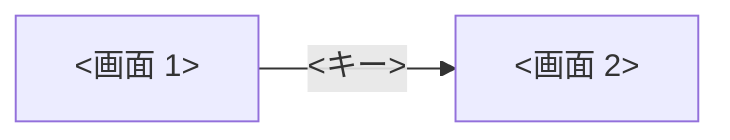

# デザイン計画書: <件名>

> **3 行でわかる要約**
> 1. <どの画面> の見た目を決めた計画書です。数値は <架空／実測> とします。
> 2. 方向は「<方向の名前>」です。<色の土台> に <シグネチャ> を 1 つ置きます。<密度とキーボードの要点>。
> 3. フロントエンドはトークンの表のとおりに作ってください。できたら監修記録の型で、計画との差を機械で確かめます。

色のコントラスト比は `contrast-check.sh` で計算した値です。

## 目的と対象

依頼と利用者の像から対象を写し、画面の仕事を 1 文に決めます。ペルソナ（根拠をもって描いた利用者像）は <n> 体です。

| 項目 | 内容 |
|---|---|
| 依頼 | <依頼者の 1 行> |
| ペルソナ | <誰が、どこで、何をどれだけ> |
| 片付けたい用事 | <〜のとき、〜したい、〜のために> |
| 今の画面の困りごと | <数字つき> |
| 画面の仕事（1 文） | <1 文> |

## 全体像

画面と操作の型の関係を図にします。

図の読み方: <1〜2 文>。

## 方向

見た目の方向を、既定ではなく主題の世界から決めます。

| 項目 | 決めたこと |
|---|---|
| 主題 | <利用者の世界> |
| 方向の名前 | <名前> |
| 素材と語彙 | <主題から取る素材> |
| 取らない方向 | <既定の 3 つの見た目など> |
| 取る危険 1 つ | <危険と、取る理由> |

## 色

名前つきの色は 4〜6 色です。比は `contrast-check.sh` で計算し、文字は 4.5 対 1、部品は 3 対 1 を下限にします。組み合わせは「<色名> で N 対 1」の形で書きます。

| 名前 | 16 進 | 役割と使う場所 | 組み合わせと比 |
|---|---|---|---|
| <名前> | <#RRGGBB> | <地／本文／補助／強調／焦点> | <色名> で <N.NN> 対 1 |

導出する色は式で書き、生の値を増やしません。

| 導出する色 | 16 進 | 式と使う場所 | 組み合わせと比 |
|---|---|---|---|
| <名前> | <#RRGGBB> | color-mix(in srgb, <色> 10%, <色>)。<使う場所> | <色名> で <N.NN> 対 1 |

## 書体

書体は 1 家族 2〜3 役です。12px 未満と太さ 400 未満は使いません。

| 役 | 書体 | 大きさと太さ | 使う場所 | 理由 |
|---|---|---|---|---|
| 本文役 | <書体> | <14px、太さ 400> | <場所> | <理由> |
| 見出し役 | <書体> | <20px と 16px、太さ 700> | <場所> | <理由> |

## レイアウトと密度

配置図と、行高・塊の数・固定する帯を決めます。

| 項目 | 値 | 理由 |
|---|---|---|
| 表の行 | <36px> | <理由> |
| 情報の塊 | <7 つ以内> | <理由> |
| 固定の帯 | <高さ。scroll-padding で焦点を隠さない> | <理由> |

## シグネチャ

記憶に残す要素を 1 つ決め、伝える情報を書きます。

| 項目 | 決めたこと |
|---|---|
| 形 | <形と大きさ> |
| 伝える情報 | <状態・日付・担当など> |
| 描き方 | <CSS だけで。クラス名> |

## 動き

動きは意味のある場面だけ、300ms 未満で、transform と opacity だけを動かします。

| 場面 | 時間と曲線 | 何を伝えるか | 動きを減らす設定のとき | キーボード起点のとき |
|---|---|---|---|---|
| <場面> | <80ms、ease-out> | <伝えること> | <0ms> | <0ms> |

## キーボードと操作の型

主要な用事をマウスなしで終えるキーを決めます。1 文字キーを使うなら、設定でオフにできると書きます（2.1.4）。

| 操作 | キー | マウス | 型の出どころ |
|---|---|---|---|
| <操作> | <キー> | <マウスの操作> | <Linear、APG など> |
| 1 文字キーの扱い | 表に焦点があるときだけ有効。設定でオフにできる | 設定画面 | WCAG 2.2 の 2.1.4 |

## 既定との差（自己批評）

既定に対して言葉で測ります。5 軸と、外した装飾を 1 つ書きます。

| 軸 | 既定 | この計画 | なぜこの依頼に効くか |
|---|---|---|---|
| 色 | <既定> | <この計画> | <10 字以上の理由> |
| 書体 | <既定> | <この計画> | <理由> |
| レイアウト | <既定> | <この計画> | <理由> |
| シグネチャ | <既定> | <この計画> | <理由> |
| 動き | <既定> | <この計画> | <理由> |
| 外した装飾 | なし | <外したもの> | <理由> |

## WCAG 2.2 AA の点検（見た目側）

見た目で決まる達成基準の値と確認方法を書きます。

| 達成基準 | この計画 | 値 | 確認方法 |
|---|---|---|---|
| 1.4.3 コントラスト（最低限） | <全組を計算> | <最小 N 対 1> | `contrast-check.sh` |
| 2.4.7 フォーカスの可視化 | <outline の太さと色> | <見えない要素 0> | <Tab で全要素> |
| 2.4.11 フォーカスの非遮蔽（最低限） | <scroll-padding> | <隠れる要素 0> | <確認> |
| 2.5.8 ターゲットのサイズ（最低限） | <24px。片手なら 44px> | <最小 px> | <DOM の寸法> |

## 引き渡し

| 渡す先 | 渡すもの | 受け取る側の確認 |
|---|---|---|
| フロントエンド | <tokens.css、表> | <生の値が無い> |

## やらないこと

| やらないこと | 理由 |
|---|---|
| <やらないこと> | <理由> |

## 未確定

| # | 決まっていないこと | 決め方 |
|---|---|---|
| 1 | <内容> | <誰がいつ何で> |
