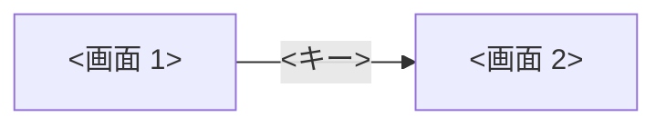
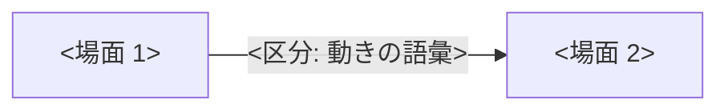

# デザイン計画書: <件名>

> **3 行でわかる要約**
> 1. <どの画面> の見た目を決めた計画書です。画面の型は <没入の型／既存に合わせる型／今の型> で、数値は <架空／実測> とします。
> 2. 方向は「<方向の名前>」です。<色の土台> に <シグネチャ> を 1 つ置きます。<密度とキーボードの要点。没入の型なら見せ場の要点>。
> 3. フロントエンドはトークンの表のとおりに作ってください。できたら監修記録の型で、計画との差を機械で確かめます。

| 項目 | 内容 |
|---|---|
| 画面の型 | <没入の型／既存に合わせる型／今の型>。<材料（commit の作者の数、既存の UI の有無）>。<決めた人と日付> |
| 作成日 | <日付> |
| 状態 | <承認待ち。伺う点> |
| 入力 | <受付票、事業判断メモ> |

画面の型は、受付票の「画面の型」の欄をそのまま写します。デザイナーは型を選び直さず、合わないと見たら未解決の対立として返します。没入の型だけが「方向の 3 案」「世界観の設定」「場面の一覧」の節と、見せ場ごとの演出計画書を持ちます。ほかの型では、その 3 つの節を消します。色のコントラスト比は `contrast-check.sh` で計算した値です。

## 目的と対象

依頼と利用者の像から対象を写し、画面の仕事を 1 文に決めます。ペルソナ（根拠をもって描いた利用者像）は <n> 体です。

| 項目 | 内容 |
|---|---|
| 依頼 | <依頼者の 1 行> |
| ペルソナ | <誰が、どこで、何をどれだけ> |
| 片付けたい用事 | <〜のとき、〜したい、〜のために> |
| 今の画面の困りごと | <数字つき> |
| 画面の仕事（1 文） | <1 文> |

## 全体像

画面と操作の型の関係を図にします。

図の読み方: <1〜2 文>。

## 方向

見た目の方向を、既定ではなく主題の世界から決めます。既存に合わせる型では、方向の名前を「既存に合わせる」とし、既存の値を写して、足す値には 1 行ずつ理由を書きます。

| 項目 | 決めたこと |
|---|---|
| 主題 | <利用者の世界> |
| 方向の名前 | <名前> |
| 素材と語彙 | <主題から取る素材> |
| 取らない方向 | <既定の 3 つの見た目など> |
| 取る危険 1 つ | <危険と、取る理由> |

### 足す値（既存に合わせる型）

既存に合わせる型では、既存の UI の値を `fidelity-check.sh --inventory <既存の UI の置き場>` で表にし、計画書と同じ置き場に残します。その表に無い値を足すときだけ、ここに 1 行ずつ理由を書きます。足さないなら「なし」の 1 行にします。ほかの型では、この節を消します。

| 値 | 種類 | 理由 |
|---|---|---|
| <#RRGGBB か Nms か Npx か書体の名前。足さないなら「なし」> | <色／時間／大きさ／書体> | <既存の値で足りない理由> |

### 方向の 3 案（没入の型）

没入の型では、方向を 3 案、静止画 1 枚ずつで並べ、依頼者が 1 つ選びます。選ばれるまでは、色と書体を決めません。

| 案 | 方向の名前 | 物語の 1 文 | 静止画 | 依頼者の選択 |
|---|---|---|---|---|
| A | <名前> | <利用者は何者として、どこで何をするか> | <置き場> | <選んだ（日付）／選ばない> |
| B | <名前> | <1 文> | <置き場> | <選んだ（日付）／選ばない> |
| C | <名前> | <1 文> | <置き場> | <選んだ（日付）／選ばない> |

### 世界観の設定（没入の型）

選んだ案の世界を、色と書体の前に 10 行で決めます。上の方向の表は、この表で置き換えます。動きの語彙は主題の動詞で書き、技法の名前（フェード、スライド）だけで書きません。

| 項目 | 決めたこと |
|---|---|
| 主題 | <利用者の世界> |
| 方向の名前 | <選んだ案の名前> |
| 物語の 1 文 | <利用者は何者として、どこで何をするか> |
| 感情の流れ | <入り口から目的の場面まで> |
| 素材と光 | <素材、光の向きと強さ> |
| 奥行の層 | <奥から手前へ 3 つ以上。動く物の役目> |
| 動きの語彙 | <主題の動詞と、その中身> |
| 参照と取る所 | <参照と、そこから取るもの> |
| 取らない方向 | <暗い地にネオンの光、ガラスの板、意味の無い粒子、何でも下から浮き上がる動き、ほか> |
| 取る危険 1 つ | <危険と、取る理由> |

## 場面の一覧（没入の型）

画面を場面として並べ、矢印に区分と動きの語彙を書きます。見せ場ごとに、演出計画書を 1 本書きます。

図の読み方: <1〜2 文>。

| 場面 | 画面 | 入る動きの区分 | 動きの語彙 | 演出 ID |
|---|---|---|---|---|
| <場面> | <画面> | <応答／移動／見せ場／環境> | <語彙> | <見せ場なら ID。演出計画書の名前> |

## 色

名前つきの色は 4〜6 色です。比は `contrast-check.sh` で計算し、文字は 4.5 対 1、部品は 3 対 1 を下限にします。組み合わせは「<色名> で N 対 1」の形で書きます。

| 名前 | 16 進 | 役割と使う場所 | 組み合わせと比 |
|---|---|---|---|
| <名前> | <#RRGGBB> | <地／本文／補助／強調／焦点> | <色名> で <N.NN> 対 1 |

導出する色は式で書き、生の値を増やしません。

| 導出する色 | 16 進 | 式と使う場所 | 組み合わせと比 |
|---|---|---|---|
| <名前> | <#RRGGBB> | color-mix(in srgb, <色> 10%, <色>)。<使う場所> | <色名> で <N.NN> 対 1 |

## 書体

書体は 1 家族 2〜3 役です。12px 未満と太さ 400 未満は使いません。没入の型では、場面の題に題字の段（32〜96px）を使えます。

| 役 | 書体 | 大きさと太さ | 使う場所 | 理由 |
|---|---|---|---|---|
| 本文役 | <書体> | <14px、太さ 400> | <場所> | <理由> |
| 見出し役 | <書体> | <20px と 16px、太さ 700> | <場所> | <理由> |

## レイアウトと密度

配置図と、行高・塊の数・固定する帯を決めます。

| 項目 | 値 | 理由 |
|---|---|---|
| 表の行 | <36px> | <理由> |
| 情報の塊 | <7 つ以内> | <理由> |
| 固定の帯 | <高さ。scroll-padding で焦点を隠さない> | <理由> |

## シグネチャ

記憶に残す要素を 1 つ決め、伝える情報を書きます。没入の型では、これとは別に、場面ごとに見せ場を 1 つ置けます。

| 項目 | 決めたこと |
|---|---|
| 形 | <形と大きさ> |
| 伝える情報 | <状態・日付・担当など> |
| 描き方 | <描き方。クラス名> |

## 動き

動きは意味のある場面だけに置きます。今の型と既存に合わせる型では 300ms 未満で、transform と opacity だけを動かします。没入の型では、区分（応答・移動・見せ場・環境）ごとの長さの枠を使います。見せ場の時刻ごとの値は演出計画書に書き、区分の列はほかの型では消してかまいません。

| 区分 | 場面 | 時間と曲線 | 何を伝えるか | 動きを減らす設定のとき | キーボード起点のとき |
|---|---|---|---|---|---|
| <応答／移動／見せ場／環境> | <場面。見せ場なら演出 ID> | <80ms、ease-out。見せ場なら初回と 2 回目から> | <伝えること> | <0ms> | <0ms。見せ場ならキーでも流し、どのキーでも飛ばせる> |

## キーボードと操作の型

主要な用事をマウスなしで終えるキーを決めます。1 文字キーを使うなら、設定でオフにできると書きます（2.1.4）。

| 操作 | キー | マウス | 型の出どころ |
|---|---|---|---|
| <操作> | <キー> | <マウスの操作> | <Linear、APG など> |
| 1 文字キーの扱い | 表に焦点があるときだけ有効。設定でオフにできる | 設定画面 | WCAG 2.2 の 2.1.4 |

## 既定との差（自己批評）

既定に対して言葉で測ります。5 軸と、外した装飾を 1 つ書きます。没入の型では、既定の列に没入の既定（暗い地にネオンの光、ガラスの板、意味の無い粒子、一律の浮き上がり）も並べます。

| 軸 | 既定 | この計画 | なぜこの依頼に効くか |
|---|---|---|---|
| 色 | <既定> | <この計画> | <10 字以上の理由> |
| 書体 | <既定> | <この計画> | <理由> |
| レイアウト | <既定> | <この計画> | <理由> |
| シグネチャ | <既定> | <この計画> | <理由> |
| 動き | <既定> | <この計画> | <理由> |
| 外した装飾 | なし | <外したもの> | <理由> |

## WCAG 2.2 AA の点検（見た目側）

見た目で決まる達成基準の値と確認方法を書きます。没入の型では、下の 3 行（レベル A）も書きます。

| 達成基準 | この計画 | 値 | 確認方法 |
|---|---|---|---|
| 1.4.3 コントラスト（最低限） | <全組を計算> | <最小 N 対 1> | `contrast-check.sh` |
| 2.4.7 フォーカスの可視化 | <outline の太さと色> | <見えない要素 0> | <Tab で全要素> |
| 2.4.11 フォーカスの非遮蔽（最低限） | <scroll-padding> | <隠れる要素 0> | <確認> |
| 2.5.8 ターゲットのサイズ（最低限） | <24px。片手なら 44px> | <最小 px> | <DOM の寸法> |
| 2.2.2 一時停止、停止、非表示（没入の型） | <5 秒を超えて続く動きの止め方> | <止める手段の数> | <5 秒待って止め、前後のフレームを比べる> |
| 2.3.1 3 回の閃光、又は閾値以下（没入の型） | <明るさの大きな切り替わり> | <1 秒に N 回。3 回まで> | <フレームの一覧で明るさを見る> |
| 1.4.2 音声の制御（没入の型で音を入れるとき） | <消音の操作の置き場> | <消音の操作の数> | <操作の前に鳴らないかを見る> |

## 引き渡し

| 渡す先 | 渡すもの | 受け取る側の確認 |
|---|---|---|
| フロントエンド | <tokens.css、表> | <生の値が無い> |
| フロントエンド | <演出計画書（没入の型）> | <時刻ごとの表とトークンのとおりに作り、100ms ごとのフレームを撮る> |

## やらないこと

| やらないこと | 理由 |
|---|---|
| <やらないこと> | <理由> |

## 未確定

| # | 決まっていないこと | 決め方 |
|---|---|---|
| 1 | <内容> | <誰がいつ何で> |
