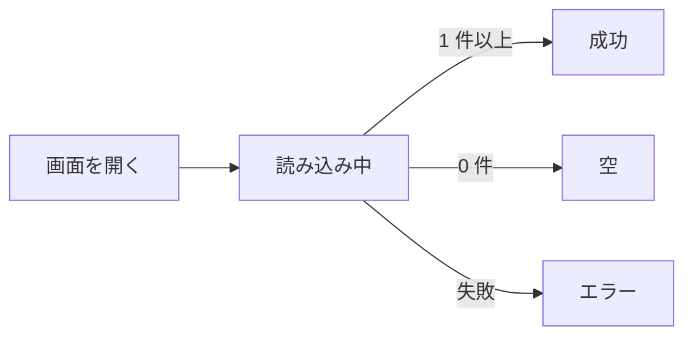

# 画面仕様: <件名>

> **3 行でわかる要約**
> 1. デザイン計画書「<件名>」を受けて書いた、<画面> の画面仕様です。要素・5 状態・操作と遷移・エラー表示・権限を決めます。数値は <架空／実測> とします。
> 2. 5 状態のどれにも次に押せる操作があり、空とエラーでも行き止まりにしません。エラーは 2 文で出します。
> 3. フロントエンドは要素表と 5 状態表のとおりに作り、バックエンドはエラーコードの表を契約と 1 対 1 で結んでください。

## 要素

画面に置く要素と、初期値を決めます。

| 要素 | 役割 | 初期値 | 備考 |
|---|---|---|---|
| <要素> | <役割> | <初期値> | <備考> |

## 5 状態

初期・読み込み中・空・エラー・成功のどれにも、次に押せる操作を置きます。

| 状態 | 出すもの | 操作 |
|---|---|---|
| 初期 | <出すもの> | <操作> |
| 読み込み中 | <150ms 待ってから骨組み> | <中断> |
| 空 | <文と、条件を外す候補> | <操作> |
| エラー | <2 文とお問い合わせ番号> | <もう一度読み込む> |
| 成功 | <出すもの> | <操作> |

## 操作と遷移

画面を移る操作だけを書きます。

| 操作 | 結果 | 遷移先 |
|---|---|---|
| <操作> | <結果> | <遷移先> |

## エラー表示

「何が起きたか」と「どうすればよいか」の 2 文で書き、エラーコードは契約と 1 対 1 で結びます。

| エラーコード | 何が起きたか | どうすればよいか | 追跡番号の表示 | 置き場 |
|---|---|---|---|---|
| <CODE> | <1 文> | <1 文> | <あり／なし> | <置き場> |

## 状態の流れ

状態の移り方を図にします。

図の読み方: <1〜2 文>。

## アクセシビリティ点検（振る舞い側）

見た目側の項目は計画書にあります。振る舞いで決まる項目を書きます。

| # | 項目 | この画面で決めたこと | 確認方法 |
|---|---|---|---|
| 1 | キーボード操作 | <決めたこと> | <確認> |
| 2 | ラベルと読み上げ | <決めたこと> | <確認> |
| 3 | ステータスメッセージ（4.1.3） | <決めたこと> | <確認> |
| 4 | エラーの識別 | <決めたこと> | <確認> |
| 5 | 拡大（1.4.4）とリフロー（1.4.10） | <決めたこと> | <確認> |
| 6 | 時間切れ（2.2.1） | <決めたこと> | <確認> |

## 権限

| 役割 | 見える要素 | 見えない要素 | サーバー側の認可 |
|---|---|---|---|
| <役割> | <要素> | <要素> | <API の認可> |

## 引き渡し

| 渡す先 | 渡すもの | 受け取る側の確認 |
|---|---|---|
| フロントエンド | <表> | <確認> |
| バックエンド | <エラーコードの表、権限表> | <確認> |
