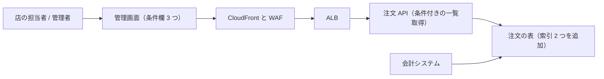

# 仕様書: 注文一覧の絞り込み（orders-admin）

> **3 行でわかる要約**
> 1. 注文一覧に注文番号・期間・状態の絞り込みを足し、注文を探す時間を 30 秒以内にする仕様書です。
> 2. 完成の条件は、9 章の 11 項目が検証環境（stg）で全部通ることです。
> 3. 次にすることは、17 章の確認事項 2 件への依頼者の判断です。

| 項目 | 内容 |
|---|---|
| 状態 | 下書き（見本アプリの文書で、数値は架空。承認の伺いの前） |
| 著者 / 審査者 | 取りまとめ役 / バックエンド役・フロントエンド役・セキュリティ役 |
| 関連 | 要件定義書 `skills/documents/examples/requirements-orders-admin-filter.md`、orders-admin 運用設計書（見本）、注文 API リリース作業手順書（見本） |
| 様式 | 見本アプリに既存の仕様書が無いので、`skills/documents/templates/specification.md` の雛形を使った |
| 版 | 1.0（2026-11-11） |

## 1. 背景と範囲

店の担当者は、問い合わせを受けた注文を一覧から探すのに中央値で 170 秒かかっています。一覧は新しい順に 50 件ずつ送るだけで、条件で絞れないからです。この仕様書の範囲は、管理画面の注文一覧と注文 API の一覧取得、注文の表の索引（列から行を速く探す仕組み）です。商品名の検索・顧客情報の検索・CSV 出力・条件の保存は範囲外で、理由は 3 章に書きます。

## 2. 利用者と場面

利用者は店の担当者 4 人と管理者 1 人で、事務所の回線から管理画面を使います。場面は 2 つで、どちらも「探す」業務です。

| 利用者 | 場面 | いまの困りごと |
|---|---|---|
| 店の担当者 | 電話やチャットで注文番号を聞き、その注文の詳細を開く | 新しい順の一覧を送って目で探す。中央値 170 秒 |
| 管理者 | 10:00 と 16:00 に、当日の状態「受付」（未発送）の注文を一覧で見る | 全件から未発送を目で拾い、見落とす |

## 3. 目標とやらないこと

目標は 2 つの数値です。やらないことは、目標になり得たのに今回は外したもので、理由を添えます。

| 区分 | 内容 | 理由 |
|---|---|---|
| 目標 | 注文 1 件を開くまでの時間の中央値を 30 秒以内にする | 要件定義書の 2 章の指標 |
| 目標 | 条件付きの一覧取得を p95（100 回のうち 95 回が収まる値）で 1.0 秒以内にする（注文 12 万件、同時 5 利用者） | 要件定義書の NFR-B-001 |
| やらないこと | 商品名の部分一致による検索 | 全文検索の仕組みが 1 つ増え、今回の期間に収まらない |
| やらないこと | 顧客名と電話番号による検索 | 個人情報を条件とログに通す決まりを先に決める |
| やらないこと | 絞った結果の CSV 出力 | 別の依頼として受付票を書く |
| やらないこと | 条件の保存 | URL に条件を含める振る舞い（F-007）で代わりになるかを 4 週間見る |

## 4. 全体像（文脈図と読み方）

変わる部品は、管理画面、注文 API、注文の表の索引の 3 つです。入口の CloudFront と WAF（Web の防火壁）、振り分けの ALB（負荷分散装置）、会計システムは変えません。

図の読み方: 左から右へ。括弧の中が、この仕様で変わる所です。会計システムは注文の表を読むだけなので、表の構造は変えません。

## 5. 振る舞いの詳細

機能は 7 つで、要件定義書の FR-001〜FR-007 と同じ番号にしました。索引の利用は作り方なので 10 章に置き、ここでは入力・処理・出力・異常時だけを書きます。

| ID | 機能 | 入力 | 処理 | 出力 | 異常時 |
|---|---|---|---|---|---|
| F-001 | 条件欄の表示 | 注文一覧を開く | 注文番号・期間・状態の 3 つの欄を描く | 条件欄と、条件なしの一覧 | 欄の描画に失敗しても一覧は出す |
| F-002 | 注文番号で絞る | 10 桁の数字 | 番号が一致する注文を取る | 0 件か 1 件 | 10 桁の数字でないとき、400（入力の誤りを示す応答の番号）と「注文番号は 10 桁の数字」 |
| F-003 | 期間で絞る | 開始日と終了日 | 注文日時が開始の 0:00 から終了の 23:59:59（日本時間）までの注文を取る | 合う注文の一覧 | 開始が終了より後、または 93 日超（Q-001）のとき、400 と「期間は開始が終了以前で、93 日以内」 |
| F-004 | 状態で絞る | 受付・発送済み・取消のどれか | 状態が一致する注文を取る | 合う注文の一覧 | 定義に無い値のとき、400 と「状態は受付・発送済み・取消のどれか」 |
| F-005 | 条件の組み合わせ | 2 つ以上の条件 | 全部の条件を満たす注文を取る | 合う注文の一覧 | 片方の条件が不正なら、その条件の 400 を返す |
| F-006 | 0 件の表示 | 合う注文が無い結果 | 文と入力した条件を描く | 「条件に合う注文はありません」と条件 | - |
| F-007 | 条件の URL 反映 | 条件の変更 | 条件を URL のクエリに書く | 再読み込みで同じ結果 | URL の条件が不正なら F-002〜F-004 の 400 の文を出す |

条件の形は次の表のとおりで、注文 API 側で検査します。画面側の検査は入力の補助で、守りには数えません。

| 条件 | 形 | 例 |
|---|---|---|
| 注文番号 | 10 桁の数字 | 2026110401 |
| 期間 | 開始日と終了日（YYYY-MM-DD、日本時間）。開始が終了以前で、93 日以内（Q-001） | 2026-11-01 から 2026-11-07 |
| 状態 | 受付・発送済み・取消 | 受付 |

## 6. 外部との境目

変わる境目は、管理画面と注文 API の間の 1 つです。会計システムとの境目（注文の表）は、構造を変えないので影響しません。

| 相手 | 向き | 形 | 失敗したとき |
|---|---|---|---|
| 管理画面 → 注文 API | 呼ぶ | GET（取得の要求）/orders に number・from・to・status の 4 つのクエリを足す。cursor と、応答の items・next_cursor は既存のまま | 400 と error（code と message）。message は利用者にそのまま見せる文 |
| 会計システム → 注文の表 | 呼ばれる | 既存のまま（表を読む） | 変更なし。索引の追加は読み取りに影響しない |

## 7. データ

扱う列は既存の注文の表の 3 列で、新しい列は作りません。索引を 2 つ足し、保持期間と件数は既存のままです。

| 項目 | 型 | 保持期間 | 件数の見込み | 個人情報か |
|---|---|---|---|---|
| 注文番号（索引を新設） | 10 桁の数字の文字列（先頭の 0 を保つため文字列型）。重複しない | 5 年（既存） | 12 万件（2026-11-05）。1 日 400 件以内で増える | いいえ |
| 注文日時（索引を新設） | 時刻（時間帯つき） | 5 年（既存） | 同上 | いいえ |
| 注文状態 | 受付・発送済み・取消の列挙 | 5 年（既存） | 同上 | いいえ |
| 検索条件のログ | 注文番号・期間・状態と時刻 | 400 日（既存のアプリのログ） | 1 日 60 件以内 | いいえ（顧客の情報は条件に無い） |

## 8. 品質の数値

数値は要件定義書の 9 章と同じで、応答時間は平均ではなく p95 で書きます。探す時間の指標も、ここで測り方を決めます。

| 観点 | 要求値 | 測り方 |
|---|---|---|
| 探す時間 | 注文 1 件を開くまでの時間の中央値が 30 秒以内 | 管理画面のログで、一覧を開いた時刻から詳細を開いた時刻までを取り、リリース後 4 週間の全件で中央値を出す |
| 応答時間 | 条件付きの一覧取得が p95 で 1.0 秒以内（注文 12 万件、同時 5 利用者） | stg に 12 万件を入れ、同時 5 利用者で 10 分間測る |
| 件数の増え方 | 36 万件でも上の値を満たす | stg に 36 万件を入れて同じ測り方 |
| 稼働率 | 注文 API の月 99.9% を下げない | 月次の SLO（利用者に約束した数値）の報告 |
| 安全 | 3 つの条件を注文 API 側で形式検査し、不正な値は 400 | 不正な値 6 種（9 桁の番号・数字でない番号・開始が終了より後・94 日の期間・定義に無い状態・形式の違う日付）の試験 |
| 記録 | ログに残す条件は注文番号・期間・状態だけ | ログの項目の一覧の検査 |

## 9. 完成の条件と確かめ方

完成の条件は 11 項目で、全部が stg で通ったら本番のリリースを依頼者に伺います。確かめ方は、要件定義書の 8 章と 9 章の受け入れ基準と同じです。稼働率は月次の報告で見るので、完成の条件には入れません。

| ID | 条件 | 確かめ方 | 検証の方法 |
|---|---|---|---|
| F-001 | 一覧を開くと 3 つの条件欄と条件なしの一覧が出る | 店の担当者 2 人が stg で開き、取りまとめ役が立ち会う | 実演 |
| F-002 | 番号で 1 件・0 件・400 が正しく返る | 存在する番号、存在しない番号、9 桁の番号の 3 件を試す | 試験 |
| F-003 | 期間で件数が一致し、逆順と 94 日で 400 | 11-01〜11-07 の件数を SQL（データベースへの問い合わせ）の件数と比べる。逆順と 94 日を試す | 試験 |
| F-004 | 状態で絞った結果に他の状態が 0 件 | 「受付」で絞り、状態の列を数える | 試験 |
| F-005 | 2 条件で両方を満たす 1 件だけが返る | 番号と状態を同時に指定する | 試験 |
| F-006 | 0 件のとき文と条件が出る | 存在しない番号で絞る | 実演 |
| F-007 | 再読み込みで同じ条件と件数 | 条件を変え、再読み込みして比べる | 実演 |
| 性能 | 条件付きの一覧取得が p95 で 1.0 秒以内 | 8 章の測り方で 10 分間測る | 試験 |
| 件数 | 36 万件でも p95 で 1.0 秒以内 | stg に 36 万件を入れ、8 章の測り方で測る | 試験 |
| 安全 | 不正な値 6 種が全部 400 と文を返す | 6 種を順に送る | 試験 |
| 記録 | ログに残る条件が注文番号・期間・状態と時刻だけ | ログの項目の一覧を見る | 検査 |

## 10. 設計の概要と制約

作り方の要点は 3 つです。注文 API は一覧取得に 4 つのクエリ（number・from・to・status）を足し、条件は API 側で形式検査します。注文の表には注文番号と注文日時の索引を足し、カーソル（注文日時と注文番号の組）はそのまま使います。索引が使われることは、stg で EXPLAIN（実行計画を出す命令）を見て確かめます。管理画面は条件欄 3 つを足し、条件を URL のクエリに反映します。

| 制約 | 内容 | 由来 |
|---|---|---|
| 表の構造 | 列と型は変えない。索引の追加だけ | 会計システムが同じ表を読む（要件定義書の CN-002） |
| 索引の追加 | リリース窓（平日 10:00〜16:00）の中で足す。stg で測って 1 分を超えるなら夜間に変える | 要件定義書の TR-001 |
| 入口と権限 | WAF の既定と管理画面のログインは変えない | 要件定義書の CN-001 |

## 11. 代替案と却下の理由

代替案は 3 つ検討し、どれも却下しました。やらない場合の影響も書きます。

| 案 | 内容 | 却下の理由 | やらない場合の影響 |
|---|---|---|---|
| 全文検索の仕組みを足す | 検索専用の部品を置き、商品名も探せるようにする | 部品が 1 つ増え、月額と運用項目が増える。2 つの業務要件は注文番号・期間・状態で満たせる | 商品名で探す依頼には答えられない。要件定義書の 14 章（保留）で持つ |
| 画面側で全件を取って絞る | 注文 API を変えず、管理画面が全件を受けて絞る | 12 万件を毎回送ると p95 1.0 秒を満たせない。回線の負荷も増える | - |
| 一覧を注文番号順に並べ替えるだけ | 作る量が最小 | 期間と状態で絞れず、BR-002 を満たせない | - |

## 12. 横断事項

横断事項は 4 つで、どれも既存の仕組みの範囲に収めます。

| 観点 | 内容 |
|---|---|
| 安全 | 条件の形式検査は注文 API 側に置き、画面側の検査は補助。入口の WAF と管理画面のログインは変えない |
| 個人情報 | 顧客の氏名と電話番号は条件にもログにも入れない。ログに残す条件は注文番号・期間・状態だけ |
| 観測 | 5xx（サーバー側の失敗を示す応答の番号）は既存のアラームで数える。400 の件数は日次のログの点検で見て、入力の誤りが多い欄を直す |
| 費用 | 索引 2 つで保存量が数 MB 増える見込み。月額の増分は 0 円と見込むが、未測定 |

## 13. 実装の進め方と移行

4 段階で進め、段階ごとに戻し方を決めておきます。本番の作業は 2026-12-04（金）のリリース窓の中で、依頼者の承認を得てから進めます。

| 段階 | 作るもの | 確かめ方 | 戻し方 |
|---|---|---|---|
| 1 | 注文の表の索引 2 つ | stg で作成の時間と実行計画を見る | 索引を消す |
| 2 | 注文 API の 4 つのクエリと形式検査、F-002〜F-005 の試験 | stg で試験を全部通す | 前の版のタスク定義（コンテナの起動設定）に切り戻す（リリース作業手順書 6-2） |
| 3 | 管理画面の条件欄、0 件の表示、URL の反映 | 店の担当者 2 人の実演 | 前の版に切り戻す |
| 4 | 目標の計測（3 章の 2 つ） | リリース後 4 週間のログを集計する | - |

## 14. 将来の変化

増えると見込むのは、注文状態の値と、条件の種類です。状態に「返品」を足すとき（Q-002）は、F-004 の値の一覧と画面の選択肢の 2 か所を直します。条件を足すときは、条件を 1 つずつ独立に検査する作りにし、F-005 の組み合わせをそのまま使います。商品名の検索は別の仕組みになるので、この仕様の延長では作りません。

## 15. 未確定（未解決の問い）

未確定は 2 件で、実装を始める前に 1 件、実装中に 1 件を決めます。

| 番号 | 問い | 区分 | 担当 | 期限 |
|---|---|---|---|---|
| Q-001 | 期間の上限は 93 日でよいか。会計の締めは四半期だが、月で見たい声もある | 実装前に決める | 取りまとめ役（依頼者に伺う） | 2026-11-18 |
| Q-002 | 注文状態に「返品」を足すか | 実装中に決める | バックエンド役 | 2026-11-20 |

## 16. 用語

3 回以上使う語を集めました。初出の括弧説明と同じ意味です。

| 用語 | 説明 |
|---|---|
| 注文番号 | 注文 1 件に付く 10 桁の数字。重複しない |
| 注文状態 | 受付・発送済み・取消の 3 値 |
| カーソル | 一覧の続きを取るための印。注文日時と注文番号の組 |
| 索引 | 表の列から行を速く探すための仕組み。追加しても列と型は変わらない |
| p95 | 100 回のうち 95 回が収まる値。平均より遅い側を表す |
| stg | 本番と同じ構成コードで作る検証の環境 |
| 400 | 入力の誤りを示す応答の番号。文を添えて利用者に見せる |

## 17. 確認事項

依頼者に判断してほしいことは 2 件です。どちらも既定の案で進めてよければ、「承認」の一言で足ります。

| 番号 | 確認したいこと | 既定の案 |
|---|---|---|
| 1 | 期間の上限を 93 日にしてよいか（Q-001） | 93 日。会計の締めが四半期なので、1 四半期を 1 回で見られる |
| 2 | リリース日を 2026-12-04（金）のリリース窓にしてよいか | はい。実装を 2026-11-27 までに終え、stg の試験に 1 週間取る |

## 改版履歴

版を上げたら、変えたことを 1 行で足します。

| 版 | 日付 | 変えたこと |
|---|---|---|
| 1.0 | 2026-11-11 | 初版（見本） |
