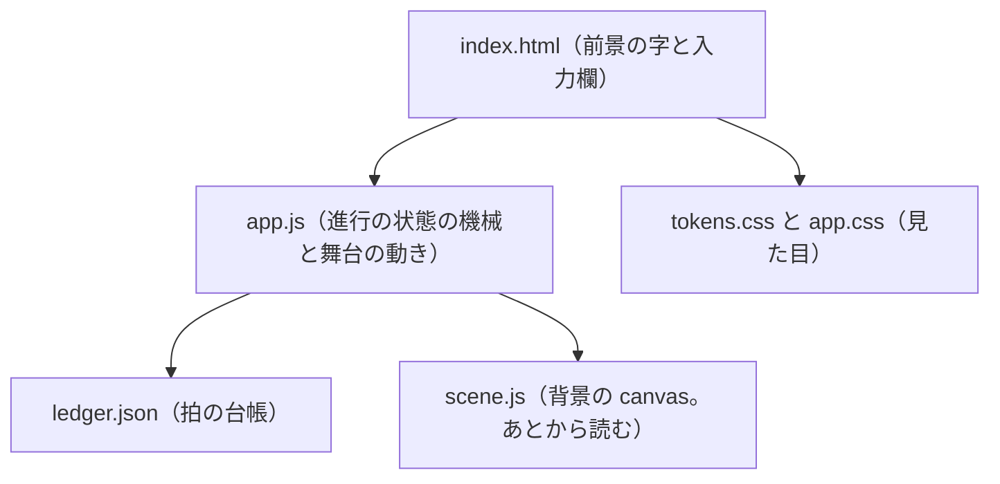

# 実装計画: 深海の探査日誌のスタートとログイン

> **3 行でわかる要約**
> 1. デザイン計画書と演出計画書「潜る」を受けた、架空の個人開発アプリ「深海の探査日誌」のスタートとログインの実装計画です。画面の型は没入の型で、作ったのは動くサンプル（samples/immersive）です。
> 2. 画面は前景・舞台・背景の 3 層で、押す前に動きを組み、押したら開始の時刻を入れるだけにします。予算は初期表示 2.5 秒と JS 170KB に、演出の最初のフレーム 100ms と 50ms 超のフレーム 0 個を足します。
> 3. 取りまとめ役は構成・予算・段階の 3 点を承認伺いに写してください。デザイナーは撮ったフレームで監修してください。

| 項目 | 内容 |
|---|---|
| 作成日 | 2026-11-26 |
| 状態 | 完成例。サンプルを作り、motion-measure と immersive-test で測ったあとの版 |
| 画面の型 | 没入の型。受付票から写した（デザイン計画書と同じ） |
| 数値 | 予算と合格の線は案。サンプルの実測値は自己点検票 `self-check-dive-log.md` にある |
| 数列 | 数列の前の版（2026-11-27 より前）。値は見本アプリと実測につながるので、次の PR で数列に直す |
| 入力 | デザイン計画書 `design-plan-dive-log.md`、演出計画書 `motion-plan-dive-log.md`。どちらも `skills/designer/examples/` にある |
| 置き場 | 本番の案件では tmp/flow/dive-log/frontend-plan.md。計測の設定 motion-measure.json も同じ置き場に置く |

## 背景と目的

依頼は、スタートを押したらゲームのように世界に入ってからログインする画面です。いまは白地のフォームだけの試作で、演出の実装も計測もありません。目的は、演出計画書の「潜る」を 3 層で作り、押した直後のフレームを落とさずに測れる形にすることです。

| 項目 | いま | 目標 |
|---|---|---|
| 初期表示（LCP） | 測っていない（試作） | 2.5 秒以内 |
| 操作の応答（INP） | 測っていない | 200ms 以内 |
| JS の転送量 | 測っていない | 170KB 以内 |
| 自動検査の違反 | 測っていない | 0 |

## 全体像

部品は 3 層に分け、前景の字と入力は最初の描画から読めるようにします。背景は最初の画面が出たあとに読み込みます。

図の読み方: 上から下へ読み、矢印は「読み込む」を表します。台帳は app.js と計測の両方が読みます。

## 構成

静的なファイルだけで作り、どの部品もブラウザで動きます。サーバーは配るだけです。

| 部品 | 置き場 | 動く場所 | 理由 |
|---|---|---|---|
| 前景（題字、スタートの札、計器盤の字と入力欄） | samples/immersive/index.html | ブラウザ | 最初の描画から読めて打てるように、DOM に置く |
| 舞台（2 つの場面と、場面をまたぐ灯） | samples/immersive/app.js | ブラウザ | 拍の時刻をそろえ、飛ばす・巻くために WAAPI で組む |
| 背景（水、光の帯、マリンスノー） | samples/immersive/scene.js | ブラウザ | 粒子と階調は canvas 1 枚で描く。最初の画面のあとに読む |
| 拍の台帳 | samples/immersive/ledger.json | ブラウザ | 演出計画書の時刻ごとの表を、実装と計測が同じ形で読む |

## 状態

状態は出どころで分け、置き場を 1 つずつにします。進行は状態の機械 1 つで持ちます。

| 状態 | 出どころ | 置き場 |
|---|---|---|
| 場面（海面・潜る・計器盤） | URL | ハッシュ（#panel）と、html の data-scene |
| 進行（海面、潜る途中、計器盤、戻る途中） | 画面の操作 | app.js の状態の機械 |
| 押す前に組んだ見せ場 | 画面の操作 | app.js の armed（idle の動き） |
| 潜った回数 | 画面の操作 | sessionStorage（同じ利用の中だけ。2 回目から短い版） |
| 背景を止めたか | 画面の操作 | localStorage と、隅の札の aria-pressed |
| 入力中の値と誤り | フォーム | 入力欄と aria-invalid |

## データ取得

取りに行くのは台帳 1 本と、背景の scene.js 1 本だけです。どちらも同じ置き場から読みます。

| 要求 | いつ | 方法 | 時間の上限と失敗時 |
|---|---|---|---|
| ledger.json | 最初の描画のとき | fetch（preload で先に頼む） | 準備の予算 3 秒の内側（motion-measure の項目 12 で測る）。打ち切りは入れない。失敗したら演出を出さず、スタートで計器盤へ移り、1 つ目の入力欄に焦点を入れる |
| scene.js | 最初の画面が出たあと | 動的 import | 準備の予算 3 秒の内側。打ち切りは入れない。失敗したら背景なしで、短い版で進む。1,500ms 遅らせた試験で、灯は 50ms ほどで動いた |

## エラー表示

誤りの文は「何が起きたか」と「どうすればよいか」の 2 文で、欄の下に出します。送信はしないので、サーバーのエラーコードはありません。

| エラーコード | 何が起きたか | どうすればよいか | 置き場 |
|---|---|---|---|
| メールアドレスが空 | メールアドレスが空です | 登録したアドレスを入れてください | メールアドレスの欄の下 |
| メールアドレスの形 | メールアドレスの形になっていません | @ の前後を確かめてください | メールアドレスの欄の下 |
| パスワードが空 | パスワードが空です | 登録したパスワードを入れてください | パスワードの欄の下 |

## 性能予算

最初の 1 画面の予算は今の型と同じで、没入の型だけ演出の行を足します。演出の行は、motion-measure の 12 項目で 1 つでも落ちたら FAIL です。

| 指標 | 予算 | 目標 | 測り方 | 測定条件 |
|---|---|---|---|---|
| 初期表示（LCP） | 2.5 秒以内 | 1.5 秒 | Lighthouse（Google の性能測定の道具） | tools/immersive-test.mjs が既定のモバイル条件（往復 150ms、1.6Mbps、CPU 4 倍遅く、幅 412px）で 1 回 |
| 操作の応答（INP） | 200ms 以内 | 100ms | motion-measure の項目 1（Event Timing） | CPU 等速と 4 倍遅く、各 3 回の最大 |
| 画面のずれ（CLS） | 0.1 以内 | 0 | Lighthouse | 初期表示と同じ条件で 1 回 |
| 初期表示の JS の転送量 | 170KB 以内（brotli 後） | 20KB | motion-measure の項目 12 | 1 回目の計測で、LCP より前に頼んだ JS を数える |
| 演出 | 最初のフレーム 100ms、50ms 超のフレーム 0 個、演出のアセット 600KB | 60ms、0 個、10KB | motion-measure の 12 項目 | CPU 等速と 4 倍遅く、各 3 回の悪い側。画面なしのブラウザ |

## テスト

受け入れ条件とテストを 1 対 1 にします。サンプルなので、テストは samples/immersive/check.mjs と計測の 2 本です。

| # | 受け入れ条件 | テスト名 | レベル | サイズ |
|---|---|---|---|---|
| 1 | 台帳の拍が演出計画書の時刻ごとの表と同じ | check.mjs の「計画との一致」と immersive-test の「台帳と演出計画」 | 単体 | small |
| 2 | 同じ時刻の seek は何度でも同じ絵 | check.mjs の「seek の再現」 | 結合 | medium |
| 3 | どのキーでも飛ばせて、打った字が 1 つ目の欄に入る | check.mjs の「飛ばす」と motion-measure の項目 7 | 端から端まで | medium |
| 4 | 動きを減らす設定で位置が動かない | check.mjs の「縮小版」と motion-measure の項目 6 | 端から端まで | medium |
| 5 | 押した直後のフレームが落ちない | motion-measure の項目 3 と 4 | 端から端まで | large |
| 6 | 空の欄と形の誤りで、誤りの文と警告灯の枠が出る | immersive-test の --shots の error-panel と、手動の確かめ | 端から端まで | medium |

## アクセシビリティ

部品は標準の button・input・form で作り、APG の型を新しく作りません。

| 項目 | 実装 | 確かめ方 |
|---|---|---|
| 焦点 | 灯の色の outline 2px、offset 3px。見せ場の終わりに 1 つ目の入力欄へ | テスト 3、check.mjs の「終わりの焦点」 |
| 去った場面 | 海面は inert（操作も読み上げも受けない） | motion-measure の項目 8 |
| 誤り | aria-invalid と aria-describedby で欄と誤りの文を結ぶ | 手動で VoiceOver（未確認の表） |
| 背景を止める | aria-pressed の button。押した状態は印の形と色と字の色 | motion-measure の項目 9 |
| 自動検査 | axe（アクセシビリティの自動検査の道具）を海面と計器盤で回す | check.mjs の「axe」 |

## デザイン忠実度の確認

受け取った計画書の色・時間・曲線は、tokens.css にだけ書きます。ずれは `fidelity-check.sh` で測ります。

| 受け取るもの | 内容 | 受領の判定 |
|---|---|---|
| デザイン計画書 | 名前つきの色 6 つと導出の色 11 個、書体 3 役、灯の形 | 受領。fidelity-check は FAIL 0 |
| 演出計画書 | 時刻ごとの表 9 行、守りの表 8 行、トークン 14 個 | 受領。台帳と表の食い違い 0 |

## 横断事項

動きと計測の決めごとは、あとから足すと直しが大きいので、計画の段階で決めます。

| 事項 | 決めたこと | 確かめ方 |
|---|---|---|
| 動き | 応答は 80・120・180ms、移動は 400ms、見せ場は 1,400ms と 600ms。縮小版はトークンで 0ms か 150ms | motion-lint |
| 国際化 | 字は日本語だけ。文言は index.html と app.js の MESSAGES に集める | MESSAGES の行を数える |
| 安全 | 外の素材を読まない。送信しない | check.mjs の「外の素材」と、計測の外への要求 0 件 |
| 型と道具 | ライブラリなし。node --check と token-lint と motion-lint | frontend-gate.sh |
| トークン | tokens.css の変数だけで描く。canvas も色をトークンから読む | token-lint |

## 演出の実装（没入の型だけ）

演出計画書の時刻ごとの表を台帳に写し、前景は DOM、舞台は WAAPI と View Transitions、背景は canvas 1 枚で作ります。押す前に動きを idle のまま組み、押したら開始の時刻を入れるだけにします。

| 演出 ID | 受け取る演出計画書 | 台帳 | レイヤーと手段 | 計測の設定 |
|---|---|---|---|---|
| `scene-start-login` | skills/designer/examples/motion-plan-dive-log.md | samples/immersive/ledger.json | 前景は DOM。舞台は WAAPI（潜る）と View Transitions（戻る）。背景は canvas 1 枚を画面の半分の解像度で描く | tools/immersive-test.mjs（本番の案件では tmp/flow/dive-log/motion-measure.json） |

## 実装の進め方

段階は 2 つで、段階ごとに検査を回します。

| 段階 | 納品物 | 確認 | 期間 |
|---|---|---|---|
| 1 サンプル | 「潜る」の動くサンプルと方向の 3 案 | check.mjs、motion-measure、immersive-test が PASS | 2026-11-26（済み） |
| 2 依頼者の承認のあと | 観測室の場面と、灯る・浮かぶの見せ場 | 同じ検査と監修 | 承認のあとに決める |

## やらないこと

意図して外したものを先に書き、あとで足すかを依頼者に決めてもらいます。

| やらないこと | 理由 |
|---|---|
| 音 | 最初の版は音なし。入れるときは消音の操作を常に置く |
| ライブラリ | 標準の API で作れた。増える KB を測ってから伺う |
| 新規登録の面 | デザイン計画書のやらないことの表にある |

## 未確定

決まっていないことは 2 つで、どちらも実装を止めません。

| # | 決まっていないこと | 決め方 |
|---|---|---|
| 1 | GPU のある画面と、Safari・Firefox での滑らかさ | 依頼者の環境で同じ seek の時刻を撮る。既定は画面なしの Chromium の値 |
| 2 | 4 倍遅い条件の合格の線（50ms 超 0 個）を続けるか | 依頼者が測る機械を決める。既定は今の線 |

## 受け渡し

取りまとめ役には承認伺いの材料を、デザイナーには監修の材料を渡します。

| 誰に | 何を | いつ |
|---|---|---|
| 取りまとめ役 | 承認伺いに写す 3 点（構成、予算、段階） | いま |
| デザイナー | 自己点検票と、immersive-test の --shots で撮ったフレームの一覧 | いま |
| 依頼者 | 動くサンプルと方向の 3 案 | 監修のあと |
