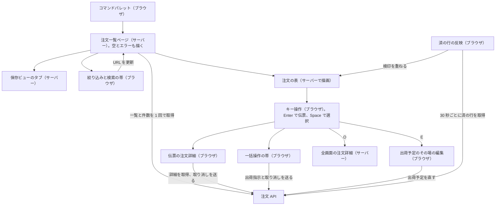
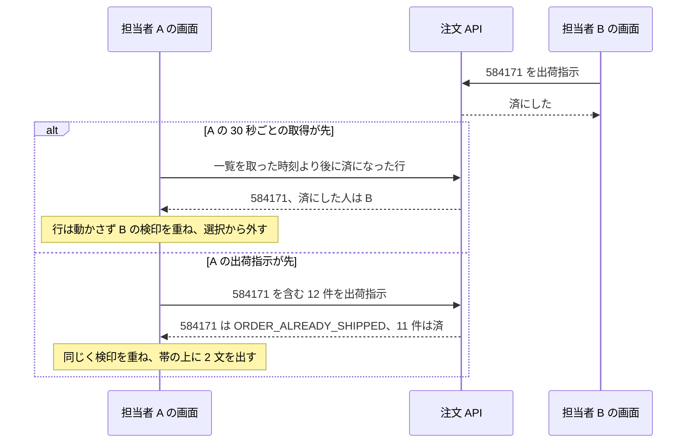

# 実装計画: 管理画面の注文一覧

> **3 行でわかる要約**
> 1. デザイン計画書「管理画面の注文一覧」と画面仕様を受けた、注文一覧と伝票の実装計画です。件数や時間の数値は架空とします。
> 2. 表と保存ビューはサーバーで描きます。ブラウザで動かす部品は 8 つで、操作を受ける 7 つと、済の行を表に重ねる 1 つです。性能予算は初期表示 2.5 秒以内と、初期表示で読む JS 170KB 以内です。
> 3. 取りまとめ役は構成・予算・段階の 3 点を承認伺いに写してください。バックエンドは API への要望 9 件に答え、デザイナーは第 1 段階の見本を監修してください。

| 項目 | 内容 |
|---|---|
| 作成日 | 2026-11-06 |
| 改訂日 | 2026-11-07 |
| 状態 | 承認待ち |
| 数値 | 件数、秒、KB、日付は架空。見本アプリの実測値は自己点検票にある |
| 自己点検票 | `skills/frontend/examples/self-check-order-list.md` |
| 入力 | デザイン計画書、トークン、画面仕様。どれも `skills/designer/examples/` にある |
| 入力のファイル | 計画書は `design-plan-order-list.md` で、動きの表を含む。トークンは `tokens-order-list.css`。画面仕様は `screen-spec-order-list.md` |
| 置き場 | 本番の案件では tmp/flow/admin-orders/frontend-plan.md |

## 背景と目的

運営担当者 5 人が毎朝 9 時から 10 時に、未出荷の注文 400 件を出荷指示にしています。いまの画面は 20 件ずつのページ送りで、20 画面を要します。初期表示に 4.1 秒かかり、絞り込みは再読み込みで消えます。作り直しの目的は、未出荷の注文を今日中に漏れなく出荷指示にできる一覧です。性能予算の内側で、キーボードだけで使える形にします。

| 項目 | いまの画面（架空の計測） | 目標 |
|---|---|---|
| 初期表示（LCP。最も大きい要素が描かれるまで） | 4.1 秒 | 2.5 秒以内（目標 1.8 秒） |
| 操作の応答（INP。押してから次の描画まで） | 380ms（並び替え） | 200ms 以内 |
| JS の転送量 | 612KB | 170KB 以内 |
| 見落とした注文の件数 | 月 30 件（CEO の事業判断メモ） | 月 5 件以下 |
| 絞り込みの保持 | 再読み込みで消える | URL に置き、共有と「戻る」が効く |
| キーボード操作 | 並び替えに届かない | 18 操作すべてにキー |
| 自動検査の違反 | 23 件 | 0 件 |

この計画では一覧、伝票、全画面の注文詳細を作ります。操作は出荷指示・担当・印刷・取り消しの 4 つです。注文の編集、返金、CSV の書き出しは末尾の「やらないこと」にまとめました。

## 用語

この計画では次の語を使います。デザイン計画書と重なる語は、計画書の用語の表と同じ意味です。

| 用語 | 意味 |
|---|---|
| 5 状態 | 画面が取る 5 つの状態。初期・読み込み中・空・エラー・成功 |
| 初期表示の JS | 画面を開いたときに読み込む JavaScript（ブラウザで動くプログラム）。性能予算の対象 |
| タイムアウト（打ち切りの時間） | 応答を待つのをやめ、エラーとして扱うまでの時間。速さの目標（予算）とは別に決める |
| スケルトン表示 | 読み込み中に、これから出る行の形を薄い枠で先に描く表示（骨組みの表示） |
| ホバー | ポインター（マウスの矢印）を要素の上に重ねること |
| 上の帯 | 画面のいちばん上の帯。店の名前、メニューの 7 項目、利用者を 1 段に並べる。固定しない |
| 帳簿の紙面 | 絞り込みの帯、列の見出し、群ごとの行を載せた白い面。表の面とも呼ぶ |
| 伝票 | 帳簿の紙面の右に、台紙を空けて並べる 1 件の詳細の面。影を付けず、一覧を隠さない |
| 固定 | スクロールしても画面の上か下に残す置き方。CSS の position: sticky で描く |
| 群 | 次にすることの順で分けた行のまとまり。頭に群の見出しの行を置く |
| 群の見出し | 群の頭の帯の行。地は群の見出しの色で、下の端に墨の 2px の線を 1 本だけ引く。群の帯とも呼ぶ |
| 縞 | 群の中の偶数行に敷く地。明るい版も暗い版も台紙の色 |
| 二重罫 | 帳簿で列の見出しと合計を締める線。墨の 1px の線 2 本を、間をあけて引く |
| 検印 | 出荷指示済みの行に付く朱の印（「済」の 1 字）。日時と担当を名前に持つ |
| 検印の欄 | 伝票の右上の円。まだ押していない注文では、罫の色で刷った破線の空の円になる。朱は押した検印だけ |
| 担当なし | 担当の無い注文の担当の欄に出す語。表の列では名前より一段弱い色で、伝票では墨で書く |
| 保存ビュー | 絞り込み・並び順・列・まとめ方の組に名前を付けて保存したもの。URL で共有できる |
| タブ | 保存ビューを切り替える見出しの部品。帳簿の紙面の上の縁に差した付箋の形 |
| チップ | 絞り込みの帯に並ぶ小さな選択の部品。項目名と今の値を書く |
| 記入欄 | 箱にせず、下線だけを引いた入力の形。検索欄とチップをこの形にし、箱の形はボタンだけに使う |
| 一括操作の帯 | 選んだ件数と 4 つの操作を出す帯。選択中だけ紙面の下の縁に出る |
| 主ボタン | --fill-primary の地のボタン（明るい版は墨、ダーク版は藍）。画面に 1 つだけ置く |
| 状態の札 | 状態の列で急ぐ行に付ける印。要対応は墨で塗った札、出荷遅れは墨の枠の札 |
| 出荷指示の直後 | 出荷指示した行を移す群。次に読み込むと済の群に入る。タブの件数には数えない |
| 確かめの窓 | 取り消しの前に出す alertdialog（応答を求める窓）。「やめる」と「取り消す」を持つ |
| トークン | 色・大きさ・時間の値に名前を付けた CSS の変数。tokens.css に置く |
| E2E テスト（画面の端から端までを通す試験） | 画面の操作から API までを、本物に近い形で通すテスト |
| 基準画像 | 視覚回帰（見た目の変化を画像で見つけるテスト）で比べる元の画像 |

## 全体像

画面は 1 つの機能「orders」にまとめます。取得と描画はサーバーに寄せます。ブラウザで動かす部品は 8 つで、操作を受ける 7 つと、済の行を重ねる 1 つです。

図の読み方: 上のページがサーバーで注文 API から一覧と件数を取り、表・保存ビューのタブ・空とエラーを描きます。絞り込みの帯とコマンドパレットは URL を書き換え、ページに描き直させます。伝票・一括操作の帯・その場の編集・済の行の反映は、ブラウザから API を呼びます。取り消しは、帯からも伝票からも、送る前に同じ確かめの窓（CancelDialog）を通ります。

## 構成

ファイルは features/orders の下にまとめます。上の帯は管理画面の共通の枠が描くので、この計画の部品は保存ビューのタブから伝票までです。上の帯の見た目は、計画書のレイアウトの表のまま共通の枠への要望として渡します。共通の部品（ボタン、入力欄、面の土台）だけを components/ui から使います。

寸法・色・字の大きさは、計画書とトークンが正本です。この表には、部品が何を受け持ち、なぜその場所で動くかだけを書きます。

| 部品 | 置き場 | 動く場所 | 理由 |
|---|---|---|---|
| OrdersPage | features/orders/page.tsx | サーバー | URL を読んで API を 1 回呼び、5 状態を切り替える。取得と描画だけで対話を持たない |
| SavedViews | features/orders/components/saved-views.tsx | サーバー | 5 つの付箋のタブを描くリンク。件数は出荷指示の直後と済の行を数えない。今のタブに aria-current=page。対話を持たない |
| OrdersTable | features/orders/components/orders-table.tsx | サーバー | 群ごとの tbody と 24 行を描く。群は 6 つで、順は画面仕様の初期値のとおり。状態の列は全行に語か札か検印を出す。行の太字は注文番号・札・検印の「済」だけ。済の群は検印を名前にする。列は 9 本で、余りは氏名の列が受け、足りなければ右の端から CSS で隠す |
| OrderPage | features/orders/[id]/page.tsx | サーバー | 全画面の注文詳細。伝票と同じ要素を 1 画面に描く。印刷と長い履歴のため |
| KeyMap | features/orders/components/key-map.tsx | ブラウザ | キーを 1 か所で受ける。受けるのは計画書のキーの表の 18 操作で、Ctrl+B（メニュー）だけは共通の枠が受ける。取り消しにはキーを割り当てない。焦点の行は注文番号で持ち、一覧を取り直しても同じ行に戻す。キー入力はブラウザにしか無い |
| DueDateEditor | features/orders/components/due-date-editor.tsx | ブラウザ | E で出荷予定日をその場で直す。入力中の値を持ち、Enter で送り、Esc で戻す |
| Pagination | features/orders/components/pagination.tsx | サーバー | 「次へ」「前へ」のリンク。最後の行の群・受注日時・番号を起点にする。出荷指示で行が減っても次の 24 件を飛ばさない |
| OrdersSkeleton | features/orders/loading.tsx | サーバー | 初回の読み込み中に 24 行分のスケルトン表示を返す。CSS で 150ms 遅らせて出し、2.5 秒で遅れの知らせを足す |
| FilterBar | features/orders/components/filter-bar.tsx | ブラウザ | 状態・担当・配送・支払いのチップと、/ の検索。どちらも記入欄の形。表の面が 892px 未満では、配送と支払いを「操作」の中に移す。入力中の値を持つので、ブラウザで動かす |
| OrderSlip | features/orders/components/order-slip.tsx | ブラウザ | 伝票（aside と見出しの非モーダルの面）。開閉と、Esc で行に戻す焦点の管理を持つ。欄は画面仕様の注文詳細の表のとおりで、升で囲まず上の罫線で区切る。画面の上に固定し（top 8px）、高いときは中で送る。固定は CSS で描く |
| BulkBar | features/orders/components/bulk-bar.tsx | ブラウザ | 選んだ行が 1 件以上のときだけ出し、`N件を出荷指示` を主ボタンにする。出荷指示の POST（データを送って変える要求）を送る。件数は ICU の鍵で語に入れる。応答の行ごとの結果を OrderChanges のキャッシュに書く |
| CancelDialog | features/orders/components/cancel-dialog.tsx | ブラウザ | 取り消しの確かめの窓（APG の alertdialog）。「取り消す」で取り消しの POST を送る。焦点の管理を持つので、ブラウザで動かす |
| OrderChanges | features/orders/components/order-changes.tsx | ブラウザ | 画面に出ている間だけ 30 秒ごとに、あとから済になった行を取る。ほかの人の済は検印を重ね、並びを変えない。自分の出荷指示は、出荷指示の直後の群に移す。時計と画面の表示状態を見るので、ブラウザで動かす |
| CommandPalette | features/orders/components/command-palette.tsx | ブラウザ | Ctrl+K か帯の「操作を探す」で開く combobox（候補を打鍵で絞る入力欄の型）。18 操作を絞り、右の列にキーを出す |
| EmptyOrders、OrdersError | features/orders/components/ | サーバー | 0 件の候補と、エラーの 2 文。文だけで対話を持たない |
| orders-api.ts | features/orders/api/ | サーバー | 一覧と件数の取得と、応答の検証（zod。型のとおりかを実行時に確かめる道具）。鍵と内部の URL をブラウザに出さない |
| orders-client.ts | features/orders/api/ | ブラウザ | 伝票の詳細、あとから済か取消済みになった行、出荷指示と取り消しの POST を受け持つ。出荷予定日の PATCH（一部だけを直す要求）も送る。応答は orders-api.ts と同じ zod の型で検証 |
| ja.json | features/orders/i18n/ | 両方 | 画面の言葉。ICU 形式（複数形と選択を書ける文言の形式）。描画の場所を問わず同じ文言を使う |
| tokens.css | app/styles/ | 両方 | デザイナーのトークンをそのまま置く。描画の場所を問わず同じ値で描く |

ブラウザで動く部品は 8 つで、API を呼ぶコードは orders-client.ts の 1 本です。表の本体をサーバーで描くので、24 行 × 9 列の描画コードは初期表示の JS に入りません。列を隠すのは CSS で、ブラウザのコードを足しません。

## 状態

持つ値は 7 つで、出どころ 5 種類に分け、置き場を 1 か所ずつ決めました。保存ビュー・絞り込み・期間・検索語・並び順・ページは URL に置き、画面の状態には写しません。

| 状態 | 出どころ | 置き場 |
|---|---|---|
| 保存ビュー、絞り込み（状態・担当・配送・支払い）、期間、検索語、並び順、「次へ」の起点 | URL | クエリ文字列。例は ?view=today&sort=next&after=ready.20261106T0947.584240。起点は群・受注日時・番号の 3 つ |
| 注文の一覧（24 件ずつ）と件数、一覧を取った時刻 | サーバー由来 | サーバーの部品の引数。ブラウザには描画した HTML と、取った時刻だけが届く |
| 開いている注文の詳細（過去の注文 2 件と荷物の大きさを含む） | サーバー由来 | TanStack Query（取得とキャッシュを引き受けるライブラリ）。5 分で古いとみなす |
| あとから済になった行（自分とほかの担当者の出荷指示） | サーバー由来 | TanStack Query の 1 つのキャッシュ。出荷指示の応答もここに書き、30 秒ごとに取り直す |
| 焦点の行、選んだ行、伝票の開閉、確かめの窓の開閉 | 画面の操作 | 行の状態は KeyMap、伝票の開閉は OrderSlip の中。確かめの窓は CancelDialog の中。BulkBar と OrderSlip は選択を引数で受ける |
| 検索語の入力中の値 | フォーム | FilterBar の中。Enter か 300ms の停止で URL へ |
| 1 文字キーのオン・オフと役割（運営担当者か閲覧者） | 利用者の設定 | サーバーに保存し、一覧と同じ応答で受け取る |

同じ値を 2 か所に持たないので、「URL は未出荷、表は全件」のような食い違いが起きません。選んだ件数は、選んだ行からあとで済になった行を引いて描画中に数え、状態には入れません。主ボタンの置き場も、選んだ件数から描画中に決めます。1 件以上なら帯の `N件を出荷指示`、0 件なら伝票の `この1件を出荷指示` です。S・A・P と取り消しの対象も、同じ件数から決めます。行がどの群に入るかと群の件数も、描画中に決めます。出荷指示のあとと、開いている注文が済になったときは、詳細のキャッシュを捨てて取り直します。

## データ取得

取得と更新は 6 本です。一覧と件数は、1 回の要求でサーバーが取ります。詳細は伝票を開いたときに、あとから済になった行は 30 秒ごとに、ブラウザが取ります。出荷指示は一括操作の帯から、取り消しは確かめの窓から、出荷予定日の更新はその場の編集から送ります。N+1（一覧の行ごとに要求を出してしまうこと）は作りません。

| 要求 | いつ | 方法 | 時間の上限と失敗時 |
|---|---|---|---|
| 一覧と件数（利用者の設定を含む） | 初期表示と、URL が変わるたび | サーバーの部品が注文 API を 1 回呼ぶ。URL が変わったら、前の要求は待たずに捨てる | 10 秒でタイムアウトにし、エラーの状態へ。自動では送り直さない。待つ間の見せ方は下の表 |
| 注文の詳細 | 行で Enter を押したとき | ブラウザから 1 回で取る。過去の注文と荷物の大きさも同じ応答に入れる（要望 9）。5 分はキャッシュから出す | 10 秒でタイムアウトにし、伝票の中に 2 文と再試行。待つ間は 150ms 後に伝票の中にスケルトン表示 |
| あとから済になった行 | 画面に出ている間 30 秒ごと。ブラウザのタブに戻ったときはすぐ | ブラウザから一覧の API を `since`（一覧を取った時刻）付きで 1 回呼ぶ | 10 秒でタイムアウトにする。失敗しても画面には出さず、次の 30 秒で取り直す |
| 出荷指示 | S か「出荷指示」を押したとき | POST を 1 回。冪等キー（同じ操作を 2 回送っても 1 回しか効かない印）を付ける | 10 秒でタイムアウトにする。タイムアウトは失敗と決めず、すぐ済の行を取り直して検印で結果を見せる。一部失敗は成功数と失敗数を 2 文で出し、残りを選び直せる |
| 取り消し | 確かめの窓で「取り消す」を押したとき。対象は選んだ件、無ければ伝票の 1 件 | POST を 1 回。冪等キーを付ける（要望 8） | 10 秒でタイムアウトにする。タイムアウトは失敗と決めず、すぐ要望 5 の取得で取り直す。取り消せた行の状態の欄に `取消済み` を出す。出荷指示済みの行は ORDER_CANCEL_NOT_ALLOWED の 2 文で出す |
| 出荷予定日の更新 | E で直して Enter を押したとき | PATCH を 1 回。冪等キーを付ける | 10 秒でタイムアウトにする。タイムアウトか失敗なら詳細を取り直す。変わっていなければ欄を元の値に戻し、欄の直下に 2 文 |

タイムアウトは、速さの目標とは別の数字として決めました。LCP の予算 2.5 秒は、75 パーセンタイル（利用者の 4 人に 3 人がそれより速い値）で守る速さの目標です。そこから描画の 0.5 秒を引いた 2.0 秒は、一覧の API の応答の目標としてバックエンドに求めます（要望 7）。目標を超えた応答は遅いだけで、壊れてはいません。利用者の画面は、予算を超えてもエラーにせず待ち続けます。超えた分は、CI（変更ごとに自動で検査する仕組み）と計測画面で見つけて直します。

タイムアウトは、応答が来ないと分かる時点に置きます。Google の API 設計の指針 AIP-151 は、10 秒より長い処理を同期の応答にしないよう定めます。API は 8 秒以内に自分で打ち切り、ORDER_LIST_UPSTREAM_SLOW と追跡番号を返します。画面のタイムアウトはその 2 秒後の 10 秒です。応答がまったく来ない接続を、最後にここで切ります。混む朝に 5 人の画面が自動で送り直すと、遅い API に要求が重なります。送り直しは、利用者が「もう一度読み込む」を押したときだけにします。

待つ間の見せ方は、経過した時間で 4 段に分けます。2.5 秒は予算の速さを過ぎた時点で、ここからは知らせながら待ちます。

| 経過 | 初回の表示 | 条件を変えたとき | 読み上げ |
|---|---|---|---|
| 0〜150ms | 空の表の枠 | 古い表のまま | なし |
| 150ms〜2.5 秒 | 24 行のスケルトン表示。出したら 300ms は消さない | 古い表を薄くする。絞り込みの帯はそのまま使える | 表に aria-busy（更新中の印） |
| 2.5 秒〜10 秒 | スケルトン表示の上に `時間がかかっています。このまま待つか、条件を変えてください` | 古い表の上に同じ文 | role=status（焦点を移さずに読む領域）で 1 回 |
| 10 秒 | ORDER_LIST_UPSTREAM_SLOW の 2 文と「もう一度読み込む」 | 初回と同じ | エラーの 2 文を読む |

API への要望は 9 件で、バックエンドに渡します。要望ごとに、画面のどこで効くかを添えました。

| # | 要望 | 画面で効くところ |
|---|---|---|
| 1 | 件数を一覧と同じ応答に入れる。空のときは、条件を 1 つ外した候補の件数も入れる | 件数と空の状態。いまは件数が別の要求 |
| 2 | 利用者の設定（1 文字キーと役割）と、一覧を取った時刻（サーバーの時計）を同じ応答に入れる | 1 文字キー、閲覧者の表示、要望 5 の `since` に使う時刻 |
| 3 | sort に降順の記法 -orderedAt を受ける | 並び替え |
| 4 | 最後の行を起点に、次の 24 件を返す（`after`） | 「次へ」で行を飛ばさない |
| 5 | 指定の時刻より後に済か取消済みになった行だけを、した担当と日時つきで返す（`since`） | 5 人が同時に使うとき、取り消しのタイムアウト |
| 6 | 出荷指示の応答に行ごとの結果を入れる。先に済の行は ORDER_ALREADY_SHIPPED と担当・日時を返す。全件がそうなら 409（ほかの変更と食い違った印の応答コード）を返す | 先に済の行を検印で見せる |
| 7 | 一覧の応答の目標を 75 パーセンタイルで 2.0 秒以内にし、API 自身のタイムアウトを 8 秒以内にする | 画面のタイムアウト 10 秒の根拠 |
| 8 | 取り消しの POST を足す。冪等キーを受け、応答に行ごとの結果を入れる。出荷指示済みの行は ORDER_CANCEL_NOT_ALLOWED を返す。閲覧者には 403 を返す | 取り消しの一部不可と `取消済み` の表示 |
| 9 | 詳細の応答に、同じ宛先の過去の注文を新しい順に 2 件（日付・番号・金額）入れる。荷物の大きさと割れ物の指定も入れる | 伝票の「過去の注文」の欄と、「配送と支払い」の 2 行目。伝票のために要求を足さない |

## 5 人が同時に使うとき

運営担当者 5 人は、同じ今日出荷の一覧を同時に開きます。受け持ちは画面仕様の「5 人で分ける」のとおり担当の列で分けますが、担当の無い行には 2 人が当たり得ます。ほかの人が先に出荷指示した行は、30 秒ごとの取得か、出荷指示の応答で知ります。どちらでも行は動かさず、その行に検印を重ねます。

図の読み方: 上から下へ時間が進みます。B が先に済にした行を、A は 30 秒ごとの取得と出荷指示の応答の、早いほうで知ります。

取り直しの時機は 4 つで、時機ごとに描き直し方を決めました。

| 時機 | 取るもの | 描き直し |
|---|---|---|
| 画面に出ている間 30 秒ごと。ブラウザのタブに戻ったときはすぐ | 一覧を取った時刻より後に済になった行（要望 5） | 行は動かさず、状態の欄に済にした人の検印を重ねる。選んでいた行なら、帯の上に ORDER_ALREADY_SHIPPED の文を出す。焦点の行だけなら、検印の名前を 1 回読む |
| 出荷指示の応答 | 行ごとの結果（要望 6） | 自分が済にした行は、出荷指示の直後の群に移す。先に済の行は検印を重ね、帯の上に ORDER_ALREADY_SHIPPED の文を出す。出荷指示にできなかった行だけを、ORDER_SHIP_PARTIAL で選び直させる |
| 伝票で開いている注文が済になった | 注文の詳細 | 詳細のキャッシュを捨てて取り直し、伝票の検印の欄に検印を入れる |
| 条件を変えた、「次へ」、もう一度読み込む | 一覧と件数 | 済の行は済の群へ移る。焦点は同じ注文番号の行に戻す。畳んだ群に入ったら、元の位置に来た行へ移す |

30 秒は、出荷指示が出る間隔から決めました。架空の件数では、400 件を 5 人が 12 件ずつ送るので、1 時間に約 33 回、約 110 秒に 1 回です。30 秒ごとに取れば、ほかの人の出荷指示を次の 1 回より前に知らせられます。要求は 5 人で毎分 10 回で済みます。SSE（サーバーが開いたままの接続で送り続ける方式）は、5 人のためには重すぎます。取りこぼしても、二重の出荷指示は 409 が止めます。

ほかの人の済で行を並べ替えないのは、J と K で移っている最中の詰まりを防ぐためです。行が上へ詰まると、焦点の先が変わり、Space が別の行を選びます。そのときの群と件数は、次に読み込むまで変えません。自分の出荷指示では、行を出荷指示の直後の群に移します。焦点は、元の位置に来た行へ移します。押したのは自分なので、行が動いても次の行を見失いません。選択が 0 件になっても、一括操作の帯は文を出したまま、次の操作まで残します。同じ人の二度押しは冪等キーで 1 回にし、ほかの人との重なりは 409 で分けます。

## エラー表示

エラーは画面仕様の表と同じ 8 コードで、文も置き場も画面仕様の表のとおりです。文は画面側で組み立てず、ja.json の鍵から取ります。追跡番号は画面では「お問い合わせ番号」と表示します。N と M には実際の件数が入り、文は ICU 形式の鍵で持ちます。

| エラーコード | 何が起きたか | どうすればよいか | 置き場 |
|---|---|---|---|
| ORDER_LIST_UPSTREAM_SLOW | 注文一覧を読み込めませんでした | しばらく待ってから、もう一度読み込んでください | 画面上部 |
| ORDER_LIST_INTERNAL | 問題が発生し、注文一覧を表示できませんでした | お問い合わせ番号を添えて、お問い合わせください | 画面上部 |
| ORDER_SHIP_PARTIAL | N 件のうち M 件を出荷指示にできませんでした | 残った M 件を選び直して、もう一度出荷指示してください | 一括操作の帯の上 |
| ORDER_ALREADY_SHIPPED | N 件のうち M 件は、ほかの担当者が先に出荷指示していました | 先に押した人の検印を付けたので、出荷指示をやり直す必要はありません | 一括操作の帯の上。1 件だけのときは通知 |
| ORDER_CANCEL_NOT_ALLOWED | N 件のうち M 件は出荷指示済みのため、取り消せませんでした | 出荷指示の直後なら、通知の「元に戻す」で戻してから取り消してください | 一括操作の帯の上。1 件だけのときは伝票の操作の上 |
| ORDER_NOT_FOUND | この注文は見つかりませんでした | 注文番号を確かめて、一覧から開き直してください | 伝票の中 |
| ORDER_DETAIL_UPSTREAM_SLOW | この注文を読み込めませんでした | 一覧に戻って、もう一度開いてください | 伝票の中 |
| OFFLINE（通信なし） | インターネットに接続できません | 接続を確かめてから、もう一度読み込んでください | 画面上部 |

ORDER_ALREADY_SHIPPED は失敗ではなく、先に済んでいた知らせです。選び直しを求める ORDER_SHIP_PARTIAL とは次の操作が逆なので、件数も文も分けます。両方が出たときは、操作の要る ORDER_SHIP_PARTIAL を上に置きます。1 件だけのときの 1 文目と、同時に出たときの並べ方は、画面仕様のエラー表示の節に従います。

## 性能予算

予算は 2 種類です。1 つは Core Web Vitals（Chrome が定めた体感の 3 指標）の「良い」の閾値です。もう 1 つは初期表示の JS の上限です。超えたら CI が落ちます。予算は速さの目標で、利用者の画面のタイムアウトには使いません。道具は Lighthouse（Google の性能測定）の CI 版と size-limit です。size-limit は、JS のファイルの大きさの上限を見る道具です。設定は雛形の lighthouserc.json と size-limit.json を写します。

| 指標 | 予算 | 目標 | 測り方 | 測定条件 |
|---|---|---|---|---|
| 初期表示（LCP） | 2.5 秒以内 | 1.8 秒 | Lighthouse CI。largest-contentful-paint に maxNumericValue 2500 | 本番相当ビルド、4G 相当（往復 150ms、下り 1.6Mbps）、CPU 4 倍遅く。幅 1,280px と 412px、3 回の中央値 |
| 操作の応答（INP） | 200ms 以内 | 120ms | Playwright（ブラウザの自動操作の道具）で 3 つの操作を送る。J・K、絞り込み、伝票を開く操作で、event の duration の最大を見る | 同じ条件。3 回 × 3 操作の最大 |
| 画面のずれ（CLS。読み込み中に要素がずれた量） | 0.1 以内 | 0.02 | Lighthouse CI。cumulative-layout-shift に maxNumericValue 0.1 | 同じ条件。3 回の最大 |
| 初期表示の JS の転送量 | 170KB 以内（brotli。転送時の圧縮方式で圧縮した後） | 140KB | size-limit。path は注文一覧の初期表示で読む JS | ビルド後に 1 回 |
| 外部の要求 | 0 件 | 0 件 | Lighthouse CI。resource-summary:third-party:count に 0 | 同上 |
| 書体 | サブセット 2 ファイル、合計 240KB 以内 | 210KB | Lighthouse CI。resource-summary:font:size に 245760 | 同上 |

LCP の要素は、表の見出し行か伝票の段落になる見込みで、画像はありません。表の caption は見えない字にしたので、要素になりません。書体は BIZ UDPGothic の 1 家族を、太さ 400 と 700 の 2 ファイルで持ちます。数字は同じ書体の等幅数字です。サブセットは font-display: optional で読みます。氏名に出る髙や﨑のように、サブセットに無い字は代替の字形で描きます。間に合わなければ代替の字形で表示を終えます。swap（代替の字形で先に出し、後で入れ替える指定）は使いません。字形を入れ替えると行の幅が変わり、CLS を生みます。表の行の高さはトークンの --row-height に固定し、画面のずれを抑えます。本番の 3 指標は、web-vitals（Chrome と同じ定義で実利用者の値を測るライブラリ）で送ります。見るのは 75 パーセンタイルです。

## テスト

受け入れ条件 34 件にテスト 34 本を 1 対 1 で結びました。配分は単体 15 本、結合 15 本、E2E テスト 4 本です。部品のテストは Testing Library で書き、要素は役割と名前（getByRole）で取ります。getByTestId は使いません。

| # | 受け入れ条件 | テスト名 | レベル | サイズ |
|---|---|---|---|---|
| 1 | URL の条件が API の要求に写る | buildOrdersQuery maps url params to api query | 単体 | small |
| 2 | 降順の並び順が -orderedAt になる | buildOrdersQuery encodes descending sort | 単体 | small |
| 3 | 件数の無い応答は検証で落ちる | parseOrdersResponse rejects missing count | 単体 | small |
| 4 | 日時は今日なら「今日」と時刻、それ以外は日付と時刻 | formatOrderedAt prefixes today | 単体 | small |
| 5 | 件数と金額の文は ja.json の鍵から出る。表の金額は数字だけで、伝票は 1 行ずつ `7,480円` | messages render counts and yen amounts from keys | 単体 | small |
| 6 | 絞り込みの確定で URL が変わる | FilterBar updates url on submit | 単体（部品） | small |
| 7 | 検索語は 300ms の停止で確定する | FilterBar debounces search input | 単体（部品） | small |
| 8 | J と K で焦点の行が移る。表の外では効かない | KeyMap moves focus only inside grid | 単体（部品） | small |
| 9 | 伝票は Esc で閉じ、焦点が行に戻る | OrderSlip closes on escape and restores focus | 単体（部品） | small |
| 10 | 5 状態が表示される | OrdersPage renders five states | 結合 | medium |
| 11 | S で選んだ 12 件が出荷指示になり、検印と時刻が付いて出荷指示の直後の群に移る。検印に焦点を当てると日時と担当が出る | BulkBar moves shipped rows into the just shipped group | 結合 | medium |
| 12 | 5 状態 × 3 幅（1,280px・640px・320px）で自動検査の違反が 0 | orders page has no axe violations | 結合 | medium |
| 13 | 担当者が未出荷を絞り込み、12 件を出荷指示する | staff ships twelve unshipped orders by keyboard | E2E | large |
| 14 | 1 文字キーをオフにすると S で出荷指示が出ない | single key shortcuts can be disabled | E2E | large |
| 15 | Ctrl+K で開き、「出荷」でも「しゅっか」でも出荷指示に当たる | CommandPalette matches command by alias | 単体（部品） | small |
| 16 | 閲覧者には出荷指示・担当・取り消し・E が出ない | viewer sees no mutating actions | 結合 | medium |
| 17 | O で全画面の詳細が開き、Esc で一覧の行に戻る | full page detail opens with O and returns | E2E | large |
| 18 | E で出荷予定日をその場で直し、Enter で確定、Esc で戻す | DueDateEditor commits on enter and reverts on escape | 単体（部品） | small |
| 19 | / で検索、1〜5 で保存ビュー、? でキーの一覧が開く。入力欄の中では効かない | KeyMap routes global keys outside inputs | 単体（部品） | small |
| 20 | 24 件を出荷指示してから「次へ」を押すと、次の未出荷 24 件が飛ばさずに出る | Pagination keeps cursor after shipping | 結合 | medium |
| 21 | 済の群は既定で畳み、見出しのボタンが `済 N件 開く` と読まれる。見える「済」は検印の 1 つだけ。Enter で開くと、行ごとの検印の名前が読まれる | done group toggles and names seals | 結合 | medium |
| 22 | 一覧の応答が 3 秒かかってもエラーにせず表を出す。2.5 秒で知らせの文、10 秒で ORDER_LIST_UPSTREAM_SLOW を出す | OrdersPage waits for slow list and times out at ten seconds | 結合 | medium |
| 23 | 選んだ 12 件のうち 2 件が先に済なら、2 件に済にした人の検印が付いて選択から外れる。ORDER_ALREADY_SHIPPED の文が出る | BulkBar marks rows already shipped by others | 結合 | medium |
| 24 | 2 人が同じ行を出荷指示しても二重にならない。後の人の画面では 30 秒以内に先の人の検印が付き、行は動かない | two staff never ship the same order twice | E2E | large |
| 25 | 取り消しを押すと確かめの窓が開き、最初の焦点は「やめる」にある。Esc で閉じると、押したボタンに焦点が戻る | CancelDialog focuses the safe button and restores focus | 単体（部品） | small |
| 26 | 選んだ 3 件のうち 1 件が出荷指示済みなら、2 件だけ `取消済み` になる。帯の上に ORDER_CANCEL_NOT_ALLOWED の 2 文が出る。取り消しは Ctrl+Z と「元に戻す」で戻らない | BulkBar cancels unshipped rows and keeps cancel out of undo | 結合 | medium |
| 27 | 主ボタンは画面に 1 つ。行を選べば帯の `N件を出荷指示`、0 件なら伝票の `この1件を出荷指示` になる。S・A・P も同じ対象に効き、どのボタンにもキーの印が無い | one primary button follows the selection and S A P follow it | 結合 | medium |
| 28 | 列は右の端から隠れる。幅 1,280px で 9 列すべて、640px で 6 列。隠した数の印は出ず、列の見出しは 1 段 | OrdersTable hides columns from the right without a mark | 結合 | medium |
| 29 | 文字の間隔を当てても、状態・金額・列の見出しは欠けない。省略されるのは長い氏名だけで、焦点を当てると全文が出る。表は横に送らない | OrdersTable truncates only names under text spacing | 結合 | medium |
| 30 | 伝票に開いた行は墨の線で囲まれ、選んだ行の藍の地と分かれる。強制カラーでは Highlight の線になる | OrdersTable outlines the open row also in forced colors | 結合 | medium |
| 31 | 状態の列は全行に語か札か検印を出す。担当の無い行は「担当なし」と出し、明暗どちらでも、選んだ行の上でも 4.5 対 1 以上。行の太字は注文番号・札・検印の「済」だけ | OrdersTable shows a status word and an assignee on every row | 結合 | medium |
| 32 | タブの件数は、出荷指示の直後と済の行を数えない。今のタブは aria-current=page を持ち、強制カラーでは Highlight の線になる | SavedViews counts open orders and marks the current tab | 単体（部品） | small |
| 33 | 伝票の検印の欄は、まだ押していない注文で「まだ押していない」と読まれる。押した注文では検印の名前が読まれる | OrderSlip names the stamp slot by state | 単体（部品） | small |
| 34 | 下の行を開いても、伝票の見出しが画面に残る。伝票は上に固定（top 8px）で、画面より高いときは中で送る | OrderSlip stays pinned while the list scrolls | 結合 | medium |

不安定の要因は 5 つで、テストごとに固定の方法を決めました。

| 要因 | 該当するテスト | 固定の方法 |
|---|---|---|
| 時刻 | 4、10、22、24 | 注文日時は固定の見本データ。「今日」と 150ms・2.5 秒・10 秒・30 秒の経過は、注入した時計で進める |
| 乱数 | なし | 使うテストはない。足すときは種を固定する |
| 外部サービス | 10〜14、16〜18、20、22〜24、26〜31、33、34（注文 API） | MSW（ブラウザとテストで API を模擬する道具）で固定の応答。13・14・17・24 だけ localhost の API |
| 並行 | 12、13、24（読み込み待ちと 2 つの画面） | スリープで待たず、要素の表示を待つ assertion を使う |
| 実行順序 | 10〜17、20〜24、26〜31、34 | テストごとに見本データを作り直し、状態を共有しない |

視覚回帰は toHaveScreenshot で撮ります。基準画像は 5 状態 × 3 幅の 15 枚で、許容差は maxDiffPixels 10 です。暗い版は幅 1,280px の 5 状態を別に撮り、合わせて 20 枚を基準にします。線と形の見た目は、この基準画像で見ます。群の見出しの下の線、二重罫、記入欄の下線を見ます。暗い版の弱い縦罫、検印の欄の円、伝票の担当なしの墨も見ます。基準画像は CI と同じコンテナの Chromium で作り、更新はデザイナーの監修を通した枠だけに限ります。

## アクセシビリティ

部品の作りは APG（W3C が公開する部品ごとのキーボード操作の作法集）の型から選びます。表は行の選択と J・K の移動があるので grid の型にし、Tab の止まり先は表全体で 1 つです。

| 項目 | 実装 | 確かめ方 |
|---|---|---|
| 表の型 | grid（APG の、表の形で矢印のキーで移る部品の型）。Tab で表に 1 回止まり、中は ↑↓ と J・K。並び替えは見出しの行で Enter。columnheader に aria-sort | axe（アクセシビリティの自動検査の道具）と、アクセシビリティの木で「受注日時」の列見出しが降順と読まれること |
| 行の読み上げ | `584205、出荷可、松本 清、12,022 円` と読む。出荷遅れは `2日遅れ、出荷予定 11月4日`。検印は role=img と aria-label `出荷指示済み、11月6日 09:50、高木` | アクセシビリティの木で、行と検印の名前を確かめる（自己点検票の 17 番と同じ測り方） |
| ランドマーク | 上の帯のメニューと保存ビューは名前の違う 2 つの nav。表の面は main、伝票は aside。最初の Tab で「表へ移る」 | テスト 12 の axe と、アクセシビリティの木のランドマークの一覧 |
| 検印と氏名の吹き出し | 焦点を当てると、検印は日時と担当を、省略した氏名は全文を出す。Esc で消え、焦点を外すまで残る（WCAG 2.2 の 1.4.13） | テスト 11 |
| 伝票 | aside と見出し 2 の非モーダルの面で、欄は見出し 3。Enter で開いても焦点は行に残し、Tab で中へ入る。Esc で閉じて行に戻す。上に固定し、表の横に並ぶので行の焦点を隠さない | テスト 9 と 34 |
| 検印の欄 | 空の円は aria-hidden にし、見えない字で「まだ押していない」と読ませる | テスト 33 |
| 1 文字キー | 表の操作キーは表に焦点があるときだけ、画面全体のキーは入力欄の外でだけ。設定で全部オフ（WCAG 2.2 の 2.1.4） | テスト 8・14・19 |
| 主ボタンとキー | 主ボタンは画面に 1 つで、効く件数を語に持つ。ボタンにキーの印は添えず、キーは ? の一覧とコマンドパレットで示す | テスト 27。見本では主ボタンとキーの印を数える（自己点検票の 7 番） |
| 隠れた列 | 右の端から CSS で隠し、隠した数の印は出さない。押せない印は、押せる部品と読み違えられるため。隠した列は伝票で読める | テスト 28 |
| 開いた行の印 | 選んだ行の藍とは色の系統を分け、形でも分かる。強制カラー（Windows の高コントラスト表示）では box-shadow が消える。そこで Highlight の border に替える | テスト 30 |
| 状態の札と担当なし | 状態は色に頼らず、札の塗り・札の枠・語・検印の形で示す（1.4.1）。担当なしは、表では --text-none と --text-none-selected で描く。伝票では --text で描く。どの地でも 4.5 対 1 以上 | テスト 31 と、テスト 12 の color-contrast |
| 群の見出しと隣の面 | 暗い版の群の見出し（罫 20%）を、明るさで離す。選んだ行（藍 36%）と 1.45、縞と 1.60、紙面と 1.44 対 1。色相の差だけに頼らない | 暗い版の基準画像。見本では計算値の比を測る（自己点検票の 5 番） |
| 記入欄の下線 | 検索欄とチップは箱が無いので、下線で欄と分かるようにする。下線は入力枠の色で、紙面と 3 対 1 以上（1.4.11） | 見本で下線の比を測る（自己点検票の 19 番）と、基準画像 |
| 今いる場所 | 今のタブは aria-current=page を持つ。強制カラーでは上の端の線を Highlight の border に替える | テスト 32 |
| 文字の間隔（WCAG 2.2 の 1.4.12） | 列の幅は、間隔を広げても字が欠けない下限にする。省略は氏名だけ。列の見出しは間隔を広げたときだけ 2 段まで折り返す | テスト 29 |
| 確かめの窓 | 取り消しは APG の alertdialog。題は `注文を取り消しますか`。最初の焦点は「やめる」、Esc は「やめる」と同じ。閉じたら押したボタンに焦点を戻す | テスト 25 |
| 焦点の見え方 | 藍の 2px の枠（outline）を、部品から 2px 離して描く。焦点で送るときの端の余白（scroll-padding）は、上を固定の帯と見出しの下端まで取る。下は一括操作の帯の高さ。上の帯は固定しないので数えない | 焦点が固定の帯の裏に入らないことを測る（自己点検票の 8 番と同じ測り方） |
| 押せる領域 | 行・ボタン・入力欄・タブ・チップ・上の帯の項目・選択の列とも 44px。根拠は仕様書の 7.3 節（`docs/SPEC_20261106_company-skills.md`） | Playwright で、見えている押せる部品を全部測る（自己点検票の 9 番と同じ測り方） |
| 件数の読み上げ | 絞り込んだときだけ、当たった件数を aria-live=polite の領域に 1 回出す | 「佐藤」で絞ると、その領域に `2件` が入ること（自己点検票の 1 番） |
| 待ちと食い違いの知らせ | 2.5 秒の知らせと ORDER_ALREADY_SHIPPED は role=status で 1 回だけ読む。ほかの担当者の済は、選んでいた行か焦点の行に当たったときだけ読む | テスト 22〜24 |
| 200% の拡大 | 幅 640px（1,280px の画面の 200%）では 6 列にし、絞り込みの帯の固定を外す。伝票は表の下に回り、横スクロールなし | 幅 640px で scrollWidth が 640 以下（自己点検票の 10 番）と、幅 640px の基準画像 |
| リフロー | 幅 320px（400%）と 412px で、表を 1 件 2 段の一覧にする。横スクロールなし（WCAG 2.2 の 1.4.10） | 幅 320px と 412px で scrollWidth が表示域の幅以下（自己点検票の 10 番）。幅 320px の基準画像 |
| 自動検査 | axe を 5 状態 × 幅 1,280px・640px・320px で実行し、違反 0 | テスト 12 |

キーボードだけの通し操作は、最初の Tab で「表へ移る」に止まり、Enter で表に入ります。J と K で移って Space で 12 件を選び、S を 1 回押すと、12 件の出荷指示が終わります。400 件は同じ手を繰り返します。見本と同じく、読み上げ・件数・焦点・押せる領域・拡大とリフローの 5 項目も自動で測り、結果を自己点検票に書きます。

## デザイン忠実度の確認

デザイナーからは 3 点を受け取りました。実装はトークンの変数だけで描き、生の値は token-lint が落とします。

| 受け取るもの | 内容 | 受領の判定 |
|---|---|---|
| デザイン計画書（色と書体） | 方向「出荷の帳場」、名前つきの 6 色と導出の色（明るい版 9 色、ダーク版 12 色）、書体の 3 役。縞は明暗とも台紙。暗い版の群の見出しは罫 20%、選択行は藍 36%、縦罫は罫 30% | 受領 |
| デザイン計画書（配置） | 配置「上の帯と帳簿の紙面と伝票」と、列の表（9 列、隠す順、数の印なし）。行の状態の表、幅 640px と 320px の図。伝票は上に固定（top 8px）、紙面と伝票の下の余白は 16px。1 画面に 16〜21 行 | 受領 |
| デザイン計画書（部品の形） | 群の線は見出しの下の墨 2px の 1 本。検索欄とチップは記入欄で、箱はボタンだけ。伝票の欄は上の罫線で区切り、番号は 16px。上の帯の項目は左右 16px で 1 段。列の見出しは字詰めなし | 受領 |
| デザイン計画書（印と動き） | 主ボタンを画面に 1 つにする決め。検印（直径 28px）と検印の欄（空の円は罫の色）。動きの表（6 場面）、キー 18 操作。見本の範囲とデータの決まり（自分の担当は 4 件、履歴は 3 件） | 受領 |
| tokens-order-list.css（色） | 名前つきの 6 色（明暗）と、color-mix の式だけの導出。面の役（--surface-group、--surface-tab ほか）。縞の --row-stripe と縦罫の --table-line-col。担当なしの字（--text-none ほか）。強い面の --fill-strong、主ボタンの --fill-primary、遅れの札の --fill-late。ダーク版 | 受領 |
| tokens-order-list.css（寸法と時間） | 列の幅（--col-…）、検印（--seal-size ほか）、二重罫（--rule-double）。書体、余白、角丸 2 段、影、時間 3 つと曲線 | 受領 |
| 画面仕様 | 要素 13、5 状態、操作と遷移 11（取り消しと確かめの窓を含む）、エラー 8 コード。5 人で分ける、狭い幅、注文詳細の要素 10、点検 9 項目、権限 2 役割。表の行数は 1 回 24 行、見本 23 行、済 377 件、開くと 29 行。伝票の担当なしは墨、代引きの決済の行は届けたあと | 受領 |

ずれの検査は 5 つです。色・大きさ・時間はトークン名で照合し、部品の値がトークンに無ければ、token-lint が落とします。縮小版の無い動きは motion-lint が落とします。生の 16 進と ms が計画書の色と時間の集合に収まるかは、デザイナーの fidelity-check が見ます。既定の見た目に落ちていないかは ai-look-check が数え、0 件でなければ監修に出せません。配置は基準画像で比べます。

| 検査 | 何を見るか | 合格 |
|---|---|---|
| token-lint | 部品の CSS の生の色・px・書体名 | 0 件 |
| motion-lint | 縮小版の無い動き、transition: all | 0 件 |
| fidelity-check | 実装の 16 進と ms が計画の集合に収まるか | PASS |
| ai-look-check --plan | 既定の見た目の数 | 0 件 |
| 基準画像 | 幅ごとに計画書の図（1,280px の配置図、640px と 320px の図）と比べる | ずれ 0 |

撮る幅は、計画書に図のある 1,280px・640px・320px の 3 つにそろえました。412px は計画書で 320px と同じ 2 段の一覧に決まったので撮らず、性能の測定にだけ使います。

| 幅 | 比べる相手と理由 | 使う検査 |
|---|---|---|
| 1,280px | 計画書の配置図。計画書はこの幅を基準にする。受注日時まで 9 列すべてが並び、伝票は右に並ぶ | 基準画像、axe、性能 |
| 640px | 計画書の 640px の図。1,280px の画面の 200% で、支払い・担当・受注日時を隠した 6 列。伝票は表の下 | 基準画像、axe、200% の拡大 |
| 412px | Lighthouse のモバイルの測定条件の幅。計画書では 320px と同じ 2 段の一覧 | 性能だけ。見た目は 320px の基準画像で見る |
| 320px | 計画書の 320px の図。1,280px の画面の 400% で、表を 1 件 2 段の一覧にする | 基準画像、axe、リフロー（1.4.10） |

監修は `skills/designer/templates/design-review.md` の型で頼みます。指摘は採否と理由を記録して直します。残る指摘が 0 になってから基準画像を確定します。

## 横断事項

5 つの横断事項は計画の段階で決め、実装の途中で足しません。確かめ方の列には、検査の名前か手順を書きました。

| 事項 | 決めたこと | 確かめ方 |
|---|---|---|
| 動き | 動かすのは計画書の動きの表の 5 場面だけ。時間は --duration-1〜3、曲線は --ease-standard。縮小版はトークン側で 0ms。キーボード起点は 0ms で、例外は S で 1 件の検印 | motion-lint が 0 件。減らす設定と一括の出荷指示で 6 場面を目で見る |
| 国際化 | 文言は ja.json の鍵から。文は連結しない。日時と金額は Intl。今日は「今日」と時刻、昨日より前は日付と時刻。金額の単位は、表は見出し `金額（円）` に 1 回、伝票は 1 行ずつ `7,480円` | i18n の外の日本語リテラル、toFixed、getFullYear を grep して 0 件。テスト 4・5 |
| 安全 | innerHTML と dangerouslySetInnerHTML を使わない。eval と new Function を使わない。鍵は server-only。閲覧者には出荷指示・担当・取り消し・E を描かず、API も 403 を返す。CSP（読み込み元を制限する HTTP ヘッダー）は報告だけの設定で 3 日見てから強制にする | grep で 0 件。CSP の違反報告 0 |
| 型と道具 | tsc は strict。eslint は strictTypeChecked と jsx-a11y strict。応答は zod で検証 | frontend-gate.sh の型と lint が PASS、警告 0。gate は検査をまとめて回すスクリプトで、`skills/frontend/scripts/` にある |
| トークン | tokens.css の変数だけで描く。1px の罫線と 0 だけ生でよい | token-lint が 0 件 |

## 実装の進め方

6 段階に分け、段階ごとに納品物と確認を決めます。各段階の終わりに、検査をまとめて回す frontend-gate.sh を走らせ、赤のまま次へ進みません。第 1 段階は見本アプリ（`samples/app`）として静的に作ります。デザインの見え方と、性能・アクセシビリティの実測を先に取ります。

| 段階 | 納品物 | 確認 | 期間（架空） |
|---|---|---|---|
| 1 見本 | 幅 1,280px の 1 画面を、トークンだけで静的に描いた samples/app。上の帯、付箋のタブ、絞り込みの帯、表 23 行と畳んだ済の群、一括操作の帯、伝票を描く。動くのは検索・状態の絞り込み・済の開閉と、選んだ件数に合わせた主ボタンの置き場 | sample-app-test、token-lint、motion-lint が PASS。fidelity-check と ai-look-check も PASS。自己点検票 | 11-06〜11-07 |
| 2 スケルトン表示と 5 状態 | OrdersPage、SavedViews、OrdersSkeleton、空とエラー。URL の状態、タイムアウトと待つ間の表示 | frontend-plan-check、単体 1〜5・32、結合 10・22 | 11-10〜11-13 |
| 3 絞り込みと表 | FilterBar、OrdersTable、Pagination、KeyMap、DueDateEditor。済の群の開閉、列の隠しと状態の札 | 単体 6〜8・18・19、結合 20・21・28・29・31、gate の fast 版 | 11-16〜11-18 |
| 4 伝票と一括操作 | OrderSlip、OrderPage、BulkBar、CancelDialog、OrderChanges。通知と元に戻す、主ボタンの置き場と S・A・P の効く先 | 単体 9・25・33、結合 11・16・23・26・27・30・34、E2E テスト 13・14・17・24 | 11-19〜11-25 |
| 5 コマンドパレットと予算 | CommandPalette、Lighthouse CI、size-limit、axe の 5 状態 × 3 幅 | gate の full 版が PASS、単体 15、結合 12 | 11-26〜11-27 |
| 6 忠実度と監修 | 基準画像 20 枚、忠実度の報告、監修の反映 | ずれ 0、残る指摘 0、既定の見た目 0 件 | 12-01〜12-03 |

段階の確認に載せたテストは、受け入れ条件と同じ 34 本で、どれも 1 つの段階に 1 回だけ出ます。

公開は旧画面と並行です。機能フラグ（公開の切り替えスイッチ）admin_orders_v2 で担当者ごとに切り替えます。12-25 にフラグと旧画面を消します。切り替えと戻し方は別の計画で書きます。

## やらないこと

次の 7 つは、この計画の範囲に入れません。理由を添えます。

| やらないこと | 理由 |
|---|---|
| 注文の編集、返金、CSV の書き出し | 別の案件。この計画は一覧と詳細の閲覧と、出荷指示・担当・印刷・取り消しの 4 操作だけ |
| 取り消しを元に戻すこと、取り消しの 1 文字キー | 画面仕様で決めた。戻せない操作なので確かめの窓を挟み、「元に戻す」と Ctrl+Z の履歴に積まない |
| 指標カードや図表 | デザイン計画書で外した。朝の出荷に要らない |
| 密度の切り替え | 44px の行で 400 件を見渡す設計。状態の置き場を増やす |
| スマートフォン向けの配置 | 担当者は PC で使う。幅 320px と 412px の 2 段の一覧はリフロー（1.4.10）のために保つが、片手向けの調整はしない |
| サーバーから画面へ押し出す通知 | 5 人のために開いたままの接続を持つほどの差が無い。30 秒ごとの取得と 409 で足りる |
| 独自の表の振る舞い | APG の grid の型から外れない |

## 未確定

決まっていないことは 5 つで、どれも実装を止めません。4 はバックエンドの実装ノートが出た時点で決め、ほかの 4 つは期限つきです。

| # | 決まっていないこと | 決め方 |
|---|---|---|
| 1 | API がデータ取得の節の要望 9 件を受けるか | バックエンドが 11-10 までに契約で答える。件数が入らなければ、第 2 段階で件数の要求を 1 本足す。API のタイムアウトが 8 秒を超えるなら、短くするよう求める |
| 2 | 保存ビューを担当者ごとに持つか、5 人で共有するか | 運営チームに聞き取り、11-12 までに決める。既定は共有 |
| 3 | 書体のサブセットの合計を 240KB に収められるか | 第 2 段階の初めに切り出して測る。超えるなら、削る字の範囲をデザイナーと決める |
| 4 | 元に戻すための操作の履歴を、サーバーに何日残すか | バックエンドの実装ノートで応答時間と容量を見て決める |
| 5 | 一括の出荷指示を行ごとに処理するか、全件か無しかで処理するか | バックエンドが 11-10 までに契約で決める。全件か無しなら、409 のときは何も済にならない。画面は先に済の行だけを外し、残りを選んだまま残して、もう一度 S で送れるようにする |

## 受け渡し

この計画は 4 つの相手に渡します。

| 誰に | 何を | いつ |
|---|---|---|
| 取りまとめ役 | 承認伺いに写す 3 点（構成、予算、段階） | いま |
| バックエンド | API への要望 9 件（データ取得の節の表）と、未確定 5 の処理の単位 | 承認後すぐ |
| デザイナー | 第 1 段階の見本の忠実度の報告と監修の依頼 | 11-07（見本の監修。計画の承認とは別） |
| SRE | web-vitals の送信先と、75 パーセンタイルの計測画面の依頼 | 11-26 |

## 付録: 出典

出典は 2026-11-05 に本文を開いて確かめました。Google AIP-151 だけは、バックエンドの調査の検証役が 2026-11-06 に本文を確かめた出典です。節ごとに、どの決めの根拠かを示します。

| 出典 | 使った節 |
|---|---|
| web.dev の 4 本（LCP、INP、CLS の解説と「Performance budgets 101」） | 背景、性能予算 |
| Lighthouse CI Docs「Configuration」。size-limit と web-vitals の README | 性能予算 |
| Next.js Docs「Server and Client Components」。TanStack Query Docs | 構成、状態 |
| Google AIP-151「Long-running operations」 | データ取得（タイムアウト 10 秒） |
| W3C APG「Grid」「Combobox」、WCAG 2.2「2.1.4」「2.4.11」「2.5.8」 | アクセシビリティ |
| Deque の自動検査の網羅率の記事、Testing Library「About Queries」 | テスト、アクセシビリティ |
| Playwright Docs「Visual comparisons」。Google Testing Blog「Test Sizes」 | テスト |
| W3C Design Tokens Format Module（2025.10）、MDN「font-display」 | 忠実度、性能予算 |
