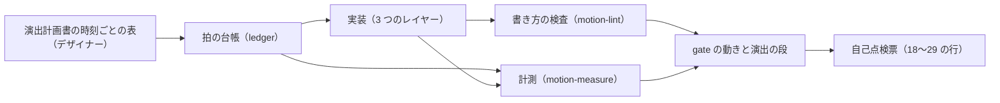

# 没入の型の実装: 3 つのレイヤー、軽い手段、試験の約束と計測

> **3 行でわかる要約**
> 1. 画面の型が没入のときに、場面の演出を作って測るための決まりで、ほかの型では読まなくてよい。
> 2. 画面を 3 つのレイヤーに分けて軽い手段から選び、ページは試験の約束 `window.__scene` を持つ。
> 3. 演出は `scripts/motion-measure.sh` が画面なしのブラウザで 12 項目を測り、予算の案と比べて判定する。

## 1. 目的と範囲

読み手は、実装計画の「画面の型」が没入のときのフロントエンドである。型は依頼者がプロジェクトごとに 1 回決め、計画書はそれを写すだけなので、この文書では型を選び直さない。予算と合格の線はどれも案で、最初のサンプルで測って決め直す。

| 画面の型 | この文書 | 動きの決まり |
|---|---|---|
| 没入 | 読む | 応答の動きは 200ms まで。場面の演出は、この文書の決まりで作って測る |
| 既存に合わせる | 読まない | `cross-cutting.md` の動き。既存の UI の値から外れない |
| 今の型 | 読まない | `cross-cutting.md` の動き |

応答の動き（押した、選んだ、開いたへの返事）の上限は、型で分ける。今の型と既存に合わせる型は 300ms 未満、没入の型は 200ms までにする。長さを使えるのは場面の演出だけである。長さの代わりに、飛ばせる・縮小版がある・入力を失わない・最初のフレームが 100ms 以内、の 4 つで縛る。

デザイナーは動きを 4 つの区分（応答・移動・見せ場・環境）で書く。この文書は、それを 2 種類（応答の動き・場面の演出）と背景で受ける。対応は次の表のとおりで、長さの枠はデザイナーの計画書の値を正にする。

| デザイナーの区分 | 長さの枠（デザイナーの計画書） | この文書での扱い |
|---|---|---|
| 応答 | 80〜200ms | 応答の動き。縮小版は 0ms |
| 移動 | 240〜500ms | 場面の演出。飛ばせて、途中で次の操作を受ける |
| 見せ場 | 初回 600〜1,400ms、2 回目から 600ms 以下 | 場面の演出。演出計画書と台帳で作り、motion-measure で測る |
| 環境 | 周期 4 秒以上 | 背景のレイヤー。5 秒を超えるなら止める操作を置く |

## 2. 全体図

拍の台帳を、実装と計測の両方が読むのが芯である。計画の時刻と実装の時刻と測った数字が、同じ台帳でつながる。



図の読み方: 左から右へ読む。台帳から出る 2 本の矢印が、実装と計測が同じ台帳を読むことを表す。

## 3. 用語

繰り返し使う語を先にそろえる。現場で通じる語は言い換えず、そのまま使う。

| 語 | 意味 |
|---|---|
| 応答の動き | 押した、選んだ、開いたへの返事の動き。今の型と既存に合わせる型で 300ms 未満、没入の型で 200ms まで |
| 場面の演出 | 場面から場面へ移る間の、振り付けのある動き。スタートからログインへの遷移がこれに当たる |
| 拍 | 演出の中の 1 つの区切り。時刻、対象、変化、長さを持つ |
| 拍の台帳 | 拍を機械が読める形で書いた物（ledger）。実装と計測が同じ物を読む |
| フレーム | 画面の 1 回の描き直し。毎秒 60 回なら、1 フレームは約 16.7ms |
| 縮小版 | OS の「動きを減らす」設定（prefers-reduced-motion）のときに出す、位置の動かない版 |
| メインスレッド | JS とレイアウトが走る場所。詰まると、入力と JS の動きが止まる |
| コンポジター | 描いた層を重ねて画面に出す係。transform と opacity は、ここだけで動かせる |
| View Transitions | 場面の前後をブラウザが撮り、間を補う標準の API |
| WAAPI | Web Animations API。JS から CSS と同じ仕組みの動きを作り、止め、巻く標準の API |
| LoAF | Long Animation Frames。50ms を超えたフレームと、原因のスクリプトを記録するブラウザの API |
| CDP | Chrome DevTools Protocol。ブラウザを外から操る口で、CPU を遅くする設定もここにある |
| Playwright | ブラウザの自動操作の道具。この一式に 1.64.1 が入っている |
| Lighthouse | Google の性能測定の道具。読み込みを測り、押したあとの演出は測らない |

## 4. 3 つのレイヤーと、軽い手段から選ぶ 5 段

画面を 3 つのレイヤーに分け、手段は軽い段から選ぶ。文字と入力は必ず DOM に置くので、演出が重くても読めて打てる。

### 4.1 3 つのレイヤー

レイヤーごとに作り方と守り方を変える。背景は最初の画面が出たあとで読み、最初の 1 画面の予算に入れない。

| レイヤー | 中身 | 作り方 | 守り方 |
|---|---|---|---|
| 前景 | 文字、入力欄、ボタン | DOM。最初の描画から読める。色の決まった板の上に置く | 役割と名前で操作できる。文字と地の比は 4.5 対 1 を計算する |
| 舞台 | 場面の出入り、場面をまたぐ要素 | CSS、View Transitions、WAAPI。動かすのは transform と opacity | 縮小版と飛ばす操作を持つ。去る場面は inert（操作も読み上げも受けない属性）にする |
| 背景 | 粒子、奥行き、光 | canvas か WebGL。LCP のあとに読む | 読み上げから隠す。5 秒を超えて動くなら、止める操作を置く |

### 4.2 軽い手段から選ぶ 5 段

上の段ほど軽くて測りやすいので、上の段で作れない拍だけ下の段に降りる。計測で見えない段を使った拍は、台帳で engine の印を付ける。

| 段 | 手段 | 向く拍 | 増えるアセット | 計測で見えるか |
|---|---|---|---|---|
| 1 | CSS の transition と animation。ずらしは animation-delay | 部品の出入り、順に現れる列 | なし | 見える |
| 2 | View Transitions | 場面から場面。場面をまたぐ要素の変形 | なし | 見える |
| 3 | WAAPI | 拍の時刻をそろえる振り付け。飛ばす、巻く | 台帳と再生の関数だけ | 見える |
| 4 | canvas と WebGL | 粒子、奥行き、光 | 描く関数とアセット。測って計画に書く | 見えない。seek(ms) の絵で見る |
| 5 | 事前に作った動画 | その場で描けない映像 | 動画のアセット。測って計画に書く | 再生の有無だけ |

ライブラリ（GSAP、three.js、Rive など）は、最初のサンプルでは使わない。標準の API で作れない拍が出たら、増える KB を測ってから依頼者に伺う。道具の導入は、今の決まりでも承認の要る判断だからである。

## 5. 実装の決まり 10 個

決まりは 10 個で、どれも 7 節の計測の項目と対になる。決まりを破ると、対になる項目が落ちる。

| # | 決まり | 理由 | 対になる計測 |
|---|---|---|---|
| 1 | 押す前に準備し、押したら走らせるだけにする。アセットの読み込み、音の用意、描画の準備は題名の画面のあとに済ませる。動きは idle のまま組んでおき、押したら開始の時刻を入れるだけにする。毎フレーム描く canvas は、1 フレームの仕事を小さく保つ | 押した瞬間と毎フレームの仕事が重いと、最初のフレームが遅れ、押した直後のフレームが落ちる | 1、3、4、12 |
| 2 | ボタンは標準の button。押し込みの見た目は pointerdown と keydown で先に出し、場面の移動は click で始める | 指を離す前に返事が出る。指をずらして離せば取り消せる（WCAG 2.2 の 2.5.2） | 1 |
| 3 | 進行は状態の機械 1 つで持つ。動きの終わりのイベントを待って次へ進めない | 縮小版や飛ばしで動きが無いと、イベントが来ずに止まる | 6、7 |
| 4 | 場面は URL に置く | 「戻る」と再読み込みが効く。状態の置き場は 1 つの決まりに合う | 8 |
| 5 | DOM の動きは CSS か WAAPI で書く。requestAnimationFrame で DOM を動かさない | ブラウザが動きを一覧にでき、コンポジターで走る | 2、5 |
| 6 | 背景のエンジンは、時刻と乱数の種を外から受け取る。始める、止める、指定の時刻を描く、の 3 つを持つ | 同じフレームを何度でも撮れる。止められる | 9、11 |
| 7 | 色と時間は、canvas の中でもトークンか台帳から読む | トークンだけで描く決まりを、背景にも通す | lint |
| 8 | どのキーでも、どこを押しても飛ばせる。2 回目からは短い版にする | 急ぐ人と毎日使う人を待たせない | 7 |
| 9 | 焦点は、演出計画書の守りの表の「終わりのフォーカス」の要素に、時刻ごとの表のフォーカスの時刻（多くは演出の終わり）で入れる。途中で打った字は、飛ばして 1 つ目の入力欄に入れる。場面が替わるときに title を変える | 打った字を失わない。読み上げに場面の変化が伝わる | 8 |
| 10 | 音は、動きとは別のスイッチで持つ。操作の前には鳴らさない | 音で困る人と動きで困る人は別。ブラウザも操作の前の音を止める | 10 |

## 6. 試験の約束: window.__scene と拍の台帳

没入の型の画面は、計測のために `window.__scene` を持つ。計測のスクリプトは、この約束と本物の入力だけで演出を動かして測る。

### 6.1 約束の 6 つ

約束は台帳 1 つと関数 4 つで、ready だけは任意である。どれも欠けると、欠けた物を使う項目が「測れない」で落ちる。

| 名前 | 形 | 振る舞い |
|---|---|---|
| ledger | JSON にできる値だけの物 | 拍の台帳。形は 6.2 にある |
| play() | 関数。Promise を返してよい | 押す前の状態から演出を始める。入力の処理と同じ道を通る |
| seek(ms, 版) | 関数。Promise を返してよい | 演出の時刻を ms に合わせて止め、その時刻の姿を描く。背景のエンジンも同じ時刻を描く。版（full・short・reduced）は任意で、渡されたらその版の姿を描く。フレームの撮影（7.5）が使う |
| skip() | 関数。Promise を返してよい | 終わりの状態へ進める。飛ばす操作と同じ道を通る |
| reset() | 関数。Promise を返してよい | 押す前の状態へ戻す。時計と乱数の種も最初に戻す |
| ready | Promise（任意） | 準備が済んだら解決する。準備には、背景のエンジンの読み込みと、次に押したときの動きを組むことまで含める（決まり 1）。無いときは、`window.__scene` を置いた時刻を準備の完了とみなす |

`window.__scene` は 1 ページに 1 つで、題名の画面を描いたあとに置く。ready は `window.__scene` と同じときに置き、あとから足さない。演出が終わったら DOM を書き換え続けない。計測では、style の属性を除く書き換えが 150ms 止んだ時点が、演出の終わりになる。

### 6.2 台帳の形

台帳は、デザイナーの演出計画書の時刻ごとの表を写した JSON である。次の例の値は架空で、鍵の意味は例の下の表にある。

```json
{
  "id": "scene-start-login",
  "total_ms": 1400,
  "short_ms": 600,
  "trigger": { "role": "button", "name": "スタート" },
  "focus": { "role": "textbox", "name": "メールアドレス", "at_ms": 1400 },
  "title": "ログイン",
  "inert": ["#title-scene"],
  "skip": { "key": "Enter", "at_ms": 200 },
  "reduced": { "kind": "fade", "ms": 150 },
  "ambient": { "stop": { "role": "button", "name": "背景の動きを止める" } },
  "sound": { "mute": { "role": "button", "name": "音を消す" } },
  "beats": [
    { "at_ms": 0, "target": "start-button", "ms": 120, "props": ["transform"], "sound": "tap" },
    { "at_ms": 120, "target": "particles", "ms": 600, "engine": "background" },
    { "at_ms": 200, "target": "title", "ms": 400, "props": ["transform", "opacity"] },
    { "at_ms": 900, "target": "login-frame", "ms": 400, "props": ["transform", "opacity"] }
  ]
}
```

必須の鍵は id・total_ms・trigger・focus・beats の 5 つで、ほかは書いたときだけ計測が確かめる。id は演出計画書の演出 ID（`scene-前-次` の形）と同じにし、計測の設定の scene にも同じ値を書く。

| 鍵 | 中身 | 使う項目 |
|---|---|---|
| id | 演出計画書の演出 ID と同じ値。英数字・点・ハイフン・下線 | 全部（設定の scene と違えば全部落ちる） |
| total_ms、short_ms | 全体の長さと、2 回目からの短い版の長さ | 2、6、7 |
| trigger | 押す要素の role と name か、selector。計測は本物の入力でこれを押す | 全部 |
| focus | 終わりに焦点を置く要素の role と name か、selector。at_ms は焦点を入れる時刻で、演出計画書の時刻ごとの表のフォーカスの時刻と同じ | 6、7、8 |
| title、inert | 終わりの title に含まれる語と、終わりに inert か隠れているべき要素のセレクタ | 8 |
| skip | 計測が押すキー（既定は Enter）と、押す時刻（既定は 200ms） | 7 |
| reduced | 縮小版の種類と長さ | 6 |
| ambient.stop | 5 秒を超える動きを止める操作の role と name | 9 |
| sound.mute | 消音の操作の role と name。音を鳴らす演出では必須 | 10 |
| beats | 拍の並び。target は動く要素の id か data-beat の値、WAAPI の id、view-transition-name のどれか。props は動かしてよい属性。engine は canvas などの拍、sound はその拍で鳴らす音 | 2、5、10 |
| allowed_props | 拍に当たらない動きに許す属性。既定は transform と opacity | 5 |

台帳は、版ごとに拍を分けた形でもよい。versions.full・short・reduced に total_ms を置き、versions.full.beats の拍ごとに tracks（要素ごとの動き）を並べる形である。計測は tracks の 1 つを 1 拍として読み、tracks の id を WAAPI の id と照らす。複数の要素に同じ拍を付けると、id の後ろに「#1」のような番号が付く。計測は、これも同じ拍と数える。

### 6.3 計測が約束をどう使うか

計測は、押す操作とキーを本物の入力で送り、約束の関数は巻き戻しと時刻合わせにだけ使う。項目と約束の組は次のとおりである。

| 項目 | 使う約束 |
|---|---|
| 1〜5、8、10、12 | trigger の上へポインターを動かし、2 フレーム待ってから押す。終わりまで待つ |
| 6 | 動きを減らす設定で trigger を押す。終わりの読み上げの木と焦点を通常の回と比べ、終わったあとの 2 枚も比べる |
| 7 | reset() のあと trigger を押し、skip の時刻にキーを押す |
| 9 | reset()、play()、skip() で終わりの状態へ進め、5 秒待つ |
| 11 | reset() のあと、seek(ms) で 33ms ずつ時刻を巻いて撮る |
| フレームの撮影 | reset() のあと、seek(ms, 版) で 100ms ずつ時刻を巻いて撮る。静止の画面と飛ばしたときは、trigger とキーの本物の入力で撮る |

## 7. 計測: motion-measure の 12 項目

`scripts/motion-measure.sh` は、Playwright（ブラウザの自動操作の道具）で画面なしの Chromium を起こし、12 項目を測る。入っている道具だけで測り、新しい依存は入れない。

### 7.1 12 項目と合格の線

合格の線はどれも案で、最初のサンプルで測って決め直す。予算の理由は `performance-budget.md` の「演出の予算」にある。

| # | 測るもの | 測り方 | 合格の線（案） |
|---|---|---|---|
| 1 | 最初のフレーム | trigger を押し、Event Timing の duration を読む。今の INP の測り方と同じ | 100ms 以内 |
| 2 | 拍と長さ | getAnimations で動きを一覧にし、台帳の拍と比べる。時刻は最初の拍に合わせてから比べる | 拍が全部あり、差は ±20ms。最初の拍の遅れは 100ms 以内 |
| 3 | フレームの間隔 | requestAnimationFrame の間隔を、押してから終わりまで記録する | 50ms 超は 0 個。25ms 超は 5% 以内 |
| 4 | 長いフレームの原因 | LoAF の記録から、スクリプトの名前と ms を出す | 0 件。出たら原因を表示 |
| 5 | 動かす属性 | 動きごとに getKeyframes の属性の名前を読む | 台帳で許した属性だけ |
| 6 | 縮小版 | 動きを減らす設定で同じ操作をし、終わったあとに 1 秒あけた 2 枚を比べる | 位置の動きが 0 本、終わりの状態が同じ、終わったあとの差が 0px |
| 7 | 飛ばす | 途中の時刻でキーを押す | 300ms 以内に終わりの状態 |
| 8 | 焦点と読み上げ | 終わりの焦点の要素、title、去った場面を読む | 台帳どおり |
| 9 | 5 秒を超える動き | 5 秒待って 1 秒あけた 2 枚を比べ、動いていれば止める操作を押して撮り直す | 動かないか、止めたあとの差が 0px |
| 10 | 音 | 再生の命令を記録する。操作の前、消音のとき、拍との差を見る | 操作の前 0 回、消音で 0 回、差 ±20ms |
| 11 | 閃光 | 33ms ごとに時刻を巻いて撮り、16 区画ごとに明るさの反転を数える | 1 秒に 3 回以内 |
| 12 | アセットと準備 | 要求を LCP の前と後に分け、brotli 後の大きさで数える | 初期表示の JS 170KB、演出のアセット 600KB（うち JS 170KB）、準備 3 秒以内、外への要求 0 件 |

### 7.2 測る条件

CPU は等速と 4 倍遅く（CDP の Emulation.setCPUThrottlingRate）の 2 条件で、既定は 3 回ずつ回す。判定は項目ごとに、6 回のうち悪い側を採る。回ごとに新しいブラウザの文脈を開くので、前の回の記憶は残らない。画面の大きさの既定は 1,280 × 800 である。

測るのは画面なしのブラウザで、GPU ではなくソフトウェアで描くことが多い。出力の「描画」の行に、画面なしで測ったことと WebGL の描き手の名前を必ず書く。GPU での滑らかさは、この計測では確かめていないと読む。

外のネットワークには出ない。対象は 127.0.0.1・localhost・[::1] だけで、ページが外へ出す要求は止めて数え、項目 12 で落とす。

### 7.3 使い方と設定

設定のファイルで、対象と演出の ID を渡す。dir を書けば、スクリプトが 127.0.0.1 の空きポートで配る。url を書けば、起こしてあるサーバーを測る。

```text
$ bash skills/frontend/scripts/motion-measure.sh --config tmp/flow/<件名>/motion-measure.json
$ bash skills/frontend/scripts/motion-measure.sh --dir <置き場> --scene scene-start-login
$ bash skills/frontend/scripts/motion-measure.sh --config tmp/flow/<件名>/motion-measure.json --frames tmp/flow/<件名>/frames
$ bash skills/frontend/scripts/motion-measure.sh --judge <記録.json>
$ bash skills/frontend/scripts/motion-measure.sh --selftest
```

```json
{
  "scene": "scene-start-login",
  "dir": "../../../samples/immersive",
  "path": "/",
  "viewport": { "width": 1280, "height": 800 },
  "record": "motion-measure-record.json"
}
```

設定の鍵は 6 つで、知らない鍵があれば誤りとして止まる。dir と record は、設定のファイルからの相対で読む。設定に書いた record は、設定の置き場か tmp/.verify の下だけに書ける。書き込み先が外へ出るときと、hooks（操作を止める仕組みの置き場）や .claude・.cursor・.git の下のときは、誤りとして止まる。

| 鍵 | 中身 | 既定 |
|---|---|---|
| scene | 演出の ID。台帳の id と同じ | 必須 |
| dir | 静的なファイルの置き場 | dir か url のどちらか 1 つ。gate からは対象のディレクトリ |
| url | 起こしてあるサーバーの URL。127.0.0.1・localhost・[::1] だけ | 同上 |
| path | dir のときに開くパス | / |
| viewport | 画面の幅と高さ | 1,280 × 800 |
| record | 記録の JSON の置き場 | tmp/.verify/motion-measure-<ID>.json |

### 7.4 出力と記録

出力は、項目ごとの RESULT の 1 行と全体の RESULT の 1 行で、落ちた項目にはその前に FAIL の行で理由が付く。次の例の数値は架空である。

```text
RESULT: PASS motion-measure 1 最初のフレーム: 押してから最大 48ms（CPU 4 倍遅い条件の 1 回目。予算 100ms）
RESULT: PASS motion-measure 2 拍と長さ: 拍 3 本が全部走り、最初の拍に合わせた時刻と長さの差は最大 0ms（許容 ±20ms）
RESULT: PASS motion-measure 3 フレームの間隔: CPU 等速: 最大 16.8ms、25ms 超 0.0%、50ms 超 0（94 個）
（4〜12 の行は省いた）
描画: 画面なしのブラウザ（Chromium 156.0.8078.4、headless）で測った。WebGL は SwiftShader（ソフトウェア描画）。GPU での滑らかさは未確認
記録: tmp/flow/dive-log/motion-measure-record.json
RESULT: PASS motion-measure scene-start-login (PASS 12、FAIL 0。2 条件で計 6 回の悪い側。画面なしのブラウザ)
```

記録の JSON には、測った値をそのまま残す。中身はフレームの間隔と動きの一覧、音の命令と明るさの列、アセットの一覧である。判定は記録だけから出すので、`--judge` で同じ記録を何度でも判定し直せる。架空の記録（browser.fictional）は、12 項目が通っても FAIL になる。判定の試験だけは `--allow-fictional` で許す。

### 7.5 監修のフレーム

デザイナーの監修は、撮ったフレームを見て計画と比べる（`skills/designer/references/review-method.md` の 6 節）。撮るのはフロントエンドである。`--frames <置き場>` を付けると、計測の代わりにフレームを撮る。

| 撮るもの | 撮り方 | ファイル |
|---|---|---|
| 初回 | seek(ms, 'full') で 0ms から total_ms まで 100ms ごと | full-0000.png など |
| 2 回目以降 | seek(ms, 'short') で 0ms から short_ms まで 100ms ごと | short-0000.png など |
| 動きを減らす設定 | 設定を有効にした画面で、seek(ms, 'reduced') の始まり・半ば・終わり | reduced-0000.png など |
| 静止の画面 | trigger を押し、終わってから 1 秒あと | still.png |
| 飛ばしたとき | trigger を押し、skip の時刻にキーを押して 300ms あと | skip.png |

一覧は置き場の frames.json に残る。撮った日時とブラウザの版と画面の大きさ、ファイルごとの版と時刻が入るので、監修記録の対象の表に置き場をそのまま写す。

## 8. gate と自己点検票

`scripts/frontend-gate.sh` に `--plan` で実装計画を渡すと、画面の型が没入のときだけ、演出の段が加わる。没入の型の実装計画には、「演出の実装」の節と、性能予算の演出の行が要る。frontend-plan-check が、欠けた計画を落とす。

| 場合 | 演出の段 |
|---|---|
| 画面の型が没入で、計画書と同じ置き場に motion-measure.json がある | 測る。--full は 2 条件 × 3 回、--fast は 2 条件 × 1 回 |
| 画面の型が没入で、設定が無い | FAIL。設定の置き場を出す |
| 画面の型が既存に合わせる型か今の型 | SKIP と型を出す |
| --plan があるのに、画面の型の行か値が読めない | FAIL。行の見出しは「画面の型」を含めばよく、** とバッククォートは外して読む |
| 同じ置き場の design-plan.md と、画面の型が食い違う | FAIL（型の照合）。受付票の型にそろえる |
| --plan が無い | 段を出さない |

自己点検票では、18〜29 の行に 12 項目の数字を写し、「演出の計測」の節に出力をそのまま貼る。文書情報の表には、画面の型と、演出の記録とフレームの一覧の置き場を書く。self-check は、没入の型でこれらが欠けると落とす。計測のスクリプトそのものの試験は、`evals/run.sh` の記録の正例と負例が受け持つ。実ブラウザでの試験は、`evals/run.sh --browser` が `evals/fixtures/scene/` を測る。

## 9. 落とし穴

どれも、演出を足したあとで気づくと直しが大きくなる所である。1・2・10 は試験用の場面で、11・12 はサンプル（samples/immersive）のトレースで、2026-11-26 に測って確かめた。

| # | 落とし穴 | 避け方 |
|---|---|---|
| 1 | 押した瞬間に AudioContext を作ると、その処理だけで 119ms かかり、最初のフレームが 152ms になった | 音の用意は押す前に済ませ、押したら resume() と再生だけにする（決まり 1） |
| 2 | 押した時刻から拍を比べると、入力から最初のフレームまでの遅れ（測った例で 25〜32ms）が全部の拍に乗る | 拍どうしは最初の拍に合わせて比べ、入力の遅れは項目 1 と、最初の拍の遅れ 100ms の線で見る |
| 3 | 上限を外すだけだと、長いだけの横滑りが出る | 長さではなく中身を縛る。中身の良し悪しは、デザイナーの監修がフレームを見て決める |
| 4 | requestAnimationFrame の間隔は、メインスレッドのフレームしか表さない | 項目 3 はメインスレッドのフレームと読む。コンポジターの側は、GPU のある環境で別に見る |
| 5 | 平均のフレーム数は、途中の止まりを隠す | 判定は、50ms 超の個数と 25ms 超の割合で下す |
| 6 | 動きの終わりのイベントで場面を進めると、縮小版や飛ばしで止まる | 進行は状態の機械で持つ（決まり 3）。項目 6 と 7 が、終わりに着くかを見る |
| 7 | 回り続ける動きは、WAAPI の finish() で終わらせられない | 飛ばすときは、終わりのある動きは finish()、回り続ける動きは止めて終わりの姿を描く |
| 8 | 画面なしのブラウザでは音が聞こえない | 機械で見るのは、いつ何を鳴らす命令が出たかまで。音の好みは、依頼者がサンプルを開いて聞く |
| 9 | 没入の検査を管理画面に掛けると、今の完成例が落ちる | 検査は画面の型で分ける。gate の演出の段は、型が没入のときだけ測り、ほかの型は SKIP にする |
| 10 | 時刻の項目は、同じ機械でほかのブラウザや試験が走ると揺れる。試験用の場面を 12 回測り、1 回だけ落ちた | 重い処理と並べて測らない。落ちたら記録の JSON で原因の行を見てから、測り直す |
| 11 | 背景の canvas を全画素で毎フレーム描くと、CPU を 4 倍遅くした条件で 1 フレームに約 11ms かかった。押した直後の仕事が重なり、そのフレームが 50〜67ms になった | なめらかな階調の水と光は、画面の半分の解像度で描いて CSS で引き伸ばす。サンプルでは 1 フレーム約 3ms になった |
| 12 | 計測で Playwright の locator.click を使うと、押す直前に Playwright のスクリプトが 11〜12ms 走った。4 倍遅い条件では、その遅れが押した直後のフレームに乗った | motion-measure は、先にポインターを要素の上へ動かし、2 フレーム待ってから押す。人も押す前にポインターを動かすので、測る条件も同じにする |

## 10. やらないことと未確定

最初のサンプルでやらない物と、まだ決まっていない値を分けて書く。未確定の項目は、最初のサンプルを測ったあとで決める。

| 区分 | 項目 | 今の扱い |
|---|---|---|
| やらない | ライブラリと外部のアセット | 使わない。要るときは KB を測って伺う |
| やらない | 1 ページに 2 つ以上の演出 | 約束は 1 ページに 1 つ。増えたら約束を広げる |
| 未確定 | 没入の画面の LCP と CLS | motion-measure は判定しない。gate の画面の段（axe と Lighthouse）は対象が samples/app のときだけ回るので、移した先の没入の画面では測る手段がまだ無い。自己点検票では未確認と書く。一式のサンプル（samples/immersive）は、tools/immersive-test.mjs が Lighthouse の既定のモバイル条件で 1 回測る |
| 未確定 | 予算と合格の線の値（7.1 の表） | 案。最初のサンプルで測って決め直す |
| 未確定 | GPU での滑らかさ | 画面なしのブラウザでは確かめられない。GPU のある環境での測り方は決めていない |
| 未確定 | canvas の拍の時刻 | 項目 2 は DOM の拍だけを比べる。エンジンの拍は seek(ms) の絵でしか見ていない |

## 付録: 出典

設計の正本は、この一式に入っているデザイナーの決まり（`skills/designer/references/systems.md` の 4 節）と、演出計画書の完成例（`skills/designer/examples/motion-plan-dive-log.md`）である。外の出典は手元の知識で書き、この文書を書くときに本文は開いていない。

| 出典 | 使った所 | 確かめたか |
|---|---|---|
| designer の systems.md の 4 節と、演出計画書の完成例 | 動きの区分と枠、見せ場の 5 つの条件、守り、時刻ごとの表 | 2026-11-26 に読んだ |
| WCAG 2.2 の 2.2.2、2.3.1、2.3.3、1.4.2、2.5.2 | 止める操作、閃光、縮小版、音、押し込み | 手元の知識 |
| MDN の Web Animations、View Transitions、Long Animation Frames、Event Timing | 手段と計測 | 手元の知識 |
| Chrome DevTools Protocol の Emulation.setCPUThrottlingRate | 測る条件 | 手元の知識。2026-11-26 に動かして確かめた |
| Playwright の reducedMotion と ariaSnapshot | 項目 6 と 8 | 手元の知識。2026-11-26 に動かして確かめた |
