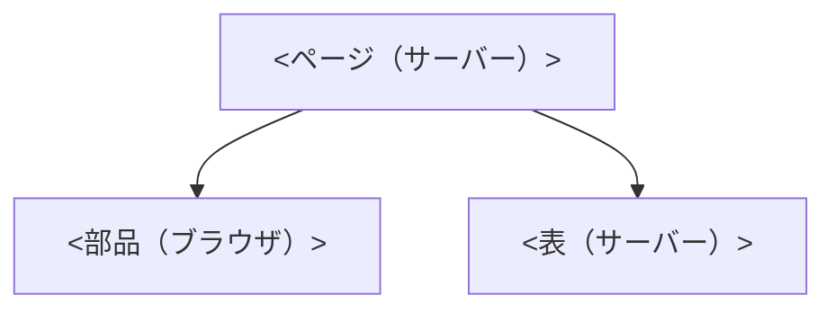

# 実装計画: <件名>

> **3 行でわかる要約**
> 1. <誰の、どの画面を、何のために作るかを 1 文で>。
> 2. <構成の要点（サーバーで描くもの、ブラウザで動くもの）と、予算の 2 つの数字>。
> 3. <読み手が次にすること。秘書は承認伺いへ、バックエンドは API への要望に答える、デザイナーは監修>。

| 項目 | 内容 |
|---|---|
| 作成日 | <YYYY-MM-DD> |
| 状態 | 承認待ち |
| 数値 | <測った値か「架空」> |
| 入力 | デザイン計画書、tokens.css、画面仕様、API の契約 |
| 置き場 | tmp/flow/<件名>/frontend-plan.md |

## 背景と目的

<いまの画面の困りごとを、測った値で 2〜3 文。作り直しの目的を 1 文>。

| 項目 | いま | 目標 |
|---|---|---|
| 初期表示（LCP） | <秒> | 2.5 秒以内 |
| 操作の応答（INP） | <ms> | 200ms 以内 |
| JS の転送量 | <KB> | 170KB 以内 |
| 自動検査の違反 | <件> | 0 |

## 全体像

<部品の親子関係と、動く場所を 1 図で>。

図の読み方: <矢印の意味を 1 文>。

## 構成

<分け方の方針を 1〜2 文>。

| 部品 | 置き場 | 動く場所 | 理由 |
|---|---|---|---|
| <部品名> | <ファイルの場所> | <サーバー／ブラウザ／両方> | <なぜその場所か> |

## 状態

<出どころで分け、置き場を 1 つずつ決めたことを 1 文>。

| 状態 | 出どころ | 置き場 |
|---|---|---|
| <絞り込み、並び順、ページ> | URL | <クエリ文字列> |
| <一覧と件数> | サーバー由来 | <サーバーの部品の引数か、取得の仕組み> |
| <開閉、選択> | 画面の操作 | <部品の中> |
| <入力中の値> | フォーム | <入力欄の部品の中> |

## データ取得

<要求の本数と、呼ぶ側を 1 文>。

| 要求 | いつ | 方法 | 時間の上限と失敗時 |
|---|---|---|---|
| <一覧と件数> | <初期表示と URL の変化> | <サーバーの部品が 1 回呼ぶ> | <800ms で打ち切り、エラーの状態へ> |

## エラー表示

<2 文の型と、コードの出どころ（画面仕様と契約）を 1 文>。

| エラーコード | 何が起きたか | どうすればよいか | 置き場 |
|---|---|---|---|
| <CODE> | <1 文> | <1 文> | <表の位置／面の中／画面上部> |

## 性能予算

<予算の出どころと、超えたら落ちる仕組みを 1〜2 文>。

| 指標 | 予算 | 目標 | 測り方 | 測定条件 |
|---|---|---|---|---|
| 初期表示（LCP） | 2.5 秒以内 | <秒> | Lighthouse CI | <ビルド、回線、CPU、幅、回数と集計> |
| 操作の応答（INP） | 200ms 以内 | <ms> | Playwright で操作を送り、event の最大 | <同じ条件> |
| 画面のずれ（CLS） | 0.1 以内 | <値> | Lighthouse CI | <同じ条件。3 回の最大> |
| 初期表示の JS の転送量 | 170KB 以内（brotli 後） | <KB> | size-limit | ビルド後に 1 回 |

## テスト

<対応の方針（1 対 1、レベルの配分）を 1 文>。

| # | 受け入れ条件 | テスト名 | レベル | サイズ |
|---|---|---|---|---|
| 1 | <条件> | <テスト名> | <単体／結合／端から端まで> | <small／medium／large> |

## アクセシビリティ

<部品の型（APG）の選び方を 1 文>。

| 項目 | 実装 | 確かめ方 |
|---|---|---|
| <表の型、面、焦点、押せる領域、読み上げ、自動検査> | <どう作るか> | <テスト番号か手動の手順> |

## デザイン忠実度の確認

<受け取ったものと、ずれの測り方を 1〜2 文>。

| 受け取るもの | 内容 | 受領の判定 |
|---|---|---|
| <計画書、tokens.css、画面仕様、動きの表> | <要点> | <受領／差し戻し> |

## 横断事項

<計画の段階で決める理由を 1 文>。

| 事項 | 決めたこと | 確かめ方 |
|---|---|---|
| 動き | <場面と ms、縮小版> | motion-lint |
| 国際化 | <文言の表、書式化> | <grep の対象> |
| 安全 | <無害化、鍵、CSP> | <lint と CSP の報告> |
| 型と道具 | <tsc、eslint、zod> | frontend-gate.sh |
| トークン | <tokens.css の変数だけで描く> | token-lint |

## 実装の進め方

<段階の数と、段階ごとに gate を回すことを 1 文>。

| 段階 | 納品物 | 確認 | 期間 |
|---|---|---|---|
| 1 <名前> | <何ができるか> | <どの検査が PASS か> | <日付> |

## やらないこと

<意図して外したものを先に書く理由を 1 文>。

| やらないこと | 理由 |
|---|---|
| <外したもの> | <理由> |

## 未確定

<決まっていないことの数と、実装を止めないことを 1 文>。

| # | 決まっていないこと | 決め方 |
|---|---|---|
| 1 | <こと> | <誰に、いつまでに、既定は何か> |

## 受け渡し

<誰に何を渡すかを 1 文>。

| 誰に | 何を | いつ |
|---|---|---|
| 秘書 | 承認伺いに写す 3 点（構成、予算、段階） | いま |
| バックエンド | API への要望 | 承認後 |
| デザイナー | 忠実度の報告と監修の依頼 | 実装後 |
