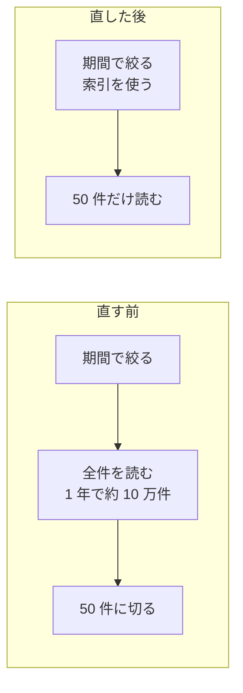

# fix(admin-orders): 注文一覧を、画面に出す分だけ読む作りに変える

> **3 行でわかる要約**
> 1. 注文一覧で期間を 1 年にすると 9 秒かかる不具合を、画面に出す 50 件だけを読む作りに変えて直す PR です。
> 2. 検証環境の測定で 9.2 秒が 0.8 秒になり、表示する中身と並び順は直す前と同じでした。
> 3. レビュアーは「レビューの観点」の 2 点を重点的に見て、承認か差し戻しを返してください。

関連 Issue: Closes #128。この PR の件数と時間は、すべて架空です。

## 背景と目的

CS（お客さまの問い合わせ窓口）の担当者は、電話で客の注文を探すときに、期間を 1 年にします。今の注文一覧は、期間で絞ったあと全件を読んでから 50 件に切ります。そのため期間が長いほど遅く、1 年では平均 9.2 秒かかります。
この PR は、Issue の完了の条件 4 件を満たすことを目的にします。Issue のリンクが将来たどれなくても読めるよう、要点をここに書きました。

## 変えたこと

変えたのは 3 か所です。画面と API の契約は変えていません。

| 場所 | 変更 | 理由 |
|---|---|---|
| 注文一覧の API で、一覧を取る処理 | 全件を読んでから切る作りを、50 件だけを読む作りに変えた | 期間が長くても、読む量を一定にするため |
| 注文の表 | 受注日時の列に索引を足した | 期間で絞るときに、全件を調べずに済むようにするため |
| 一覧を取る処理のテスト | 1 年分の注文 10 万件で、件数と並び順を確かめるテストを足した | 直す前と同じ中身が出ることを、毎回機械で確かめるため |



図の読み方: 上が直す前、下が直した後です。直した後は、期間が長くても読む件数は 50 件のままです。

## 方針

案は 3 つ比べ、案 A を採りました。決め手は、画面を変えずに Issue の条件をすべて満たせることです。

| 案 | 結果 | 理由 |
|---|---|---|
| A 50 件だけ読み、受注日時の列に索引を足す | 採用 | 画面と契約を変えずに、条件 1〜4 を満たす |
| B 結果を 5 分間取っておく | 却下 | 同じ条件の 2 回目しか速くならない。電話のたびに条件が違う |
| C 期間の上限を 1 か月にする | 却下 | CS が 1 年前の注文を探せなくなり、目的に反する |

## 影響

利用者に見える変化は、表示が速くなることだけです。観点ごとの影響は次のとおりです。

| 観点 | 影響 | 根拠 |
|---|---|---|
| 利用者 | 期間 1 年の表示が 9.2 秒から 0.8 秒になる。見た目は変わらない | 検証の表 |
| 既存のデータ | 変えない。索引を足すだけ | 移し替えの手順は無い |
| 性能 | 注文を書き込むたびに索引も更新されるが、書き込みの時間の増え方は 1% 未満 | 検証の表 |
| セキュリティ | 変わらない。権限を確かめる処理には触れていない | 差分に権限の処理が無い |
| 互換 | API の入力と出力の形は同じ。画面の変更は要らない | 契約の検査が PASS |
| 他のチーム | 無し | 注文の表を使う他の処理は、索引で遅くならない |

## 検証

実行して確かめた結果だけを書きます。コマンドと出力の抜粋は、付録にあります。

| 確かめたこと | どう確かめたか | 結果 |
|---|---|---|
| 期間 1 年の表示（条件 1） | 検証環境で 10 回測った | 平均 0.8 秒、最大 1.2 秒。10 回とも 3 秒以内 |
| 期間 1 か月の表示（条件 2） | 同じく 10 回測った | 平均 0.4 秒。直す前の 1.1 秒より速い |
| 2〜5 ページ目（条件 3） | 期間 1 年で、各ページを開いた | すべて 1 秒以内 |
| 中身と並び順（条件 4） | 直す前と後の 50 件を突き合わせるテスト | 一致 |
| 自動の検証 | `verify-all.sh` の full | 11 種類すべて PASS |

## レビューの観点

重点的に見てほしいのは 2 点です。読む順は、一覧を取る処理、索引、テストの順が分かりやすいです。

| # | 見てほしい所 | なぜ |
|---|---|---|
| 1 | 同じ受注日時の注文が並ぶときに、順番が毎回同じになるか | 同じ時刻の注文で順番が揺れると、ページをまたいで同じ注文が 2 回出るおそれがある |
| 2 | 索引を足す処理を、本番で注文を止めずに流せるか | 表を止める作り方だと、索引を作る数分のあいだ注文を受けられない |

## リリースと戻し方

出し方は 2 段階です。先に CS の 2 人だけに新しい作りを見せ、1 日問題が無ければ全員に広げます。

| 項目 | 内容 |
|---|---|
| 見る指標 | 注文一覧の表示時間（99% の利用者が待つ時間）と、エラーの割合 |
| 止める基準 | 表示時間が 3 秒を超える、またはエラーが 1% を超える |
| 戻し方 | 設定の切り替えで、1 分以内に元の作りに戻す。索引は残しても害が無い |

## 用語

この PR で初めて出る言葉を、言い換えて並べます。

| 用語 | 意味 |
|---|---|
| API | 画面と注文の記録をつなぐ窓口 |
| 索引 | 記録を速く探すための目次 |
| 契約 | API の入力と出力の形の約束。変えると、画面も直す必要がある |

## 付録: 検証のコマンドと出力の抜粋

検証で実行したコマンドと、出力の要点です。数値は架空です。

```text
$ bash tools/verify-all.sh --full
RESULT: PASS (11/11)

$ bash scripts/measure-orders.sh --period 1y --runs 10
avg=0.8s max=1.2s over_3s=0
```
