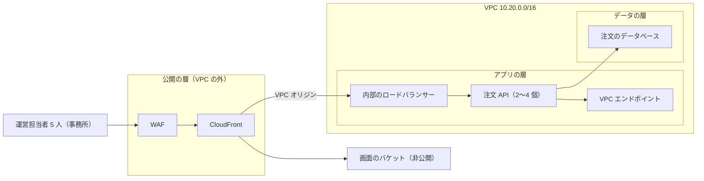
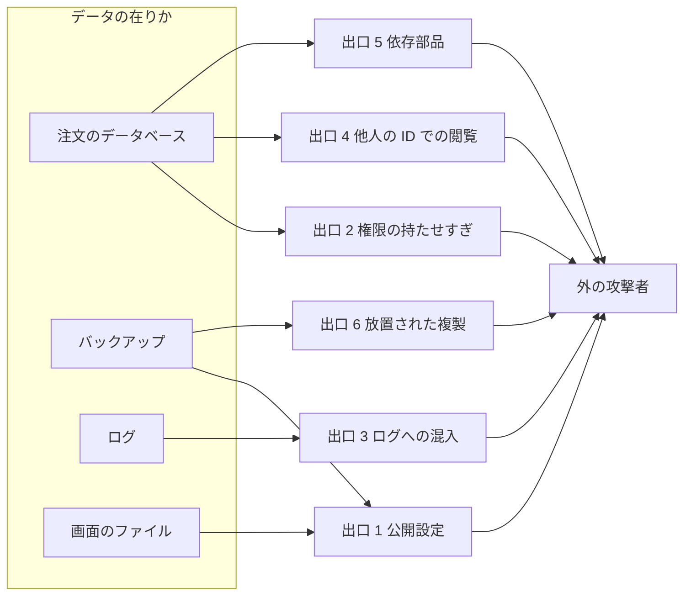

# 設計書: 管理画面の注文一覧を載せるインフラ構成

> **3 行でわかる要約**
> 1. この設計書は、注文一覧の管理画面が載る AWS の構成を決めます。対象は画面の配信・注文 API・データベースで、アカウント ID と金額は架空です。
> 2. 外への道は方針つきの VPC エンドポイントだけです。アカウントの守りと移行の文は「許す物の一覧」で書き、DB の側でも強制します。守りのアカウントへ適用する CI の役割と鳴る先は、その CI が届かない管理のアカウントの芯に置きました。部品は、網の無い作りとダイジェストの土台と、作る job の外が出す来歴で入れます。復元の手順は 10 万行で 0.20 秒と実測しました。
> 3. 費用は本番で月 38,900〜81,400 円で、最大は目標を 6,400 円超えます。取りまとめ役は費用の幅と未確定の 37 件を承認伺いに写し、SRE は通知の宛先と復元の測定を受けてください。

| 項目 | 内容 |
|---|---|
| 作成日 | 2026-11-07 |
| 状態 | 承認待ち |
| 書いた役割 | インフラ |
| 数値 | アカウント ID、金額、件数、単価はすべて架空。復元の秒だけは restore-drill で測った実測 |
| 構成コード | samples/infra/（Terraform。適用はしない静的な見本）。アカウントの上限は org/、アカウントごとの土台は foundation/、外からの見張りは security/ |
| 置き場 | 本番の案件では tmp/flow/admin-orders/infra-design.md |

## 背景

運営担当者 5 人が毎朝 9 時から 10 時に、未出荷の注文 400 件を出荷指示にしています。画面と API はデザイナーとフロントエンドの計画で決まり、残るのは載せる基盤です。注文には注文者の名前と住所が入るので、漏れたときの害が最も大きいのはデータベースです。基盤の仕事は、ここへ人と攻撃者を近づけず、壊れても測った時間で戻すことです。

## 目標

この節は、基盤が満たす数を目標と実測に分けて並べます。目標は約束の値で、実測の列には測った値だけを書きます。

| 項目 | 目標 | 実測 |
|---|---|---|
| 構成コードの静的検査（iac-scan） | FAIL 0 | FAIL 0（資源 330、規則 12。org/、foundation/、security/ を含む） |
| 計画の関所（plan-gate）の自己試験 | 20 例すべて | 20 例すべて PASS（一覧の内と外、値の一覧、置き換え、削除、データを消す変更、来歴、部品、前提の検査） |
| データベースの権限と正本の突き合わせ（db-grants-check） | FAIL 0 | FAIL 0（表 8。正本は samples/api/db-access.json） |
| 移行の文の許す一覧（migrate-gate）の自己試験 | 24 例すべて | 24 例すべて PASS（足し算の DDL の正例 3 つ、攻撃者役の文 20 個） |
| 攻撃者役の移行の文を、手元の PostgreSQL 17 で流す | 写しと読み出しが 1 つも通らない | 22 本のうち 17 本は DB の側で誤り。通った 5 本は、列と表を足す文、索引、外部キー、COPY。足した列は写しの比べ、足した表は突き合わせが誤りにした。COPY は migrate-gate が落とす |
| 第 10 回の攻撃者役の手順（型の付け直しの USING 3 本、生成の列、大きなオブジェクト 2 本、期限の切れた鍵）を、手元の PostgreSQL 17 で流す | 写しと読み出しが 1 つも通らない | 7 本とも止まった。型の付け直しと生成の列は guard_no_rewrite、大きなオブジェクトは権限の取り上げで誤り。期限の切れた鍵は 0 行。許す移行（列、now() の既定値、索引）は通り、突き合わせは移行の利用者と管理者で PASS。旧い書き手の読み書きも通る |
| 外の道具の構成検査（trivy の HIGH 以上） | 0 件 | 0 件（MEDIUM 1 件、LOW 2 件は未確定に回す） |
| 本番のデータベースへの人の直接接続 | 0 回 | 未実測（適用の前） |
| 戻すまでの時間（RTO） | 60 分以内 | 未実測（検証環境で測る） |
| 月の費用 | 75,000 円以内 | 未実測（適用の前。見積もりの最大は 81,400 円） |

## 用語

この節は、設計書に出る略語を先にまとめます。2 回目からは説明を省きます。

| 用語 | 意味 |
|---|---|
| IaC | インフラをコードで作る仕組み。ここでは Terraform を使う |
| VPC | クラウドの中に切った自分専用のネットワーク |
| IAM | 誰が何をしてよいかを決めるクラウドの権限の仕組み |
| KMS | 暗号の鍵を預けて、使った記録を残す仕組み |
| WAF | 要求の中身とアドレスを見て、悪い要求を止める門 |
| OIDC | CI が長期の鍵を持たずに、その場限りの資格を借りる仕組み |
| RPO | 失ってよいデータの時間。5 分なら、最後の 5 分の書き込みまでは失ってよい |
| RTO | 壊れてから戻すまでにかけてよい時間 |
| VPC エンドポイント | インターネットを通らずに AWS の窓口へ届く、VPC の中の出入り口 |
| SCP | 組織がアカウントごとに決める操作の上限。アカウントの管理者でも越えられない |
| RCP | 組織が資源ごとに決める上限。外のアカウントの主体に、バケットや鍵を使わせない |
| 権限の境界 | 役割に付ける権限の上限。方針に何を書いても、境界の外の操作はできない |
| CSP | ブラウザに、読み込みと送信の相手を伝える応答の見出し |
| データイベント | CloudTrail が取る、オブジェクトの読み書きや関数の呼び出しの記録 |
| RLS | データベースの行の単位の制限。条件を書き漏らしても、他の店の行は返らない |
| SNS | 通知を宛先へ送る AWS の仕組み。ここでは SRE の当番へメールで送る |
| IAM Access Analyzer | 資源が外のアカウントへ開いていないかを調べ、所見を出す仕組み |
| DNS Firewall | VPC の中から引ける名前を決め、それ以外を拒む仕組み |
| Amazon Inspector | 配備したイメージを、新しい穴の情報が出るたびに検査し直す仕組み |
| Lambda | 決めた時刻か出来事のたびに、小さなプログラムを動かす仕組み |
| 来歴 | 作った物に付ける「どの workflow が作ったか」の署名。Sigstore（署名の公開の仕組み）で確かめる |
| pg_cron | データベースの中で、決めた時刻に SQL を動かす仕組み。ここでは毎時の突き合わせに使う |
| 監査ログの流し出し | GitHub の操作の記録を、出来事ごとに外の置き場へ送る仕組み（GitHub Enterprise の機能） |
| Mermaid | 文字で図を描く記法 |

## 全体の設計

構成は、画面の配信・注文 API・データベースの 3 つを、3 つの層に分けて置く形です。画面のファイルは非公開のバケットに置き、CloudFront（AWS の配信の仕組み）だけが読みます。注文 API は、CloudFront の VPC オリジン（VPC の中の相手へ直接つなぐ口）から内部のロードバランサーを通ります。配置の図は、次のネットワークの節に置きました。

## 6 本の柱

この節は、AWS の設計の 6 つの観点（柱）ごとに、決めたことと測り方を並べます。測り方の無い決めは書きません。

| 柱 | 決め | 測り方 |
|---|---|---|
| 運用の上手さ | 変更は Terraform と CI だけから出す。計画に置き換えか削除が出たら止める。承認 1 人で通すのは一覧の変更だけで、ほかは承認 2 人の経路へ回す | 人の書き込みと知らない主体の書き込みのアラームが月 0 回。iac-scan と plan-gate が PASS |
| セキュリティ | 3 層の分離、最小権限と権限の境界、秘密は保管庫、保存と通信の暗号化、消せない監査ログ、アカウントと資源の上限 | iac-scan の FAIL 0、trivy の HIGH 以上 0 件、guardrails.tf のアラーム |
| 信頼性 | API は 2 つのゾーンに 2〜4 個、データベースは 2 つのゾーンに置く。復元は毎月測る | SRE の成功率の目標（SLO）、restore-drill と検証環境の復元の秒 |
| 性能の効率 | 一覧の API の応答 2.0 秒以内をバックエンドと共有する。CPU 60% で API の数を増やす | ロードバランサーの応答時間の 99 パーセンタイル、Performance Insights |
| 費用の最適化 | 常時の資源を小さく始めて自動で増やす。検証環境は 1 個と 1 ゾーン | 月の請求を費用の幅と比べ、最大を超えたら取りまとめ役に知らせる |
| 持続可能性 | ARM の小さな資源を使い、ログは決めた日数で消す | API の vCPU 時間の月の合計、ログの GB |

## ネットワーク

この節は、3 つの層に何を置き、どこからの通信を受けるかを決めます。VPC の中に公開のサブネットも、インターネットへ出る口も置きません。

図の読み方: 左の担当者から右へ要求が流れます。箱は守る範囲で、VPC の箱の外から中へ入る道は、CloudFront からロードバランサーへの 1 本だけです。

| 層 | 置くもの | 受ける通信 | 外へ出る道 |
|---|---|---|---|
| 公開の層（VPC の外） | CloudFront、WAF | 事務所のアドレスからの HTTPS だけ。鍵ごとに量を絞る | 画面のバケットと、内部のロードバランサー |
| アプリの層 | 内部のロードバランサー、注文 API | VPC オリジンのグループからの 443、ロードバランサーからの 8080。API へ渡すのは /api/v1/ の下だけ | データベースの 5432、VPC エンドポイントの 443、AWS の名前だけの DNS |
| データの層 | 注文のデータベース | 注文 API からの 5432 だけ | なし。経路表に外への道が無い |

受ける相手は、アドレスの範囲ではなくセキュリティグループで名指しします。0.0.0.0/0（どこからでも）を許す規則は 1 本もありません。ロードバランサーの受け口は、AWS が VPC オリジンのために置くグループ CloudFront-VPCOrigins-Service-SG を名指しします。このグループはアカウントに 1 つで、アカウントの中のどの配信からも使えます。そのため配信と WAF を作る・変える操作は、SCP で守りの適用の役割だけに許しました。WAF の無い配信と、VPC オリジンを使う 2 本目の配信は、毎日の棚卸しが知らせます。

外への道は、窓口ごとの方針で絞りました。窓口は ECR の 2 つ、ログ、秘密の 4 種です。どれも「このアカウントの主体が、この構成の資源に」使うときだけ通します。部品が乗っ取られても、自分のアカウントのロググループやリポジトリへは書けません。S3 への出口は、ECR のイメージの層を読むことだけを許します。

配送会社の API の鍵は置きません。外の宛先へ出る道が無く、API も外を呼ばないからです。呼ぶと決めたときは、宛先を固定した出口を別の設計で足します。NAT とインターネットゲートウェイは SCP が拒むので、誰かが黙って出口を足すこともできません。

名前の問い合わせは、DNS Firewall で使う窓口の名前だけに絞りました。4 つの窓口、ECR のイメージの層のバケット、この地域の DB の名前です。amazonaws.com を丸ごと許すと、S3 の汎用の名前で自分のバケットへ要求を送れるからです。ほかの名前は NXDOMAIN で返すので、問い合わせに載せた持ち出しも届きません。問い合わせの中身は、別のロググループに残します。

## IAM

この節は、誰がどの操作を、どの資源に対してしてよいかを並べます。長期のアクセスキーは 0 本で、人も CI もその場限りの資格を借ります。

| 主体 | 許す操作 | 対象 | 借り方 |
|---|---|---|---|
| 注文 API の起動の役割 | イメージを引く、ログを書く、秘密を読む | 注文 API のリポジトリ、API のロググループ、秘密 1 つ | ECS が起動のたびに借りる |
| 注文 API の実行中の役割 | rds-db:connect | データベースの利用者 orders_api の 1 人 | ECS が起動のたびに借りる |
| API の押し込みの役割（iam.tf の ci_push の api） | イメージを押し込む | 注文 API のリポジトリ 1 つ | OIDC。環境の承認を通った main の image-push.yml だけ |
| データベースの作業の押し込みの役割（iam.tf の ci_push の db-jobs） | イメージを押し込む | 移行と利用者づくりのリポジトリ 2 つ | OIDC。-guarded の環境を通った main の db-image-push.yml だけ |
| 計画の役割（foundation/iam.tf） | 設定を読む。データの中身と WAF の見本の要求を読む操作は拒む | このアカウントの資源と、状態のバケット | OIDC。main にある infra-plan-run.yml だけ。PR から借りられるのは検証環境のアカウントだけ |
| 適用の役割（foundation/iam.tf） | plan-gate の一覧と同じ操作だけ。API の作業の定義の登録、API のサービスの更新、数の増減、待ち先の設定。データベースは変えられない | API のサービスと作業の定義、待ち先 1 つ。渡せる役割は API の 2 つ | OIDC。承認 1 人の環境を通った main の infra-apply.yml だけ |
| 守りの適用の役割（foundation/iam.tf） | 一覧の外の操作。作る操作、境界つきの役割、資源の方針、配信と WAF、監査と検出、作業の起動、データベースの変更（大きさを含む）、パラメータグループ、守りの関数 | このアカウントの資源。役割は名前の頭 orders-admin-環境- で、境界つきだけ | OIDC。セキュリティのチームだけが承認する -guarded の環境を通った main の infra-apply.yml だけ |
| 復元の役割（foundation/iam.tf） | 時点復元とスナップショットからの復元、訓練の写しを消す。付けられる札は purpose と drill_id だけ | データの層のサブネットの組と、名前が -restore- の資源 | OIDC。環境の承認を通った main の restore-drill.yml だけ |
| 利用者づくりの作業（foundation/iam.tf） | 管理者のパスワードを読む、専用のイメージを引く | 管理者の秘密 1 つ、利用者づくりのイメージ 1 つ | 守りの適用の役割が ecs:RunTask で 1 回だけ起動する |
| 移行の作業 | rds-db:connect。移行専用のイメージを引き、移行のロググループに書く。DB の中で流せる文は CREATE TABLE・CREATE INDEX・ALTER TABLE だけで、行は書けない | データベースの利用者 orders_migrate の 1 人 | 守りの適用の役割が、スキーマを変えるリリースで起動する。一覧の外の文は、利用者づくりの作業が承認 2 人の経路で流す |
| 複製の棚卸し（Lambda） | 複製と配信とバケットと受ける通信の規則と守りを数える。古い手の複製と、時間を過ぎた訓練の写しを消す。通知し、守りのアカウントへ便りを送る | 2 つの地域のスナップショットとデータベース、保管庫、配信とバケットと規則の一覧、アラームと購読とその絞り込み、通知 1 つ、守りのアカウントのバス 1 つ | 1 時間に 1 回、EventBridge が起動する |
| 当番（障害のとき） | 設定の一覧（ViewOnlyAccess）に、Logs Insights の問い合わせと結果を読む操作だけを名指しで足す。FilterLogEvents、GetLogEvents、DB のログのファイルの読み出しは許さない。どれも SCP が当番だけに残す。伏せ字を外す操作は付けず、SCP の NoUnmask が誰にも許さない | この構成のロググループのうち、名前の一覧に書いた物（API、DB の作業、DB、WAF、フローログ、棚卸しの台帳）。管理の記録と DNS の記録は一覧の外 | IAM Identity Center の常設のグループ。1 回 1 時間で、承認の仕組みは無い（未確定 28）。借りるたびに、守りのアカウントの event-watch がセキュリティ（当番の外）へ 1 件ずつ送り、障害の記録（当番を呼ぶ障害のアラームが ALARM になった出来事）と照らす。記録の無い入りは entry-ng が鳴る（org/sso.tf、security/event-watch.tf、guardrails.tf の alarm-forward） |
| 緊急の管理（人） | 復旧の一覧だけ。設定を読む、データベースの再起動、作業の停止。許可セットも SCP も同じ一覧だけを許し、管理の方針は付けない。データの中身と管理の記録の履歴は読めない | このアカウントの資源 | IAM Identity Center で 1 時間だけ（org/sso.tf）。借りた瞬間に守りのアカウントが鳴らす（security/watch.tf） |
| 画面の file を配る役割（iam.tf の ci_push_static） | 画面の file を書く・消す。版を消す操作は持たない | 画面のバケット 1 つ。境界も画面のバケットの外を許さない | OIDC。環境 prod の承認を通った main の static-deploy.yml だけ。作る workflow（static-build.yml）は別の file で、環境も持たないので借りられない |
| 画面の照らし（守りのアカウントの Lambda。security/static-watch.tf） | 画面のバケットの版を読む。配信の鍵で、S3 を通すときだけ復号する。GitHub App の鍵を読む。照らした版の印を読み書きする | 作業のアカウントの画面のバケット 2 つと配信の鍵、守りのアカウントの秘密 1 つと表 1 つ | 画面のバケットへの書き込みのたびに、組織の CloudTrail の購読が起動する |
| GitHub の見張り（守りのアカウントの Lambda。security/github-watch.tf） | GitHub App の鍵と前回の印を読み書きする。組織の CloudTrail の CI の借り入れを読む | 守りのアカウントの秘密 1 つ、印 1 つ、組織の記録のロググループ 1 つ | 1 時間に 1 回、EventBridge が起動する |
| 出来事ごとの見張り（守りのアカウントの Lambda。security/event-watch.tf） | 2 つの宛先へ送る。障害の記録を読む。GitHub の監査ログの file を読む | 守りのアカウントの話題 2 つ、障害の記録のロググループ 1 つ、流し出しのバケット 1 つ | 組織の記録の購読と、流し出しの file が届くたびに起動する |
| GitHub の監査ログの流し出し（security/event-watch.tf の github-audit-stream） | 流し出しのバケットへ書く | バケット 1 つ | GitHub の流し出しの OIDC。enterprise の sub だけ |
| 守りのアカウントの適用（org/guard-core.tf の StackSet が置く orders-guard-apply） | 守りのアカウントの構成（security/）の資源の型を書く。自分と芯の役割は変えられず、ログの中身と記録と秘密は読めない（SCP） | 名前の頭が orders-guard の資源 | OIDC。セキュリティだけが承認する環境 security-guarded を通った main の security-apply.yml だけ。借りた瞬間と書き込みの 1 件ずつを、管理のアカウントの芯が AWS の外へ鳴らす |
| 守りのアカウントの芯（org/guard-core.tf） | 守りのアカウントの出来事を管理のアカウントのバスへ送る。守りのアカウントの Access Analyzer の所見を出す | 管理のアカウントのバス 1 つ | 組織の StackSet が置き、管理のアカウントの土台の CI だけが変える |
| 障害の記録の送り（guardrails.tf の alarm-forward） | 守りのアカウントの便りのバスへ送る | バス 1 つ | この構成のアラームが ALARM になるたびに EventBridge が借りる |
| 土台の CI（管理のアカウントの orders-org-apply。org/ci.tf） | 組織の方針と許可セットと StackSet を変える。作業のアカウントの platform-foundation を借りる。アカウントの移動と外しは自分の方針でも拒む | 組織の SCP と RCP、2 つの許可セット、StackSet 1 つ、作業のアカウントの platform-foundation | OIDC。セキュリティだけが承認する環境 org-guarded を通った main の org-apply.yml だけ |
| 土台の役割（作業のアカウントの platform-foundation。org/ci.tf の StackSet が置く） | foundation/ の適用。役割と方針と OIDC の窓口、アカウントの公開のブロック、状態のバケット | 名前の頭が orders-admin- の役割と方針、状態のバケット | 管理のアカウントの orders-org-apply だけが借りる |

作業のアカウントの守りは、許す物の一覧で書きました（org/scp.tf の allow_list）。名指しで拒む一覧を伸ばすと、並べ忘れた型が毎回残るからです。一覧は 3 つあります。

1 つ目は使うサービスの一覧です。一覧の外のサービスは、名指ししなくても誰も使えません。App Runner、CloudShell、Systems Manager も、ここで止まります。2 つ目は主体の一覧です。操作できるのは、環境ごとに名指しした役割 17 個と土台の役割です。人は、当番と緊急の管理の 2 つの許可セットだけです。root と、管理のアカウントから借りる役割は何もできません。

3 つ目はデータへの入口の一覧です。DB への IAM の接続は、API と移行の実行中の役割だけです。秘密の読み出しは、API と利用者づくりの起動の役割だけです。データの鍵は、RDS・秘密・イメージ・バックアップのサービスを通すときだけ復号できます。表の持ち主（orders_migrate）の役割は、ECS の作業のほかは借りられません（RCP）。

GitHub の資格の sub（誰の要求かを示す欄）は、org/ で「リポジトリ・環境・workflow の file とブランチ」の形に変えました。そのため main 以外のブランチから prod の環境を名指ししても、sub が合わずに借りられません。計画の役割は、PR から呼んだ main の再利用の workflow にだけ貸します。PR の中で workflow を書き換えると、sub が変わって借りられません。

環境の保護の規則は foundation/github.tf でコードにしました。承認 1 人の環境と、セキュリティのチームだけが承認する -guarded の環境を分けています。GitHub の環境は並べた承認者の 1 人で通るので、-guarded に配備のチームは並べません。

main へ入る PR は、別の 2 人の承認が要ります（org/github.tf）。構成コード（/infra/）は丸ごとセキュリティが持ち主なので、2 人のうち 1 人はセキュリティです。守りの差分は、この 2 人に加えて -guarded の環境でもセキュリティの承認を通ります。file を 1 つずつ持ち主に並べると、並べ忘れた file が配備の側の承認だけで入るため、丸ごと並べました。

承認 1 人で通す変更は、許す物の一覧で決めました。一覧は plan-gate の中にあり、型ごとに変えてよい属性を並べます。載っているのは API のサービスの数と版、API のイメージのダイジェスト、待ち先の設定です。データベースの変更は、大きさも含めて守りの経路へ回します。rds:ModifyDBInstance はパスワードや公開の設定も同じ 1 回の操作で変え、IAM の条件キーで大きさだけに絞れないからです。ダイジェストは、CI が来歴を確かめた物に限ります。一覧に無い型と属性と、新しく作る資源は、全部が守りの経路へ回ります。

属性の値の形も一覧で決めます。サービスに付けてよい作業の定義は、API の family の版だけです（APPLY_VALUES）。移行や利用者づくりの版をサービスに付ける差分は、守りの経路へ回ります。SCP の ServicesRunApiFamilyOnly も、同じ範囲を AWS の側で強制します。

同じ一覧を AWS の側でも強制します。適用の役割の方針は一覧と同じ操作だけで、データへ届く操作は SCP が名指しの役割のほかに拒みます。そのため CI の手順を書き換えても、承認 1 人では一覧の外へ出られません。

守りの仕組みそのものも、守りの経路でしか変えられません。plan-gate と workflow と SCP と土台は、持ち主の欄（CODEOWNERS）でセキュリティの承認を要ります。通知とアラームと棚卸しの関数も同じです（org/github.tf）。CI は判定の前に plan-gate の自己試験を回し、PASS でなければ止めます。

provisioner は、適用のときに命令を動かす仕掛けです（local-exec など）。plan-gate は、構成にこれがあれば、属性の差分が一覧の内側でも守りの経路へ回します。承認 1 人の適用の job の中で、命令は動きません。役割と方針の書き換えは、守りの適用の役割でも iam-write が鳴り、承認の記録と突き合わせます。

権限の境界を付けた役割は、方針の操作が境界の内側にあることを iac-scan が確かめます。境界の外の操作は方針に書いても拒まれ、棚卸しのような守りが黙って落ちるからです。

守りの適用の役割が作る役割には、権限の境界を必ず付けます。境界の外の操作（IAM、Lambda と ECS の起動、方針の書き換え、配信、監査の停止）は、方針に何を書いてもできません。SCP の例外は、名前の型ではなく、環境ごとの役割の名前で 1 つずつ名指しします。例外の名を持つ役割と境界は foundation/ が作り、SCP が土台のほかに変えさせません。

データベースの権限の正本は、バックエンドの samples/api/db-access.json です。表ごとに読めるかと消せるか、入れてよい列と書き換えてよい列、行の制限の掛け方を決めています。db/roles.sql はこれに合わせ、db-grants-check.sh が食い違いを落とします。orders_api が書けるのは orders・order_events・idempotency の決まった列だけで、shops には触れません。

DB の中の正本との突き合わせは、手続き guard.check_all に置きました。手続きは管理者が持ち、移行の利用者は呼ぶだけで変えられません。名前で許す例外は置かず、指紋は取る所と比べる所で同じ関数を使います。

| 比べる物 | 正 | 回す所 | 違いが出たとき |
|---|---|---|---|
| orders_api が実際に持つ権限（表・列・順番・関数。一員の役割を通した付与を含む） | 正本の一覧（db-access.json） | roles.sql の最後、移行の作業の最後（db/migrate-run.sh）、毎時（pg_cron） | roles.sql と移行は誤りで止まり、db-job-failed が鳴る。毎時の回は orders_api の入りを閉じて接続を切り、api-5xx が鳴る |
| public の表と見方、利用者のスキーマ、規則（0 本）、守りのトリガー | 正本の一覧と、public・guard・cron の 3 つのスキーマ | 同上 | 同上 |
| 方針、public と guard の全部の関数（トリガーの関数を含む）、トリガー、事象のトリガー、スキーマ、orders_api の設定 | roles.sql が取った指紋（guard.current_fingerprints。search_path を固定） | 同上 | 同上 |
| スキーマの丸ごとの写し（pg_dump --schema-only） | 移行と同じ PR の schema-expected.sql | 移行の作業の最後 | 移行が誤りで終わる |

移行の文は、許す文の一覧と許す表の形で 4 段に確かめます。どの段も、一覧に無い物を止めます。

| 段 | 確かめる所 | 止める物 |
|---|---|---|
| 1 | PR の必須の検査と、イメージを押し込む前（skills/infra/scripts/migrate-gate.sh） | 一覧の外の文の型、関数の呼び出し、短い定数でない既定値、RENAME と INHERIT、psql の命令 |
| 2 | 移行の入口（db/migrate-run.sh） | 逆斜線とドルの引用を含む file。流した後のスキーマの写しの違い |
| 3 | DB の中（db/roles.sql の事象のトリガーと文のトリガー） | CREATE TABLE・CREATE INDEX・ALTER TABLE の外の DDL。移行の接続が行を書く文。守りのトリガーや行の制限を外す ALTER TABLE と、定数でない既定値。DO（plpgsql の USAGE を外した） |
| 4 | DB の中の DDL の後の表の形（guard.shape_problems）。突き合わせの検査 12 でも毎時に回す | 継承と区分け。指紋を取った列と制約の名前・型・既定値・式の変更と消し込み。足した列の長い定数の既定値。足した検査の制約が呼ぶ、変わらない関数の外 |

関数・トリガー・規則・権限・行の書き換えは一覧の外です。利用者づくりの作業が承認 2 人の経路で管理者の名で流し、関数は持ち主へ渡し、roles.sql が指紋を取り直します。ALTER TABLE の中の型（INHERIT、RENAME、SET DEFAULT、検査の制約）は文では見分けにくいので、4 段目が後の表の形で止めます。

前の作りの「sessions と users の行の指紋を前後で比べる」はやめました。同時に動く旧 API の書き込みで値が揺れ、ほかの表への写しも見えなかったからです。

表の持ち主は移しません（正本の owner）。移行の利用者を持ち主の役割の一員にし、移行の SQL は持ち主の役割で流します。旧い書き手（正本の otherRoles）には、明示の CONNECT と USAGE と全行の方針を付けました。取引の上限は DB の側で掛けません。書き手の取引の始まりは、orders_write_horizon が時刻だけで返します。

持ち主には public の USAGE と CREATE を明示で付け、データベースの CREATE は外しました。USAGE が無いと、持ち主の権限で動く店を引く関数と外部キーの確かめが落ちます。API の読みと旧 API の受注が止まるので、手元の PostgreSQL 17 で確かめて直しました。orders_api の search_path は public に固定し、同じ名のスキーマで表を隠させません。

店の分離は RLS で掛けます。店は、API が自由に書ける値では決めません。API は取引ごとに鍵のハッシュ（app.key_hash）だけを流し、DB の側で店を引きます。sessions は鍵のハッシュが合う 1 行だけを見せます。users は 2026-11-07 の正本で店の列の表に変わり、鍵から引いた店の利用者だけを見せます。注文の 3 列をたどる前の形は、一覧を遅くしたのでやめました。

orders、customers、idempotency、users は shop_id の列を持ちます。この列を、sessions と users から引いた店と比べます。店を引くのは関数 app_key_shop で、表の持ち主の権限で鍵のハッシュの合う 1 行だけを引きます。users の方針が orders を通るので、関数で方針の呼び合いを切りました。

列の無い表（order_items、order_events）は、親の orders を order_id で結んで絞ります。正本は 2026-11-07 に、migration_stage の読み出しと、orders の cancelled_from の書き換えを外しました。roles.sql もそれに合わせ、orders_api はどちらにも触れません。

見たことのない鍵のハッシュは読めないので、注入で設定を書き換えても他の店は 0 行です。実行中の文を見せる見方（pg_stat_activity）も、orders_api から取り上げます。同じ利用者の別の接続から、他の鍵のハッシュを拾わせません。全店を見る値（shop_scope）と、API が書ける店の値（app.shop_id）は置きません。SQL の最後の検査は、一覧か RLS が 1 つでも違えば誤りで止めます。

対象を絞れない操作は、理由つきの例外として 10 か所に書きました。ECR の認証の札を取る操作が 4 か所、X-Ray（処理の追跡）への書き込みが 1 か所です。作る前に ARN が無い操作が 2 か所（適用と守りの適用）、棚卸しの一覧の操作が 2 か所、権限の境界が 1 か所です。データベースにはパスワードで入らず、15 分で切れる IAM の認証の札で入ります。

## 秘密情報

この節は、秘密の置き場と回し方を決めます。秘密の値は、コードにも変数の値にも書きません。

| 秘密 | 置き場 | 回転 | 読める主体 |
|---|---|---|---|
| データベースの管理者のパスワード | Secrets Manager（RDS が作って預ける） | 7 日ごとに自動 | RDS と、最初の利用者づくりの作業だけ。資源の方針でアカウントの管理者も拒む |
| セッションの署名の鍵 | Secrets Manager | 30 日ごとに入れ替える | 注文 API の起動の役割 |
| API からデータベースへの接続 | パスワードを持たない。IAM の認証の札 | 札は 15 分で切れる | 注文 API の実行中の役割 |

秘密の値は、Terraform の状態にも残りません。構成コードは秘密の置き場だけを作り、値は回転の仕組みと担当者が入れます。管理者のパスワードの方針を外せるのは守りの適用の役割だけで、外す操作も読む操作もアラームで知らせます。利用者づくりは API の部品の入らない専用のイメージで動き、終わったらパスワードを 1 回回します。

## 暗号化

この節は、データの在りかごとに、保存時と通信時の暗号化と鍵を並べます。鍵は用途ごとに 4 本で、年 1 回自動で回します。

| 対象 | 保存時 | 通信時 | 鍵 |
|---|---|---|---|
| 注文のデータベース | 暗号化する | TLS 1.2 以上を強制（rds.force_ssl） | データの鍵 |
| バックアップ（自動と保管庫） | 暗号化する | AWS の中の TLS | データの鍵 |
| 秘密と、API のイメージ | 暗号化する | TLS | データの鍵 |
| 画面のファイル | 暗号化する（SSE-KMS） | 利用者まで TLS 1.2 以上 | 配信の鍵 |
| 監査ログ | 暗号化する（SSE-KMS） | AWS の中の TLS | ログの鍵 |
| アプリ・データベース・DNS・通信のログ | 暗号化する | AWS の中の TLS | ログの鍵 |
| WAF のログと us-east-1 の通知 | 暗号化する | AWS の中の TLS | us-east-1 のログの鍵 |

どの鍵も、消す予約と無効化を方針で誰にも許しません。方針を書き換えられるのは守りの適用の役割だけです。方針に外のアカウントを書いても、組織の資源の上限（RCP）が外の主体を拒みます。鍵を消すには、まず PR で方針から拒否を外す必要があり、その変更は計画とアラームの両方に出ます。

## 監査ログ

この節は、誰が何をしたかの記録を、消せない形で残す決めです。CloudTrail（AWS の操作の記録）を全地域で取り、ファイルごとに改ざんの検知を付けます。管理の操作に加えて、状態のバケットの読み書き、画面のバケットへの書き込み、アカウントの全 Lambda の呼び出しも取ります。

置き場は監査用のバケットで、オブジェクトロック（決めた日数は誰にも消せない設定）を COMPLIANCE の型で掛けます。保持は本番で 400 日、検証環境で 30 日です。管理者の権限でも、保持の日数より前には消せません。

ロックが守るのは、書いた記録です。記録を書き続けることは、別の 2 つで守ります。CloudTrail を止める・消す・変える操作は、SCP で守りの適用の役割のほかに拒みます。記録が 15 分届かなければ、アラーム trail-silent が SRE に知らせます。人が書き込めば human-write が、知らない役割が書き込めば unknown-writer が知らせます。

作業のアカウントの外にも、もう 1 本の記録を置きます。組織の CloudTrail を守りのアカウントが受け、同じくオブジェクトロックで 400 日残します（security/watch.tf）。作業のアカウントの管理者は、この記録も判定も止められません。守りのアカウントへ適用する CI も、記録を止める・消す操作は SCP で拒まれます。

| 記録 | 置き場 | 保持 | 消せなさ |
|---|---|---|---|
| AWS の操作（CloudTrail） | 監査用のバケット | 400 日 | オブジェクトロックと改ざんの検知 |
| VPC の通信（フローログ） | CloudWatch Logs | 400 日 | 人の役割に削除の権限を渡さない |
| WAF の要求 | CloudWatch Logs（us-east-1） | 400 日 | 同上。authorization、cookie、問い合わせの文字列は伏せる |
| データベースのログ | CloudWatch Logs（構成コードで作る） | 400 日 | 同上。SQL の本文、束ねた値、誤りの本文は出さない |

## アカウントの上限と通知

この節は、アカウントの管理者でも越えられない拒否と、守りが働いたことを知らせる仕組みを並べます。拒否は org/scp.tf、通知は guardrails.tf と inventory.tf にあります。

| 拒否（SCP と RCP） | 例外 | 気づく仕組み |
|---|---|---|
| 複製の共有と写し、S3 への書き出し、別の地域への自動の複製、バケットの複製、ログの書き出しと転送（ロググループの購読、アカウント単位の方針、配送） | なし（別のアカウントへの複製は未確定 4） | copy-share-restore と export-and-policy のアラーム、守りのアカウントの log-path-change、2 つの地域の Access Analyzer |
| 緊急の管理の、復旧の一覧（設定を読む、データベースの再起動、作業の停止）の外の操作。役割の ARN は path の段の数に頼らない型で名指しする | なし | 守りのアカウントの breakglass-used（借りた瞬間）と human-write |
| 当番と緊急の管理のほかの許可セットの役割（OnlyTwoHumanSets） | なし | 守りのアカウントの、許可セットの変更の見張り |
| 使うサービスの一覧の外の操作（App Runner、CloudShell など。allow_list の OnlyUsedServices） | なし | 拒否が先に効く |
| 名指しの役割と 2 つの許可セットの外の主体（root、管理のアカウントから借りる役割。OnlyNamedPrincipals） | なし | 守りのアカウントの breakglass-used（root）と outside-principal（一覧の外の役割を借りた） |
| DB への IAM の接続、秘密の読み出し、データの鍵の直の復号（allow_list） | 使う役割だけ。接続は API と移行、読み出しは API と利用者づくりの起動、復号はサービスを通すときだけ | 拒否が先に効く。管理者のパスワードの読み出しは db-admin-secret-read |
| 移行と利用者づくりの役割を借りること（RCP の DbJobRolesOnlyForEcsTasks） | ECS の作業だけ | 拒否が先に効く。作業の起動は task-run |
| VPC に入口を置く操作。受ける通信の規則、窓口とその方針、ロードバランサーの受け口、API Gateway、経路、ネットワークのインターフェース、Verified Access の端点、VPC のコネクタ | 守りの適用の役割と、土台の役割 | network-entrance のアラームと、棚卸しの受ける規則の点検 |
| データベースとクラスタと保管庫を消す操作 | 訓練の写し（名前が -restore-）だけ | db-settings-change のアラーム |
| 組織の外の資源へ書く操作（バケット、通知、列、関数、イベント） | なし | 拒否が先に効く |
| 組織の外の主体がバケット・鍵・秘密・列を使い、役割を借りること（RCP） | AWS のサービス | 拒否が先に効く。Access Analyzer の所見 |
| 手で取るスナップショットと、手で始めるバックアップ（StartBackupJob） | バックアップの役割 | 同上と、複製の棚卸し（全部の保管庫を見る） |
| 復元 | 復元の役割と、バックアップの役割 | copy-share-restore のアラーム |
| インターネットゲートウェイ、NAT、VPC の接続、既定の VPC、EC2、作業の中への入り込み | なし | 拒否が先に効く |
| 作業の定義の登録、サービスの作成と更新、役割の受け渡し（path_guard）。サービスに付ける版は API の family だけ | 適用の役割と、守りの適用の役割 | human-write、task-def-db-family、service-family のアラーム |
| 作業の起動、移行と利用者づくりの役割の受け渡し、データベースの作成と変更（大きさを含む）、パラメータグループ、秘密の値と鍵の別名、リポジトリの寿命、守りの関数（path_guard） | 守りの適用の役割と、土台の役割 | task-run、db-settings-change、guard-change のアラーム |
| パスワードを RDS の管理から外す変更（path_guard） | なし | db-settings-change のアラーム |
| イメージのリポジトリを外へ開く方針、複製、外のイメージの取り込み（path_guard） | 土台の役割だけ | log-and-image-policy のアラーム |
| 鍵の消す予約と無効化 | なし | key-and-secret-policy のアラーム |
| 監査と検出の停止と書き換え、ログと WAF の伏せ字、資源の方針、配信と WAF、通知の経路（宛先、購読の絞り込み、話題の方針、ロググループの変換と鍵、アラームの状態） | 守りの適用の役割と、土台の役割 | audit-tamper、key-and-secret-policy、edge-change、log-and-image-policy、guard-change のアラームと、守りのアカウントの notify-path-change |
| 役割を作る・変える。境界の無い役割を作る | 守りの適用の役割（境界つきだけ）と、土台の役割 | unknown-writer と iam-write のアラーム（守りの適用でも鳴る） |
| 例外の名を持つ役割、権限の境界、アカウントの公開のブロック | 土台の役割だけ | human-write と unknown-writer のアラーム |
| データの中身を読む操作。全部のロググループの中身と問い合わせの結果、異常の検知の見本、Performance Insights（SQL の本文）、DB のログのファイル、WAF の見本の要求、管理の記録の履歴（LookupEvents） | 当番の役割 | data-read-outside-oncall のアラームと監査ログ。当番の利用そのものは守りのアカウントの oncall-used |
| 伏せ字を外す操作（logs:Unmask。NoUnmask） | なし（外す必要が出たら未確定 28） | 拒否が先に効く |
| 長期のアクセスキー、決めた 2 つの地域の外 | なし | 拒否が先に効く |
| 守りのアカウントの芯（orders-guard-apply の役割、出来事の転送、Access Analyzer、記録の停止）を変える。管理の方針を付ける。orders-guard-apply でログの中身・記録・秘密を読む（守りのアカウントに直に付ける orders-guard-core） | なし（芯を変えるのは管理のアカウントの StackSet だけ） | 管理のアカウントの芯が、守りのアカウントの CI の借り入れと書き込みと、芯への試みを 1 件ずつ鳴らす。芯の便りが 2 時間止まれば guard-core-silent |
| 組織の外の主体が、守りのアカウントのバケットと鍵を使う（RCP を守りのアカウントにも付ける） | AWS のサービス | 拒否が先に効く。守りのアカウントの Access Analyzer の所見を、管理のアカウントの芯が鳴らす |

通知は SNS で SRE の当番へ送ります。人と信頼の根の入りは、当番の外にあるセキュリティの宛先にも送ります。宛先はメールと、メールでない 2 本目（呼び出しの仕組みの HTTPS の窓口）の 2 つです。WAF の量の上限、ログの個人情報とパスワードの検出、イメージの新しい穴も同じ宛先です。宛先が購読を確認していないと、通知は誰にも届きません。そのため計画のたびに確認の状態を検査し、未確認なら plan-gate が止めます。

通知と棚卸しは、止まったり誤ったりしたら鳴ります。棚卸しは 1 時間ごとにアラームの数と動作、購読の数と絞り込み、起動の規則を数えます。棚卸しそのものは、呼ばれない・落ちた・最後まで動かなかったの 3 本のアラームで見ます。守りの仕組みを変えたときは、守りの適用の役割でも guard-change が鳴るので、承認の記録と突き合わせます。

アラームは状態が変わったときだけ鳴るので、落ち続ける守りは最初の 1 回しか鳴りません。そこで棚卸しは点検を 1 つずつ動かし、落ちた点検を守りの欠けとして、知らせと ng の便りを出してから落ちます。知らせは毎時 SNS へ出し、ALARM のままのアラームも毎時並べ直します。

作業のアカウントの通知は、作業のアカウントの中で潰せます。そこで守りのアカウントに、外からの見張りを置きました（security/watch.tf）。守りの適用と土台の役割を借りたら、その場で guarded-apply-used が鳴ります。一覧の外の役割を借りたら outside-principal が鳴ります。組織の CloudTrail からは、緊急の管理と当番の利用を拾います。通知とログの経路、組織の形と SCP、許可セットとグループの変更も拾います。見張りそのものの変更は watch-change が、通知の経路の書き換えは watch-path-change が拾います。棚卸しは守りの欠けが 0 のときだけ、守りのアカウントへ ok の便りを送り、2 時間届かなければ鳴ります。宛先は守りのアカウントの SNS で、メールと呼び出しの窓口の 2 つです。

人の許可セットは、当番と緊急の管理の 2 つだけです（org/sso.tf）。ほかの許可セットの役割は、SCP がすべての操作を拒みます。緊急の管理は、許可セットの方針と SCP の entry_guard の 2 段で、復旧の一覧だけを許します。起点を型で縛るので、緊急の管理から始まる新しい道は、一覧に無い限り通りません。使った時点で外から鳴るので、一覧の中の操作も黙っては使えません。

SCP で人の役割を名指しする型は、path の段の数に頼りません。型は sso.amazonaws.com の下の、地域の段のある形と無い形の 2 つです。許可セットの名前は完全一致で名指しします。名前の後ろを「_」と 16 字の印で閉じるので、orders-oncall- で始まる 3 つ目の許可セットは合いません。IAM Identity Center の置き場の地域によって、path に地域の段が入るときと入らないときがあるからです。段の数を決め打ちすると、縛りが黙って外れます。

SCP は 6 枚で、AWS の FullAWSAccess と合わせて 7 枚です。OU に直接付けられる上限は 10 枚です。守りのアカウントには、SCP の orders-guard-core と組織の RCP を直に付けます。どれも 1 枚 5,120 字の内側に収めました。変数を展開した見積もりで、allow_list は約 4,500 字、entry_guard は約 4,400 字です。path_guard は約 4,200 字、data_guard は約 3,500 字です。

## 信頼の根

この節は、SCP と保護を外せる立場を並べます。ここを乗っ取られると、上の拒否は外れます。そのため、ここは拒否ではなく、持ち方と鳴らし方で守ります。

| 信頼の根 | 外せる守り | 守り | 使ったら鳴る所 | file |
|---|---|---|---|---|
| 組織の管理のアカウント（root と、人の入口） | SCP と RCP の付け外し、人の許可セット、組織の記録の委任 | ハードウェアの MFA。長く使える鍵を持たない。人の入口は IAM Identity Center だけ | 守りのアカウントの trust-root-used（root、コンソールへの入り、役割の借り入れ、IAM の利用者、AssumeRoot、読むだけでない出来事の全部。第 15 回）と long-term-key-used と stackset-change と org-guard-change（SCP と委任とアカウントの移動）と human-access-change（許可セットとグループ）。宛先は AWS の外のメールと呼び出しの窓口 | org/scp.tf、org/sso.tf、security/watch.tf、security/event-watch.tf、org/guard-core.tf の mgmt_summary（github-watch が IAM の数を毎時読む） |
| 土台の CI（管理のアカウントの orders-org-apply と、作業のアカウントの platform-foundation） | 上の行と同じ。platform-foundation は例外の名を持つ役割と境界を変えられる | 借りられるのは org-guarded の環境を通った main の org-apply.yml だけ。アカウントの移動と外し、組織の解体、SCP の型の停止、委任の解除は、自分の方針でも拒む。platform-foundation は orders-org-apply だけが借り、StackSet が置く | 管理のアカウントで借りた瞬間に trust-root-used、作業のアカウントで借りた瞬間に guarded-apply-used。CI の実行の記録が GitHub から消えても、守りのアカウントの GitHub の見張りが AWS の側の借り入れと突き合わせて鳴らす | org/ci.tf、security/watch.tf、security/functions/github_watch.py |
| GitHub の組織の持ち主 | main の保護、環境の承認者、持ち主の欄、GitHub App、自前の走る機械、組織の名前（改名で空いた名前は外の人が取れる。OIDC の sub は番号で縛るので、借り入れには使えない） | ハードウェアの鍵の 2 段の認証。長く使える札（classic の PAT）を持たない。人数は最小にする。見張りを GitHub の中に置かない | GitHub の監査ログの流し出しを守りのアカウントが受け、保護と環境と規則の変更、main への直の push、自前の走る機械の登録を出来事ごとに鳴らす（github-audit-ng）。流し出しが 24 時間止まれば github-audit-silent。守りのアカウントの関数も 1 時間ごとに、設定・配備・CI の借り入れを確かめる。配備ごとに、SHA が今の main から届くか、PR を通ったか、承認者が決めた team の人かを見る | security/event-watch.tf、security/functions/event_watch.py、security/functions/github_watch.py、org/github.tf |
| 守りのアカウントの見張り（関数、秘密、印、購読、組織の記録） | 上の鳴る所の全部 | 主体の許す一覧の SCP（orders-guard-core-principals。第 16 回）で、操作できる主体を名指しの役割だけにした。OrganizationAccountAccessRole、人の許可セット、root は何もできない。関数と役割と出来事の宛先を変えられるのは watch-apply（その下の行）だけ。鳴る経路（話題、購読、アラーム、メトリクスフィルタ、記録の購読、規則）を変えられるのは、watch-apply と守りのアカウントへの適用（下の行）だけで、その書き込みは 1 件ずつ管理のアカウントの芯が鳴らす | 関数・秘密・印・購読・記録の選び方を変えたら watch-change。フィルタ・アラーム・購読の絞り込み・話題を変えたら watch-path-change。関数が落ちたら -errors、書き込みを照らし漏らしたら static-watch-missed。15 分ごとに event-watch が見張りの正本と今の形を数え、欠けが 0 のときだけ便りを送る。欠けたか宛先を黙らせたら、便りが 20 分届かずに AWS の外の受け手が鳴る（heartbeat-receiver.json）。管理のアカウントが SCP を外して見張りを消す手も、ここで鳴る | org/guard-core.tf の guard_core_principals、security/heartbeat.tf、security/functions/guard-expected.json、security/heartbeat-receiver.json、security/watch.tf、security/static-watch.tf、security/github-watch.tf、security/event-watch.tf |
| 見張りの関数を置く役割（orders-guard-core-watch-apply。芯の StackSet が置く） | 見張りの関数のコードと役割。その役割の名で、組織の記録と秘密を読める | 借りられるのは org-guarded の環境を通った main の watch-apply.yml だけ。役割は芯の SCP が誰にも変えさせない。守りのアカウントへ適用する CI は、関数を 1 つも作れない。出来事の宛先は許す物の一覧（見張りの関数 3 つ、話題、決めたロググループ）だけで、外のアカウントの宛先は置けない。組織の記録の伏せ字も、この役割だけが置く | 借りた・書いた・関数を変えたを、管理のアカウントの芯が 1 件ずつ AWS の外へ鳴らす（ci-assumed、ci-writes、watch-code） | org/guard-core.tf の WatchApply と orders-guard-core-watch、security/watchers/ |
| 守りのアカウントへ適用する CI（org/guard-core.tf の StackSet が置く orders-guard-apply） | 上の行の見張りの全部 | 借りられるのは、セキュリティだけが承認し管理者も越えられない環境 security-guarded を通った main の security-apply.yml だけ。役割と信頼と権限は管理のアカウントの StackSet が持ち、守りのアカウントの誰も変えられない（SCP の orders-guard-core）。自分と芯は書ける範囲の外。ログの中身と記録と秘密は読めない。外の主体は RCP が拒む | 借りた瞬間と、その資格の書き込みの 1 件ずつを、守りのアカウントの芯が管理のアカウントのバスへ送り、AWS の外のメールと呼び出しの窓口へ鳴る。芯が止まれば guard-core-silent。別のリポジトリの sub での借り入れは github-watch-ng | org/guard-core.tf、security/ci.tf、org/ci.tf、security/event-watch.tf、security/functions/github_watch.py |
| 守りのアカウントの芯（管理のアカウントの StackSet、管理のアカウントのバスと宛先） | 守りのアカウントへ適用する CI の見張り | 管理のアカウントの土台の CI（org-guarded）だけが変える。守りのアカウントの中の物は SCP が誰にも変えさせない | 変えたら trust-root-used と org-guard-change。宛先は AWS の外 | org/guard-core.tf、org/ci.tf、security/watch.tf |
| GitHub の作る機械（GitHub が置く ubuntu-24.04。前提） | 来歴の署名（悪い機械は、来歴つきの悪い束を出せる） | 前提として信じ、自前の走る機械は使わない。部品は札の無い作る job だけで動き、署名の job は部品を動かさない。配る前の確かめは --deny-self-hosted-runners | 鳴らせない（前提）。自前の機械の登録は github-audit-ng、CI の役割を借りた job が GitHub の機械の外なら github-watch-ng | ci/static-build.yml、ci/static-deploy.yml、security/functions/github_watch.py |

守りのアカウントの管理者も、見張りを止められます。そのため、守りのアカウントでは名指しの役割のほかは何もできない形にしました（第 16 回）。管理のアカウントはその SCP を外せるので、答えの本体は AWS の外の便りに置きます。信頼の根の守りのうち、コードにできない物（MFA の型、PAT を止める設定、持ち主の人数）は未確定 25 と 26 に置きました。

## バックアップと復元

この節は、どこまで失ってよく、どれだけで戻すかを決め、測った値を書きます。バックアップは 2 段で持ちます。

1 段目は RDS の自動バックアップで、本番は 14 日の間、5 分単位で時点を選んで戻せます。2 段目は AWS Backup の日次の複製で、ロックした保管庫に 35 日残します。ロックの後は、アカウントの管理者でも保持の日数より前に消せません。

| 項目 | 目標 | 実測 | 測り方 |
|---|---|---|---|
| RPO（失ってよいデータの時間） | 5 分 | 未実測 | 検証環境で時点復元し、最後の書き込みとの差を見る |
| RTO（戻すまでの時間） | 60 分 | 未実測 | 検証環境の保管庫の複製から復元し、API が 200 を返すまで。複製は本番と同じ行数の合成のデータ |
| 復元の手順の時間（10 万行） | 60 秒以内 | 0.20 秒（3 回とも同じ） | restore-drill.sh --rows 100000 --rto 60 |

手順の実測は、架空の注文 10 万行を sqlite3 に作り、複製を取り、元を消してから戻しました。複製は 14.5 MB で、取るのに 0.02 秒でした。戻すときは、複製の指紋、整合の検査、行数、中身の指紋の 4 つを確かめています。測った機械は Apple M5、Python 3.14.7、SQLite 3.53.4 です。

この 0.20 秒は手順の時間で、RDS の復元の時間ではありません。RDS の RTO は、適用の後に検証環境で毎月測り、この表の実測の列を埋めます。

復元に使う複製は、どの環境でも自分のアカウントの保管庫のものだけです。本番の複製は本番のアカウントから出しません。復元は restore-drill.yml が復元の役割で行い、復元先は、データの層にあるサブネットの組に限ります。名前は -restore- で始め、訓練の後に同じ役割が消します。

消し忘れは、複製の棚卸しが 1 時間ごとに名前と作られてからの時間で見つけます。6 時間を超えた訓練の写しは、棚卸しが消して知らせます。そのため本物の写しが残るのは、長くて約 7 時間です。札は判定に使わないので、付け替えても逃れられません。棚卸しは東京と us-east-1 の両方で、手とクラスタの複製、自動バックアップ、バケット、配信を見ます。

棚卸しの設定の値は、起動のたびに幅を確かめます。手の複製の日数は 7〜35 日、訓練の写しの時間は 1〜24 時間の外なら、関数が落ちて Errors のアラームが鳴ります。同じ幅を変数の検査にも置きました。

## 環境の差

この節は、本番と検証環境の違いを並べます。2 つは同じコードで、違いは env/ の下の変数の値だけです。

| 項目 | 検証環境 | 本番 |
|---|---|---|
| データベースの大きさ | db.t4g.micro、1 つのゾーン | db.t4g.medium、2 つのゾーン |
| 注文 API の数 | 1 個 | 平常 2 個、最大 4 個 |
| 自動バックアップの日数 | 7 日 | 14 日 |
| 保管庫の複製の日数 | 7 日 | 35 日 |
| ログと監査ログの保持 | 30 日 | 400 日 |
| データ | 合成のデータだけ | 本物の注文 |
| アカウント | 444455556666（架空） | 111122223333（架空） |
| 開けるアドレス | 開発の網の出口 198.51.100.32/28 | 事務所の出口 203.0.113.0/28 |
| 利用者の認証 | 未確定のまま適用できる | 決まるまで適用できない（前提の条件で止める） |

検証環境に本番のデータの複製は置きません。restore-drill と同じ作り方の合成のデータを入れます。アカウントを分けたので、検証環境の権限が漏れても本番の資源には届きません。違うアカウントへの適用は allowed_account_ids が止めます。

## 費用の幅

この節は、本番の月の費用を最小と最大の幅で出します。単価は架空で、為替と税は含めません。

| 項目 | 最小（円） | 最大（円） | 前提 |
|---|---|---|---|
| 配信（CloudFront、WAF、画面のバケット） | 1,500 | 4,300 | 要求は月 15 万〜50 万件。WAF の規則は 7 本 |
| 内部のロードバランサー | 3,000 | 5,000 | 常時 1 台で、通信量は少ない |
| 注文 API（Fargate） | 6,000 | 12,000 | 0.5 vCPU と 1GB を、平常 2 個から最大 4 個 |
| データベース（RDS） | 16,000 | 30,000 | db.t4g.medium を 2 つのゾーン、保存は 20〜100GB |
| VPC エンドポイント | 5,500 | 7,000 | 窓口 4 種を 2 つのゾーンに置く |
| バックアップと監査ログ | 1,000 | 4,000 | 日次の複製を 35 日、監査ログを 400 日 |
| 鍵と秘密 | 1,400 | 2,400 | 鍵 4 本、秘密 2 つ |
| ログと監視 | 2,000 | 8,000 | ログは 1 日 0.2〜1GB で、400 日残す |
| 守りの検査と通知 | 1,200 | 3,000 | アラーム 40 本前後、棚卸しの関数を月 720 回、DNS の問い合わせ月 100 万件以下、イメージの再検査月 20 回以下、ログの検出 1 日 0.5GB 以下、データイベント月 10 万件以下 |
| 守りのアカウントの見張り | 1,300 | 5,700 | 組織の CloudTrail の 2 本目の写しを月 50 万〜200 万件（画面のバケットの書き込みのデータイベントと、窓口で拒まれたネットワークの出来事を含む）、ロググループへ 1 日 0.1〜0.5GB、アラーム 30 本、見張りの関数 3 つ（毎時、書き込みのたび、出来事のたび）、照らした版の印の表、GitHub の監査ログの流し出しの置き場、管理のアカウントの芯（アラーム 1 本、話題 1 つとその鍵 1 本、出来事の転送は月 1 万件以下）。2 つの環境で分ける前の額 |
| 合計（本番） | 38,900 | 81,400 | 上の 10 行の和 |

要求の数は、5 人が 30 秒ごとに済の行を取る分から見積もりました。画面を 1 日 8 時間開くと、月に約 10 万件です。最大の側は、API が 4 個に増えたままの月を置いています。守りの追加（WAF の規則、アラーム、ログの検出、データイベント、守りのアカウント）で、最大は目標の 75,000 円を 6,400 円超えます。検証環境は、同じ単価で月 9,000〜16,000 円です。

## 流出経路

この節は、データの在りかと、外に出うる 6 つの出口を図と表で示します。出口ごとに守りと確認方法を決めました。

図の読み方: 左の箱がデータの在りかで、矢印は漏れうる向きです。どの出口にも、下の表の守りが掛かっています。

| 出口 | どこから漏れうるか | 守り | 確認方法 |
|---|---|---|---|
| 公開設定 | 画面のバケット、スナップショット、復元した複製、書き出し、ログの転送と配送、2 本目の配信と入口、イメージのリポジトリ | 公開のブロック（バケットとアカウント）。SCP で共有・写し・書き出し・転送・複製とリポジトリの方針を拒み、RCP で外の主体を拒む。配信と WAF と入口は守りの適用だけが作る | iac-scan の IAC-001 と IAC-002、Access Analyzer の所見、copy-share-restore・export-and-policy・edge-change・network-entrance・log-and-image-policy のアラーム、棚卸しの配信と受ける規則の点検 |
| 権限の持たせすぎ | 役割の方針、CI、緊急の管理、管理者のパスワード、鍵、作業の定義、データベースの設定、通知の経路、DB の中の権限 | 操作と対象を名指し。承認 1 人で通すのは一覧の型と属性と値だけ。データへ届く操作は SCP で名指しの役割に限る。緊急の管理は復旧の一覧だけ。DB の権限は正本に合わせる | iac-scan の IAC-003、plan-gate の経路、db-grants-check と DB の突き合わせ（guard.check_all。roles.sql の最後、移行の後、毎時）、unknown-writer・iam-write・task-run・task-def-db-family・service-family・db-settings-change・guard-change のアラーム、iac-scan の境界の外、守りのアカウントの 4 本と便りの途絶、守りのアカウントの芯 |
| ログへの混入 | アプリ、移行、利用者づくり、データベースとそのログのファイル、WAF とその見本、Performance Insights、問い合わせの結果と異常の検知、DNS、監査の記録 | 問い合わせの文字列を伏せ、SQL の本文・束ねた値・誤りの本文を出さない。作業ごとに別のロググループ。中身を読む操作は型でまとめて当番だけ。WAF の見本は取らない | 8 つのロググループのデータ保護の検出（パスワードの形と見張りの値を含む）、log-and-image-policy・db-settings-change・data-read-outside-oncall のアラーム |
| 他人の ID での閲覧 | 注文 API の一覧と詳細、顧客と利用者の表 | 注文ごとの認可はバックエンド。基盤は要求の形を正し、鍵ごとに 3 段で量を絞り、一覧と詳細の 1 日の総量と、配信が送った 1 時間のバイト数を数える。DB の RLS は、店を要求の鍵から引いて全部の表を分ける | バックエンドの認可の試験、WAF の 6 つのアラーム、edge-bytes-out-hourly のアラーム、db-grants-check と roles.sql の最後の検査、前提の条件 |
| 依存部品 | API のイメージ、移行と利用者づくりのイメージ、CI の部品、画面の部品、プロバイダ | イメージはダイジェストで固定し、来歴を確かめた物だけを承認 1 人で通す。表の持ち主の作業は API の部品の入らないイメージ。押し込む役割を分ける。部品の指紋は main の版。lock の file の変更はセキュリティの承認が要る | plan-gate の来歴と部品の一覧、PR ごとの部品の一覧の差分（deps-diff。npm と Python）、自前のコードの外へ移る処理の検査（egress-check）、守りのアカウントの画面の照らし（書き込みのたびと毎日の見回り）、移行の文の許す一覧（migrate-gate と DB の事象のトリガー）、Inspector の HIGH 以上の通知、応答の見出しの方針、DNS の問い合わせのログ、持ち主の欄（org/github.tf） |
| 放置された複製 | 手とクラスタの複製、最後の複製、訓練の写し、別の地域の自動バックアップ、知らないバケット、状態の古い版、古いイメージ、配った画面の古い file、正本の表への写し | 手の複製は AWS Backup だけが作る。名前と時間で 2 つの地域を 1 時間ごとに数え、時間を過ぎた訓練の写しは消す。古いイメージは寿命の規則で消す。配る手順は今の作りに無い file を消す。移行は行を書けない | 複製の棚卸しの台帳と通知、copy-inventory の 3 本のアラーム、守りのアカウントの便りの途絶、画面の毎日の見回り、DB の文のトリガー |

## 攻撃者の目: 私ならここから入る

この節は、攻撃者役の「私ならここから入る」に、出口ごとに答えます。答えはどれも、構成コードか確認方法で確かめられます。

| 出口 | 私ならここから入る | 答え | 確かめ方 |
|---|---|---|---|
| 公開設定 | 資格を 1 つ取り、複製を既定の VPC に公開で復元する。または複製を外のアカウントへ共有し、鍵の方針に外のアカウントを足す | 復元は SCP で復元の役割だけに許し、その役割は復元先をデータの層に限る。共有と外への写しは SCP で誰にも許さない。鍵の方針を変えられるのは守りの適用の役割だけ | org/scp.tf、iam.tf の restore、kms.tf、Access Analyzer と copy-share-restore のアラーム |
| 権限の持たせすぎ | main 以外のブランチから prod の環境で CI の役割を借り、次に適用の役割を狙う。管理者の権限でパスワードを読み、鍵の削除を予約する | どの役割の信頼も、main の workflow の file まで名指しする。パスワードは資源の方針、鍵の削除は鍵の方針と SCP で拒む | iam.tf、foundation/、database.tf、kms.tf、key-and-secret-policy と db-admin-secret-read のアラーム |
| 権限の持たせすぎ（監査の停止） | アカウントの管理者で CloudTrail を止め、気づかれずに動く | 止める操作は SCP で守りの適用の役割のほかに拒む。記録が 15 分途絶えたら知らせる | org/scp.tf、audit-tamper と trail-silent のアラーム |
| 権限の持たせすぎ（鍵の身代金） | データの鍵の削除を予約し、複製ごと読めなくする | 消す予約と無効化は、鍵の方針と SCP の両方で誰にも許さない | kms.tf、org/scp.tf。別のアカウントへの複製は未確定 4 |
| ログへの混入 | WAF のログの q から氏名を、遅い SQL のログから束ねた値を集める | WAF は問い合わせの文字列を伏せる。SQL の本文と束ねた値と DETAIL はログに出さない。ロググループは構成コードで鍵と日数を決める | edge.tf、database.tf、データ保護の検出のアラーム |
| 他人の ID での閲覧 | 盗んだ鍵 1 本で、事務所の網から自分の店の全件を順に抜く | 鍵ごとに 5 分 300 件、詳細は 100 件、一覧は 40 回で止めて知らせる。認証が決まるまで本番に適用しない。検証環境は別の網 | edge.tf の rate-per-key と前提の条件、waf のアラーム、env/stg.tfvars |
| 依存部品 | 悪い版から、方針の無い窓口で自分のアカウントのログや秘密へ書く。DNS の問い合わせに載せて流す | 窓口は自分のアカウントの資源だけを通す。DNS は AWS の名前だけを引ける。配備後の穴は継続の検査が拾う | network.tf、app.tf の継続の検査、image-high-findings のアラーム |
| 放置された複製 | 復元の訓練の写しや、最後の複製 orders-final を、誰も消さないうちに読む | 訓練の写しは訓練の後に消す。残りは棚卸しが 1 時間ごとに見て、6 時間を超えたら消して知らせる。手の複製は 35 日で消す。検証環境は別のアカウントで合成のデータだけ | inventory.tf、functions/copy_inventory.py、iam.tf の ExpireDrillCopies、台帳のロググループ |
| 公開設定（書き出しと方針） | 管理者か適用の役割で、スナップショットを S3 へ書き出す。新しい鍵とバケットの方針、バケットの複製で外のアカウントへ渡す | 書き出し、別の地域への複製、バケットの複製は、SCP で誰にも許さない。バケットの方針と新しい鍵は守りの適用だけで、外のアカウントを書いても RCP が拒む | org/scp.tf、foundation/iam.tf のアカウントの公開のブロック、export-and-policy のアラーム |
| 公開設定（2 本目の配信） | WAF の無い配信を作り、同じロードバランサーを VPC オリジンに名指しして、事務所の縛りを通らずに API へ届く | 配信と VPC オリジンを作れるのは、守りの適用の役割（承認 2 人）だけ。作られたら edge-change が鳴り、毎日の棚卸しも知らせる | org/scp.tf、foundation/iam.tf、guardrails.tf、functions/copy_inventory.py |
| 権限の持たせすぎ（役割づくり） | 悪い PR か乗っ取った手順で、管理者の役割を orders-admin-prod-x-apply の名で作る。iam.tf か edge.tf を変える PR を配備の 1 人の承認で通し、同じ側の 1 人に -guarded の適用も承認させて、攻撃者の OIDC の sub で借りられる役割を作る | 承認 1 人の適用は役割を作れない。守りの適用が作る役割は境界の中だけで、管理の方針も付けられない。main へ入る PR は別の 2 人の承認が要り、/infra/ は丸ごとセキュリティが持ち主。-guarded の環境はセキュリティだけが承認する。守りの適用の IAM の書き込みも iam-write が鳴る | foundation/github.tf の environments、org/github.tf の main の保護と codeowners、org/variables.tf の guard_paths、org/scp.tf、guardrails.tf の iam-write と unknown-writer |
| 権限の持たせすぎ（計画の役割） | 自分の PR で infra-plan.yml を書き換え、計画の役割を借りて状態を読む | 信頼は main にある再利用の workflow だけ。状態の読み出しはデータイベントに残る。状態に秘密の値は置かない | foundation/iam.tf、audit.tf、iac-scan の IAC-011 |
| ログへの混入（利用者の記録と作業） | 利用者のログの q、利用者づくりが書いたパスワード、型の誤りの本文に入った値を集める | 利用者のログは問い合わせの文字列を外す条件で足す（未確定 2）。誤りの本文は出さない。パスワードの形は検出して伏せ、作業のログは当番だけが読む。パスワードは利用者づくりの後に回す | database.tf、guardrails.tf、org/scp.tf、app.tf |
| 他人の ID での閲覧（一覧） | 盗んだ鍵で一覧を 100 件ずつめくる。見出しの書き方やパスの斜線を変えて上限を外す | 一覧は鍵ごとに 5 分 40 回で止めて知らせる。見出しとパスは形の悪いものを止め、鍵とパスを正規化して数える。DB の RLS が店を分ける | edge.tf、guardrails.tf、db/roles.sql |
| 依存部品（画面と Actions） | 画面の npm の部品に悪い版を混ぜ、鍵と注文を外へ送る。Actions の札を差し替え、適用の job で資格を取る | CSP で、送り先を同じ源と認証の発行元に絞る。Actions は 40 桁の SHA だけを許す。資格を取っても、承認 1 人の適用では権限を変えられない | edge.tf、org/github.tf、foundation/iam.tf |
| 依存部品（API のイメージ） | API の部品に悪い処理を入れ、利用者づくりか移行として動いて、パスワードか全店の行を取る | 利用者づくりも移行も専用のイメージで、API の部品は入らない。起動できるのは守りの適用だけ（SCP） | app.tf、foundation/iam.tf、org/scp.tf の GuardedDataSettings |
| 依存部品（ビルドから押し込む） | API のビルドの資格で、移行と利用者づくりのリポジトリへ悪いイメージを押し込み、ダイジェストだけを変える PR を出す | 押し込む役割を分けた。API のビルドが押し込めるのは API のリポジトリだけ。承認 1 人で通すダイジェストは、CI が来歴を確かめた物だけで、移行と利用者づくりの作業の定義は一覧の外 | iam.tf の ci_push、skills/infra/scripts/infra_check.py（plan-gate の --attested と APPLY_TASK_FAMILIES） |
| 依存部品（計画のときのプロバイダ） | インフラの PR で指紋のファイルと一緒に external のプロバイダを足し、計画の役割の資格で任意の命令を動かす | PR から借りられる計画の役割は検証環境のアカウントだけ。本番の計画は main に入った後にだけ出す。一覧の外のプロバイダは plan-gate が止める。指紋を main の版から読む手順は未確定 7 | foundation/iam.tf の plan（plan_from_pull_requests）、skills/infra/scripts/infra_check.py の ALLOWED_PROVIDERS |
| 依存部品（悪い移行の SQL） | 移行の SQL に全店の顧客を写す文を混ぜ、表の持ち主として流す | 移行のイメージを押し込めるのは -guarded の環境の workflow だけで、起動も守りの適用だけ。-guarded の承認者はセキュリティのチームだけで、配備のチームの 1 人では通らない | iam.tf の ci_push の db-jobs、org/scp.tf の GuardedDataSettings、foundation/github.tf の environments |
| 依存部品（画面の移動で持ち出す） | 画面の npm の部品に悪い版を混ぜる。同じ源の API を正規の鍵で呼んで注文を読み、location.href で外へ移って行を問い合わせの文字列に載せる。鍵ごとの上限より少なく読む | ブラウザでは移動を止められないので、部品が入る所で答える。lock の file の変更はセキュリティの承認が要る。PR ごとの必須の検査が部品の一覧（SBOM）の差分を出し、新しい部品と版の変更を注記で鳴らし、登録所の外の取り込み元・指紋の無い部品・指紋だけの変更・新しい入れ時の命令は止める。作る workflow は入れ時の命令を動かさず、AWS の資格を持たない。鍵を部品から読めない置き方は未確定 18 | org/github.tf の workflows と required_status_checks、ci/deps-diff.yml、skills/infra/scripts/deps-diff.sh、ci/static-build.yml、edge.tf の rate-per-key |
| 放置された複製（札と地域） | 訓練の写しに managed_by=terraform を付けて残す。自動バックアップを us-east-1 へ複製する | 復元の役割が付けられる札は purpose と drill_id だけ。棚卸しは札を見ず、名前と時間で 2 つの地域を見る。別の地域への複製は SCP が拒む | foundation/iam.tf、functions/copy_inventory.py、org/scp.tf |
| 公開設定（イメージのリポジトリ） | 緊急の管理で ecr:SetRepositoryPolicy を使い、API と移行のリポジトリを外のアカウントに開く | リポジトリの方針、レジストリの方針、複製、外のイメージの取り込みは、SCP で土台のほかに拒む。試みは記録に残り、log-and-image-policy が鳴る | org/scp.tf の NoImageSharing、guardrails.tf |
| 権限の持たせすぎ（承認 1 人で移行を書き換える） | 悪い PR で移行の作業の定義の命令と環境変数を書き換え、新しい版を登録して上書きなしで起動する | 承認 1 人で通る作業の定義は API の family のイメージだけ。移行の版は守りの経路へ回る。移行の役割を渡す操作と作業の起動は、SCP で守りの適用のほかに拒む | skills/infra/scripts/infra_check.py の APPLY_ALLOW、org/scp.tf の DbJobRolesOnlyFromGuarded と GuardedDataSettings、guardrails.tf の task-run |
| 権限の持たせすぎ（承認 1 人でデータベースを変える） | 大きさの変更に見せた 1 回の ModifyDBInstance で、公開・網・パスワード・削除の保護・保持の日数まで変える。パラメータグループを既定に付け替える。保持の日数を 0 にして時点復元の履歴を消す | 適用の役割は rds:ModifyDBInstance を持たない。大きさの変更も守りの適用だけ（この操作に効く条件キーは rds:ManageMasterUserPassword だけで、大きさだけに絞れない）。SCP でもデータベースの作成と変更は守りの適用だけ。パスワードを RDS の管理から外す変更は誰にも許さない。保持を縮める変更は plan-gate がどの経路でも止める | foundation/iam.tf の DataAndAlarms、skills/infra/scripts/infra_check.py の APPLY_ALLOW と STOP_ATTRS、org/scp.tf の GuardedDataSettings と KeepManagedMasterPassword、guardrails.tf の db-settings-change |
| 権限の持たせすぎ（緊急の管理で古い版を動かす） | 緊急の管理で、移行や古い API の版をサービスか作業として動かす | 緊急の管理は復旧の一覧だけで、サービスも作業も触れない。サービスの作成と更新は適用の役割だけ、作業の起動は守りの適用だけ（SCP）。古いイメージは寿命の規則で消える | org/scp.tf の BreakglassRecoveryOnly と TasksAndServicesOnlyFromApply、app.tf の keep_recent、guardrails.tf の task-run |
| 権限の持たせすぎ（承認 1 人でサービスに移行の版を付ける） | 乗っ取った PR で、サービスの task_definition を移行か利用者づくりの既存の版の ARN に書き換える。API のサービスが表の持ち主の役割で動く | plan-gate は属性の値も一覧で見て、API の family の外の版を守りの経路へ回す。SCP もサービスに付ける版を API の family に限る（承認 2 人のほかは拒む）。付け替えの試みは service-family が鳴る | skills/infra/scripts/infra_check.py の APPLY_VALUES、org/scp.tf の ServicesRunApiFamilyOnly、guardrails.tf の service-family |
| 権限の持たせすぎ（緊急の管理という起点） | 緊急の管理を借り、表に無い操作を探す。購読の絞り込み、ログの変換、アカウント単位の方針、入口の規則、DB の削除など、SCP の拒否の名簿の漏れを突く。置き場の地域で役割の path に地域の段が入らず、SCP の型から外れるのを狙う | 道を 1 本ずつ拒まず、起点を型で縛る。緊急の管理は、許可セットの方針と SCP の 2 段で、復旧の一覧（設定を読む、DB の再起動、作業の停止）だけを許す。SCP の型は path の段の数に頼らない。ほかの許可セットの役割は何もできない。借りた瞬間に、守りのアカウントが組織の CloudTrail から拾い、メールと呼び出しの窓口へ鳴らす。作業のアカウントの管理者は、この見張りを止めも変えもできない | org/scp.tf の breakglass_actions・BreakglassRecoveryOnly・OnlyTwoHumanSets、org/sso.tf の RecoveryListOnly、security/watch.tf の breakglass-used |
| 権限の持たせすぎ（通知を黙らせる） | 購読に、どの通知にも合わない絞り込みを付ける。解除のリンクを開くか、ロググループの変換で記録の欄を消す。そのあと、ふだんなら鳴る操作を続ける | 通知の経路（購読の絞り込み、話題の方針、ロググループの変換と鍵、アラームの状態）は守りの適用だけ（SCP）。宛先はメールと呼び出しの窓口の 2 本。棚卸しは購読の数と絞り込みを毎時見て、欠けがあれば守りのアカウントへの ok の便りを止める。守りのアカウントは、経路の変更と便りの途絶を外で鳴らす | org/scp.tf の GuardsOnlyFromGuardedApply、guardrails.tf の alerts_pager と guard-change、functions/copy_inventory.py の check_subscriptions、security/watch.tf の notify-path-change・log-path-change・inventory-not-ok |
| 公開設定（アカウント単位の購読と配送） | アカウント単位の購読の方針で全ロググループを外のアカウントへ流す。配送で、CloudFront の利用者のログを外のアカウントのバケットへ送る | ログの転送は 3 つの型（ロググループの購読、アカウント単位の方針、配送の 4 操作）をまとめて、誰にも許さない。試みは export-and-policy と、守りのアカウントの log-path-change が鳴る | org/scp.tf の NoSharingNoCopyOut、guardrails.tf の export-and-policy、security/watch.tf |
| 公開設定（入口を足す） | 緊急の管理か盗んだ鍵で、受ける規則を足すか、API Gateway の VPC リンクで内部のロードバランサーを出す。窓口の方針を緩め、外のアカウントへ書く | 受ける規則、窓口とその方針、ロードバランサーの受け口、API Gateway、経路は、守りの適用のほかに SCP が拒む。試みは network-entrance が鳴り、棚卸しはアドレスの範囲で受ける規則を毎時知らせる | org/scp.tf の NetworkEntrancesOnlyFromGuarded、guardrails.tf の network-entrance、functions/copy_inventory.py の check_network |
| ログへの混入（性能の記録とログのファイル） | 緊急の管理で、Performance Insights から SQL の本文を、DB のログのファイルを直に読む。当番が流した問い合わせの結果や、異常の検知の見本の行を読む | データの中身を読む操作は型でまとめ、当番のほかに SCP が拒む（ログの中身、問い合わせの結果、異常の検知、DB のログのファイル、WAF の見本）。Performance Insights は使うサービスの一覧の外で、誰も読めない。計画と適用の役割も自分の方針で拒む。試みは data-read-outside-oncall が鳴る | org/scp.tf の LogReadsOnlyForOncall、foundation/iam.tf の deny_data_reads、guardrails.tf の data-read-outside-oncall |
| 権限の持たせすぎ（DB を消す） | 承認 1 人の適用で削除の保護を外し、緊急の管理で DB を消す。保持を 14 日から 7〜13 日へ少しずつ縮める | DB とクラスタと保管庫を消す操作は、訓練の写しのほかに SCP が誰にも許さない。削除の保護を外す変更と、決めた日数より短い保持は db-settings-change が鳴り、plan-gate はどの経路でも止める | org/scp.tf の NoDataDeletion、guardrails.tf の db-settings-change、skills/infra/scripts/infra_check.py の STOP_ATTRS |
| 権限の持たせすぎ（パスワードを名前で読む） | 管理者のパスワードを、ARN ではなく秘密の名前で GetSecretValue し、ARN を比べる通知を外す | 通知は RDS が預ける秘密の名前の型（rds!db-）で拾うので、ARN でも名前でも鳴る。読めるのは利用者づくりの役割だけ | guardrails.tf の db-admin-secret-read、database.tf |
| 権限の持たせすぎ（利用者づくりの family に版を足す） | 適用の役割で db-bootstrap の family に版を登録し、守りの適用が次に起動するのを待つ | 利用者づくりの役割を渡せるのは守りの適用だけなので、ほかの版はパスワードを読めない。守りの適用は CI が状態から読んだ版を名指しして起動する。ほかの役割の登録は task-def-db-family が鳴る | org/scp.tf の DbJobRolesOnlyFromGuarded、foundation/iam.tf の RunDbJobs、guardrails.tf |
| 権限の持たせすぎ（適用の job の中でコードを動かす） | API の作業の定義に provisioner の local-exec を足し、ダイジェストだけを変える PR を出す。作り直しのときに適用の役割で命令を動かし、API の family に移行か利用者づくりの役割を付けた版を登録してサービスを付け替える | plan-gate は構成の provisioner を見て、属性の差分が一覧の内側でも守りの経路へ回す。一覧の外のプロバイダは止める。適用の役割が渡せるのは API の 2 つの役割だけで、移行と利用者づくりの役割を渡すのは SCP が守りの適用のほかに拒む。どの family でも、移行と利用者づくりの役割を書いた版の登録は task-def-db-family が鳴る。登録のときに役割の受け渡しが確かめられるかは未確定 20。Terraform の版は 1.14 より前に限り、plan-gate の見ない action のブロックを使えない | versions.tf の required_version、skills/infra/scripts/infra_check.py の config_provisioners と ALLOWED_PROVIDERS、foundation/iam.tf の PassApiRolesToEcsOnly、org/scp.tf の DbJobRolesOnlyFromGuarded、guardrails.tf の task-def-db-family |
| 権限の持たせすぎ（DB の中の権限） | orders_api の権限の広さを使い、顧客と利用者の表を書き換える | 権限の正本はバックエンドの db-access.json。roles.sql は列の単位でそれに合わせ、食い違いは検査と SQL の最後の検査が落とす | db/roles.sql、skills/infra/scripts/db-grants-check.sh、samples/api/db-access.json |
| 権限の持たせすぎ（守りの仕組みを書き換える） | plan-gate の一覧や棚卸しの関数を書き換える PR を、配備のチームの 1 人の承認で通す | 守りの仕組みの置き場は、持ち主の欄でセキュリティの承認が要る。CI は判定の前に plan-gate の自己試験を回す。関数と通知を変えたら guard-change が鳴る | org/github.tf の codeowners、skills/infra/scripts/plan-gate.sh、guardrails.tf の guard-change |
| ログへの混入（移行のログと付け替え） | 移行の行や例外の本文を API のロググループから集める。パラメータグループを既定に付け替え、誤りの文と束ねた値をログへ戻す | 移行と利用者づくりのログは作業ごとに別のロググループ。どのロググループも中身を読めるのは当番だけ。付け替えは守りの適用だけで、鳴る | app.tf の db_migrate、org/scp.tf の LogReadsOnlyForOncall と DbParameterGroupOnlyFromGuarded、guardrails.tf の db-settings-change |
| ログへの混入（WAF の見本と伏せ字） | WAF の見本の要求から Authorization と q を読む。伏せ字の規則を上書きする | 見本はどの規則でも取らない。見本を読む操作は計画と適用の役割で拒み、SCP で当番のほかに拒む。伏せ字とログの規則を変えられるのは守りの適用だけで、変えたら鳴る | edge.tf、foundation/iam.tf の deny_data_reads、org/scp.tf、guardrails.tf の log-and-image-policy |
| ログへの混入（氏名と住所） | 自由な文の氏名と住所がログに混ざるのを待ち、ログを読む権限で集める | 形で拾えないので、出どころで止め、読める人を当番に絞る。当番が入るたびに守りのアカウントが鳴らす（下の当番の行）。検証環境の見張りの値で道を確かめる。本番の見張りは未確定 19 | org/scp.tf の LogReadsOnlyForOncall、guardrails.tf のデータ保護、security/watch.tf の oncall-used |
| 他人の ID での閲覧（RLS の外の表と店の付け替え） | SQL 注入 1 本で customers を読む。set_config で店の設定を書き換え、店を 1 つずつ替えて読む。users と sessions から全店の鍵のハッシュを読む | 店は API が書ける値で決めない。RLS は鍵のハッシュから sessions と users を通して店を引き、sessions は鍵の合う 1 行だけを見せる。見たことのない鍵の店は 0 行で、ハッシュの一覧も読めない。全店を見る値は置かない。残る道（API に届いた鍵の店を読む）は、下の「乗っ取った API が届いた鍵で読む」の行で答える | db/roles.sql、skills/infra/scripts/db-grants-check.sh、edge.tf の rate-per-key |
| 他人の ID での閲覧（実行中の文から鍵を拾う） | 注入 1 本で pg_stat_activity を読み、同じ利用者の別の接続が流している文から、他の要求の鍵のハッシュを拾って店を替える | 2 段で答える。DB の側で、実行中の文を見せる見方と関数（pg_stat_activity、pg_stat_get_activity、pg_stat_get_backend_activity）を orders_api から取り上げ、SQL の最後の検査が読めないことを確かめる。取り上げが効かない環境では最後の検査が止める。API の側でも、鍵のハッシュは文に書かず束ねた値で渡す（横断事項の 5 点目） | db/roles.sql の REVOKE と最後の検査、横断事項 |
| ログへの混入（記録に残る問い合わせの文） | 当番が Logs Insights に氏名を入れて探す。その文が CloudTrail の要求の欄に残る。計画か適用の役割の ReadOnlyAccess に入る LookupEvents で、90 日の管理の記録から集める | 管理の記録の履歴（LookupEvents と CloudTrail の問い合わせ）も、データの中身を読む操作の型に入れた。計画・適用・守りの適用の役割は自分の方針で拒み、SCP の NoQueryHistory は当番にも拒む。緊急の管理の一覧からも外した。試みは data-read-outside-oncall が鳴る。記録のロググループには伏せ字を掛ける。組織の記録を読める人は未確定 21 | foundation/iam.tf の deny_data_reads、org/scp.tf の LogReadsOnlyForOncall と breakglass_actions、guardrails.tf の data-read-outside-oncall と protected_log_groups |
| 他人の ID での閲覧（窓の下で続ける） | 5 分 39 回の一覧か、5 分 99 回の詳細を、鍵の期限の 12 時間続ける。詳細に出る同じ顧客の過去の注文の番号から次をたどる。ログインを繰り返して鍵を増やし、鍵ごとの上限を倍にする | 全部の鍵の 1 日の回数を、一覧と詳細のパスごとに数え、目安を超えたら知らせる。詳細を 12 時間続ける手（約 14,000 回）は、詳細の目安 3,000 回で鳴る。残る量は目安と平常の差で、一覧は約 1,200 回、詳細は約 1,000 回（どちらも架空の幅から）。利用者ごとに束ねる上限はバックエンド（未確定 16） | edge.tf の list-volume と detail-volume、guardrails.tf の waf-list-daily-total と waf-detail-daily-total、variables.tf の api_detail_daily_total |
| 他人の ID での閲覧（事務所の網の中） | 来客の網か乗っ取った社内の端末から、事務所のアドレスで入る | 事務所のアドレスは入口の札の 1 枚にすぎない。利用者の認証が決まるまで本番に適用しない | edge.tf の precondition、未確定 1 |
| 放置された複製（解除のリンク） | 届いた通知のメールの解除のリンクを開く。そのあと残った訓練の写しや知らない複製を、誰も知らないうちに読む | 宛先はメールのほかに呼び出しの窓口がある。棚卸しは購読の数を毎時見て、減れば守りのアカウントへの ok の便りを止め、外で鳴る。解除の操作は守りのアカウントの notify-path-change も拾う | guardrails.tf の alerts_pager、functions/copy_inventory.py の check_subscriptions、security/watch.tf |
| 放置された複製（棚卸しの目を潰す） | 承認 1 人で棚卸しの関数の環境変数かコードを書き換える。MAX_DAYS を 0 にする。関数を落とし続ける。訓練の写しを削除の保護つきで復元し、境界に無い操作で棚卸しが毎回落ちる間に残す | 関数と起動の規則は一覧の外で、SCP でも守りの適用だけ。設定の値が幅の外なら関数が落ちる。役割の操作は境界の内側にあることを iac-scan が確かめる。点検は 1 つずつ動き、落ちた点検も知らせと ng の便りに載せてから落ちる。知らせは毎時出し、ALARM のままのアラームも毎時並べ直す。消せない訓練の写しは毎時知らせる | inventory.tf、functions/copy_inventory.py の handler と validate、foundation/iam.tf の boundary、skills/infra/scripts/infra_check.py の check_boundaries、org/scp.tf の GuardedDataSettings |
| 放置された複製（既定の保管庫） | 手でバックアップの作業を始め、既定の保管庫に復旧点を置く。棚卸しが決めた保管庫しか見ないうちに、そこから復元する | 手で始めるバックアップは、SCP がバックアップの役割のほかに拒む。棚卸しは全部の保管庫を数え、決めた保管庫の外の復旧点を知らせる。復元は復元の役割だけ | org/scp.tf の SnapshotsOnlyByBackup、functions/copy_inventory.py の check_vault、iam.tf の copy_inventory |
| 権限の持たせすぎ（3 つ目の許可セット） | 組織の管理者を騙して、作業のアカウントに別の許可セットを割り当てさせる。当番と緊急の管理の型に合わない役割で動く | 人の役割の型（aws-reserved/sso.amazonaws.com の下）のうち、当番と緊急の管理のほかは、SCP がすべての操作を拒む。当番と緊急の管理は許可セットの名前の完全一致で名指しするので、orders-oncall- で始まる 3 つ目にも合わない。許可セットの変更は守りのアカウントが外で拾う | org/scp.tf の OnlyTwoHumanSets と oncall_roles、security/watch.tf の org-guard-change |
| 権限の持たせすぎ（SSO の外の管理者と root） | 作業のアカウントの root か、管理のアカウントから借りる OrganizationAccountAccessRole で、CloudShell の VPC 環境を API の網に作る。orders_migrate の IAM の札で DB に入り、RLS の外で全店の顧客を読む | 道を 1 本ずつ拒まず、許す物の一覧で縛る。名指しの役割と 2 つの許可セットの外の主体は何もできない（root を含む）。CloudShell は使うサービスの一覧に無い。DB への IAM の接続は API と移行の実行中の役割だけで、移行の役割は ECS の作業のほかは借りられない。root は breakglass-used、一覧の外の役割を借りたら outside-principal が、守りのアカウントで鳴る | org/scp.tf の allow_list（OnlyNamedPrincipals、OnlyUsedServices、DbConnectOnlyForApiAndMigrate）と resource_perimeter の DbJobRolesOnlyForEcsTasks、security/watch.tf の breakglass-used と outside-principal |
| 公開設定（使っていないサービスで入口を置く） | App Runner の VPC コネクタを API の網に作り、公開の URL から DB の行を返す。Verified Access の端点を自分の OIDC の信頼で外へ開く | App Runner は使うサービスの一覧に無く、誰も呼べない。VPC に入口を置く操作（インターフェース、端点、ロードバランサー、Verified Access、VPC のコネクタ）は守りの適用だけ。試みは network-entrance が鳴る。起点の root と管理の役割は、主体の一覧で何もできない | org/scp.tf の OnlyUsedServices と NetworkEntrancesOnlyFromGuarded、guardrails.tf の network-entrance |
| 権限の持たせすぎ（GitHub のリポジトリの管理者） | 毎時の回の直後に、prod の環境の承認者と main の保護を外し、web/ か API の部品を変えた commit を main へ直に押し込む。正規の workflow が来歴つきで配る。設定を戻し、main を前回の先頭と同じ SHA へ force push で戻し、その push の実行を消す | 見張りは 2 段。GitHub の監査ログの流し出しを守りのアカウントが受け、保護と環境の変更、main への直の push を出来事ごとに鳴らす（毎時の間に外して戻す手も鳴る）。毎時の見張りは、配備ごとに SHA が今の main から届くか、別の 2 人が承認した PR を通ったか、承認者が決めた team の人かを確かめる。同じ SHA へ戻しても、配った commit は main に無いので鳴る。CI の役割の借り入れは、借り入れの名前の実行の番号で GitHub の実行を引き、消された実行と main に無い commit を鳴らす。環境は管理者も承認を越えられない。画面の照らしも、今の版の来歴の commit が main にあり PR を通ったかを見る | security/event-watch.tf の github-audit-ng、security/functions/github_watch.py の check_deployments と check_aws_runs、foundation/github.tf の can_admins_bypass、security/functions/static_watch.py |
| 依存部品（配る役割の資格で画面を書き換える） | 配る job の部品か機械を悪い版にするか、配る役割の資格（1 時間）を盗む。画面の script を悪い中身で書き、長い Cache-Control を付ける。運営担当者が開くのを待ち、元の中身で書き直す | 照らしは CI の外にあり、書くたびに動く。組織の CloudTrail が画面のバケットへの書き込みを取り、守りのアカウントの関数が、そのキーのまだ照らしていない全部の版を、作りの来歴の署名（main の static-build.yml）と照らす。時刻の窓は使わない。合わない版は書いた時点で static-watch-ng が鳴る。版を消す操作は配る役割にも無い。控えは、名前に指紋を入れた assets/ だけ 1 年、入口は 60 秒で、端末向けの Cache-Control は配信が上書きする。index.html の script の指紋の印（integrity）はフロントエンドへ渡す | security/static-watch.tf、security/functions/static_watch.py、security/watch.tf の static-writes、edge.tf のバケットの方針と cache policy と応答の見出し |
| 権限の持たせすぎ（PR と守りの適用の承認者が重なる） | 乗っ取った PR を、同じセキュリティの 1 人に、PR でも -guarded でも承認させる。そのあとリポジトリの管理者が配備の記録を消す | 毎時の見張りが、-guarded の配備の承認者と、同じ commit の PR の作者と承認者の重なりを拾い、ng で鳴らす。記録を消しても、守りの適用の借り入れは組織の CloudTrail に残り、見張りが GitHub の実行と突き合わせる。重ならない顔ぶれそのものは未確定 23 | security/functions/github_watch.py の check_deployments と check_aws_runs、security/watch.tf の guarded-apply-used |
| 権限の持たせすぎ（当番と緊急の管理で DB に入る） | 当番か緊急の管理の資格で、IAM の札を作って DB に入る。秘密を名前で読む | DB への IAM の接続と秘密の読み出しは、使う役割のほかを SCP が拒む。当番も緊急の管理も一覧に無い | org/scp.tf の DbConnectOnlyForApiAndMigrate と SecretReadsOnlyForUsers、org/sso.tf |
| 公開設定（データの鍵で直に解く） | 手に入れた暗号文を、データの鍵の Decrypt で直に解く | データの鍵は、RDS・秘密・イメージ・バックアップのサービスを通すときだけ復号できる。直の復号は誰にもできない | org/scp.tf の DataKeyOnlyThroughServices、kms.tf |
| 権限の持たせすぎ（許す物の一覧と見張りを外す） | 一覧の SCP を外すか書き換える。GitHub の見張りを止めるか、GitHub App を外す | SCP を変えられるのは組織の管理のアカウント（信頼の根）だけで、変えたら org-guard-change が鳴る。見張りは守りのアカウントにあり、GitHub の中には置かない。App を外せば札が作れず ng、関数を止めれば 2 時間で github-watch-not-ok、関数を変えれば watch-change が鳴る | org/scp.tf、security/watch.tf の org-guard-change と watch-change、security/github-watch.tf |
| 依存部品（作る job と配る job が同じ部品を使う） | download-artifact か configure-aws-credentials の固定した版を悪い版にする。署名する job の download-artifact が、指紋を数える前に束を悪い中身に替え、static-build.yml@main の来歴を付けさせる。配る job でも同じ部品が同じ中身を置く。作る job の npm run build で動く部品が、作る job の札で AWS の役割を借りる | 札を持つ job では、外の部品で束を落とさない。署名する job の外の部品は attest-build-provenance の 1 つだけで、束は機械に入っている gh で落とす。配る job も gh で落とし、外の部品を 1 つも使わない。資格も、機械の OIDC の窓口と機械に入っている aws で借りる。Actions の SHA の付け替えは、deps-diff が部品の差分として注記で鳴らし、SHA で固定しない uses: を落とす。作る workflow は AWS の資格を持たず、配る役割の信頼は「環境 prod と static-deploy.yml」だけ。照らしの正は CI の外の関数にある。gh で走っている実行の束を落とせるかは未確定 29 | ci/static-build.yml の attest、ci/static-deploy.yml、ci/deps-diff.yml の Actions の差分、iam.tf の ci_push_static、security/functions/static_watch.py |
| 依存部品（見張りの部品） | 見張りの関数の層（PyJWT と sigstore）を悪い版にし、いつも ok を出させる。または Sigstore の確かめが毎回落ちる形にし、本物の ng を埋もれさせる | 層は守りのアカウントの適用でしか変えられず、層の中身の指紋を決めた値と照らす（違えば計画が止まる）。ok を偽っても、守りの役割を借りた瞬間の guarded-apply-used と、作業のアカウントの棚卸しは GitHub にも層にも頼らない。非公開のリポジトリの来歴は GitHub の信頼の根で確かめ、確かめ自体が落ちたら ng ではなく Errors で鳴らす。層の版の差分の読み方は未確定 7 | security/github-watch.tf の watch_layer_pinned と layers、security/functions/static_watch.py の verify_bundle、security/watch.tf |
| 依存部品（窓口の拒否の記録に載せる） | API のイメージの部品に自分のアカウントの鍵を埋める。許した窓口（ログ、秘密、ECR、層のバケット）の名前か ENI のアドレスへ直に、自分のアカウントの資源を名指しして行を符号にして送る。拒まれても、相手の側の記録に残れば行が届く | 窓口の方針は、このアカウントの主体と資源だけを通す。S3 は閉じた。窓口の方針で拒まれた S3 の要求は、呼んだ側にもバケットの持ち主にも記録が届かない（aws-facts の 38）。秘密の拒否は、ネットワークの出来事（VpceAccessDenied）として組織の記録に残り、network-endpoint-denied が鳴る（aws-facts の 39 と 40）。vpce-denied の値は、置いた窓口のうち対象と確かめた S3 と Secrets Manager だけにした（KMS の窓口は置いていない。ECR は確かめていないので値に入れない）。ログの窓口は出来事の対象の外なので鳴らない（下の行）。ECR が対象に入るかと、拒まれた要求が呼んだ主体のアカウントに残るかは未確定 20。第 16 回: 上の行と同じく、未確定 20 の 3 つの問いを取りまとめ役が確かめるまで、本番への適用の前提に置く | network.tf の窓口の方針と DNS Firewall、security/watch.tf の vpce-denied と network-endpoint-denied、未確定 20 |
| 依存部品（書いて戻して控えに残す） | 盗んだ配る役割の資格で、assets/ の既にある名前を悪い中身で書き、すぐ元に戻す。配信の端に 1 年残るのを待つ | 書いた時点で static-watch-ng が鳴る。当番は配信の控えを消し（invalidation）、版を戻す。中身が名前の指紋と違えば、index.html の integrity でブラウザが拒む（フロントエンドへ渡す）。入口は 60 秒で入れ替わる | security/static-watch.tf、edge.tf の cache policy、横断事項 |
| 権限の持たせすぎ（GitHub の組織の持ち主） | 見張りのコードか決めた値を書き換え、いつも ok を出させる。そのあと配備のリポジトリの保護を外し、上の道を毎時の回の間に通す | 見張りのコード・決めた値・鍵・印は守りのアカウントにあり、GitHub の持ち主は書き換えられない。保護の外しと押し込みは、監査ログの流し出しで出来事ごとに鳴り、配った commit が main に無いことも毎時の回が鳴らす（上の行）。流し出しを止めれば github-audit-silent、App を外せば札が作れず ng | security/event-watch.tf、security/github-watch.tf、security/functions/github_watch.py、security/functions/github-expected.json |
| 権限の持たせすぎ（自前の走る機械） | 毎時の回の間に、配備のリポジトリか組織へ自前の走る機械を ubuntu-24.04 の札で登録する。正規の承認を通った job がその機械で動き、資格を使う。job の後に外す | 登録は監査ログの流し出しで出来事ごとに鳴る。CI の役割を借りた実行の job が GitHub の機械で動いたかを、毎時の見張りが照らす。配る前の確かめは --deny-self-hosted-runners。札の重なりの振る舞いと、機械の印の値は未確定 29 | security/functions/event_watch.py、security/functions/github_watch.py の check_aws_runs、ci/static-deploy.yml |
| 権限の持たせすぎ（管理のアカウントの CI でアカウントを移す） | 土台の CI の資格で、本番のアカウントを OU の外へ移す。SCP と RCP が一度に外れ、platform-foundation で入ってスナップショットを外へ共有する | 土台の CI の役割は、アカウントの移動と外し、組織の解体、SCP の型の停止を自分の方針でも拒む。借りた瞬間に trust-root-used、移動の試みに org-guard-change が鳴る。platform-foundation を借りれば guarded-apply-used。信頼は org-guarded の環境と main の org-apply.yml だけ | org/ci.tf、security/watch.tf の trust-root-used と org-guard-change |
| ログへの混入（当番が集める） | 当番のグループの 1 人が、障害の無い時間に入るか、本物の障害の最中に紛れて入る。入った直後に拒まれる書き込みを 1 回して、障害の記録を作る。ページを送って FilterLogEvents と GetLogEvents で読み、問い合わせの数の目安を外す | 伏せ字を外す操作は、当番を含めて誰にも許さない。当番の読み方は Logs Insights の問い合わせだけで、FilterLogEvents と GetLogEvents は許さない。問い合わせの数を守りのアカウントが 1 時間ごとに数え、目安を超えたら oncall-queries-hourly が鳴る。残る量は目安の内側の 1 時間 20 万行（20 回 × 1 回 10,000 行）。当番が入るたびに、event-watch がセキュリティへ 1 件ずつ送り、照らした障害の記録の名も載せる。障害の記録は、当番を呼ぶアラームの一覧（incident_alarms）だけで作る。human-write は通った書き込みだけで鳴り、拒まれた人の書き込みは human-write-denied がセキュリティへ鳴らす。グループへ人を足せば human-access-change が鳴る。一時の割り当ては未確定 28 | org/scp.tf の NoUnmask、org/sso.tf の ReadThisStackLogs、security/event-watch.tf と functions/event_watch.py、guardrails.tf の incident_alarms と human-write、security/watch.tf の oncall-queries-hourly と human-write-denied と human-access-change |
| 他人の ID での閲覧（乗っ取った API が届いた鍵で読む） | 乗っ取った部品か注入 1 つで、届く要求の鍵を集め、そのハッシュを流して鍵の店の行を読む。9 時台の外に 1 時間 1 店ずつ、自分の鍵の応答にまとめて返す | 外へ出る道は配信の応答だけなので、出口で数える。配信の 1 時間の目安を平常の幅（50MB）まで下げ、1 日の総量（150MB）も数える。数えるのは配信の BytesDownloaded で、圧縮の後の量。残る量は 1 日 30〜90MB と、9 時台の外の 1 時間に 50MB 近く。圧縮の前の行の数は、圧縮の率を測っていないので書かない。鍵ごとの応答の量とタスクごとの行の数を API の外で数える所はまだ無い（未確定 27） | guardrails.tf の edge-bytes-out-hourly と edge-bytes-out-daily、variables.tf の edge_bytes_hourly_max と edge_bytes_daily_max、未確定 27 |
| 権限の持たせすぎ（適用の役割で API の版の中身を変える） | 盗んだ適用の役割の資格か乗っ取った適用の job で、API の family の新しい版を登録する。環境変数（AUTH_ISSUER_URL）か命令だけを変え、届いた鍵を貯める | 承認 1 人で通るのはイメージのダイジェストだけで、計画の中身は plan-gate が見る。AWS の側では登録を family で絞れない（aws-facts の 6）。登録の記録を計画の値と突き合わせる仕組みは未確定 30。使うには事務所の網と有効な鍵も要る（起点が 2 つ） | skills/infra/scripts/infra_check.py の APPLY_VALUES、未確定 30 |
| 権限の持たせすぎ（移行が写しの表を作る） | 移行の SQL が RLS の無い写しの表を作り、PUBLIC に SELECT を付ける。API の注入 1 本で写しから全店を読む | 突き合わせ（guard.check_all）を、roles.sql の最後と、移行の作業の最後と、毎時の 3 か所で回す。public の表と見方は正本の一覧だけで、一覧の外は止まる。PUBLIC への付与も表と列で止まる。移行の作業は誤りで終わり db-job-failed が鳴る。毎時の回は orders_api の入りを閉じ、api-5xx が鳴る | db/roles.sql の guard.check_all、db/migrate-run.sh、database.tf の pg_cron、guardrails.tf の db-job-failed と api-5xx |
| 放置された複製（名前を -restore- に変える） | 適用の役割で本番の DB の名前を -restore- で始まる名前に変え、棚卸しに訓練の写しとして消させる | 名前の変更（newDBInstanceIdentifier）は db-settings-change が鳴る。削除の保護が付いた DB は、棚卸しは消さずに知らせるだけ | guardrails.tf の db-settings-change、functions/copy_inventory.py |
| 公開設定（問い合わせの写しを外へ送る） | 緊急の管理で support:CreateCase を呼び、写しの宛先に外のメールを入れる | 緊急の管理の一覧はサポートの読む操作（support:Describe*）だけにした。読めるのは設定だけで、データの中身は無い | org/scp.tf の breakglass_actions |
| 依存部品（分けた送りで時刻の窓を外す） | 配る役割の資格で、既にある key に分けた送りを始めて悪い中身を送る。6 分待ち、元の中身を書いてから送りを終える。悪い版の時刻は照らしの窓の外にある | 時刻の窓をやめた。書き込みごとに、そのキーのまだ照らしていない全部の版を照らし、照らした印は守りのアカウントの表に置く。記録の版の番号が版の一覧に無ければ鳴る。配る手順は分けた送りを使わないので、配る役割の分けた送りはそれだけで鳴る。照らしの一覧に無い書き込みの名前も ng | security/functions/static_watch.py、security/static-watch.tf の static_checked、ci/static-deploy.yml |
| 依存部品（古い作りを書き戻す） | 配る役割の資格か配る job の部品で、過去の main の作りの index.html を来歴つきで書く。外した悪い部品の入った古い assets/ を指させ、運営担当者が読み込んだ後、照らしが届く前に今の版を書き戻す | 照らしは、今の版かどうかで照らし方を変えない。記録が名指す版を含め、まだ照らしていない全部の版を、その版が書かれた時刻の main の最新の作りと照らす。照らす前に書き戻しても、書いた古い版が static-watch-ng で鳴る。最新の作りは、やり直しでない実行の run_number の最大で決める。配る手順は今の作りに無い file を消すので、古い assets/ はバケットに残らない | security/functions/static_watch.py の make_judge と check_record（自己試験の「古い作りを書いてすぐ戻した」）、ci/static-deploy.yml |
| 依存部品（作る job の部品が署名する） | 悪い npm の部品が、作る job の札で static-build.yml@main の署名を任意の指紋に付ける。そのあと配る役割の資格で、その中身を書く | 作る job と署名する job を分けた。部品は札の無い作る job だけで動く。署名する job は部品を動かさず、束の指紋に来歴を 1 つ付ける | ci/static-build.yml |
| 他人の ID での閲覧（Authorization を 2 つ付ける） | 盗んだ鍵の前に、毎回違う作り物の鍵を置く。量の上限を 1 つ目の値で数えさせ、API には後の値で認可させて、店の過去の注文を上限なしで抜く | WAF の形の検査が、見出しの並びで Authorization が 2 つ以上の要求を止める。値に「,」が入る形も止める。/api/ かどうかは符号を解いて正規化したパスで決め、符号（%）の付いたパスは全部止める。API も 2 つ以上を 400 にする（横断事項）。CloudFront の重なった見出しの扱いは未確定 20 | edge.tf の api-request-shape（header_order）、横断事項 |
| 依存部品（自前のコードで画面の移動） | 乗っ取った PR で web/ の自前のコードに、読んだ行を location.href で外へ運ぶ処理を混ぜる。部品と lock は変えず、配備のチームの 2 人の承認で入れる | web/ と API の置き場を持ち主の欄に入れ、セキュリティの承認を要るようにした。外へ移る処理と外へ送る処理を落とす検査を、main の必須の検査にした。正本の db-access.json も持ち主の欄に入れた | org/variables.tf の guard_paths、org/github.tf の required_status_checks と egress_check、ci/egress-check.yml、skills/infra/scripts/egress-check.sh |
| 権限の持たせすぎ（守りのアカウントの適用で見張りを黙らせる） | 守りのアカウントへ適用する CI の 1 回で、アラームの宛先を空にし、購読を外す。自分の信頼に別のリポジトリの sub を足し、AdministratorAccess を付ける。そのあと作業のアカウントで、ふだんなら鳴る道を通す | この CI の役割と信頼と権限は、管理のアカウントの StackSet が持つ（守りのアカウントの芯）。守りのアカウントの SCP が、自分と芯の役割の書き換え、管理の方針の付与、芯の規則と記録の停止を誰にも許さない。借りた瞬間と、その資格の書き込みの 1 件ずつを、芯が管理のアカウントのバスへ送り、AWS の外のメールと呼び出しの窓口へ鳴らす。この CI は宛先にも経路にも届かない。芯の規則は、CloudTrail の出来事が守りのアカウントの既定のバスに届く前提に立つ。その前提を、芯が毎時書く canary の出来事で確かめ、2 時間届かなければ guard-core-trail-silent が鳴る（届かないアカウントでは鳴り続けるので、黙らない）。芯が止まれば guard-core-silent。別のリポジトリの sub での借り入れは、GitHub の見張りも ng にする | org/guard-core.tf（GuardCoreUntouchable、NoAdminManagedPolicies、guard_core_alert、guard_core_silent、CanarySchedule と RuleCanary と guard_canary_silent）、security/ci.tf、security/functions/github_watch.py の check_aws_runs |
| 権限の持たせすぎ（CI の役割の借り入れを紛れさせる） | 承認待ちで長く残る正規の実行の時刻の窓に、盗んだ札の借り入れを紛れさせる。sub の無い形で借りる | 照らしは時刻ではなく、借り入れの名前（gh-実行の番号-試み）で実行を引く。同じ実行で同じ役割を 2 回借りたら鳴る。sub の無い借り入れと、名前の無い借り入れも鳴る | security/functions/github_watch.py の check_aws_runs、ci/static-deploy.yml の role-session-name |
| 権限の持たせすぎ（移行が全店を返す関数を足す） | 承認を通った移行の 1 文で、全店の customers を返す SECURITY DEFINER の関数を足す。app_key_shop かトリガーの関数 orders_before_write の中身だけを書き換えるか、ALTER POLICY で条件を緩め、名前は残す | 移行の接続の DDL は、DB の事象のトリガーが CREATE TABLE・CREATE INDEX・ALTER TABLE に絞る。関数・トリガー・規則・権限・スキーマ・方針の文はそこで誤りになる。持ち主が直に書き換えても、public の全部の関数（トリガーの関数を含む）とトリガーと方針の指紋が、移行の後と毎時に違いとして止まる。名前で許す例外は置かない。手元の PostgreSQL 17 で、トリガーの関数の書き換えが両方で止まるのを確かめた | db/roles.sql の guard_migrate_ddl と guard.current_fingerprints と guard.check_all、db/migrate-run.sh、skills/infra/scripts/migrate-gate.sh、guardrails.tf の db-job-failed と api-5xx |
| 放置された複製（移行の写しの表） | 移行の段で RLS の無い customers の写しを作る。表を足さず、正本の表に列を足すか、規則とトリガーで order_events.actor や idempotency.body へ写し続ける。写しは自動バックアップと保管庫にも入る | 写しには行の書き込みが要る。移行の接続の行の書き込みは、全部の表の文のトリガーが誤りにし、足した表にも同じトリガーが付く。規則とトリガーの関数は事象のトリガーが止め、既定値の式で写す手は ALTER TABLE ごと戻す。定数の既定値で写す手は、下の「移行の定数の既定値と制約で写す」の行で止める。足した列は写しの比べ（schema-expected.sql）、足した表は突き合わせが一覧の外として止める。移行で表と列を足すときは、先に正本と schema-expected.sql に載せる（横断事項）。行の文を使わずに表を書き直す ALTER TABLE（型の付け直しの USING、生成の列、揮発の既定値）は、事象のトリガー guard_no_rewrite が移行の接続で誤りにする。手元の PostgreSQL 17 で、orders.note と order_events.actor へ全店の顧客を写す文が止まった | db/roles.sql の guard_no_migrate_dml と guard_new_table、db/migrate-run.sh、skills/infra/scripts/migrate-gate.sh、db/roles.sql の guard_no_rewrite、ci/migrate-gate.yml |
| 権限の持たせすぎ（移行で鍵の行と店を書き換える） | 移行の役割で sessions に自分の知る鍵のハッシュを入れるか、users.shop_id を付け替える。他の店の顧客を店 A の行として足すか、orders.note に写す。そのあと事務所の網から正規の画面で他の店を読む | 移行は行を書かない（正本の writers）。移行の接続の INSERT・UPDATE・DELETE・TRUNCATE は、全部の表の文のトリガーが誤りにする。session_user で見分けるので、持ち主の役割に切り替えても同じ。移行の SQL はセキュリティの承認と migrate-gate を通る。型の付け直しの USING で sessions.user_id を書き換える手は、guard_no_rewrite が止める（手元で確かめた）。migrate-gate は PR の必須の検査に入れ（ci/migrate-gate.yml）、移行のイメージを押し込む workflow も押し込む前に呼ぶ | db/roles.sql の guard.no_migrate_dml、db/migrate-run.sh、skills/infra/scripts/migrate-gate.sh、guardrails.tf の db-job-failed、db/roles.sql の guard_no_rewrite、ci/migrate-gate.yml、org/github.tf の required_status_checks、security/functions/github-expected.json |
| ログへの混入（移行の誤りの本文） | 移行の SQL で値を引用する誤りを起こし、本文を移行のロググループへ書かせる。当番がそれを読む | 移行の入口は誤りの本文を出さず、SQLSTATE の 5 字だけを出す。当番の入りはセキュリティへ鳴る | db/migrate-run.sh、security/event-watch.tf |
| 放置された複製（別の地域の保管庫） | バックアップの計画の写しの規則で、復旧点を us-east-1 の保管庫へ写す。棚卸しが住みかの地域しか見ない間に残す | 棚卸しは許した全部の地域の保管庫を数え、住みかの決めた保管庫の外の復旧点を知らせる。計画の変更は守りの経路だけ。サービスが写す場合の SCP の効き方は未確定 20 | functions/copy_inventory.py の check_vault、iam.tf の copy_inventory、org/scp.tf |
| 依存部品（古い実行をやり直す） | リポジトリへの書き込みの権限で、外した悪い部品の入った過去の static-build の実行をやり直す。成功すると配る手順が起き、配備のチームの 1 人の承認で配られる | 配る手順は、やり直し（run_attempt が 2 以上）を配らない。最新の作りは、やり直しでない実行の run_number の最大で決めるので、やり直した古い実行は一覧の先頭に来ても最新にならない。照らしも同じ決まりで ng にする。やり直しは GitHub の監査ログの流し出しで 1 件ずつ鳴る。一覧の並び順と時刻の振る舞いは未確定 29 | ci/static-deploy.yml、security/functions/static_watch.py の latest_at、security/functions/event_watch.py の GITHUB_ALERT_PREFIXES |
| 放置された複製（外した部品の古い file） | 部品が効いている間に、古い html と script を運営担当者のブラウザで読ませ、端末と配信の端に 1 年控えさせる。部品が外された後、運営担当者に、本物の配信の名前で古い html への案内を送る | 長く控えるのは、名前に指紋を入れた script と style（assets/*.js と assets/*.css）だけにした。html は assets/ の下でも入口と同じく端末は毎回確かめ、配信の端は 60 秒で元へ取りに行く。--delete で消えた html は返らず、古い script を読み込む同じ源の頁が無い。部品を外した版では clear_site_cache を真にし、入口の応答の Clear-Site-Data: "cache", "storage" で端末の控えと Service Worker の登録を消す。消し漏れは毎日の見回りが鳴らす。外した file の配信の端の無効化は未確定 32 | edge.tf の static の控えの規則と admin の見出しの規則（Clear-Site-Data）、variables.tf の clear_site_cache、ci/static-deploy.yml、security/functions/static_watch.py の sweep |
| 権限の持たせすぎ（移行で一員の役割に権限を付ける） | 承認を通った移行の 1 文で、API の利用者が一員の rds_iam に、users の shop_id の書き換えを付ける。そのあと API の注入 1 本で、自分の鍵の利用者を店 B に移して読む | 権限の文（GRANT）は、移行の接続では事象のトリガーが誤りにする。突き合わせは、orders_api が実際に持つ権限を表と列ごとに正本と比べ、一員の役割を通した付与も数える。PUBLIC と pg_ と rds の役割への付与も一覧の外にする。手元で、持ち主が直に付けた場合も検査 1 が止めた | db/roles.sql の guard_migrate_ddl と guard.check_all の検査 1 |
| 権限の持たせすぎ（同じ名のスキーマで表を隠す） | 表の持ち主がデータベースに CREATE を持つとき、移行で orders_api という名のスキーマを作り、customers という名の見方を置く。API の修飾しない文が見方を読み、全店が返る | CREATE SCHEMA は移行の接続では誤りになる。持ち主と書き手からデータベースの CREATE を外し、orders_api の search_path は public に固定する。突き合わせは、public・guard・cron の外のスキーマを、持ち主を問わず一覧の外にする | db/roles.sql の REVOKE CREATE ON DATABASE と ALTER ROLE orders_api SET search_path と検査 5 |
| 権限の持たせすぎ（移行の file で命令を動かす） | 承認を通った移行の file に psql の命令（逆斜線の `!` や `copy … to program`）を混ぜ、移行のタスクの中で命令を動かす。そこから S3 のアドレスへ直に送る | 移行の入口は、逆斜線とドルの引用を含む file を、流す前に拒む。PR の必須の検査（migrate-gate）も psql の命令を落とす | db/migrate-run.sh、skills/infra/scripts/migrate-gate.sh |
| 公開設定（守りのアカウントのバケットと鍵を外へ開く） | 守りのアカウントへ適用する CI の 1 回で、組織の記録のバケットの方針と見張りの鍵の方針に外のアカウントを書き、外のアカウントから記録を読む | 組織の RCP を守りのアカウントにも付け、外の主体はバケットと鍵を使えない。守りのアカウントの Access Analyzer の所見と、その CI の書き込みの 1 件ずつを、管理のアカウントの芯が鳴らす | org/guard-core.tf の resource_perimeter_guard と Analyzer と guard_core_alert |
| ログへの混入（守りのアカウントの適用で組織の記録を読む） | 守りのアカウントへ適用する CI の ReadOnlyAccess で、組織の記録のロググループに StartQuery か FilterLogEvents を流し、当番の問い合わせの文から氏名を集める | 守りのアカウントの SCP が、ログの中身・問い合わせ・管理の記録の履歴・記録と印の中身・秘密・復号の読み出しを、見張りの関数の役割 3 つのほかの誰にも許さない（この CI も、この CI が作った役割も）。守りのアカウントでのログの読み出しは、見張りの関数のほかを芯が 1 件ずつ鳴らす（読むだけの出来事を受ける規則の状態は未確定 20） | org/guard-core.tf の DataReadsOnlyForWatch と reads の規則 |
| 公開設定（守りのアカウントの適用で組織の記録を外へ流す） | 守りのアカウントへ適用する CI の 1 回で、組織の記録の置き場を自分のアカウントのバケットに替える。記録のロググループの購読を外のアカウントの送り先へ向ける。events を信じる役割を作り、全部の出来事を外のアカウントのバスへ送る | 記録の行き先は、守りのアカウントの誰にも変えさせない（記録の置き場と選び方、2 本目の記録、購読、論理的な送り先、アカウント単位の購読、配送、書き出し）。変えるのは信頼の根の経路だけで、使えば org-guard-change が鳴る。出来事の宛先は、信頼の根の経路の watch-apply だけが置ける。条件キーに頼らず、操作そのものを 1 つの役割に限った。新しい役割は芯の境界を付けたときだけ作れる | org/guard-core.tf の GuardFeedFixed、TargetsOnlyByWatchApply、RolesWithBoundary、security/watchers/functions.tf の宛先、security/watch.tf の org |
| ログへの混入（守りのアカウントの適用で読む役割を作る） | 守りのアカウントへ適用する CI で orders-guard-reader を作る。信頼は自分のリポジトリの sub にし、インラインの方針で読み出しを付ける。後日その役割で組織の記録を読む | データの読み出しは、見張りの関数の役割 3 つのほかは誰にも許さない。新しい役割は、芯の境界（許す物の一覧。借り入れ、役割づくり、書き出しを持たない）を付けたときだけ作れる。境界の外し、替え、書き換えも拒む。役割の信頼の書き換えも拒む。作った役割は ci-writes に入らない。そのため、境界で書ける資源を名指しで絞った（守りのアカウントの話題、表、前回の印、監査の流し出しのバケット）。見張りの印は見張りの役割だけが書ける（SCP） | org/guard-core.tf の DataReadsOnlyForWatch、RolesWithBoundary、BoundaryFixed、Boundary、StaticMarksOnlyByStaticWatch、GitHubStateOnlyByGitHubWatch、security/ の permissions_boundary |
| 権限の持たせすぎ（守りのアカウントの地域の窓口） | 守りのアカウントへ適用する CI を、STS の地域の窓口（例 eu-west-1）で借りる。芯の規則の無い地域で、見張りの関数の役割を渡して関数を作る | 守りのアカウントは、決めた 2 つの地域の外の操作を拒む（全部の地域にまたがる仕組みのほか）。2 つの地域での書き込みは ci-writes が鳴らす。地域の STS で借りた記録を ci-assumed が拾えるかは未確定 20 | org/guard-core.tf の GuardRegions |
| 他人の ID での閲覧（移行で型を付け直して鍵の店を替える） | 悪い版の移行のイメージか、PR の検査を通らない移行の文で ALTER COLUMN … TYPE … USING を流し、sessions.user_id を店 B の利用者に替える。店 A の自分の鍵で店 B を読む | 書き直しを伴う ALTER TABLE は、移行の接続では事象のトリガー guard_no_rewrite が誤りにする（型の付け直しの USING、生成の列、揮発の既定値）。PR の段では migrate-gate が TYPE と USING を落とし、必須の検査に入れた。手元の PostgreSQL 17 で、攻撃者役の文が止まり、許す移行は通ることを確かめた | db/roles.sql の guard_no_rewrite と guard.check_all の検査 6、ci/migrate-gate.yml、org/github.tf の required_status_checks |
| 放置された複製（大きなオブジェクトに写す） | 移行の接続で、全店の顧客を大きなオブジェクトとして DB の中に置く。表の外なので、棚卸しも突き合わせもスキーマの写しも数えない | 作る関数と書く関数の EXECUTE を PUBLIC から取り上げ、効かなければ roles.sql が止まる。突き合わせ（検査 11）が件数 0 を、移行の後と毎時に確かめる。手元で、移行の接続の lo_from_bytea と制約の式で作る手が誤りになり、管理者が置いた 1 件を突き合わせが止めた | db/roles.sql の lo_ の取り上げと guard.check_all の検査 11、skills/infra/scripts/db-grants-check.sh |
| 他人の ID での閲覧（期限の切れた鍵で読む） | 乗っ取った API で、過去に見た鍵のハッシュを、期限が切れた後も app.key_hash に流して読む | 店を引く関数 app_key_shop は、期限の切れた鍵では店を引かない（expires_at）。手元で、1 日前に切れた鍵の customers と orders が 0 行になった | db/roles.sql の app_key_shop |
| 依存部品（見回りの時刻に照らし漏れを隠す） | 毎日の見回りの時刻に合わせて書き、照らし漏れの 1 件を見回りの行の数で隠す | 照らした数（static-checks）は書き込みごとの照らしだけを数え、見回りの行を数えない | security/static-watch.tf の static_checks |
| 放置された複製（外した部品の Service Worker） | 悪い部品が npm run build の中で /sw.js を足し、画面で Service Worker を登録する。部品が外された後も登録は端末に残る。運営担当者が開くたびに入口の応答を自分で作り、CSP の無い応答で鍵を使って読み、外へ送る | 登録そのものを止める。CSP に worker-src 'none' を足した（無いと script-src 'self' に落ちて登録が通る）。来歴が正しくても、置き場の一覧の外の名前（根の /sw.js など）と、Service Worker の登録の呼び出しを含む script と html は、画面の照らしが書き込みごとと毎日の見回りで鳴らす。部品を外した版では Clear-Site-Data に "storage" を足し、登録と端末の保存を消す（入り直しは受け入れる）。入口まで横取りする端末のために、外した版の /sw.js に登録を外すだけの作りを置く（横断事項の手順）。ブラウザの振る舞いの確かめは未確定 33 | edge.tf の local.csp と admin の見出しの規則、security/functions/static_watch.py の shape と sweep、横断事項 |
| ログへの混入（守りのアカウントの適用で見張りの役割のコードを置く） | 守りのアカウントへ適用する CI の 1 回で、見張りの役割を渡して自前の関数を作るか、見張りの関数のコードを替える。DataReadsOnlyForWatch の例外を通り、組織の記録と秘密を見張りの名で読む | 見張りの関数と役割と出来事の宛先を、その CI の外へ移した（security/watchers/）。置けるのは信頼の根の経路の watch-apply だけ。守りのアカウントの SCP が、関数の作成・コード・設定・呼び出しの許可と、見張りの役割の受け渡しと書き換えを、ほかの誰にも許さない。その CI は関数を 1 つも作れない。関数の変更は誰のものでも芯の watch-code が 1 件ずつ AWS の外へ鳴らし、セキュリティが計画の指紋と照らす | org/guard-core.tf の WatchApply、WatchCodeOnlyByWatchApply、WatchRolesOnlyByWatchApply、NotItselfNorCoreNorWatch、watch-code の規則、security/watchers/ |
| 公開設定（守りのアカウントの関数を外から呼べる入口にする） | 守りのアカウントへ適用する CI で、関数の方針に外のアカウントの呼び出しを足すか、関数の URL を作る。Lambda は RCP の対象の外なので、外のアカウントから見張りの関数を呼べる | 呼び出しの許可を足せるのは watch-apply だけで、その CI には無い（SCP）。関数の URL は誰にも作らせない。許可の変更は watch-code が鳴らし、外のアカウントへ開いた関数は Access Analyzer の所見（ACCOUNT 型は関数も見る）を芯が鳴らす | org/guard-core.tf の WatchCodeOnlyByWatchApply、NoFunctionUrls、Analyzer、watch-code と analyzer の規則 |
| 公開設定（守りのアカウントから外の資源へ書く） | 守りのアカウントの適用で境界つきの役割を作り、読んだ物を外のアカウントのバケットや話題へ書く | 境界の資源を名指しにした。書けるのは守りのアカウントの話題、表、前回の印、監査の流し出しのバケットだけで、外のアカウントの資源は一覧の外になる。条件キー（aws:ResourceOrgID）には頼らない | org/guard-core.tf の Boundary |
| 依存部品（境界つきの役割で照らした版の印を先に書く） | 配る役割の資格で悪い版を書き、守りのアカウントの適用で作った境界つきの役割で、照らした版の印を先に入れて照らしを飛ばす（起点が 2 つ） | 照らした版の印を書けるのは static-watch の役割だけ、前回の main の印は github-watch の役割だけにした（SCP）。境界の資源も名指しにした | org/guard-core.tf の StaticMarksOnlyByStaticWatch と GitHubStateOnlyByGitHubWatch |
| 依存部品（署名する job の部品の中の部品） | attest-build-provenance は組み立ての型で、中で別の部品を版の札で呼ぶ。中の部品の悪い版が、任意の指紋に static-build.yml@main の来歴を付け、同じ実行の中で束を上げ直す | 2 つで閉じる。deps-diff が固定した SHA の action.yml を取り、中の uses も 40 桁の SHA かを辿って確かめる（--uses-remote）。配る job は、作る job が終わる前に作られた名前 site の束 1 つだけを配る。来歴は、この実行の署名 1 つで、主語が束の全部の file と同じときだけ認める。上げ直した束も足した署名も、配る job で止まる。照らしの関数も、同じ実行の束と中身を比べる（「同じ実行に 2 つ目の来歴を付ける」の行） | ci/deps-diff.yml、ci/static-deploy.yml の束と来歴の確かめ、skills/infra/scripts/deps_diff.py |
| 他人の ID での閲覧（パスの頭を符号にする） | /%61pi/v1/orders のように頭を符号にし、形の検査（Authorization の形と 2 つの重なり）を外す。そのうえで作り物の鍵を前に置き、量の上限を外す | /api/ かどうかを、量を数える規則と同じく符号を解いて正規化したパスで決める。API のパスに符号（%）が付けば全部止める。配信が符号を解いて振る舞いに合わせるかに頼らない。API も Authorization が 2 つ以上なら 400 にする（横断事項） | edge.tf の api-request-shape |
| 依存部品（必須の検査を同じ名前の状態で満たす） | 書き込みの権限を持つ PR の作者が、必須の検査と同じ名前の成功の状態を、別の出どころから付けて main へ入れる | 必須の検査を、名前と出す App（GitHub Actions）の組で縛った。github-watch も名前と App の番号の組で照らす。migrate-gate の workflow と、検査の本体（tools/deps-diff/ と tools/migrate-gate/）もリポジトリへ置いた。名前だけの必須の検査は残らない | org/github.tf の github_branch_protection_v3 と gate_tools と workflows、security/functions/github-expected.json、github_watch.py |
| 依存部品（資格を借りる部品） | configure-aws-credentials の固定した版を悪い版にする。配る job に加え、守りのアカウントと土台の適用の workflow でも同じ部品が資格を受け取り、CI の役割の道を全部受け継ぐ | 資格を借りる job では外の部品を動かさない。札は機械の OIDC の窓口から取り、機械に入っている aws で借りる。この部品は使える部品の一覧から外した。setup-terraform も外した（第 14 回）。動くときに落とす terraform の本体が固まらず、計画か適用の役割の資格で動くからである。資格を借りる job の terraform は、repo に固定した版と SHA-256（ci/pinned-tools.json）で取り、資格を借りる step より前に指紋を確かめる（ci/fetch-terraform.sh。固定の値が印のままなら止まる）。守りのアカウントと土台の適用の workflow（未確定 7）も同じ形で書く | ci/static-deploy.yml、ci/pinned-tools.json と ci/fetch-terraform.sh、org/github.tf の ci_tools、org/org.tfvars と github-expected.json の pinned_actions |
| 依存部品（uses の書き方を変えて固定の検査を外す） | 流れの書き方（- {uses: …}）、引用した鍵（"uses":）、折り返し（uses: >-）で版の札を書き、行の頭の grep を外す | uses の行は許す形の一覧で確かめる。通るのは「- uses: 持ち主/名前@40 桁の SHA」か「./.github/actions/」の下の場所（./.github/actions/build など）の 1 行だけで、ほかの書き方は全部落ちる。第 14 回の道（.github の外の手元の部品 ./scripts/act の中に札を書く）は 2 段で閉じた。手元の部品の置き場を .github/actions に限り（持ち主の欄の内側）、確かめる file を repo の全部の action.yml と action.yaml にした。run の中の外からの取り出し（curl、wget、npx、pip install、shell への流し込み）も落とし、許すのは機械の OIDC の窓口から札を取る 1 行の形だけにした。外の組み立ての型は run の step を持てない。書き方ごとの負例を自己試験に入れた | skills/infra/scripts/deps_diff.py の --uses と --uses-remote と FETCH、ci/deps-diff.yml |
| 依存部品（requirements の書き方で取り込み元を替える） | -f、--find-links、--trusted-host、-r、-c、--no-index、名前 @ URL で、登録所の外の置き場を指す | requirements の行も許す形の一覧で確かめる。通るのは「名前==版」と指紋の続きの行とコメントと空行だけで、指紋の無い部品も落ちる。書き方ごとの負例を自己試験に入れた | skills/infra/scripts/deps_diff.py の --requirements、ci/deps-diff.yml |
| 依存部品（ログの窓口の拒否に載せる） | 乗っ取った部品が、ログの窓口へ CreateLogStream を送る。宛先は自分のアカウントのロググループで、流れの名前に行を符号にして載せる。拒まれても、相手のアカウントの記録に残れば行が届く | 拒否は効くが、鳴らせない。ログはネットワークの出来事の対象の外だからである（aws-facts の 39）。そのため、この窓口では「拒まれた試みを鳴らす」と書かない。API の役割はログを書く権限を持たず、ログは実行の役割で awslogs が送る。届く道は外のアカウントの鍵だけになる。移行と利用者づくりのイメージから同じ道を通る形は、押し込みの来歴の確かめで閉じる（下の行「依存部品（利用者づくりのイメージを差し替える）」）。拒まれた CreateLogStream が呼んだ主体のアカウントに logStreamName つきで残るか、外のアカウントのロググループを名指ししたとき持ち主のアカウントに残るかは、未確定 20 の 2 つの問いで確かめる。ECR の窓口も同じ型で、外の鍵で repositoryName と registryId に行を載せる（未確定 20 の問い (3)）。どちらかが残るなら、AWS の振る舞いによらない形へ移る。先に移らないのは、移るとアプリのログのデータ保護の検出（ログへの混入の守り）が外れるからである。タスクのログを awslogs ではなく FireLens で S3（ゲートウェイの窓口）へ書き、ログの窓口をアプリの層から外す。S3 の拒否はどちらのアカウントにも残らない（aws-facts の 38）。第 16 回: 確かめる文書と問いは未確定 20 の 3 つのまま（インフラは文書を取りに行けない）。取りまとめ役が確かめるまで、本番への適用の前提に置く。1 つでも残るなら、FireLens から S3 のゲートウェイの窓口への切り替えを先に済ませる。ECR の拒否が呼んだ側に残るなら、像の取り出しは同じ ENI を通るので窓口を外せない。そのときは答えなしとして承認伺いに上げる | network.tf の logs の WriteOwnLogGroupsOnly、iam.tf の api_task（rds-db:connect だけ）、未確定 20 |
| 依存部品（固定した部品の取り出しを黙って外す） | 部品の作り手が、組み立ての型の file を action.yaml の名で置き、中の uses を版の札で書く。PR はその部品を 40 桁の SHA で足す。action.yml の取り出しが 404 でも、パイプの終わりの base64 が 0 を返し、空の file が --uses-remote を通る。Docker の型の部品の runs.image に札を書く手もある | 取り出しの step は bash の pipefail で動かす。action.yml と action.yaml のどちらも取れなければ job を落とす。--uses-remote は部品の形も許す物の一覧で確かめる。空の file、runs の無い file、一覧の外の using（composite、node20、node24、docker のほか）、docker://…@sha256: でない image は落ちる。手元で、取り出しの失敗、action.yaml の札、札の image の負例が落ちることを確かめた | ci/deps-diff.yml、skills/infra/scripts/deps_diff.py の check_remote_shape と自己試験 |
| 依存部品（同じ実行に 2 つ目の来歴を付ける） | 署名する job の悪い部品が、同じ実行で、悪い index.html と assets/x.js を主語にした 2 つ目の来歴を付ける。後で配る役割の資格でその中身を書く（起点 2 つ） | 照らしの正を、来歴の数ではなく、その実行の作る job が上げた束にした。束は名前 site の 1 つで、作る job が終わる前に作られた物に限る（配る job と同じ決まり）。版の中身が束の同じ名前の file と違えば static-watch-ng が鳴る。毎日の見回りも、今の file を今の作りの束と比べる | security/functions/static_watch.py の artifact_bundles と judge と sweep（自己試験の 3 例）、security/functions/gh_app.py の fetcher |
| 他人の ID での閲覧（移行で継承と列の名前の替えで店を替える） | 押し込む job の部品か悪い版の移行のイメージで、ALTER TABLE だけの 3 文を流す。customers に注文の列を定数の既定で足し、name を actor に替え、customers を order_events の子にする。親の表から読むと子の表の行の制限は掛からず、店 A の鍵で全店の顧客の名前が返る | ALTER TABLE の中の型は、文ではなく後の表の形で止める。移行の接続の DDL の後に guard.shape_problems が回る。継承と区分けは 0 件、指紋を取った列と制約は名前・型・既定値・式のまま（足すだけ）。外れたら文ごと戻す。持ち主が直に流しても、突き合わせの検査 12 が移行の後と毎時に止める。PR の migrate-gate も RENAME と INHERIT を落とす。手元の PostgreSQL 17 で、名前の替えと継承の文が誤りになった | db/roles.sql の guard.shape_problems と guard_new_table と検査 12、skills/infra/scripts/migrate-gate.sh |
| 放置された複製（移行の定数の既定値と制約で写す） | 移行の接続で全店の customers を読み、氏名と住所を定数にして orders.alert の既定値に置く（DO の 1 文か、イメージの側で 2 文に分ける）。旧い書き手が alert を書かずに入れた注文に全店の顧客が入り、API がどの店の画面にも返す。customers に pg_notify を呼ぶ検査の制約を足し、書くたびに通知を出させる手もある | 3 つで止める。plpgsql の USAGE を PUBLIC から外し、移行の接続は DO を流せない。列の指紋に既定値を入れ、ある列の SET DEFAULT は形の外になる。足した列の既定値は英小文字と数字の 32 字までの定数だけ。足した検査の制約は、変わらない関数だけを呼べる。手元で、DO、直の SET DEFAULT、長い定数、pg_notify の制約が誤りになり、許す移行は通った | db/roles.sql の guard.shape_problems と REVOKE USAGE ON LANGUAGE plpgsql、skills/infra/scripts/migrate-gate.sh の既定値 |
| ログへの混入（守りのアカウントの適用でメトリクスの次元に写す） | 守りのアカウントへ適用する CI の 1 回で、組織の記録のロググループにメトリクスフィルタを置く。次元に $.requestParameters の欄を名指しし、欄の値を次元の値にする。そのあと ReadOnlyAccess の ListMetrics で読む | メトリクスの一覧と値（ListMetrics、GetMetricData、GetMetricStatistics）も、データの読み出しの型に入れた。守りのアカウントでは、見張りの関数の役割 3 つのほかは読めない。書く側では、plan-gate が次元を持つメトリクスフィルタと、値が数の定数でないメトリクスフィルタを、どの経路でも止める。作業のアカウントの守りの適用も同じである。直の書き込みは芯の ci-writes と watch-path-change が鳴る | org/guard-core.tf の DataReadsOnlyForWatch、skills/infra/scripts/infra_check.py の metric_copy_reasons と自己試験 |
| ログへの混入（守りのアカウントの適用でデータ保護の所見を外へ送る） | 守りのアカウントへ適用する CI の 1 回で、組織の記録のデータ保護の方針に、監査の所見の送り先（外のアカウントのバケットか Firehose）を書く | 所見に値が入るかを確かめずに閉じる。データ保護の方針を置く操作と消す操作は、守りのアカウントの SCP が watch-apply（信頼の根の経路）のほかに拒む。組織の記録の伏せ字は security/watchers/trail-masking.tf に移し、所見の送り先は空にした。plan-gate も、所見の送り先を持つ方針をどの経路でも止める | org/guard-core.tf の MaskingOnlyByWatchApply と TrailMasking、security/watchers/trail-masking.tf、skills/infra/scripts/infra_check.py |
| 公開設定（守りのアカウントの適用で作った役割で偽の記録を書く） | 守りのアカウントへ適用する CI の 1 回で、境界つきの役割を自分のリポジトリの sub を信じる形で作る。後日その役割で、障害の記録と組織の記録に偽の行を書き、監査の流し出しのバケットに偽の file を置く（起点 2 つ） | 境界の書き込みは、名指しの役割にだけ許す（aws:PrincipalArn）。見張りの 3 つ、記録の配送、監査の流し出しの役割のほかは、ロググループにもバケットにも話題にも書けない。読み出しは DataReadsOnlyForWatch が拒むので、作った役割は何もできない。同じ名の役割は既にあり、消す権限は CI に無い | org/guard-core.tf の Boundary（WatchOwnLogs、TrailDeliveryOnly、AuditStreamWrite、GuardSecretsStateMarksTopics） |
| 公開設定（信頼の根の CI で出来事を外へ送る） | watch-apply の 1 回で、守りのアカウントの規則に、外のアカウントのバスか関数を宛先として置く。見張りの関数のコードを替え、見張りの役割の名で読んだ物を外へ送る | 宛先は許す物の一覧（見張りの関数 3 つ、守りのアカウントの話題、決めたロググループ）だけにした。ForAllValues と Null の組で、全部の宛先を縛る（aws-facts の 41）。借りた・書いた・関数を変えたは、芯が 1 件ずつ AWS の外へ鳴らす。この CI は信頼の根の経路（org-guarded とセキュリティの承認）でしか動かない | org/guard-core.tf の TargetsOnlyToListedArns、ci-assumed と ci-writes と watch-code |
| 権限の持たせすぎ（Actions に PR を承認させる） | リポジトリの管理者が「Actions に PR の作成と承認を許す」を入れる。PR の作者が pull-requests: write の workflow を足し、github-actions[bot] に承認させる。別の 2 人の承認を、セキュリティの 1 人と bot で満たす | 毎時の見張りが actions/permissions/workflow を読み、承認を許す設定と、既定の札が読むだけでない設定を ng にする。承認に数えるのは人（user.type が User）だけで、bot の承認は数えない。workflow を足す PR は、/.github/ の持ち主（セキュリティ）の承認も要る。設定の変更が監査ログに出るかと、bot の承認が保護の数に入るかは未確定 34 | security/functions/github_watch.py の check_settings と pr_people（自己試験の 2 例） |
| ログへの混入（当番が数えない読み方で集める） | 当番が本物の障害の最中に入る。性能の記録（Performance Insights）から、SQL の本文と束ねた値を 7 日分たどる。DescribeQueries か LookupEvents で同僚の queryId を拾い、GetQueryResults で結果を読み直す | 性能の記録は、使うサービスの一覧から外した。当番を含めて誰も読めない。DB の負荷は CloudWatch の数の指標で見る。DescribeQueries と LookupEvents は、当番にも SCP の NoQueryHistory が拒む。当番の読めるロググループは名前の一覧で書いた（第 14 回）。型「/orders-admin-*」に入っていた作業のアカウントの管理の記録（/orders-admin-prod/cloudtrail など）と DNS の記録は一覧の外で、SCP の NoTrailAndDnsLogReads が誰にも読ませない。同僚の StartQuery の queryId と文を拾う入口は、これで全部閉じた。queryId は推せないので、当番が読めるのは自分で始めた問い合わせの結果だけになる。始めた数は oncall-queries-hourly、結果を取った数は oncall-query-results-hourly に入る。DB のログのファイルの読み出しも当番から外した | org/scp.tf の used_services と NoQueryHistory と NoTrailAndDnsLogReads、org/sso.tf の ReadThisStackLogs（名前の一覧）、security/watch.tf の oncall-query-results |
| 権限の持たせすぎ（リポジトリの名前の付け替えと作り直しで役割を借りる） | リポジトリの管理者が名前を付け替えるか消す。空いた example-org/orders-admin を作り直し、main に security-apply.yml などを置いて -guarded の環境を指す job を回す。名前だけの sub は全部の役割の信頼と一致する。組織の改名で空いた名前を外の人が取る形も同じ | OIDC の sub に repository_id と repository_owner_id を入れ、全部の役割の信頼の条件を番号まで名指しした（locals の gh_ids）。作り直したリポジトリと、改名で空いた名前を取った組織は番号が違うので借りられない。組織の一員はリポジトリを作れない。付け替え・作成・削除・移譲・組織の改名は、監査ログの流し出しで 1 件ずつ鳴る（記録の名前が新しくても古くても数える）。毎時の照らしは、名前で引いたリポジトリの番号と組織の設定を照らす。画面の照らしも、署名の証明書のリポジトリの番号と持ち主の番号を照らす | org/github.tf の include_claim_keys と github_organization_settings、foundation/iam.tf・iam.tf・org/ci.tf・org/guard-core.tf の sub、security/functions/event_watch.py の NAME_ACTIONS、github_watch.py と github-expected.json の repository_id、static_watch.py の cert_repo_ids。sub の並びと証明書の拡張の番号の確かめは未確定 7 |
| 依存部品（利用者づくりのイメージを差し替える） | 押し込む job（db-image-push の job か、その部品か、ci-push-db-jobs の資格 1 回分）で、利用者づくりのイメージの roles.sql と入口を書き換える。セキュリティがダイジェストの PR と -guarded の起動を通すのを待つ。イメージは管理者のパスワードで入り、画面に出る列へ他の店の顧客を書くか、方針を USING (true) に緩めて指紋を取り直す。第 15 回: 正直な作る job でも、札で引いた土台の入口か psql が動く | DB の管理者を使う作業は利用者づくりの 1 本だけにした（パスワードを読めるのはその実行の役割だけ）。第 15 回に、作る場所と来歴と中身の 3 つで閉じた。作る場所: 作る job は札も資格も持たず、土台を先の step でダイジェストで取り、網の無い docker build で作る（FROM もダイジェストだけ）。来歴: 主語は押し込んだ像のダイジェストで、署名者は再利用の workflow（attest-image.yml）の job だけ。押し込む job は attestations: write を持たず、来歴を書けない。呼んだ側（main の db-image-push.yml）と走った機械（証明書の拡張 1.3.6.1.4.1.57264.1.11 が github-hosted）とリポジトリの番号も照らす。中身: 守りのアカウントの関数が押し込みのたびに像の層を自分で開き、土台の層を db/image-lock.json の値と、土台の上の file を今の main の file と、入口と利用者を lock の config と照らす。作る job の申告した指紋は使わない。どれかが違えば ng で、起動の承認より前に鳴る。指紋の正本は repo の roles.sql で、DB の上の指紋は、照らした像の roles.sql が書いた物に限る。手元の PostgreSQL では、管理者が直に方針を緩めて指紋を取り直すと check_all が通ることを確かめた。DB の中では止めず、像で止める側に置く。利用者づくりの起動（RunTask）は 1 件ずつセキュリティへ送る。第 16 回: 名前の揃え方を直した。前の作りは lstrip('./') で、.app/roles.sql を app/roles.sql と同じ鍵にし、後の行が悪い中身の指紋を上書きした。いまは頭の ./ か / を 1 回だけ外し、形の変わる名前、揃えた後に重なる名前、白抜き（.wh.）を ng にする。層の読み方は layer_files に分け、作った tar で自己試験を回す。config は像の全部の欄を lock と比べ、lock に Env を足した（PGOPTIONS の足し込みも ng） | ci/db-image-push.yml、ci/attest-image.yml、db/Dockerfile.db-bootstrap と db/image-lock.json、security/functions/event_watch.py の judge_db_image と compare_image と ecr_image_view、security/event-watch.tf の購読の型（RunTask と PutImage）、app.tf の db_images_guard_read、security/watchers/functions.tf の ReadDbImages、org/scp.tf の secret_read_roles、iam.tf の push_roles、event_watch.py の layer_files と norm_member、自己試験の「並びで指紋を上書きする層」 |
| 公開設定（守りのアカウントのロググループを資源の方針で外へ開く） | 守りのアカウントへ適用する CI の資格 1 回分で、/orders-guard/org-trail に資源の方針を置き、外のアカウントの主体に GetLogEvents・FilterLogEvents・StartQuery を許す。読み出しは外のアカウントで起き、守りのアカウントの reads に載らない | 組織の RCP の OrgPrincipalsOnly に logs:* を足した。外のアカウントの主体は、方針に何が書かれても読めない（aws-facts の 1。RCP は CloudWatch Logs に効く）。RCP は守りのアカウントにも付く。ロググループの資源の方針を置く操作は、守りのアカウントへ適用する CI から外し、信頼の根の経路の watch-apply だけに寄せた。書き込みは ci-writes と watch-code が鳴らし、作業のアカウントの守りの適用の書き込みは key-and-secret-policy が鳴らす | org/scp.tf の resource_perimeter、org/guard-core.tf の GuardStackWrites と WatchLogPolicies、security/watchers/functions.tf の heartbeat の方針、security/watch.tf の removed |
| 依存部品（列を分けた短い定数と、名前と制約に値を埋める） | 悪い版の移行のイメージで、短い既定値の列を何本も足すか、列・制約・索引の名前と検査の制約の定数に他の店の値を埋める。API の注入で目録（pg_attrdef、pg_constraint）から読む（起点 2 つ） | 指紋を取った後に足した列・制約・索引は、合わせて 12 個までにした。足した名前は英小文字と数字の 40 字まで、足した検査の制約の文字の定数は既定値と同じ 32 字までにした。CREATE INDEX も後の形を確かめる。手元の PostgreSQL で、13 本の列、63 字の索引の名前、大文字と空白の列の名前、長い定数の制約が、どれも移行の文ごと戻ることを確かめた。正規の足し算（列 2 本、索引 1 つ、短い制約）は通り、check_all も通った。悪い版のイメージは押し込みの来歴で止まる（上の行） | db/roles.sql の guard.shape_problems と current_fingerprints の index、guard_new_table の CREATE INDEX |
| 権限の持たせすぎ（移行で守りのトリガーと NOT NULL を外す） | 移行の ALTER TABLE で orders_before_write を止める（DISABLE TRIGGER）か、shop_id の NOT NULL を外す。PostgreSQL 17 では NOT NULL が指紋の外にあった | 指紋を取ったトリガー（有効の状態を含む）と索引の違いも、DDL の後の形の確かめに入れた。列の指紋に NOT NULL を足した。手元の PostgreSQL で、どちらの文も誤りで戻り、トリガーは A、NOT NULL は真のままだった | db/roles.sql の guard.shape_problems と current_fingerprints の column |
| 放置された複製（本番の復旧点を検証環境の保管庫へ写す） | 本番と検証環境の 2 つの守りの適用を重ね、本番の計画に写しの規則を足して、検証環境の決めた保管庫へ本番の復旧点を写す（起点 2 つ） | 本番の保管庫は CopyFromBackupVault を誰にも許さない。受け取る側の保管庫も、別のアカウントからの写し（CopyIntoBackupVault）を拒む。保管庫の方針の書き換え、写しの開始、計画の作成と書き換えは、守りのアカウントの backup-copy が 1 件ずつ鳴らす | backup.tf の NoCopyOutNoEarlyDelete と NoCopyInFromOtherAccounts、security/watch.tf の backup-copy |
| 依存部品（job の像と手元の docker の部品を札で引く） | 素直な PR が、資格を借りる job に container: image: hashicorp/terraform:1.9 を足すか、services の image に :latest を書く。手元の部品を using: docker にし、札の image か image: Dockerfile（FROM が札）にする。後で作り手が札を悪い版へ動かす。job の step は全部その像の中で動き、OIDC の札も渡る | 作る場所の形で閉じた（第 15 回）。像の行（container、services、手元の部品の runs.image）は「名前@sha256:64 桁」の 1 行だけを許す。資格を借りる job には container と services を置かせない。手元の action.yml にも、外の部品と同じ形の確かめ（using の一覧と image のダイジェスト）を掛け、image: Dockerfile は落とす。Dockerfile の FROM はダイジェストか前の段の名前だけ。docker build は「--network=none --pull=false」の形だけを許し、土台は先の step でダイジェストで取る。審査役が流した 3 つの file と同じ形の負例を自己試験に入れた。第 16 回: 作りの道具と取り込みの書き方も許す形にした（下の行「依存部品（作りの道具と COPY --from と Containerfile で札の像を入れる）」） | skills/infra/scripts/deps_diff.py の WF_IMAGE_OK、CRED_KEY、check_remote_shape、check_dockerfile、ci/deps-diff.yml、ci/db-image-push.yml |
| 依存部品（作るときに外から取る npm の scripts） | 素直な PR が web/package.json の scripts に "prebuild": "npx --yes font-fetcher@latest" を書く。lock は変わらないので、部品の一覧の差分に出ない。latest が悪い版になると、作る job がそれを束に入れ、来歴つきで配られる | 作る job の npm run build を網の無い場所で動かす（第 16 回から使い捨ての容器。下の行「依存部品（作る step の部品が後の step の file を書き換える）」）。scripts の取り出しも、部品が使うときに外から取る物も、作る間に落ちて job が失敗する。入る物は lock の指紋で固めた node_modules だけである。PR の段でも、scripts の取り出しの命令（npx、curl、npm exec など。FETCH と同じ一覧）を --scripts で落とす。package.json は持ち主の欄に入れた | ci/static-build.yml の Build in a throwaway container with no network、deps_diff.py の --scripts、ci/deps-diff.yml、org/variables.tf の guard_paths |
| 依存部品（run が呼ぶ repo の script の中で外から取る） | 資格を借りる job に run: bash scripts/install-tool.sh を足す。中身は curl … \| sh である。第 16 回の審査では、permissions を流れの書き方 {contents: read, id-token: write} か引用した鍵 "id-token" で書き、資格を借りる job と見なされずに通った。拡張子の無い scripts/install-tool と eval "$(cat scripts/install)" も通った | 第 16 回に、資格を借りる job の見分けと run を、どちらも許す形の一覧にした。permissions は塊の形の「名前: read\|write\|none」だけを許し、流れの書き方・引用した鍵・別名は形の外で落とし、その job を資格を借りる job と見なす。id-token と write-all の語は、書き方を問わず資格の印にする。資格を借りる job の run は 3 つの形だけを通す。set の行、tools/ci/ の file をこの実行の SHA で機械の gh で取る 1 行、その file を bash で呼ぶ 1 行である。札の取り出しと aws と gh と docker は tools/ci/cred-steps.sh の中に置いた（持ち主の欄の内側）。環境変数の名前も許す一覧にし（GITHUB_REPOSITORY と RUNNER_TEMP の上書き、BASH_ENV を入れない）、working-directory を落とす。審査役の b1.yml は外れ 12、b3.yml は外れ 5 で落ちた | deps_diff.py の cred_markers、CRED_RUN_OK、cred_run_problems、CRED_ENV_OK、ci/cred-steps.sh、ci/static-deploy.yml、ci/db-image-push.yml、ci/attest-image.yml、ci/static-build.yml、org/github.tf の ci_tools |
| 依存部品（資格を借りる job の shell と外の repo から取る道具） | 素直な PR が、prod-guarded の資格を借りる job に shell: python3 {0} の step を足し、本文で urlopen("ht"+"tps://…") の中身を exec する。gh extension install、外の repo の gh run download -R、shell: bash scripts/wrap {0}、手元の組み立ての部品の shell: python3 でも同じ。作り手が後で悪い版に替えると、借りた役割の資格で動く | shell の行は bash だけを許す（workflow、手元の部品、defaults.run.shell のどれも）。資格を借りる job の run は上の行の許す行の一覧だけで、python の本文も gh extension も通らない。FETCH には gh extension と、gh run download の -R と --repo を足した。束を落とすのは cred-steps.sh の中だけで、元の repo は GITHUB_REPOSITORY に固定した。審査役の 6 つの書き方と組み立ての部品の形を、自己試験の負例に入れた | deps_diff.py の SHELL_OK、FETCH、CRED_RUN_OK、ci/cred-steps.sh |
| 依存部品（作る step の部品が後の step の file を書き換える） | 画面の npm の悪い版が、網の無い npm run build の中から、同じ機械と同じ利用者の権限で、後の step の upload-artifact の本体か $RUNNER_TEMP の命令を書き換える。網のある後の step が外の script を web/dist に足し、署名する job が来歴を付けて配られる | 作る step を使い捨ての容器に移した（第 16 回）。docker run --rm --network=none で、ダイジェストの node の像を使い、web/ の写しだけを渡す。部品のコードは機械の _actions と $RUNNER_TEMP に届かない。外へ出すのは dist の普通の file とディレクトリだけで、リンクと特別な file があれば落とす。docker run の形は deps-diff が 1 つだけ許し、札の像では落ちる。審査役の確かめ（同じ uid で後の step の file に書いた行が残る）の前提を、容器の境で外した | ci/static-build.yml の Build in a throwaway container with no network、deps_diff.py の FETCH_OK |
| 依存部品（作りの道具と COPY --from と Containerfile で札の像を入れる） | 素直な PR が、API の Dockerfile の頭に # syntax=docker/dockerfile:1 を書く。COPY --from=ghcr.io/example/tools:latest か RUN --mount=type=bind,from=example/helper:1 を書く。file の名を api/Containerfile にし、-f で作る。札が悪い版へ動くと、作りの道具か土台が API の像に入り、API の役割で動く | 作りの道具を替える指示（# syntax=、# escape=、# check=）は落とす。COPY と ADD の --from と RUN --mount の from= は、前の段の名前か名前@sha256:64 桁だけを許す。docker build の -f は Dockerfile の名の型だけを許し、-f - と Containerfile は落ちる。deps-diff.yml の ls-files の型にも Containerfile を足した。審査役の 3 つの file は外れ 4 で落ちた。API の像の層を守りのアカウントで照らす形は未確定 39 | deps_diff.py の DIRECTIVE、FROM_OPT、MOUNT_FROM、DOCKERFILE_NAME、ci/deps-diff.yml、未確定 39 |
| 依存部品（資格を借りる job で docker の書き方を変えて札の像を動かす） | 資格を借りる job に docker container run --rm -e AWS_ACCESS_KEY_ID … hashicorp/terraform:1.9 apply を足す。docker container create、docker builder build、docker-compose run、引用した "docker"、d=docker の $d、eval と base64 でも同じ。後で札が悪い版へ動くと、job の資格で動く | 資格を借りる job の run は許す行の一覧だけなので、docker の語はどの書き方でも通らない。資格を借りない job でも、docker と docker-compose の語をどの位置でも拾い、引用と逆斜線を外した形でも探す。許すのは、ダイジェストの pull、網の無い build、決めた save、使い捨ての容器の作りの 4 つの形だけ。eval と base64 の戻しも落とす | deps_diff.py の FETCH、fetch_hit、FETCH_OK |
| 他人の ID での閲覧（悪い土台の入口が管理者で他の店の顧客を書く） | 来歴の正しい利用者づくりの像に、札で引いた土台から悪い入口が入る。roles.sql を流した後、管理者で店 A の注文の alert に店 B の顧客の氏名と住所を書く | 管理者の書き込みは DB の中では止めない（承認 2 人の経路の行の書き換えも、この作業で流すため）。像で止める。土台はダイジェストだけで、作りは網の無い docker build である。守りのアカウントの関数が押し込みのたびに層を開き、土台の層と土台の上の file と入口を lock と main に照らす（上の行「依存部品（利用者づくりのイメージを差し替える）」）。第 16 回: 審査役は、app/roles.sql（悪い）と .app/roles.sql（main と同じ）の並びで照らしが外れることを、手元の PostgreSQL で店 B の氏名が出るまで示した。上の行の直しで、この並びは ng になる（審査役の再現の script でも、app/roles.sql が今の main と違うと出た） | event_watch.py の compare_image、db/image-lock.json、db/Dockerfile.db-bootstrap、自己試験の「札で引いた悪い土台」、event_watch.py の layer_files |
| 権限の持たせすぎ（管理のアカウントに残った IAM の利用者の鍵） | 管理のアカウントの IAM の利用者の長い鍵で、直に API を呼ぶ。役割の借り入れもコンソールも使わない。芯の購読と規則を黙らせ、StackSet を書き換えて、組織の記録に管理のアカウントへの購読を置く | 管理のアカウントでは、読むだけでない出来事を全部、出来事ごとと 1 分ごとに鳴らす（AWS のサービスの物を除く）。芯の通知の書き換えも StackSet もここに入る。IAM の利用者の資格で動いた出来事は、どのアカウントでも ng で送る。StackSet の作成・更新・消去と置き直しは、どのアカウントでも stackset-change が鳴らす。AssumeRoot も数える。管理のアカウントの IAM の数（利用者 0、root の鍵 0、root の MFA あり）は、github-watch が数だけを読む役割を借りて毎時確かめ、外れるか借りられなければ ng | security/watch.tf の trust-root-used と long-term-key-used と stackset-change、security/event-watch.tf の購読の型、event_watch.py の entry_of、github_watch.py の check_mgmt_summary、org/guard-core.tf の mgmt_summary |
| 依存部品（fork の網の偽の commit を SHA で固定させる） | actions/checkout を fork し、悪い commit を push する。その 40 桁の SHA を「固定の更新」として PR に入れさせる。GitHub は fork の網の commit も同じ名前で動かすとされる | 固定した外の SHA は、上流の既定のブランチから届く commit だけを許す。deps-diff が部品ごとに compare の API を呼び、identical か behind のほかは落とす。中の uses も同じ形で辿る | ci/deps-diff.yml の Stop pinned actions の step |
| 依存部品（PR の側の検査を書き換えて必須の検査を通す） | PR で tools/deps-diff/deps_diff.py を、何でも通す形に書き換える。pull_request の検査は PR の木の file を動かす | 判定の本体は main の版を動かす。deps-diff.yml は base の tools/deps-diff/ を git show で取り出して回す。plan-gate と migrate-gate の workflow も同じ形にする（未確定 7）。第 16 回: PR が deps-diff.yml そのものを書き換える手は、/.github/ の持ち主の欄（セキュリティの承認）で止まる。main から動く必須の workflow（組織の規則）へ寄せる形は未確定 40 | ci/deps-diff.yml の Take the checker from main、未確定 7、未確定 40 |
| 権限の持たせすぎ（移行の SELECT で別の接続へ値を渡す） | 移行の文に SELECT pg_notify('c', (SELECT string_agg(name, ',') FROM customers)) を書く。DDL でも行の書き込みでもないので DB の守りを通る。乗っ取った API が同じ DB で LISTEN する（起点が 2 つ） | 別の接続へ値を渡す関数（pg_notify と助言のロック）の EXECUTE を PUBLIC から外した。旧い書き手には両方、orders_api には助言のロックだけを明示で付け、移行の利用者と表の持ち主には付けない。突き合わせの検査 13 が付与を数える。手元の PostgreSQL で、移行の利用者が持ち主の役割で流すと permission denied になり、旧い書き手と API の読み書きは前と同じに通ることを確かめた | db/roles.sql の取り上げと検査 13 |
| 権限の持たせすぎ（行の制限を素通りする役割を足す） | 管理者で CREATE ROLE x LOGIN BYPASSRLS を作り、後で読む権限を付ける。権限の無いうちは突き合わせに掛からない | この DB に入れる上の利用者と BYPASSRLS の役割を、初めの上の利用者と rdsadmin と管理者の外に置かない（検査 13）。入れる利用者が一員として SET ROLE できる役割も数える。手元で、CONNECT を付けた LOGIN BYPASSRLS と、旧い書き手に付けた NOLOGIN BYPASSRLS の両方が誤りになることを確かめた | db/roles.sql の検査 13 |
| 権限の持たせすぎ（DB に役割を付けて拡張から外へ出す） | rds:AddRoleToDBInstance で DB に役割を付け、aws_s3 か aws_lambda の拡張から外へ出す | DB に役割を付ける操作（AddRoleToDBInstance と AddRoleToDBCluster）は、守りの適用の役割だけにした。今は窓口の方針と経路でも外へ届かない | org/scp.tf の GuardedDataSettings |
| 権限の持たせすぎ（鳴りすぎで見張りを読ませなくする） | 検証環境の計画は、PR の workflow が main の再利用の workflow を呼ぶ。見張りが PR ごとに ng を出し、ng が読まれなくなったころに本物の借り入れを紛れさせる | github-watch は、実行の referenced_workflows に main の呼ばれた側が入るときだけ、呼んだ側の path を受ける。PR の sub で借りてよい役割は決めた一覧（検証環境の計画）だけで、そのときは PR の実行であることを求める。一覧の外の役割を PR の sub で借りたら ng | github_watch.py の check_aws_runs、github-expected.json の pr_roles、自己試験の再利用の 4 例 |
| 権限の持たせすぎ（管理のアカウントから守りのアカウントの見張りを数秒で消す） | 管理のアカウントから守りのアカウントの OrganizationAccountAccessRole を借りるか、管理者の許可セットを割り当てるか、AssumeRoot で root に入る。数秒で話題 orders-guard-watch と orders-guard-security を消すか、アラームを宛先なしで上書きし、メトリクスフィルタを消す。出来事が組織の記録に届くころには鳴る先が無い。続けて作業のアカウントの SCP を外す | 守りのアカウントにも主体の許す一覧の SCP を付けた（orders-guard-core-principals。第 16 回）。操作できるのは、守りの適用、見張りの適用、芯の転送と canary、見張りの関数 3 つ、記録の配送、監査の流し出し、StackSet の実行の役割だけ。OrganizationAccountAccessRole と人の許可セットと root は何もできない。鳴る経路の削除と書き換えは、2 つの適用の役割のほかに拒む。管理のアカウントが SCP を外す手は残るので、答えの本体は AWS の外の便りに置いた。15 分ごとに event-watch が見張りの正本と今の形を数え、欠けが 0 のときだけ便りを送る。受け手は 20 分届かなければ鳴らす。OrganizationAccountAccessRole の借り入れと、管理のアカウントの借り入れ（readOnly の値によらない）は出来事ごとに送る | org/guard-core.tf の guard_core_principals、security/heartbeat.tf、security/functions/guard-expected.json、security/heartbeat-receiver.json、event_watch.py の guard_heartbeat と entry_of、security/event-watch.tf の購読の型 |
| 依存部品（1 つ前の像へ戻して利用者づくりを起動する） | 押し込みの承認者か、移行か API の注入の起点で、利用者づくりのダイジェストを 1 つ前の像へ戻す PR を出す。ECR は 10 版を残し、古い像も当時の正しい来歴を持つ。古い roles.sql が弱い守りで指紋を取り直す | 起動（RunTask）の 1 件ごとに、event-watch が起動した像のダイジェストを記録から引き、来歴と中身を今の main の file に照らす（第 16 回）。古い roles.sql は今の main と違うので ng。ダイジェストの引けない起動と、命令や環境変数の上書きも ng | event_watch.py の judge_db_admin と task_image、自己試験の「1 つ前の像へ戻した起動」 |

起点を 3 つの組に分け、組ごとに攻撃者役の問いを 1 周回しました。下の表は、起点ごとに見つけた道と、答えを書いた上の表の行です。第 8 回までの道と同じ型が戻っていないかも、同じ周で確かめました。

| 起点の組 | 起点 | 見つけた道 | 答えの行 |
|---|---|---|---|
| 外から | 外の攻撃者 | 前の作りの _manifest/ を配信から読む道は、指紋の一覧を CI に書かせなくしたので無くなった。配信から読めるのは画面の file だけ | 依存部品（作る job と配る job が同じ部品を使う） |
| 外から | 盗んだ鍵 1 本 | 一覧と詳細を窓の下で 1 日続ける。パスの書き方で上限を外す。Authorization を 2 つ付けて、量の上限を作り物の鍵で数えさせる。パスの頭を符号にして、形の検査を外す | 他人の ID での閲覧（一覧）と（窓の下で続ける）と（Authorization を 2 つ付ける）、他人の ID での閲覧（パスの頭を符号にする） |
| 外から | 悪い版の部品（画面） | 作る job の部品が札で役割を借りるか、任意の指紋に署名する。画面の移動で持ち出す。外された後も、古い作りの html への案内を送る。外された後も、端末と配信の端に控えた古い html と script を案内で読ませる。根に /sw.js を足して Service Worker を登録し、外された後も端末で入口の応答を作る。第 15 回: 作るときに scripts で外から取り、来歴つきで配らせる。第 16 回: 作る step の部品が後の step の file を書き換えて、外の物を束に足す（使い捨ての容器で閉じた） | 依存部品（作る job と配る job が同じ部品を使う）と（作る job の部品が署名する）と（画面の移動で持ち出す）、放置された複製（外した部品の古い file）、放置された複製（外した部品の古い file）、放置された複製（外した部品の Service Worker）、依存部品（作るときに外から取る npm の scripts） |
| 外から | 悪い版の部品（サーバー） | 許した窓口の名前か S3 のアドレスで、拒否の記録に行を載せる（S3 は閉じた。ログと ECR は未確定 20）。ログの窓口の拒否に載せる（鳴らない）。届いた鍵で他の店を読み、応答にまとめる。行をログに書き、当番に持ち出させる（起点が 2 つ）。第 14 回: 移行と利用者づくりのイメージから同じ窓口へ送る。第 15 回: ECR の窓口の拒否にも載せる（未確定 20 の (3)）。第 16 回: # syntax= と COPY --from と Containerfile で札の像を API の像に入れる（許す形で閉じた）。窓口の拒否の記録は未確定 20 の 3 つの問いのまま | 依存部品（窓口の拒否の記録に載せる）と（ログの窓口の拒否に載せる）、他人の ID での閲覧（乗っ取った API が届いた鍵で読む）、ログへの混入（当番が集める）、依存部品（利用者づくりのイメージを差し替える）、依存部品（ログの窓口の拒否に載せる） |
| 外から | 悪い版の部品（CI） | 分けた送りで照らしの時刻の窓を外す。配る job の札で古い作りを落とし、書いて照らしの前に戻す。見張りの層を悪い版にする。署名する job の download-artifact が、署名の前に束を替える。署名する job の部品の中の部品が、任意の指紋に署名し、束を上げ直す。資格を借りる部品の悪い版が、資格を借りる全部の workflow の道を受け継ぐ。取り出しの失敗と action.yaml と札の image で、固定の検査を外す。同じ実行に 2 つ目の来歴を付ける。第 14 回: .github の外の手元の部品の中の札、固定した部品が動くときに外から取る物（run の curl、setup-terraform の本体）。第 15 回: job の像と手元の docker の部品を札で引く。作るときに npm の scripts が外から取る。run が呼ぶ repo の script の中で取る。fork の網の偽の commit を固定させる。第 16 回: permissions の書き方を変えて資格を借りる job と見なされずに通す。shell: python3 と gh extension と docker の書き方で外の物を動かす（run と shell と permissions を許す形で閉じた）。自分で回した 1 周: 資格を借りる job の env で GITHUB_REPOSITORY か RUNNER_TEMP を上書きし、取る file を外の repo へ向ける。working-directory で束の中の tools/ci/ を呼ぶ（env の名の許す一覧と working-directory の拒否で閉じた） | 依存部品（分けた送りで時刻の窓を外す）と（古い作りを書き戻す）と（見張りの部品）、依存部品（作る job と配る job が同じ部品を使う）、依存部品（署名する job の部品の中の部品）と（資格を借りる部品）と（固定した部品の取り出しを黙って外す）と（同じ実行に 2 つ目の来歴を付ける）、依存部品（uses の書き方を変えて固定の検査を外す）と（資格を借りる部品）、依存部品（job の像と手元の docker の部品を札で引く）と（作るときに外から取る npm の scripts）と（run が呼ぶ repo の script の中で外から取る）と（fork の網の偽の commit を SHA で固定させる） |
| 変更の経路から | 乗っ取った PR か手順 | PR の承認者に -guarded も承認させる。移行の文で、写しの表、トリガーの関数の書き換え、規則、行の写し、一員の役割への付与、同じ名のスキーマを足す。移行の file で命令を動かす。古い実行をやり直す。web/ の自前のコードで画面の移動を足す。承認を通った移行の 1 文で型を付け直し、鍵の店を替えるか、自由な文の列へ全店を写す。必須の検査と同じ名前の状態を、別の出どころから付ける。uses と requirements の書き方を変えて、固定の検査を外す。第 15 回: PR の側の検査を書き換える。移行の SELECT で別の接続へ値を渡す。第 16 回: 利用者づくりのダイジェストを 1 つ前の像へ戻す（起動ごとの照らしで閉じた）。PR で deps-diff.yml そのものを書き換える（持ち主の欄。未確定 40） | 権限の持たせすぎ（PR と守りの適用の承認者が重なる）と（移行が写しの表を作る）と（移行が全店を返す関数を足す）と（移行で鍵の行と店を書き換える）と（移行で一員の役割に権限を付ける）と（同じ名のスキーマで表を隠す）と（移行の file で命令を動かす）、放置された複製（移行の写しの表）、依存部品（古い実行をやり直す）と（自前のコードで画面の移動）、他人の ID での閲覧（移行で型を付け直して鍵の店を替える）、依存部品（必須の検査を同じ名前の状態で満たす）と（uses の書き方を変えて固定の検査を外す）と（requirements の書き方で取り込み元を替える）、依存部品（PR の側の検査を書き換えて必須の検査を通す）、権限の持たせすぎ（移行の SELECT で別の接続へ値を渡す） |
| 変更の経路から | CI の役割 | 適用の役割で API の版の中身を変える。守りのアカウントの適用で、見張りを黙らせ、自分の信頼を書き換え、バケットと鍵を外へ開き、組織の記録を読む。借り入れを正規の実行に紛れさせる。守りのアカウントの適用で、組織の記録を外へ流す、読む役割を作る、地域の窓口で借りる。守りのアカウントの適用で、見張りの役割で動くコードを置いて読む。関数を外から呼べる入口にする。境界つきの役割で外の資源へ書くか、照らした版の印を先に書く。メトリクスの次元に写す。データ保護の所見を外へ送る。境界つきの役割で偽の記録を書く。押し込む job で継承の 3 文を混ぜる。信頼の根の CI で出来事を外へ送る。第 14 回: 利用者づくりのイメージを差し替える。守りのアカウントのロググループを資源の方針で外へ開く。第 15 回: 押し込む job で任意のダイジェストに署名する。札の土台から悪い入口を入れ、管理者で他の店の顧客を書く。PR の計画で鳴りすぎにする。第 16 回: db-image-push の作る job の部品が、上の層に app/roles.sql と .app/roles.sql を並べて照らしを外す（名前の揃え方を直して閉じた）。自分で回した 1 周: cred-steps.sh そのものを書き換える PR（持ち主の欄。変えたら github-watch が持ち主の欄の指紋を照らす） | 権限の持たせすぎ（適用の役割で API の版の中身を変える）と（守りのアカウントの適用で見張りを黙らせる）と（CI の役割の借り入れを紛れさせる）、公開設定（守りのアカウントのバケットと鍵を外へ開く）、ログへの混入（守りのアカウントの適用で組織の記録を読む）、公開設定（守りのアカウントの適用で組織の記録を外へ流す）、ログへの混入（守りのアカウントの適用で読む役割を作る）、権限の持たせすぎ（守りのアカウントの地域の窓口）、ログへの混入（守りのアカウントの適用で見張りの役割のコードを置く）、公開設定（守りのアカウントの関数を外から呼べる入口にする）と（守りのアカウントから外の資源へ書く）、依存部品（境界つきの役割で照らした版の印を先に書く）、ログへの混入（守りのアカウントの適用でメトリクスの次元に写す）と（守りのアカウントの適用でデータ保護の所見を外へ送る）、公開設定（守りのアカウントの適用で作った役割で偽の記録を書く）と（信頼の根の CI で出来事を外へ送る）、他人の ID での閲覧（移行で継承と列の名前の替えで店を替える）、依存部品（利用者づくりのイメージを差し替える）、公開設定（守りのアカウントのロググループを資源の方針で外へ開く）、依存部品（利用者づくりのイメージを差し替える）、他人の ID での閲覧（悪い土台の入口が管理者で他の店の顧客を書く）、権限の持たせすぎ（鳴りすぎで見張りを読ませなくする） |
| 変更の経路から | 配る役割 | 書いて戻し、長い控えで残す。分けた送りで窓の外に悪い版を置く。古い作りを書き、照らしの前に戻す | 依存部品（配る役割の資格で画面を書き換える）と（書いて戻して控えに残す）と（分けた送りで時刻の窓を外す）と（古い作りを書き戻す） |
| 変更の経路から | GitHub のリポジトリの管理者 | 毎時の回の間に保護を外して押し込み、同じ SHA へ戻す。回の間に自前の走る機械を登録して外す。Actions に PR を承認させる。第 14 回: 名前を付け替えるか消して、同じ名前で作り直す | 権限の持たせすぎ（GitHub のリポジトリの管理者）と（自前の走る機械）と（Actions に PR を承認させる）、権限の持たせすぎ（リポジトリの名前の付け替えと作り直しで役割を借りる） |
| 変更の経路から | GitHub の組織の持ち主 | 見張りを書き換えて ok を出させる。保護を外して上の道を通す。第 14 回: 組織を改名し、空いた名前を外の人に取らせる | 権限の持たせすぎ（GitHub の組織の持ち主）と（許す物の一覧と見張りを外す）、権限の持たせすぎ（リポジトリの名前の付け替えと作り直しで役割を借りる） |
| アカウントの中から | アカウントの管理者 | 管理のアカウントから借りる役割で、使っていないサービスか DB の接続を使う。第 15 回: DB に役割を付けて拡張から外へ出す | 権限の持たせすぎ（SSO の外の管理者と root）、権限の持たせすぎ（DB に役割を付けて拡張から外へ出す） |
| アカウントの中から | root と管理のアカウント | 同じ道を root で通る。土台の CI でアカウントを OU の外へ移す。第 15 回: 管理のアカウントの IAM の利用者の鍵で、借り入れなしに芯と StackSet を書き換える。第 16 回: 管理のアカウントから守りのアカウントの OrganizationAccountAccessRole か許可セットか AssumeRoot で入り、数秒で話題とアラームを消す（主体の許す一覧の SCP と 15 分ごとの便りで閉じた）。自分で回した 1 周: 管理のアカウントが守りのアカウントの SCP を外してから消す（便りが止まり、AWS の外で鳴る） | 権限の持たせすぎ（SSO の外の管理者と root）と（管理のアカウントの CI でアカウントを移す）、権限の持たせすぎ（管理のアカウントに残った IAM の利用者の鍵） |
| アカウントの中から | 緊急の管理 | 一覧の漏れを突く。3 つ目の許可セットを足させる。サポートの問い合わせで外へ送る | 権限の持たせすぎ（緊急の管理という起点）と（3 つ目の許可セット）、公開設定（問い合わせの写しを外へ送る） |
| アカウントの中から | 当番 | 障害の無い時間に入り、拒まれる書き込みで障害の記録を作る。障害の最中に紛れる。問い合わせでない読み方で量の目安を外す。性能の記録と同僚の問い合わせの結果を読む。IAM の札で DB に入る。第 14 回: 管理の記録のロググループから同僚の queryId を拾い、結果を読み直す | ログへの混入（当番が集める）と（当番が数えない読み方で集める）、権限の持たせすぎ（当番と緊急の管理で DB に入る）、ログへの混入（当番が数えない読み方で集める） |
| アカウントの中から | API の役割 | 注入で店を替える。届いた鍵で読み、1 日の目安の内側で返す（残る量を書いた）。期限の切れた鍵のハッシュで読み続ける | 他人の ID での閲覧（RLS の外の表と店の付け替え）と（乗っ取った API が届いた鍵で読む）、他人の ID での閲覧（期限の切れた鍵で読む） |
| アカウントの中から | 移行の役割 | 移行の役割を ECS の外から借りる。写しの表、列、規則、トリガーの関数、全店を返す関数、緩めた方針を残す。鍵の行と店と顧客の行を書き換える。一員の役割へ付与する。同じ名のスキーマで隠す。誤りの本文をログへ出す。型の付け直しで行を書き換える。大きなオブジェクトに写す。継承と列の名前の替えで店を替える。定数の既定値と pg_notify の制約で写す。第 14 回: 守りのトリガーと NOT NULL を外す。列を分けた短い定数、名前と制約の定数に値を埋める。第 15 回: SELECT の pg_notify と助言のロックで、別の接続へ全店の氏名を渡す | 権限の持たせすぎ（SSO の外の管理者と root）と（移行が写しの表を作る）と（移行が全店を返す関数を足す）と（移行で鍵の行と店を書き換える）と（移行で一員の役割に権限を付ける）と（同じ名のスキーマで表を隠す）、放置された複製（移行の写しの表）、ログへの混入（移行の誤りの本文）、他人の ID での閲覧（移行で型を付け直して鍵の店を替える）と（移行で継承と列の名前の替えで店を替える）、放置された複製（大きなオブジェクトに写す）と（移行の定数の既定値と制約で写す）、権限の持たせすぎ（移行で守りのトリガーと NOT NULL を外す）、依存部品（列を分けた短い定数と、名前と制約に値を埋める）、権限の持たせすぎ（移行の SELECT で別の接続へ値を渡す） |
| アカウントの中から | 棚卸しの役割 | 手の複製を残す。名前を -restore- に変えた DB を消させる。別の地域の保管庫に復旧点を写す。第 14 回: 本番と検証環境の守りの適用を重ね、本番の復旧点を検証環境の保管庫へ写す | 放置された複製（棚卸しの目を潰す）と（名前を -restore- に変える）と（別の地域の保管庫）、放置された複製（本番の復旧点を検証環境の保管庫へ写す） |
| アカウントの中から | DB の管理者（利用者づくりの作業） | 第 15 回: 方針を緩めて指紋を取り直す。行の制限を素通りする役割を足す。画面に出る列へ他の店の顧客を書く。第 16 回: 名前の揃え方の誤りで悪い roles.sql を通し、管理者で店 A の行に店 B の氏名を書く。像の環境変数に PGOPTIONS を足す（どちらも像の照らしで閉じた） | 依存部品（利用者づくりのイメージを差し替える）、権限の持たせすぎ（行の制限を素通りする役割を足す）、他人の ID での閲覧（悪い土台の入口が管理者で他の店の顧客を書く） |

新しく足した仕組みは、それ自体を誰が変えられるかと、止まったら鳴るかを下の表に書きます。

| 仕組み | 変えられる人 | 変えたら鳴る | 止まったら鳴る |
|---|---|---|---|
| 画面の照らしと照らした版の印と毎日の見回り | 関数とコードと宛先は watch-apply だけ（信頼の根の経路）。印の表とアラームは守りのアカウントへの適用。印を書けるのは static-watch の役割だけ | watch-change、watch-path-change、守りのアカウントの芯（その適用の書き込みを 1 件ずつ） | static-watch-missed、static-sweep-missed、-errors |
| GitHub の見張りと出来事ごとの見張り | 関数とコードと宛先は watch-apply だけ。アラームは守りのアカウントへの適用。前回の印を書けるのは github-watch の役割だけ | 同上 | github-watch-not-ok、github-audit-silent、-errors |
| DB の突き合わせと毎時の予定、移行の許す一覧（事象のトリガーと文のトリガー） | DB の管理者だけ（パスワードは利用者づくりの作業しか読めない） | 突き合わせが、指紋の違いと守りのトリガーの欠けとして止める。予定を消したことを外から見る形は未確定 20 | 毎時の回が違いを見つけたら api-5xx。移行の後なら db-job-failed |
| 守りのアカウントの芯（CI の役割、出来事の転送、Access Analyzer、管理のアカウントのバスと宛先） | 管理のアカウントの土台の CI（org-guarded）だけ | trust-root-used と org-guard-change | guard-core-silent（芯の毎時の便りが 2 時間届かない） |
| 移行の文の許す一覧の検査（migrate-gate）と写しの比べ（schema-expected.sql） | 持ち主の欄でセキュリティの承認が要る（skills/ と移行の置き場） | 持ち主の欄でセキュリティの承認が要る（skills/、tools/、移行の置き場、ci/migrate-gate.yml） | 必須の検査の変更は guard_paths で守りの経路。required_status_checks の変更は GitHub の見張りが鳴らす |
| 移行の表の書き直しを止める事象のトリガーと、大きなオブジェクトの検査 | DB の管理者だけ | 突き合わせ（事象のトリガー 3 つの数と指紋）が止める | 毎時の回なら api-5xx。移行の後なら db-job-failed |
| CloudTrail の出来事の届きの確かめ（canary）、守りのアカウントの境界、記録の行き先の固定（SCP） | 管理のアカウントの土台の CI（org-guarded）だけ | trust-root-used と org-guard-change | guard-core-trail-silent（canary の出来事が 2 時間届かない） |
| 見張りの関数を置く役割（watch-apply）と、守りのアカウントの 2 枚目の SCP（orders-guard-core-watch） | 管理のアカウントの土台の CI（org-guarded）だけ。watch-apply を借りられるのも org-guarded の watch-apply.yml だけ | 借りた・書いたは ci-assumed と ci-writes、関数の変更は watch-code（どれも管理のアカウントの芯から AWS の外へ） | guard-core-silent と guard-core-trail-silent |
| 段 R の戻しの記録（guard.rls_waivers と guard.rls_rollback） | DB の管理者だけ（利用者づくりの作業、承認 2 人の経路）。移行の利用者は読むだけ | 戻しの作業の起動は guarded-apply-used が鳴らす | 期限が切れたら毎時の回が落ちて api-5xx |
| 表の形の許す一覧（guard.shape_problems）と plpgsql の取り上げ | DB の管理者だけ | 突き合わせが、関数の指紋の違いと検査 12 で止める | 毎時の回なら api-5xx。移行の後なら db-job-failed |
| 固定した部品の形の確かめ（deps-diff の --uses-remote） | 持ち主の欄でセキュリティの承認が要る（skills/、tools/、.github/） | 同左 | 取り出しが落ちたら job が落ち、必須の検査が通らない |
| 照らしの正の束（static_watch.py の artifact_bundles） | watch-apply だけ（信頼の根の経路） | watch-code | 束が決まらなければ ng、取れなければ Errors |
| 道具の本体の固定（ci/pinned-tools.json と fetch-terraform.sh） | 持ち主の欄でセキュリティの承認が要る（/tools/、/infra/） | 同左 | 指紋が違うか印のままなら job が落ち、適用が止まる |
| 利用者づくりと移行のイメージの来歴の確かめ（event_watch.py の judge_db_image） | watch-apply だけ（信頼の根の経路） | watch-code | 来歴を取れなければ Errors（event-watch-errors） |
| 足した物の上限（guard.shape_problems の 12 個、名前と定数の型） | DB の管理者だけ | 突き合わせが関数の指紋の違いで止める | 毎時の回なら api-5xx。移行の後なら db-job-failed |
| 作る場所の形（deps-diff の像の行、--dockerfile、--scripts、資格を借りる job の run の file） | 持ち主の欄でセキュリティの承認が要る（skills/、tools/、.github/）。判定は main の版が動く | 同左 | 判定が落ちたら必須の検査が通らず、PR が入らない |
| 網の無い作り（static-build.yml の使い捨ての容器、db-image-push.yml の --network=none） | 持ち主の欄でセキュリティの承認が要る（.github/） | deps-diff が Actions の file の差分を要約に出す | 外へ出ようとした作りは job が落ち、作る job の失敗の注記が出る |
| DB の像の来歴と中身の照らし（attest-image.yml、image-lock.json、event_watch.py の compare_image） | workflow と lock は持ち主の欄（/.github/ と /infra/）。関数は watch-apply だけ | watch-code、Actions の file の差分 | 像を読めなければ ng か Errors（event-watch-errors） |
| 管理のアカウントの数の見回り（orders-guard-core-mgmt-summary と check_mgmt_summary） | 役割は管理のアカウント（信頼の根）。関数は watch-apply だけ | 役割の変更は trust-root-used と event-watch が 1 件ずつ | 借りられなければ github-watch が ng |
| 長く使える鍵と StackSet の見張り（long-term-key-used、stackset-change） | 守りのアカウントへの適用 | watch-path-change | 型が止まればアラームの数が減り、棚卸しの便りが ng |
| 別の接続へ値を渡す関数の取り上げと BYPASSRLS の数え（検査 13） | DB の管理者だけ | 突き合わせが関数の指紋の違いで止める | 毎時の回なら api-5xx。移行の後なら db-job-failed |
| 資格を借りる job の手順の本体（ci/cred-steps.sh）と、run と permissions と env の許す一覧（deps-diff の CRED_RUN_OK、cred_markers、CRED_ENV_OK） | 持ち主の欄でセキュリティの承認が要る（/tools/ と /.github/） | github-watch が持ち主の欄の指紋を毎時照らす | 取れなければ job が落ちる（set -euo pipefail）。配る物が古いままなら static-watch の照らしが分かる |
| 守りのアカウントの主体の許す一覧（orders-guard-core-principals） | 管理のアカウントへの適用（信頼の根の経路）だけ | org-guard-change と trust-root-used（AWS の外の宛先） | 外されても SCP の外の見張りは残る。見張りが消えれば 15 分ごとの便りが止まる |
| 15 分ごとの見張りの便り（event_watch.py の guard_heartbeat、guard-expected.json、heartbeat-receiver.json） | 関数は watch-apply だけ。正本は持ち主の欄。受け手は AWS の外のセキュリティ | watch-code と watch-change。正本と資源の食い違いは計画の check（security/heartbeat.tf）が落とす | 便りが 20 分届かなければ受け手が鳴る（AWS の外） |
| 層の読み方と起動の照らし（event_watch.py の layer_files、norm_member、judge_db_admin） | watch-apply だけ | watch-code | 読めなければ例外で落ち、event-watch-errors が鳴る。像は ng のまま起動の承認に上がる |

同じ型の守りは 1 つに寄せます。画面の照らしは、毎時の棚卸しと CI の指紋の一覧と時刻の窓をやめ、書き込みのたびの照らし 1 つにしました。DB の最後の検査と移行の後の検査は、手続き guard.check_all の 1 つです。GitHub の見張りは、出来事ごとの流し出しと毎時の照らしの 2 段で、毎時の側は流し出しが止まっても残る型だけを見ます。守りのアカウントの中の guard-ci-used は消し、守りのアカウントの芯の 1 つに寄せました。移行の前後で比べた行の指紋は、文のトリガーに置き換えました。 移行の表の書き直しは、文の型の検査を PR の段に足さず、DB の事象のトリガー 1 つで止めます。守りのアカウントの読み出しの拒否は、適用の役割だけへの拒否をやめ、見張りの関数のほかの全部への拒否 1 つにしました。窓口で拒まれた要求を選ぶ記録の設定からは、出来事の対象の外で鳴らないログの eventSource を消しました。

## 代替案

この節は、比べて採らなかった案と理由を残します。どれも、攻撃者が入れる面か、人がデータへ近づく道を増やします。

| 案 | 良い所 | 採らなかった理由 |
|---|---|---|
| 公開のロードバランサーに、事務所のアドレスを許す | CloudFront の VPC オリジンが要らない | ロードバランサーが外から見え、受ける面が増える |
| 踏み台のサーバーからデータベースに入る | 調べ物が手早い | 人がデータへ直接届く道ができる。22 番の口と鍵を守る手間も増える |
| NAT ゲートウェイで外へ出す | 外の API を気にせず呼べる | 依存部品が乗っ取られたとき、データを外へ送れてしまう |
| 権限の差分も承認 1 人の適用で通す | 適用の手順が 1 つで済む | 悪い PR 1 本か乗っ取った手順 1 つで、上限の無い役割を作れる |
| 検証環境と本番を 1 つのアカウントに置く | アカウントの管理が 1 つで済む | 検証環境の権限が漏れたとき、本番に届く。OIDC の窓口も環境ごとに作れない |

## 横断事項

この節は、ほかの役割へ渡すものと受けるものをまとめます。決めの中身は、それぞれの役割が持ちます。

| 相手 | 渡すもの | 受けるもの |
|---|---|---|
| バックエンド | 秘密の参照名 1 つ、orders_api と orders_migrate の権限と RLS と突き合わせ（db/roles.sql）、移行の入口（db/migrate-run.sh）、API の打ち切り 8 秒（DB の側では掛けない）と AUTH_ISSUER_URL の環境変数、API が受けるパス | 環境変数の一覧、注文ごとの認可、ログに出す項目の一覧、移行の起動の仕方、一覧の件数の上限 |
| フロントエンド | 配信の入口 admin.example.jp、/api/ は保存しない規則、CSP の中身 | 静的ファイルの一覧 |
| セキュリティ | 公開面の棚卸し、権限表、監査ログの置き場、守りのアカウントの見張り（security/） | 脅威の見立て、検知の要求、守りのアカウントの管理者の顔ぶれ |
| SRE | 監視の測定点、復元の手順、停止の条件、守りのアラームの一覧と 2 つの宛先（メールと呼び出しの窓口） | 成功率の目標、毎月の復元の訓練の日程、呼び出しの窓口 |

構成の変更は、PR ごとに Terraform の計画を CI が出し、plan-gate.sh に通します。計画に置き換えか削除が 1 件でもあれば止め、差分を取りまとめ役に渡します。通知の購読が未確認のときも止めます。権限・信頼・資源の方針・配信・WAF・監査と検出の差分は、-guarded の環境と守りの適用の役割でしか適用できません。本番への適用は、承認つきの環境から CI だけが行います。

バックエンドへは 8 点を渡します。1 点目に、API は X-Forwarded-For などの利用者の見出しを信じないでください。CloudFront は利用者の見出しをそのまま渡します。2 点目に、移行の写しは AWS Backup の手動の複製で取り、7 日で消えるように寿命を付けます。消す日は複製の棚卸しの台帳に載ります。3 点目に、移行は専用のイメージで動かします。バックエンドは移行の SQL を渡し、API のイメージに RUN_MODE は要りません。

4 点目に、API は /api/v1/ の下で受けてください。Authorization は「Bearer と 1 つの空白と札」の形だけを受けます。WAF も同じ形とパスで量を数えます。 ただし、見本の API（samples/api/orders_api.py の _match）は /v1/orders で受けます。ALB と WAF の型は /api/v1/ のまま API へ渡すので、このままでは本番の要求が全部 unknown になります。これは食い違いとして残し、API が /api/v1/ で受けるか、配信で接頭を外すかをバックエンドと決めます。

5 点目に、API が DB へ流す値が変わります。取引ごとに、受けた鍵の SHA-256（sessions の token_sha256 と同じ値）を app.key_hash に流してください。値は文に書かず、set_config('app.key_hash', $1, true) の束ねた値で渡します。文に書くと、実行中の文の一覧から他の要求のハッシュを拾えるからです。DB の側でも、実行中の文を見せる見方と関数を orders_api から取り上げます（db/roles.sql）。app.shop_id は流しません。店は DB の側で、sessions と users から引きます。sessions と users の SELECT も、鍵のハッシュの合う行だけになります。流さなければ、RLS で 0 行になります。全店を見る値（app.shop_scope）は置きません。db-access.json の表と権限は変えずに済み、変えたら roles.sql を合わせます。

6 点目に、Authorization が 2 つ以上ある要求は 400 で止めてください。今の見本の API は、重なった見出しの後の値を使います（samples/api/orders_api.py）。量の上限が前の値で数えると、作り物の鍵を前に置いて上限を外せます。WAF も見出しの並びで止めますが、CloudFront が重なりをどう渡すかは未確定 20 です。API の側でも、Content-Length の重なりと同じ扱いにしてください。backend-plan-order-list.md の「他人の ID での閲覧」の行も、鍵ごとの上限を WAF に頼っています。

7 点目に、移行の作業の入口は db/migrate-run.sh です。移行の SQL は表の持ち主の役割で流れ、最後に突き合わせ（guard.check_all）とスキーマの写しの比べが回ります。許す文は CREATE TABLE・CREATE INDEX・ALTER TABLE（列と制約を足す）と、SET の 2 つの時間だけです。段 1・3・4・4v はこの一覧に入ります。

段 2（トリガーの関数とトリガーと注釈）は一覧の外です。利用者づくりの作業が承認 2 人の経路で流し、roles.sql が指紋を取り直します。移行は全部の表で行を書けず、誤りは SQLSTATE だけを出します。移行の file と同じ PR に、移行した後のスキーマの写し（schema-expected.sql）を置いてください。作り方は未確定 10 で決めます。

8 点目に、表の持ち主が作る関数にも、PUBLIC の EXECUTE を付けない既定を roles.sql が置きました。トリガーの関数 orders_before_write を持ち主で作っても、検査 6 で落ちません。もう 1 つ、orders_api.py の _PG_STAMP は shipped_at を timestamptz と比べます。LEGACY_SCHEMA の shipped_at は TEXT なので、審査役の手元では orders への INSERT が型の誤りで落ちました。本番の列の型を段 0 で確かめてください。

9 点目に、第 10 回の審査を受けて、roles.sql の守りを次の 4 つ足しました。どれも手元の PostgreSQL 17 で、攻撃者役の手順が止まることを確かめています。

| 足した守り | バックエンドへの影響 |
|---|---|
| 移行の接続で、表を書き直す ALTER TABLE（型の付け直しの USING、生成の列、揮発の既定値）を誤りにする | 書き直しの要る移行は、承認 2 人の経路に回す |
| 大きなオブジェクトを作る関数を PUBLIC から外し、突き合わせが件数 0 を確かめる | 旧い書き手が使っていれば、段 0 の調べで教えてほしい |
| 店を引く関数 app_key_shop は、期限の切れた鍵では店を引かない | API の _auth の期限の確かめと同じ結果になる |
| 検査 9 で、列の単位でしか権限を持たない書き手と、CONNECT の無い書き手も数える（第 11 回の横断の点） | 書き手を足すときは、全行の方針と CONNECT を同じ日に付ける |

バックエンドの計画との食い違いが 1 つ残っています。backend-plan-order-list.md の「他人の ID での閲覧」の行は、まだ app.shop_id と shop_scope を前提にしています。束ねた値の渡し方（set_config('app.key_hash', $1, true)）と、使う部品も書いていません。部品は psycopg 3 の既定のカーソルで、ClientCursor は使いません（値を文に埋めるため）。roles.sql の RLS は鍵のハッシュから店を引くので、食い違っても漏れずに 0 行になります。文書はバックエンドが揃えます（未確定 11）。

フロントエンドへは CSP を渡します。画面は同じ源の外へ通信せず、inline の script と style を使わない作りにしてください。外の部品を CDN から読むと、CSP が止めます。

フロントエンドへは、worker を使わない作りと、部品を外した版の手順も渡します。CSP に worker-src 'none' を足したので、Service Worker と Web Worker は登録できません。ブラウザでの確かめは未確定 33 です。

| 手順 | 中身 |
|---|---|
| 置き場 | 画面の file は index.html と assets/ の下だけに置く。照らしは、根の .js と、serviceWorker の文字を含む script と html を鳴らす。根に置く file を足すなら、照らしの一覧（static_watch.py の PLACES）を同じ PR で変える |
| 外した版の 1 | clear_site_cache を真にし、入口の応答に Clear-Site-Data: "cache", "storage" を付ける。端末の鍵は消え、入り直しになる |
| 外した版の 2 | 登録が残った端末のために、/sw.js に登録を外すだけの作りを置く。置く間だけ照らしの一覧に /sw.js を足し、90 日で外す |
| 外した版の 3 | 運営担当者に入り直しを伝える |

フロントエンドへは、画面の束の形も渡します。script と style は assets/ の下に置き、名前に中身の指紋を入れてください。配信が 1 年控えるのは assets/*.js と assets/*.css だけです。html は assets/ の下でも index.html と同じく、端末は毎回確かめ、配信の端は 60 秒しか控えません。外した部品の古い html を後で案内されても、古い script ごと読み込まれないためです。index.html の script と style には、指紋の印（integrity）を付けてください。assets/ の file を悪い中身で書き換えられても、ブラウザが読み込みを拒みます。

バックエンドへは、この周で次の 3 点も渡します。どれも、バックエンドの計画と見本の側を同じ型に揃えてください。

| 点 | インフラの作り | バックエンドへのお願い |
|---|---|---|
| 移行の file の置き場 | migrate-gate の本体は tools/migrate-gate/ の写しで、PR の検査は */migrations/*.sql を移行の file と見る | 移行の file を別の置き場に置くなら、同じ型に揃えるか、ci/migrate-gate.yml の型を同じ PR で変える |
| PUBLIC から取り上げる順（第 12 回の 1） | 旧い書き手と、入れる表の持ち主に、CONNECT・TEMPORARY・USAGE を明示で付けてから取り上げる。この DB の表を使う利用者がほかに PUBLIC の権限だけで入っていれば、取り上げる前に止まる | 段 0 の調べで見つけた書き手を、正本の otherRoles に足す。手元の PostgreSQL 17 で、列の UPDATE だけを持つ書き手を置き、止まることを確かめた |
| 段 R の戻し（第 12 回の 2） | 管理者が利用者づくりの作業（承認 2 人の経路）で guard.rls_rollback を呼ぶ。引数は表、承認の番号、別の 2 人、期限（最長 7 日）。期限の内は、毎時の検査と移行の後の確かめが受け付ける。切れたら毎時の検査が落ち、orders_api の入りを閉じる。終えるのは guard.rls_restore か流し直し | 計画の段 R の戻しの手順を、この形に揃える。戻しの間は orders_api に全店の行が見え、API の文の店の条件だけが守る |

バックエンドとの食い違いがもう 1 つあります。バックエンドの計画の「乗っ取りへの答え (3)」は、DB の監査ログで、1 取引が読んだ店と行の数を数えて知らせる仕組みを求めています。インフラは DB の監査ログを置かず、出口で数えます（edge-bytes-out-hourly）。DB の監査ログは SQL の本文と束ねた値をログに戻し、ログへの混入の出口を開けるからです。乗っ取った API は自分のログも偽れるので、数えるのは API の外に置きます。鍵ごとの量とタスクごとの行の数を API の外で数える方法は、未確定 27 でバックエンドと決めます。配信の量の目安は平常の幅まで下げ、1 日の総量も足しました。

正本の 2026-11-07 の変更に、roles.sql を合わせました。users の行の制限を店の列（shop_id = app_key_shop()）に変えた正本の変更にも合わせています。db-grants-check が、次の 4 つと突き合わせの形を正本と比べます。

| 正本の項目 | roles.sql の答え |
|---|---|
| owner（表の持ち主は移さない） | 移行の利用者と管理者を持ち主の役割の一員にし、移行の SQL は持ち主の役割で流す。持ち主が管理者なら止める。持ち主に public の USAGE と CREATE を付け、データベースの CREATE と、作る関数の PUBLIC の EXECUTE を外す |
| otherRoles（旧い書き手） | 明示の CONNECT と USAGE と、全行の方針（other_roles_all）を付ける。退役したら一覧から外す |
| sinceOverlap（書き手に上限を掛けない） | DB の側の取引の上限は掛けない。API の 8 秒は API の中で掛ける |
| horizon（orders_write_horizon） | 入れない役割 orders_horizon が持ち、書き手の取引の始まりの時刻だけを返す |

正本の open の 5 つ目（cancelled_by と cancelled_at の UPDATE を外す）は、正本が変わった日に roles.sql を合わせます。

第 13 回の審査を受けて、roles.sql の守りをさらに足しました。手元の PostgreSQL 17 で、攻撃者役の手順が止まり、旧い書き手と API の読み書きが通ることを確かめています。バックエンドへの影響は次の 6 点です。

| 点 | インフラの作り | バックエンドへのお願い |
|---|---|---|
| 書き手の始まり | orders_horizon に pg_stat_get_activity の EXECUTE を明示で付けた。付けないと、一覧の要求ごとに権限の誤りで落ちた（手元で確かめた）。roles.sql の最後で orders_write_horizon() を 1 回呼び、検査 10 も確かめる | 正本の horizon の行は変えずに済む。PUBLIC に付け直す直しはしない（実行中の文から鍵を拾う道が開く） |
| DO と plpgsql | plpgsql の USAGE を PUBLIC から外した。持ち主の役割に切り替えても DO と plpgsql の関数づくりは誤りになる | 段 2 の関数と注釈の DO は、管理者の名で承認 2 人の経路で流し、関数は ALTER FUNCTION … OWNER TO で持ち主へ渡す。旧い書き手が DO を使っていれば、段 0 の調べで教えてほしい |
| 表の形 | 移行は列と制約と索引を足すだけ。継承と区分けは置かない。足した列の既定値は英小文字と数字の 32 字までの定数だけ | 正本に「親の表から子の表を読ませない（継承と区分けを置かない）」を 1 行足すと、検査 12 と突き合わせられる |
| sessions の期限 | 方針 key_only も expires_at > now() にした。切れた鍵では自分の 1 行も見えない | API の _auth が切れた鍵の行を読む作りなら、0 行でも同じ 401 になるか確かめる |
| 書き換えの値 | 審査役の手元で、店 A の注文の shipped_by に店 B の利用者を書けた。読みの出口ではない | 書き込む値の確かめを、API で持つか、方針の WITH CHECK で持つかを決める |
| 旧い書き手の文の束ね方 | 性能の記録は誰も読めない形にした | psycopg2 か（値を文に埋める）を段 0 の調べの項目に足す（未確定 22） |

SRE へは、性能の記録（Performance Insights）を誰も読めない形にしたことを渡します。DB の負荷は CloudWatch の数の指標で見ます。遅い文の本文を人が見る道は無くなるので、遅い文の調べ方は SRE と決めます（未確定 35）。

必須の検査は、pull_request で PR の木の tools/ と .github/ を動かします。検査の結果は PR 自身の判定です。そのため、/tools/ と /.github/ を変えた PR を止めるのは、持ち主の欄の承認（セキュリティ）だけです。

正本の db-access.json は API の置き場にあり、前は持ち主の欄に無く、セキュリティの承認なしで変えられました。org/variables.tf の guard_paths に足し、/web/ と /api/ も並べました。データを読む処理と外へ移る処理を足す差分は、セキュリティの承認と egress-check を通ります。

第 14 回の審査を受けて、バックエンドへ 2 点を渡します。

| 点 | インフラの作り | バックエンドへのお願い |
|---|---|---|
| 移行と利用者づくりのイメージの押し込み | 守りのアカウントの event-watch が、ECR の PutImage ごとに来歴を確かめる。来歴は main の db-image-push.yml の作る job の物で、利用者づくりの像は主語に roles.sql の指紋を持つこと。合わなければ ng で鳴る | db-image-push.yml と、移行と利用者づくりのイメージの作り方は samples に無い。作る job（資格なし、外の部品なし）が像を作り、像のダイジェストと、像に入れた file（roles.sql、migrate-run.sh、移行の SQL）の指紋を主語に来歴を付ける。押し込む job は外の部品を動かさず、来歴を付けた像だけを押し込む。この型で書くか、置き場と持ち主を決めてほしい（未確定 10） |
| 移行で足せる物 | 指紋を取った後に足す列・制約・索引は合わせて 12 個まで。名前は英小文字と数字の 40 字まで、検査の制約の文字の定数は 32 字まで。CREATE INDEX も後の形を確かめる | 12 個を超える移行は、利用者づくり（承認 2 人の経路）で指紋を取り直してから流す。段の計画で足す数を数えてほしい |

第 15 回の審査を受けて、バックエンドへ 3 点を渡します。部品は 1 つずつ検査を足すのをやめ、作る場所の形（網の無い作り、ダイジェストの土台、作る job の外が出す来歴）で答えました。

| 点 | インフラの作り | バックエンドへのお願い |
|---|---|---|
| 別の接続へ値を渡す関数 | pg_notify と助言のロックの EXECUTE を PUBLIC から外した。旧い書き手には両方、orders_api には助言のロックだけを明示で付けた（前と同じ動き） | API が pg_notify を使うなら、正本の db-access.json に足してほしい。足すまで API の NOTIFY の関数は permission denied になる |
| API の像の作り方 | DB の像は、網の無い docker build、FROM のダイジェスト、押し込んだ像のダイジェストを主語にした来歴で作る（ci/db-image-push.yml） | API の像（image-push.yml と Dockerfile）も同じ形にしてほしい。FROM の札（python:3.12-slim など）は deps-diff の --dockerfile で落ちる |
| 段 0 の本番の写し | インフラの設計は訓練の写し（6 時間、人は入らない）しか持たない（未確定 37） | 計画の行 414 の本番の写しで測る物（pg_stat_statements、索引づくりの時間）を、集計だけを出す決めた問い合わせの一覧にしてほしい。人が入る写しは作らない |
| 旧い API の誤りの本文（第 16 回の審査の参考） | 移行の役割が CHECK (id < 9) NOT VALID を足すと、持ち主の役割で書く旧い API には DETAIL に行の値が返る（手元の PostgreSQL で審査役が確かめた）。DB のログは terse で書かない | 旧い API が DB の誤りの DETAIL を自分のログに書かない作りにする。samples/api/ はバックエンドが直しているので、インフラは触らない |
| API の像の層の照らし（第 16 回） | DB の 2 つの像は、守りのアカウントの関数が層を開いて lock と main に照らす。API の像は来歴しか見ていない（未確定 39） | API の像の lock（土台の層、土台の上の file、config）を置くかを、セキュリティと決める |

## 未確定

この節は、決め切れていない点と、誰が決めるかを並べます。どれも、適用の前に答えを出します。

| # | 点 | 決める役割 |
|---|---|---|
| 1 | 管理画面の利用者の認証（社内の ID の仕組みとつなぐ方法）。決まるまで本番には適用できない。CSP の connect-src と form-action に足す認証の発行元の host が自社だけの物か確かめる。多くの会社でテナントを path で分ける発行元なら、悪い版の画面の部品が攻撃者のテナントへ行を送れるので、CSP に path まで書く | セキュリティとバックエンド |
| 2 | CloudFront の利用者のログ（trivy の MEDIUM 1 件）。足すときは v2 の型で項目を選び、問い合わせの文字列、cookie、Authorization を残さない | インフラ。置き場の型を決めて足す |
| 3 | 画面と監査のバケットの利用ログ（trivy の LOW 2 件） | インフラ |
| 4 | 監査ログとバックアップを、別のアカウントへも複製するか。鍵を消す道への最後の備えになる | CEO（費用の優先順位）とインフラ |
| 5 | RDS の RTO と RPO の実測 | SRE とインフラ。適用の後、検証環境で毎月測る |
| 6 | 単価を本物の見積もりに置き換えた費用の幅 | インフラ。取りまとめ役が上限を伝える |
| 7 | 計画と適用の workflow の手順。部品の指紋（.terraform.lock.hcl）を main の版から読む。計画で保存した file だけを適用する。plan-gate の前に自己試験と来歴の確かめを回す。許した Actions の架空の SHA を本物に置き換える。部品の差分（ci/deps-diff.yml）と、作る手順と配る手順（ci/static-build.yml と ci/static-deploy.yml）は見本を置いた。土台の CI の org-apply.yml はまだ無い。見張りの関数の層（PyJWT と sigstore）の作り方と固定、sigstore の確かめの関数の形（verify_dsse）、attest-build-provenance の subject-checksums が相対パスの名前を残すかを確かめる。画面の作りの道（web/ と dist/）と npm run build の中身はフロントエンドと合わせる。見張りの関数の層は中身の指紋を決めた値と照らす（watch_layer_pinned）ので、層の版の差分を誰がどの手順で読むかを決める。守りのアカウントへ適用する CI の役割を security/ の状態から外し、組織の StackSet が同じ名前で作り直す 1 回の手順（承認 2 人の経路）。GitHub の Sigstore の信頼の根の file を層に入れる。どの workflow も role-session-name を gh-実行の番号-試み の形にする（見張りが実行を引く）。資格は configure-aws-credentials を使わず、機械の OIDC の窓口と aws で借りる（static-deploy.yml の形）。見張りの関数を置く watch-apply.yml（環境 org-guarded）と、その最初の 1 回（security/ の状態から見張りの関数を外し、watchers/ で作り直す。承認 2 人の経路）もまだ無い。第 14 回: 資格を借りる job の terraform は ci/pinned-tools.json の版と SHA-256 で取る（setup-terraform は一覧から外した）。版 1.9.8 は仮の決めで、公開された zip の SHA-256 への置き換えと版の決めが要る。OIDC の sub に repository_id と repository_owner_id を足したときの sub の並び（include_claim_keys の順か）と、Fulcio の証明書のリポジトリの番号の拡張（1.3.6.1.4.1.57264.1.15 と 1.17）を、GitHub Docs「OpenID Connect reference」と Sigstore の手引きで確かめる。本物の attest-build-provenance が run の step を持たないか（持てば --uses-remote が落とす）も確かめる。第 15 回: plan-gate と migrate-gate の workflow も、判定の本体を main の版から取り出して回す（deps-diff.yml の形）。API の像を作る image-push.yml と Dockerfile は samples に無い。FROM のダイジェストと網の無い作り、像のダイジェストを主語にした来歴は、DB の像（db-image-push.yml）と同じ形で書く | インフラとフロントエンド。手順は .github/ の持ち主（セキュリティ）と決める |
| 8 | 管理画面のサーバーの有無と、利用者の鍵を発行して置く場所。この構成にサーバーは無い | バックエンドとセキュリティ |
| 9 | 適用の役割に名指しした操作で足りるか。SCP の ServicesRunApiFamilyOnly が、版を省いたサービスの更新（数だけの変更）を拒まないか。拒むなら、承認 1 人の数の増減が止まる（流出ではなく可用性の問題） | インフラ。検証環境の最初の適用で、拒否の記録から確かめる |
| 10 | 移行の SQL の渡し方。移行は専用のイメージ（API の部品なし）で、守りの適用が起動する。移行した後のスキーマの写し（schema-expected.sql）を、PR の検査が使い捨ての DB で作り、PR の差分として読む手順。役割の名前が環境で同じであること。第 15 回: 押し込む workflow（ci/db-image-push.yml と ci/attest-image.yml）と像の正本（db/image-lock.json）は見本を置いた。土台の像（psql と aws を持つ物）の選びと、本物のダイジェストと層の値への置き換えが要る。移行の SQL の置き場（infra/db/migrations/）はバックエンドと合わせる | バックエンドとインフラ |
| 11 | RLS のための app.key_hash を、取引ごとに流す作り。app.shop_id と全店を見る値は置かない。backend-plan-order-list.md の行を、束ねた値の渡し方と psycopg 3 の既定のカーソルに揃える | バックエンド |
| 12 | 一覧の 1 回の件数と、さかのぼれる期間の上限 | バックエンド |
| 13 | CSP に合わせた画面の作り（同じ源の外へ通信しない、inline を使わない） | フロントエンド |
| 14 | 緊急の管理の許可セットを持つ人の顔ぶれと人数 | セキュリティ |
| 15 | 検証環境の合成のデータに、見張りの値（ZZCANARY- と 6 桁の数字）を氏名と住所に入れる作り | インフラと SRE |
| 16 | 利用者ごとに鍵を束ねた量の上限と、1 人が持てる鍵の数。WAF は鍵ごとと 1 日の総量までしか数えられない | バックエンド |
| 17 | 鍵の引き当てを関数にし、orders_api から sessions と users の SELECT を外すか（バックエンドの未確定 9）。RLS はすでに鍵から店を引くので、外すかどうかは守りの強さを変えない | バックエンド。決まったらインフラが roles.sql と検査を合わせる |
| 18 | 画面の部品が鍵を読めない置き方（HttpOnly の cookie など）。CSP は画面の移動による持ち出しを止められない | フロントエンドとバックエンド |
| 19 | 本番の見張りの値。見張りの店を 1 つ置き、合成の監視が毎日その店の一覧と詳細を引けば、氏名と住所の漏れの道を本番でも確かめられる | SRE とバックエンド |
| 20 | AWS の振る舞いで、公式の文書でまだ確かめていない点。SCP の条件キー（ecs:task-definition）と NotResource、ログのフィルタの「*」の書き方、メトリクスフィルタが変換の前と後のどちらに掛かるか、どのログの読み出しが CloudTrail に残るか、メールの解除のリンクが記録に残るか、委任された管理者の組織の記録が自分のロググループへ届くか。作業の定義の登録と更新のときに、作業の役割への iam:PassRole が確かめられるか。許可セットの役割の path に地域の段が入るか（型は段に頼らない形にした）。RDS で pg_catalog の見方と関数の権限を取り上げられるか（効かなければ roles.sql の最後の検査が止める）。メトリクスフィルタの型の字数の上限（長い型は分ける）。SCP の条件キー kms:ResourceAliases が Decrypt に効くか。許可セットの役割の名前の印が 16 字か（違えば当番と緊急の管理が閉じる側に止まる）。ECS・RDS・ロードバランサーのインターフェースを、サービスにリンクされた役割が作るか（SCP が掛からないか）。CloudShell の VPC 環境と App Runner が、使うサービスの一覧の外で止まるか。窓口の拒否の記録は、S3 は閉じた（aws-facts の 38）。ログは出来事の対象の外で鳴らない（aws-facts の 39）。残る問いは 3 つある。CloudTrail の「Logging network activity events」の表に ECR が入るか、eventSource の値は何か。CloudWatch Logs の「CloudTrail の記録」の頁で、窓口の方針で拒まれた CreateLogStream が、呼んだ主体のアカウントに logStreamName つきで残るか。外のアカウントのロググループを名指ししたとき、資源の持ち主のアカウントに残るか。残るなら答えなしで、窓口の ENI への接続の数をフローログで数える。Fargate の実行の役割の資格が容器から取れないこと（ECS の手引き「タスク実行の IAM 役割」）。RDS で plpgsql の USAGE を PUBLIC から外せるか（外せなければ roles.sql が止まる。閉じる側）。pi を使うサービスの一覧から外しても、Performance Insights を有効にした DB の作成と DBLoad の指標が動くか。S3 のゲートウェイの窓口の方針の Principal をこのアカウントの root にした形で、ECR の層を落とす要求が通るか（ECR の手引きの最小の方針と比べる。通らなければタスクが起動しない）。通らずに Principal を「*」へ広げても、資源は層のバケットに限るので流出の道にはならない。RDS の管理者が事象のトリガー（CREATE EVENT TRIGGER）を作れるか（作れなければ roles.sql が誤りで止まる。閉じる側）。読むだけの操作（StartQuery、GetLogEvents など）と STS の AssumeRoleWithWebIdentity の出来事が、どの地域の EventBridge の規則に届くか（守りのアカウントの芯の reads と ci-assumed）。CloudTrail の S3 のデータイベントで、書かれた版の番号（x-amz-version-id）が入る欄と、ブラウザの POST の送りの出来事の名前。WAF の header_order と、CloudFront が重なった Authorization を渡す形。RDS の pg_cron と cron.database_name、pg_read_all_stats と pg_stat_activity の付与、PostgreSQL 16 で持ち主の役割を付ける ADMIN OPTION、pg_cron の予定が止まったことを外から見る形。バックアップの計画の写しの規則に SCP の StartCopyJob の拒否が効くか。SCIM で入った人の出来事の源が identitystore の CreateGroupMembership になるか（ならなければ human-access-change は鳴らない）。DNS Firewall の「*」が多段の名前に合うか、DB と窓口の名前の別名の先。S3 のデータイベントの記録の欄（bucketName と key）、AssumeRoleWithWebIdentity の記録の userName に sub が入るか。CloudFront の BytesDownloaded の次元（Region=Global）。守りのアカウントの芯の前提は、EventBridge の手引きで確かめる。組織の記録だけのアカウント（委任した管理者の組織の記録）で、書き込みの管理の出来事が既定のバスに届くか（届かなければ guard-core-trail-silent が鳴り続ける）。読むだけの出来事を受けるには規則の State を ENABLED_WITH_ALL_CLOUDTRAIL_MANAGEMENT_EVENTS にするか（芯の reads はそう書いた）。地域の STS で借りた出来事の届く地域（出来事の宛先は条件キーに頼らず、watch-apply だけに限った）。FilterLogEvents と GetLogEvents が管理の出来事として残るか。第 14 回の問い: (1) CloudTrail の手引き「Logging network activity events」の対象の表に ECR が入るか、入るなら eventSource の値。(2) CloudWatch Logs の手引き「Logging Amazon CloudWatch Logs API and console operations in AWS CloudTrail」で、窓口の方針で拒まれた CreateLogStream が、呼んだ主体のアカウントに logStreamName つきで残るか。外のアカウントのロググループを名指ししたとき、持ち主のアカウントに残るか。どちらかが残るなら、タスクのログを FireLens で S3 へ書く形に移り、ログの窓口をアプリの層から外す。(3) 組織の StackSet の実行の役割（stacksets-exec）に SCP が掛かるか。掛かるなら OnlyNamedPrincipals に拒まれ、platform-foundation の置き直しが落ちる（閉じる側）。第 15 回の問い: (1) と (2) は上のとおり。(3) ECR の手引き「Logging Amazon ECR actions with AWS CloudTrail」で、窓口の方針で拒まれた要求が、呼んだ主体のアカウントに repositoryName と registryId つきで残るか。(4) 守りのアカウントの役割が、KMS で暗号化した作業のアカウントの像の層を、リポジトリの方針だけで読めるか（鍵の方針も要るか）。StackSet の実行に SCP が掛かるかの (3) は、どちらでも閉じる側に揃えた。掛からないなら SCP の外の道として stackset-change と trust-root-used が鳴らす | インフラ。適用の前に文書と検証環境の拒否の記録で確かめる |
| 21 | 守りのアカウントの管理者の顔ぶれ。作業のアカウントの管理者と重ねない。守りのアカウントの OU の上限と、組織の記録を読める人 | セキュリティ |
| 22 | 旧い書き手（正本の otherRoles）の本番の利用者の名前と、表の持ち主の名前（variables.tf の db_table_owner）。持ち主がデータベースの持ち主のとき、REVOKE CREATE が効くか（手元の PostgreSQL 17 では効いた）。roles.sql は otherRoles に全行の方針と CONNECT と USAGE を付け、持ち主は移さずに移行の利用者を一員にした。段 0 の調べで、決済の通知と受注とログインのサービスの利用者が別にいれば、正本と roles.sql の一覧に足す | バックエンド（段 0）とインフラ |
| 23 | セキュリティと配備のチームに同じ人を入れないこと。PR の 2 人と -guarded の承認者が別の人であることは、止める作りが顔ぶれに頼る。重なったら守りのアカウントの毎時の見張りが ng で鳴らす（security/functions/github_watch.py） | セキュリティ |
| 24 | GitHub の監査ログの流し出し（GitHub Enterprise の audit log streaming）の契約の型、OIDC の発行元と sub の形、出来事の名前（force push、環境の承認者、規則）、流し出しの間隔。受ける仕組みは置いた（security/event-watch.tf）。AWS の外の呼び出しの仕組みに、毎時の便り（notify-heartbeat）を待つ型を置く | セキュリティ（契約の型）と SRE とインフラ |
| 25 | 作業のアカウントと管理のアカウントの root の資格を外す手順（root を持たないアカウントにする）。root でしかできず SCP が掛からない操作の一覧。どちらも公式の文書でまだ確かめていない | インフラとセキュリティ |
| 26 | 信頼の根の守りでコードにできない物。管理のアカウントの MFA の型、GitHub の組織の持ち主の人数とハードウェアの鍵、classic の PAT を組織で止める設定。第 15 回: 管理のアカウントの利用者 0、root の鍵 0、root の MFA は、github-watch が毎時数える（コードにした）。MFA の型（ハードウェアか）は数に出ないので残る | セキュリティ |
| 27 | 鍵ごとの応答の量と、1 つのタスクが読んだ行の数を、API の外で数える方法。WAF は応答を見ず、乗っ取った API は自分のログを偽れる。配信の量は 1 時間と 1 日の目安を平常の幅に下げ、圧縮の後の量（BytesDownloaded）を数えると決めた。残る量は 1 日 30〜90MB と、9 時台の外の 1 時間に 50MB 近く。バックエンドの求める DB の監査ログは、SQL の本文と束ねた値をログに戻すので採らない | バックエンドとインフラ |
| 28 | 当番の一時の割り当てと承認の仕組み（障害の記録と結び、決めた時間だけグループに入れる）。いまは常設のグループで、入るたびに event-watch がセキュリティへ送り、障害の記録（アラームの ALARM）と照らす。呼び出しの仕組みの障害の番号と照らす形と、伏せ字を外す必要が出たときの手順。us-east-1 のアラーム（WAF と配信の量）は障害の記録に入らないので、その障害のときの当番の入りは ng で鳴る（誤って鳴る側） | セキュリティと SRE |
| 29 | GitHub と Sigstore の振る舞いで、まだ確かめていない点。自前の走る機械が ubuntu-24.04 の札を持つとき、runs-on: ubuntu-24.04 の job を受けるか（手引き「Choosing the runner for a job」「Using labels with self-hosted runners」）。非公開のリポジトリの来歴を App の札で digest から引けるか。compare の API の status の値。workflow_run で起動した job の sub の形。job の runner_group_name が、GitHub の機械で「GitHub Actions」になるか。List workflow runs の並び順（created_at か、やり直しの時刻か）と、やり直した実行の created_at・run_started_at・updated_at の変わり方。成功した実行の updated_at が終わった時刻と同じか（照らしは updated_at で、書いた時刻の最新の作りを決める）。gh run download が、走っている実行の中で、同じ実行の先の job が上げた束を落とせるか（upload-artifact v4 の手引き） | インフラ。適用の前に文書と検証環境で確かめる |
| 30 | 適用の役割が登録した API の版の中身（命令と環境変数）を、計画の値と来歴を確かめたイメージに限る仕組み。登録を family で絞れないので、登録の記録と計画の差分を突き合わせる形を決める | インフラとセキュリティ |
| 31 | 守りのアカウントで、調べのために組織の記録を読む道。読み出しは見張りの関数の役割のほかに許さないので、人が読むときは信頼の根の経路で SCP の例外を一時に足すか、管理のアカウントの芯から読む形を決める | セキュリティ |
| 32 | 部品を外したときに、外した file を配信の端からも消す無効化（cloudfront:CreateInvalidation）を、配る役割に足すか、守りの適用で流すか。端末の控えは Clear-Site-Data で消す | セキュリティとインフラ |
| 33 | ブラウザの振る舞いで、まだ確かめていない点。CSP の worker-src 'none' が、登録済みの Service Worker の更新を止めるか（止めれば、登録を外すだけの /sw.js も入らない）。Clear-Site-Data の "storage" が登録を外すか。入口を横取りされた端末に、どの手順で届くか。手元のブラウザで、悪い部品の手順をそのまま流して確かめる。画面が worker を使わないことと、置き場を index.html と assets/ の下だけにすることもフロントエンドと決める | フロントエンドとインフラ |
| 34 | GitHub の振る舞いで、まだ確かめていない点。GitHub Actions の App の番号（15368）と、github_branch_protection_v3 の checks の「名前:App の番号」の形。束の作られた時刻（artifacts の created_at）と job の終わりの時刻（completed_at）の粒。gh attestation verify の JSON の形（invocationId の場所）。組み立ての型の中の ./ が、部品のリポジトリと呼んだ側の作業場のどちらを指すか（deps-diff は落とす側にした）。必須の検査の名前は job の check run の名前か（「状態の確認について」「必須の検査の困りごと」の頁。今は「workflow / job」の形で、合わなければどの PR も入れない）。Actions に PR の承認を許す設定の変更が、監査ログの repo.update_actions_settings に出るか。github-actions[bot] の承認が required_approving_review_count に入るか（見張りは bot を数えない側にした）。GitHub App に束（artifacts）を落とす権限があるか | インフラとセキュリティ |
| 35 | 遅い文の調べ方。性能の記録（Performance Insights）は誰も読めない形にしたので、遅い文の本文を人が見る道が無い。CloudWatch の数の指標で足りるか、合成のデータの検証環境で調べるかを決める。性能の記録そのものを止めるかも決める | SRE とインフラ |
| 36 | 守りのアカウントの便りのバスの規則は source と account と status だけを見る。作業のアカウントで events:PutEvents を持つ主体（今は copy_inventory だけ）は ok を偽れる。便りに関数の呼び出しの番号を入れ、守りのアカウントが組織の記録の Lambda の呼び出しと照らすかを決める | インフラとセキュリティ |
| 37 | バックエンドの計画が段 0 で使う本番の写しの DB（pg_stat_statements と索引づくりの時間の測り）。インフラの設計は訓練の写し（6 時間、人は入らない）しか持たない。作るなら訓練の写しと同じ型にする（復元の役割が作り、データの層に置き、6 時間で消す）。人は入らず、測りは決めた問い合わせの集計だけを出す作業で取る。誰が承認し、何の資格で読むかを決める | バックエンドとインフラと SRE |
| 38 | DB の指紋を、守りのアカウントから読み専用の利用者で取って main の正と比べるか。いまは像の来歴（roles.sql の指紋）で正を repo に置き、DB の中の照らしは roles.sql を流した結果と比べる。外から取る形は、守りのアカウントから DB への新しい入口になるので、入口の数と比べて決める | インフラとセキュリティ |
| 39 | API の像にも、DB の像と同じ層の照らし（土台の層、土台の上の file、config の全部の欄）を掛けるか。いまは作る場所の形（ダイジェストの土台、網の無い作り、作りの道具の指示と札の COPY --from の拒否）と来歴で止め、層は照らしていない。掛けるなら API の像の lock と、守りのアカウントの関数の読む役割を足す | セキュリティとインフラとバックエンド |
| 40 | 部品の差分の検査（deps-diff.yml）を、PR の側の file ではなく、守りの側の repo の main の file で回す形（組織の規則の必須の workflow）。いまは PR が deps-diff.yml を書き換えると、/.github/ の持ち主の欄でセキュリティの承認が要る。Terraform の GitHub の部品の版（6.0.0）で規則の欄の名前が使えるかを確かめてから書く | セキュリティとインフラ |
| 41 | 守りのアカウントの OrganizationAccountAccessRole を消す手順。主体の許す一覧の SCP の外なので何もできないが、管理のアカウントの土台の CI で消して、残る道を減らす。StackSet の実行の役割（stacksets-exec）に SCP が掛かるかは未確定 20 の (3) で、掛かるなら許す一覧に入れたので置き直しは通る | インフラとセキュリティ |
