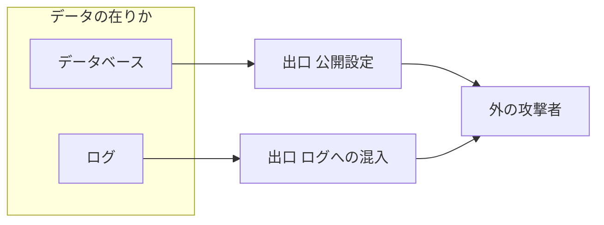

# 流出経路図と 6 つの出口

> **3 行でわかる要約**
> 1. 攻撃者の目で設計書を書くときの、データの在りかと 6 つの出口の型をまとめた資料です。
> 2. 出口ごとに守りと確認方法を 1 行ずつ決め、攻撃者役の「私ならここから入る」に全部答えます。
> 3. 設計書の「流出経路」「信頼の根」「攻撃者の目」の節を書くときに開いてください。

## 6 つの出口

この節は、データが外へ出る 6 つの出口と、基盤で掛ける守りの型です。他人の ID での閲覧の本体はバックエンドの認可で、基盤は量の制限と記録で支えます。

| 出口 | 典型の穴 | 基盤の守り | 確認方法 |
|---|---|---|---|
| 公開設定 | 公開のバケット、共有されたスナップショット、S3 への書き出し、WAF の無い 2 本目の配信 | 公開のブロック（バケットと口座）、共有と書き出しと複製の禁止、外の主体を拒む資源の上限（RCP）、配信を作れる役割を絞る | iac-scan の IAC-001 と IAC-002、全地域の IAM Access Analyzer、配信の棚卸し |
| 権限の持たせすぎ | 「*」の方針、広い管理の方針、上限の無い役割づくり、名前の型の例外 | 名指しの方針、理由つきの例外、権限の境界、例外は役割の名で 1 つずつ、権限の差分は承認 2 人 | iac-scan の IAC-003、plan-gate の経路、知らない主体の書き込みの通知 |
| ログへの混入 | 問い合わせの文、要求の見出しの鍵、誤りの本文に入る値、作業が書く合言葉 | 出す項目を決める、見出しを伏せる、誤りの本文を出さない、作業のログを読む人を絞る | 個人情報と合言葉の形の検出、見張りの値（カナリア） |
| 他人の ID での閲覧 | 番号を変えると他人の注文が見える。一覧で一括に抜く | 一覧と詳細の両方に量の制限、鍵とパスの正規化、データベースの行の単位の制限 | バックエンドの認可の試験、量のアラーム、記録の突き合わせ |
| 依存部品 | 悪い版の部品（サーバーと画面）、書き換えられたイメージ、札を差し替えた CI の部品 | ダイジェストの固定、押し込み時の検査、外への道を絞る、CSP、CI の部品を SHA で固定、合言葉を扱う作業は専用のイメージ | イメージの検査の件数、SBOM（部品の一覧）の差分 |
| 放置された複製 | 検証環境の本番の複製、古い手の複製、札を付け替えた写し、別の地域の複製 | 合成のデータだけ、手の複製の期限、別の地域への複製の禁止 | 毎日の複製の棚卸し（札ではなく名前と時間で、許した全地域を見る） |

## 図の型

この節は、流出経路図の描き方です。Mermaid（文字で図を描く記法）で、左にデータの在りか、中に出口、右に外を置きます。

図の読み方: 左から右へ、データが漏れうる向きに矢印を引きます。12 個を超えるときは、在りかごとに図を分けます。

## 攻撃者役の問い

この節は、「私ならここから入る」を書くときの問いです。出口ごとに 1 つ以上の攻め手を書き、答えと確かめ方を添えます。

| 出口 | 攻撃者役の問い |
|---|---|
| 公開設定 | 名前を推して、バケットやスナップショットを直接読めないか。複製を外の口座へ共有するか、公開の網へ復元できないか。S3 へ書き出すか、新しい鍵と方針で外へ開けないか。WAF の無い配信から内部へ届かないか |
| 権限の持たせすぎ | CI か API の役割を盗んだら、何を読めて、どこへ写せるか。口座の管理者なら、合言葉を読み、鍵を消し、監査を止められないか。通知の経路（購読の絞り込み、解除、ログの変換）を潰して、そのあと黙って動けないか。適用の役割で、上限の無い役割や例外と同じ名の役割を作れないか。PR の中で CI の手順を書き換えて、役割を借りられないか。承認 1 人の適用で、データへ届く資源（作業の定義、データベースの設定、守りの関数）を変えられないか。適用の job の中で命令を動かす仕掛け（provisioner）を足せないか。PR と守りの適用の承認を、同じ側の 1 人で済ませられないか。人の役割の ARN が SCP の型（path の段）から外れないか |
| ログへの混入 | ログを読む権限だけで、個人情報を集められないか。WAF・データベース・性能の記録・管理の記録の履歴（問い合わせの文が残る）のように、アプリの外のログも数える。これから足すログの型と、合言葉を扱う作業のログも数える |
| 他人の ID での閲覧 | 番号を順に変えたら、他人のデータが見えないか。盗んだ鍵 1 本で、一覧と詳細のそれぞれから、どれだけの速さで抜けるか。見出しやパスの書き方を変えて、量の上限を外せないか |
| 依存部品 | 部品に悪い版を混ぜたら、データを外へ送れないか。窓口や DNS を通して、自分の口座へ書けないか。ブラウザで動く部品（画面の移動で持ち出す）と、CI の部品の札の差し替えも数える。部品の差分を誰が、どの機械の出力で見るか |
| 放置された複製 | 忘れられた複製や検証環境から、本番のデータに届かないか。最後の複製や訓練の写しを、誰がいつ消すか。表の外の置き場（大きなオブジェクト）や、端末と配信の端の控えに残らないか。札を付け替えるか、別の地域や既定の保管庫へ写して、棚卸しの目を逃れられないか。棚卸しが権限の不足で落ち続けたとき、誰が気づくか |

守りは「許す物の一覧」で書き、一覧に無い物は止めるか、承認 2 人の経路へ回します。穴を 1 つずつ塞ぐと、並べ忘れた型が残るからです。

同じ起点から新しい道が何度も見つかるときは、起点ごとに型で答えます。たとえば緊急の管理は、復旧に要る操作の一覧の外を SCP で拒み、使った瞬間に作業の口座の外から鳴らします。注入した API が店を替える道は、店を API の書ける値で決めず、DB の側で要求の鍵から引いて答えます。守りの仕組みそのもの（関所、通知、棚卸し、例外）も守りの経路でしか変えられない形にし、止まったか誤ったら鳴らします。動いた数（Invocations）だけでなく、落ちた数（Errors）と最後まで動いた印も見ます。

答えは、構成コードで確かめられる形にします。設計書の確かめ方に「通知」「棚卸し」「共有の禁止」と書いたら、支える資源の file を同じ行に書いてください。たとえば、拒否は SCP、通知はメトリクスフィルタとアラーム、棚卸しは毎日動く仕組みです。file を書けない確かめ方は、未確定に回します。iac-scan の FAIL 0 は、守りが無いことまでは捕まえないからです。

## 型で答える: 許す物の一覧、信頼の根、起点の 3 つの組

この節は、同じ起点から新しい道が何度も見つかるときの答え方です。名指しで拒む一覧を伸ばすのをやめ、許す物の一覧で書きます。

| 一覧 | 書き方 | 止まる物の例 |
|---|---|---|
| 使うサービス | 作業の口座では、使うサービスの操作だけを許し、ほかを SCP で全部拒む（NotAction の形） | 使っていない App Runner、Verified Access の外の型、CloudShell |
| 主体 | 操作できる主体を、名指しの役割と人の許可セットに限り、ほかを SCP で拒む。許可セットの名前は完全一致で名指しする。作業の口座だけでなく、見張りを置く守りの口座にも同じ一覧を付ける。鳴る経路（話題、購読、アラーム、メトリクスフィルタ、規則）の削除と書き換えは、適用の役割のほかに拒む | root、管理の口座から借りる役割、3 つ目の許可セット、守りの口座で数秒のうちに鳴る先を消す手 |
| データへの入口 | DB への IAM の接続、秘密の読み出し、鍵の復号は、使う役割だけに許す。表の持ち主の役割は、決めた作業のほかは借りられない（RCP） | 当番や管理者が DB に入る道、暗号文を直に解く道 |
| 入口を作る操作 | VPC に入口を置く操作（インターフェース、端点、ロードバランサー、VPC のコネクタ）は、守りの適用の役割だけに許す | 網の中に外からの口を足す道 |
| 変更の経路 | GitHub の監査ログを守りの口座へ流し、保護の外し、force push、環境の承認者、自前の走る機械の登録を出来事ごとに鳴らす。毎時の照らしは、流し出しが止まっても残る型（配った SHA が今の main から届くか、PR を通ったか、承認者が決めた team の人か、CI の借り入れの実行）を見る。守りの役割と、守りの口座へ適用する役割を借りたら、その場で鳴らす | リポジトリの管理者が毎時の間に保護を外し、同じ SHA へ戻す道 |
| 配った中身 | 配る役割のほかの書き込みを拒む。照らしは CI の外に置き、書くたびに動かす。守りの口座の関数が、書き込みの出来事ごとに来歴の署名を自分で確かめ、まだ照らしていない全部の版を照らす。時刻の窓は使わない。今の版かどうかで照らし方を変えず、どの版も「書かれた時刻の main の最新の作り」の来歴と照らす。最新は、やり直しでない実行の番号の最大で決める。照らしの一覧に無い書き込みの名前は ng にする。照らしの正は来歴の数ではなく、その実行の作る job が上げた束 1 つで、版の中身を束の同じ名前の file と比べる。配った後、今の作りに無い file を消し、毎日の見回りで今の作りの外の file を鳴らす。長く控えるのは名前に指紋を入れた script と style だけで、html は入口と同じく短く控える。部品を外した版では、入口の応答で端末の控えと Service Worker の登録を消す（Clear-Site-Data の "cache" と "storage"）。worker の登録は CSP の worker-src 'none' で止め、照らしは置き場の一覧の外の名前と登録の呼び出しを鳴らす | 資格を盗んで書いて戻す道。分けた送りで窓の外に版を置く道。古い作りを書いて照らしの前に戻す道。古い実行をやり直す道。外した部品の古い html を、端末と配信の端の控えから読ませる道。外された後も残る Service Worker が入口の応答を作る道。署名する job の部品が同じ実行に 2 つ目の来歴を付ける道 |
| CI の job | job ごとに借りられる役割を分ける。資格を借りる job と署名する job では部品を動かさず、束も外の部品で落とさない（機械に入っている gh で落とす）。2 つの job で同じ外の部品を使わない。Actions の SHA の付け替えも、部品の差分として鳴らす。来歴を署名する workflow と資格を借りる workflow は file を分ける。OIDC の sub に環境を入れ、ほかの job から借りられない形にする。借り入れの名前に実行の番号を入れ、見張りが実行を引いて照らす。資格も外の部品で借りず、機械の OIDC の窓口と機械の aws で借りる。固定した部品が組み立ての型なら、中の uses も SHA かを辿って確かめる。配る job は、作る job が終わる前に作られた束 1 つと、主語が束の全部と同じ署名 1 つだけを認める。uses と lock の行は許す形の一覧で確かめる。資格を借りる job の見分けも許す形で読む（permissions は塊の形の「名前: read\|write\|none」だけ。流れの書き方と引用した鍵は資格を借りる job と見なして落とす）。資格を借りる job の run は許す行の一覧（set、tools/ci/ の file をこの実行の SHA で機械の gh で取る行、その file を呼ぶ行）だけにし、shell は bash だけ、環境変数の名前も許す一覧、working-directory は使わせない。固定した部品の取り出しは、失敗したら job を落とす（bash の pipefail）。取り出した部品の形（runs、using、image のダイジェスト）も許す一覧で確かめる。手元の部品（uses: ./）は .github/actions の下に限り、確かめる file は置き場を問わず repo の全部の action.yml と action.yaml にする。run の中の外からの取り出し（curl、wget、npx、pip install、shell への流し込み）も落とし、許すのは機械の OIDC の窓口から札を取る形だけにする。外の組み立ての型は run の step を持たせない。資格を借りる job の道具の本体（terraform など）は、版と SHA-256 を repo に固定して取り、資格を借りる前に指紋を確かめる（setup-terraform のような、動くときに本体を取る部品は使わない）。OIDC の sub には repository_id と repository_owner_id を入れ、信頼の条件を番号まで名指しする。名前の付け替え、消した後の作り直し、組織の改名で空いた名前では借りられない。付け替え・作成・削除・移譲は 1 件ずつ鳴らす | permissions の書き方を変えて資格を借りる job と見なされずに通る道。shell: python3 や gh extension や docker の書き方で外の物を動かす道。作る job の部品が札で役割を借りる道か、任意の指紋に署名する道。1 つの部品が 2 つの job で動く道。署名する job の部品が、署名の前に束を替える道。部品の中の部品が束を上げ直す道。uses の書き方を変えて固定の検査を外す道。取り出しの失敗と action.yaml の名と札の image で、中の検査を黙って外す道。.github の外の手元の部品に札を書く道。固定した部品が動くときに外から取る物（run の curl、道具の本体）で資格を使う道。名前を付け替えるか消して、同じ名前で作り直したリポジトリから役割を借りる道 |
| 人の常設の権限 | 当番のような常設の権限は、使った瞬間に守りの口座から鳴らし、障害の記録と自動で突き合わせる。障害の記録は、当番を呼ぶアラームの一覧だけで作り、人が自分で起こせる型（拒まれた書き込みなど）を入れない。ok の便りにも照らした記録の名を載せる。宛先は見張られる人と別にする（当番の利用はセキュリティへ）。状態が変わったときだけ鳴る通知に頼らず、出来事ごとに送る。読む手は数えられる 1 つに絞り（問い合わせだけ）、その回数と 1 回の上限から残る量を書く。数えない読み方（同僚の問い合わせの一覧、管理の記録の履歴、性能の記録の SQL の本文）は、当番にも許さない。伏せ字を外す権限は誰にも持たせないか、使うたびに鳴らす | 障害の無い日に当番で入り、自分の通知を片付けてログを集める道。拒まれる書き込みで障害の記録を作る道。数えない読み方で量の目安を外す道。同僚の queryId を拾って結果を読み直す道 |
| 出口の量 | 乗っ取った API の読みは、API の外の出口で数える。量の目安は、全体の大きな目安ではなく、鍵ごと・タスクごとの平常の幅から決め、1 日の総量も見る。パスの全部（一覧と詳細）と、読み出しの全部の手を数える。圧縮の前と後のどちらを数えるかを決めて書く。数えられない所は未確定に回し、残る量を数で書く | 届いた鍵で他の店を読み、応答にまとめる道。詳細を窓の下で 1 日続ける道 |
| 正本との突き合わせ | DB の中の表・関数・方針・権限（SECURITY DEFINER と PUBLIC の EXECUTE を含む）を、正本と、作ったときの指紋と比べる。権限は名前の付与ではなく、利用者が実際に持つ権限（一員の役割を通した付与と、列の単位だけの権限を含む）で数える。表の外の置き場（大きなオブジェクト）の件数も 0 と確かめる。関数はトリガーの関数を含めて全部、トリガー・規則・スキーマ・利用者の設定も比べる。名前で許す例外は置かない。指紋は取る所と比べる所で同じ関数（search_path を固定）を使う。変更のたび（作る作業と移行の最後）と毎時に回し、違えば作業を失敗にして鳴らすか、入口を閉じる。DB の管理者（RDS の主の利用者）を使う作業は利用者づくりの 1 本に限る。その像の押し込みは、守りの口座が来歴を確かめ、像の中の roles.sql の指紋を今の main の file と照らし、起動は 1 件ずつ鳴らす。指紋の正本は repo の file だけで、DB の上で取り直した指紋を正にしない（DB の中の照らしは、その file を流した結果と比べるだけ） | 移行が写しの表、全店を返す関数、緩めた方針を残す道。トリガーの関数を書き換える道。一員の役割に付与する道。同じ名のスキーマで表を隠す道。押し込む job で利用者づくりの像を差し替え、管理者で方針を緩めて指紋を取り直す道 |
| 移行の文 | 移行は許す文の一覧（足し算の DDL）だけを流す。PR の検査で文の型を確かめ、その検査を必須の検査（保護の一覧と見張りの決めた値）に入れ、イメージを押し込む前にも回す。DB の中でも事象のトリガーと文のトリガーで強制する（行を書く文は全部の表で誤り）。許した ALTER TABLE の中の表の書き直し（型の付け直しの USING、生成の列、揮発の既定値）も、table_rewrite の事象のトリガーで誤りにする。表の外の置き場を作る関数は取り上げる。一覧の外（関数、規則、権限、行の書き換え）は承認 2 人の経路へ回す。移行の後は、スキーマの丸ごとの写しを PR の写しと比べる。前後の行の指紋は、同時に動く書き手で揺れるので使わない。ALTER TABLE の中の型（INHERIT、RENAME、SET DEFAULT、検査の制約）は、文ではなく DDL の後の表の形で止める。継承と区分けは 0 件、指紋を取った列と制約は足すだけ、足した列の既定値は短い定数、足した制約は変わらない関数だけを呼ぶ。DO は plpgsql の USAGE を PUBLIC から外して止める。足す物にも上限を置く（指紋の後に足した列・制約・索引の数、名前の字の型と長さ、制約の中の定数の長さ）。指紋には NOT NULL とトリガーの有効の状態と索引も入れる | 行を写す、列を足して写す、規則で写し続ける、psql の命令を動かす道。型の付け直しで行の値を書き換える道。大きなオブジェクトに写す道。子の表を親の表から読ませて店を替える道。定数の既定値と pg_notify の制約で他の店の行を写す道。短い定数の列を何本も足すか、名前と制約に値を埋める道。DISABLE TRIGGER と DROP NOT NULL で守りを外す道 |
| 自前のコード | データを読む処理と外へ移る処理を足す差分は、持ち主の欄でセキュリティの承認を要るようにし、外へ移るコードを落とす静的検査を必須にする | 部品を変えずに、自前のコードで画面の移動を足す道 |
| 作る場所 | 部品が入る所は、検査を 1 つずつ足さずに作る場所の形で答える。作る job は網の無い場所で動かす（使い捨ての容器の docker run --network=none、docker build --network=none）。部品のコードが動く作りは容器の中に閉じ、同じ job の後の step の file（_actions、$RUNNER_TEMP）に届かせない。外へ出すのは決めた置き場の普通の file だけにする。Dockerfile は作りの道具を替える指示（# syntax=）を落とし、COPY --from と RUN --mount の from= も前の段かダイジェストだけにする。docker build の -f は検査が見る名の型だけにする。像の層を照らす側は、名前を 1 つの形に揃えてから比べ（頭の ./ か / を 1 回だけ外す）、形の変わる名前、揃えた後に重なる名前、白抜き（.wh.）を ng にする。config は全部の欄（Env を含む）を正本と比べる。入る物は全部 hash で固定する（lock の file、像はダイジェスト、道具は SHA-256）。網が要る取り出しは作る前の別の step で、ダイジェストか指紋で取る。像の行（container、services、手元の部品の image、Dockerfile の FROM）はダイジェストだけで、資格を借りる job には container と services を置かず、run が呼ぶ file は持ち主の欄の内側（tools/ci/）だけにする。来歴は作った物のダイジェストを主語にし、作る job の外（信頼できる再利用の workflow）が出す。確かめる側は像の層や束を自分で開いて main と照らし、署名者を job と走った機械まで名指しする。固定した外の SHA は上流の既定のブランチから届く commit だけを許し、判定の本体は main の版を動かす | 像の札を後で動かす道。手元の docker の部品の札。npm の scripts が作るときに外から取る道。run が呼ぶ repo の script の中の curl。札で引いた土台の入口。作る step の部品が後の step の file を書き換える道。名前の揃え方の違いで照らしを外す層。1 つ前の像へ戻して起動する道。押し込む job が任意のダイジェストに署名する道。fork の網の偽の commit。PR の側の検査を書き換える道 |

守りの口座へ適用する CI のように、見張りを書き換えられる立場は、見張りの外から見張ります。その CI の役割と信頼と、借り入れと書き込みを鳴らす経路は、その CI の届かない所に置きます。置き場は管理の口座の芯か AWS の外です。その口座の上限（SCP）で、自分と芯を変えさせません。外の主体を拒む上限（RCP）も、守りの口座に付けます。記録の行き先（置き場、購読、配送、書き出し、出来事の宛先、データ保護の所見の送り先）と役割の信頼は、守りの口座の誰にも変えさせません。メトリクスの一覧と値も、データの読み出しの型に入れます。メトリクスフィルタの次元に記録の欄を名指しすると、欄の値が次元に写るからです。作った役割の境界は、書き込みを名指しの役割にだけ許します。変えるのは信頼の根の経路だけです。データの読み出しは見張りの関数の役割のほかに許さず、新しい役割は芯が置く境界（許す物の一覧）を付けたときだけ作らせます。決めた地域の外の操作も拒みます。

見張りが AWS の届き（CloudTrail の出来事が既定のバスに届くこと）に頼るときは、その届きも毎時確かめます。届かないと確かめたサービス（ネットワークの出来事に入らないログなど）は、見張りの選び方に書かず、「鳴らす」とも書きません。決まった書き込みを 1 件流し、その出来事が鳴る先に届かなければ鳴らします。届かない作りなら鳴り続けるので、黙ったままにはなりません。

SCP と保護を外せる立場は、信頼の根として設計書に節を置きます。組織の管理の口座と、そこで適用する土台の CI と、GitHub の組織の持ち主がそれです。組織の形を変える操作（口座の移動と外し、OU の付け替え、SCP の付け外し、委任）も、使ったら鳴らします。拒否では守れないので、持ち方と鳴らし方で守ります。ハードウェアの MFA を使い、長く使える鍵を持ちません。使ったら、AWS の外の宛先へ鳴らします。管理の口座では、読むだけでない出来事を全部鳴らします。役割の借り入れを使わない道（IAM の利用者の鍵で直に呼ぶ、AssumeRoot、StackSet の書き換え）を残さないためです。IAM の利用者と root の鍵が 0 件かは、管理の口座の数だけを読む役割で、見張りが毎時確かめます。StackSet が SCP を受けるかのように確かめていない前提は、どちらでも閉じる側に揃えます。守りごとに file を書き、書けない物は未確定に回します。

新しく足す仕組みは、それ自体を誰が変えられるかと、止まったら鳴るかを、攻撃者の目の表に書きます。見張りの宛先が生きているかは、AWS の外の仕組みが便りの途絶で見ます。便りは、決まった文を送るだけにしません。見張りの正本と今の形を数え、欠けが 0 のときだけ送ります。正本に並べるのは、アラームとメトリクスフィルタ、記録の購読、話題と確かめた購読です。信頼の根が上限を外して見張りを消しても、便りが止まって AWS の外で鳴ります。これを信頼の根の答えの本体にします。見張りは、見張られる側と信頼の根が変えられない場所に置きます。GitHub の見張りなら、コードも鍵も守りの口座に置きます。止まったら、便りの途絶で鳴らします。

見張りの役割でコードを動かせる立場は、見張りの読みの権限を持つのと同じです。見張りの関数と役割と出来事の宛先は、見張られる CI の外の役割だけが置けるようにします。その役割は信頼の根の経路で借ります。関数の変更は、誰のものでも 1 件ずつ外へ鳴らします。関数の呼び出しの許可と URL も同じ役割に限ります。Lambda のように RCP の対象の外の資源は、SCP で入口を作る操作そのものを絞ります。

確かめていない条件キー（events:TargetArn など）に頼る答えは、置き換えます。操作そのものを 1 つの役割に限る形にします。作った役割の権限の境界も、資源を名指しした許す物の一覧にします。境界の Resource が「*」なら、外の口座の資源へ書けるからです。必須の検査は、名前だけでなく出す仕組み（App）まで縛ります。API のパスは許す文字の一覧で見て、符号の付いたパスを止めます。配信が符号を解くかに頼らないためです。

読み出しを外の口座へ開ける資源の方針（ロググループ、バケット、鍵、秘密）は、RCP の対象に入れて組織の外の主体を拒みます。置ける役割は、見張られる CI の外の 1 つに寄せます。人の常設の権限で読める物は、型（/orders-admin-*）ではなく名前の一覧で書きます。型に管理の記録のロググループが入ると、閉じた「管理の記録の履歴」を別の入口から読めるからです。

仕組みを足すほど、攻撃の面も増えます。同じ型の守りが 2 つあれば 1 つに寄せ、要らなくなった仕組みは消します。たとえば画面の照らしを書き込みのたびにしたら、毎時の照らしと CI の指紋の一覧は消します。

直し終えたら、起点を 3 つの組に分け、組ごとに攻撃者役の問いを 1 周回します。見つけた道には、攻撃者の目の表で答えます。

| 組 | 起点 |
|---|---|
| 外から | 外の攻撃者、盗んだ鍵 1 本、悪い版の部品（画面、サーバー、CI） |
| 変更の経路から | 乗っ取った PR か手順、CI の役割、配る役割、GitHub のリポジトリの管理者 |
| 口座の中から | 口座の管理者、root、緊急の管理、当番、API の役割、移行の役割、棚卸しの役割 |

設計書には、組と起点ごとに、見つけた道と答えの行を 1 表にまとめます。前の審査の道と同じ型が戻っていないかも、同じ周で確かめます。

直した守りは、読んで決めずに、攻撃者役が使った手順をそのまま流して止まることを確かめます。DB の守りなら手元の PostgreSQL で攻撃の文を流し、照らしの関数なら自己試験に同じ並びの例を足します。流した命令と結果は、設計書の実測の列に書きます。

## 出典

この節は、型の出どころです。

| 出典 | URL |
|---|---|
| OWASP Top 10 A01 アクセス制御の不備 | https://owasp.org/Top10/A01_2021-Broken_Access_Control/ |
| OWASP ログの手引き | https://cheatsheetseries.owasp.org/cheatsheets/Logging_Cheat_Sheet.html |
| SLSA（供給網の水準） | https://slsa.dev/ |
| IAM Access Analyzer | https://docs.aws.amazon.com/IAM/latest/UserGuide/what-is-access-analyzer.html |
