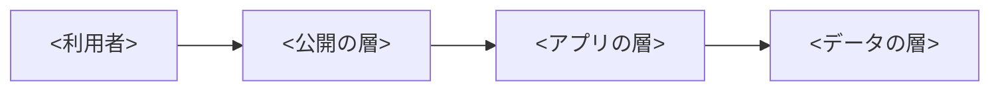
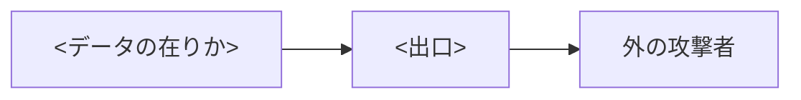

# 設計書: インフラ構成（<件名>）

> **3 行でわかる要約**
> 1. <何をどの基盤に載せる設計書か。数値が架空なら書く>
> 2. <結論。層の分け方、監査ログの保持、restore-drill で測った復元の秒>
> 3. <費用の幅（最小〜最大）と、秘書・SRE・バックエンドに頼むこと>

| 項目 | 内容 |
|---|---|
| 作成日 | <YYYY-MM-DD> |
| 状態 | <下書き / 承認待ち / 承認済み> |
| 構成コード | <リポジトリの構成コードの場所> |
| 置き場 | tmp/flow/<件名>/infra-design.md |

## 背景

<誰が、どの用事で、どれだけ使うか。漏れたときの害が最も大きいデータは何か>

## 目標

この節は、基盤が満たす数を目標と実測に分けて並べます。実測の列には測った値か「未実測」だけを書きます。

| 項目 | 目標 | 実測 |
|---|---|---|
| 構成コードの静的検査（iac-scan） | FAIL 0 | <FAIL の数> |
| 戻すまでの時間（RTO） | <分> | <秒か未実測> |
| 月の費用 | <上限> | <未実測か請求の額> |

## 用語

この節は、設計書に出る略語を先にまとめます。

| 用語 | 意味 |
|---|---|
| RPO | 失ってよいデータの時間 |
| RTO | 壊れてから戻すまでにかけてよい時間 |

## 全体の設計

<部品と層の置き方を 2〜3 文で>

## 6 本の柱

この節は、6 つの柱ごとに、決めたことと測り方を並べます。

| 柱 | 決め | 測り方 |
|---|---|---|
| 運用の上手さ | <決め> | <測り方> |
| セキュリティ | <決め> | <測り方> |
| 信頼性 | <決め> | <測り方> |
| 性能の効率 | <決め> | <測り方> |
| 費用の最適化 | <決め> | <測り方> |
| 持続可能性 | <決め> | <測り方> |

## ネットワーク

この節は、3 つの層に何を置き、どこからの通信を受けるかを決めます。

図の読み方: <どこからどこへ流れるか>

| 層 | 置くもの | 受ける通信 | 外へ出る道 |
|---|---|---|---|
| 公開の層 | <部品> | <相手と口> | <行き先> |
| アプリの層 | <部品> | <相手と口> | <行き先> |
| データの層 | <部品> | <相手と口> | <なしが望ましい> |

## IAM

この節は、誰がどの操作をどの資源にしてよいかを並べます。長期のアクセスキーは <本数。0 本にする>

| 主体 | 許す操作 | 対象 | 借り方 |
|---|---|---|---|
| <役割> | <操作を名指し> | <資源を名指し> | <OIDC、起動ごと、承認つきなど> |

## 秘密情報

この節は、秘密の置き場と回し方を決めます。

| 秘密 | 置き場 | 回転 | 読める主体 |
|---|---|---|---|
| <秘密の名前> | <秘密の保管庫> | <日数> | <役割> |

## 暗号化

この節は、データの在りかごとに暗号化と鍵を並べます。

| 対象 | 保存時 | 通信時 | 鍵 |
|---|---|---|---|
| <データベース> | <方式> | <TLS の版> | <鍵> |
| <バックアップ> | <方式> | <TLS の版> | <鍵> |
| <ログ> | <方式> | <TLS の版> | <鍵> |

## 監査ログ

この節は、操作の記録を消せない形で残す決めです。<消せない仕組み（オブジェクトロックなど）と、保持の日数>

## バックアップと復元

この節は、どこまで失ってよく、どれだけで戻すかを決め、測った値を書きます。

| 項目 | 目標 | 実測 | 測り方 |
|---|---|---|---|
| RPO（失ってよいデータの時間） | <分> | <未実測か測った値> | <測り方> |
| RTO（戻すまでの時間） | <分> | <未実測か測った値> | <測り方> |
| 復元の手順の時間 | <秒> | <restore-drill の秒> | restore-drill.sh --rows <行数> --rto <秒> |

## 環境の差

この節は、本番と検証環境の違いを並べます。2 つは同じコードで、違いは変数の値だけです。

| 項目 | 検証環境 | 本番 |
|---|---|---|
| <大きさ> | <値> | <値> |
| <数> | <値> | <値> |
| <データ> | 合成のデータだけ | <本物> |

## 費用の幅

この節は、月の費用を最小と最大の幅で出します。

| 項目 | 最小（円） | 最大（円） | 前提 |
|---|---|---|---|
| <資源> | <最小> | <最大> | <量と単価の前提> |
| 合計 | <和> | <和> | 上の行の和 |

## 流出経路

この節は、データの在りかと 6 つの出口を図と表で示します。

図の読み方: <矢印は漏れうる向き>

| 出口 | どこから漏れうるか | 守り | 確認方法 |
|---|---|---|---|
| 公開設定 | <在りか> | <守り> | <確認方法> |
| 権限の持たせすぎ | <在りか> | <守り> | <確認方法> |
| ログへの混入 | <在りか> | <守り> | <確認方法> |
| 他人の ID での閲覧 | <在りか> | <守り> | <確認方法> |
| 依存部品 | <在りか> | <守り> | <確認方法> |
| 放置された複製 | <在りか> | <守り> | <確認方法> |

## 信頼の根

この節は、SCP と保護を外せる立場を並べます。拒否では守れないので、持ち方と鳴らし方で守ります。

| 信頼の根 | 外せる守り | 守り | 使ったら鳴る所 | file |
|---|---|---|---|---|
| <組織の管理のアカウント> | <SCP の付け外しなど> | <ハードウェアの MFA、長く使える鍵を持たない> | <鳴らす仕組みと宛先> | <file> |
| <GitHub の組織の持ち主> | <main の保護など> | <ハードウェアの鍵、長く使える札を持たない> | <鳴らす仕組みと宛先> | <file> |

## 攻撃者の目: 私ならここから入る

この節は、攻撃者役の「私ならここから入る」に出口ごとに答えます。

| 出口 | 私ならここから入る | 答え | 確かめ方 |
|---|---|---|---|
| 公開設定 | <攻め手> | <答え> | <確かめ方> |
| 権限の持たせすぎ | <攻め手> | <答え> | <確かめ方> |
| ログへの混入 | <攻め手> | <答え> | <確かめ方> |
| 他人の ID での閲覧 | <攻め手> | <答え> | <確かめ方> |
| 依存部品 | <攻め手> | <答え> | <確かめ方> |
| 放置された複製 | <攻め手> | <答え> | <確かめ方> |

答えは「許す物の一覧」で書きます。起点を 3 つの組（外から、変更の経路から、アカウントの中から）に分け、組ごとに 1 周回します。

| 起点の組 | 起点 | 見つけた道 | 答えの行 |
|---|---|---|---|
| <外から> | <起点> | <道> | <上の表の行> |

## 代替案

この節は、比べて採らなかった案と理由を残します。

| 案 | 良い所 | 採らなかった理由 |
|---|---|---|
| <案> | <良い所> | <理由> |

## 横断事項

この節は、ほかの役割へ渡すものと受けるものをまとめます。

| 相手 | 渡すもの | 受けるもの |
|---|---|---|
| <役割> | <渡すもの> | <受けるもの> |

## 未確定

この節は、決め切れていない点と、誰が決めるかを並べます。

| # | 点 | 決める役割 |
|---|---|---|
| 1 | <点> | <役割> |
