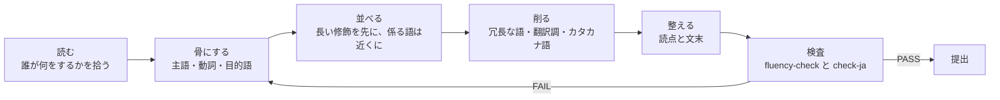
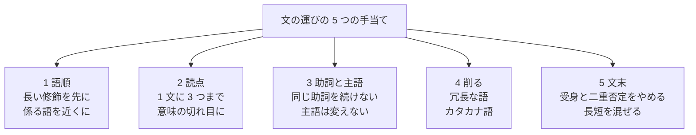

# 書き直しの完成例: 注文一覧の技術説明 5 組

> **3 行でわかる要約**
> 1. 「管理画面の注文一覧を作り直したい」案件で、AI の硬い説明 5 組を流れる日本語に直した完成例です。
> 2. 事実と数値は変えず、語順・読点・助詞・冗長な語・文末の 5 つの手当てだけで、一度読めば分かる文にしました。
> 3. 自分の文章を直すときは、各組の「何を変えたか」の表を上から順に当てはめ、機械検査を通してから提出してください。

## 目的

読み手は社長です。担当者が AI に下書きさせた注文一覧の説明は、硬くて一度では頭に入りませんでした。この文書は、その説明 5 組を内容を変えずに直し、何をどう直したかを表に残します。数値はすべて架空です。

| 項目 | 内容 |
|---|---|
| 題材 | Cradle Market の管理画面「注文一覧」の作り直し |
| 読み手 | 社長。技術の細部は知らない |
| 調 | ですます調 |
| 数値 | 件数・秒数・割合はすべて架空 |
| 直すもの | 文の運び。語順、読点、助詞、冗長な語とカタカナ語、文末 |
| 直さないもの | 事実、数値、結論、説明の順序 |

## 用語

この文書で使う言葉は 7 つです。知っている語は飛ばして構いません。

| 用語 | 意味 |
|---|---|
| N+1 問題 | 一覧を 1 回取ったあと、行ごとに 1 回ずつ問い合わせが走ること。100 行なら 101 回になる |
| 連体修飾 | 名詞の前に付いて、その名詞を説明する語句。「昨日届いた注文」の「昨日届いた」 |
| 中止法 | 「〜し、〜し、」と文を切らずに続ける書き方 |
| サ変名詞 | 「取得」「確認」のように、後ろに「する」を付けると動詞になる名詞 |
| 翻訳調 | 英語を直訳したような言い回し。「〜することが可能です」「〜において」など | <!-- ja-ok -->
| フィーチャーフラグ | 設定を切り替えるだけで、新旧の画面を行き来できる仕組み |
| ロールバック | 問題が出たときに、前の状態に戻すこと |

## 全体像

直し方は 6 つの段階で、どの組も同じ順に進めました。図は、その段階と、検査で戻る経路を示します。



図の読み方: 左から右へ進みます。検査で引っかかったら「骨にする」へ戻り、語順から直し直します。

「読む」と「骨にする」で、文から事実だけを取り出します。ここで数値と主張を書き出しておくと、直したあとに内容が変わっていないかを突き合わせられます。「並べる」から「整える」までが文の運びの手当てで、次の節で 5 つに分けます。

## 5 つの手当て

文の運びの手当ては 5 つに分けました。図は手当ての名前と、それぞれが何を見るかです。



図の読み方: 上の箱が手当ての全体で、下の 5 つが順番です。上から順に当てると、前の手当てを後の手当てが壊しません。

| 手当て | 旧文で起きていたこと | 直し方 | 根拠 |
|---|---|---|---|
| 1 語順 | 主語と述語が 100 字離れ、長い説明が名詞の前に積まれていた | 主語を頭に置き、長い修飾を先に、係る語と受ける語を近くに置く | 文化庁『公用文作成の考え方』文の書き方 エ・ク・サ、本多勝一『日本語の作文技術』修飾の順序 |
| 2 読点 | 1 文に読点が 6 つ、または 0 | 1 文に 3 つまで。長い修飾語の境界と、語順が逆の所に打つ | textlint max-ten、本多の読点の 2 原則、公用文 ス |
| 3 助詞と主語 | 「注文の顧客の情報の取得」のような「の」の連続、「は」の重なり | 「の」は 2 つまでにし、動詞に戻す。主語は文の途中で変えない | 公用文 オ・キ、textlint no-doubled-joshi |
| 4 削る | 「取得を実施する」「採用することとする」、「レスポンスタイム」 | サ変名詞＋行う は動詞 1 語に。言い換えられるカタカナ語は日本語に、残す語は括弧で説明 | textlint ja-no-redundant-expression、国語研『「外来語」言い換え提案』、やさしい日本語ガイドライン |
| 5 文末 | 「実行されることにより」「確認されています」、「ます」の 4 連続 | 動作主を書いて能動にする。二重否定をやめる。長い文と短い文を混ぜる | 公用文 ケ・コ、Google Technical Writing（能動態）、Microsoft 日本語スタイルガイド |

## 5 組の一覧

5 組の題材と、旧文に出ていた癖、効いた手当てを先にまとめます。組ごとの本文は次の節からです。

| 組 | 題材 | 旧文の主な癖 | 効いた手当て |
|---|---|---|---|
| 1 | 注文一覧が遅い理由 | 1 文 150 字、受身、「〜を行うことによって」 | 語順、文末、削る | <!-- ja-lint:ignore -->
| 2 | 絞り込みとページ送り | 「においては」「に関しては」、カタカナ語 4 つ | 削る、助詞と主語 |
| 3 | 誰がどこまで見られるか | 受身の連続、「〜ものとし」、「なお」 | 文末、語順 |
| 4 | CSV の書き出し | 1 文 110 字、「方式を採用することとします」 | 語順、削る、文末 |
| 5 | 出し方と戻し方 | 中止法の連続、「万が一」「即座に」 | 語順、削る、読点 |

## 組 1: 注文一覧が遅い理由

最初の組は、一覧が遅い理由の説明です。旧文は 1 文が 150 字あり、主語と述語の間に理由と数値が全部挟まっていました。

### 旧

<!-- ja-lint:off -->
> 現在の注文一覧画面においては、注文データの取得時に顧客情報および配送先情報の取得が注文ごとに個別に実行されることにより、いわゆる N+1 問題が発生しており、表示件数が 100 件の場合に 201 回のクエリが発行され、レスポンスタイムが 4.2 秒に達することが計測により確認されています。この問題に関しては、関連データの一括取得を行うことによってクエリ数を 3 回に削減することが可能であり、同条件でのレスポンスタイムは 0.6 秒となる見込みです。
<!-- ja-lint:on -->

### 新

> 今の注文一覧は、注文を 1 回取ったあと、顧客と配送先を注文ごとに 1 回ずつ取りに行きます。これが N+1 問題で、100 件を表示すると問い合わせが 201 回走り、応答に 4.2 秒かかっています。直し方は、顧客と配送先を注文と一緒にまとめて取ることです。問い合わせは 3 回で済み、同じ条件で応答は 0.6 秒になる見込みです。

### 何を変えたか

変えたのは 5 か所で、骨は「注文ごとに取りに行くから遅い。まとめて取れば速い」の 2 文でした。

| 変更 | 手当て | 理由 |
|---|---|---|
| 1 文 150 字を 4 文に分け、「今の注文一覧は」を頭に置いた | 語順 | 主語と述語が 100 字離れていた。公用文の「一文を短くする」「係る語を近くに」 |
| 「取得が…実行されることにより」を「取りに行きます」にした | 文末 | 受身と「ことにより」が重なり、誰が何をするかが消えていた |
| 「一括取得を行うことによって」を「まとめて取る」にした | 削る | サ変名詞＋行う は動詞 1 語で言える | <!-- ja-lint:ignore -->
| 「レスポンスタイム」「クエリ」を「応答」「問い合わせ」にした | 削る | 読み手は社長で、日本語で言える語は日本語にする |
| 「削減することが可能であり」を「3 回で済み」にした | 文末 | 「〜することが可能」は翻訳調の型。数で言い切る | <!-- ja-ok -->

## 組 2: 絞り込みとページ送り

2 組目は、絞り込みの条件とページ送りの方式です。旧文は 2 つの論点を 1 文に詰め、カタカナ語が 4 つ並んでいました。

### 旧

<!-- ja-lint:off -->
> 本機能においては、ユーザーがステータス、期間および顧客名の 3 条件による絞り込みを行うことができるようにするとともに、ページネーションに関してはオフセット方式ではなくカーソル方式を採用することにより、データ量が 10 万件に達した環境下における 500 ページ目の表示時間を 3.1 秒から 0.2 秒に短縮できる見込みです。
<!-- ja-lint:on -->

### 新

> 注文一覧は、状態・期間・顧客名の 3 つで絞り込めます。ページ送りは、オフセット方式（何件目から、と数える）ではなく、カーソル方式（この注文の次から、と覚える）にします。10 万件のとき、500 ページ目の表示が 3.1 秒から 0.2 秒になる見込みだからです。

### 何を変えたか

変えたのは 5 か所で、絞り込みとページ送りを別の文にしたことが最も効きました。

| 変更 | 手当て | 理由 |
|---|---|---|
| 1 文 130 字を 3 文にし、絞り込みとページ送りを分けた | 語順 | 論点が 2 つ入っていた。公用文の「一文の論点は一つ」 |
| 「においては」「に関しては」「ことにより」を「は」「で」「からです」にした | 助詞と主語 | 格助詞 1 字で足りる所に長い言い回しが入っていた |
| 「絞り込みを行うことができるようにする」を「絞り込めます」にした | 削る | 可能の意味は動詞の形で言える | <!-- ja-lint:ignore -->
| 「ステータス」を「状態」にし、「オフセット」「カーソル」は残して括弧で説明した | 削る | 言い換えられる語は言い換え、技術用語は説明を添える。公用文の外来語の扱い イ・ウ |
| 「〜環境下における〜を短縮できる見込みです」を、数値の文「〜になる見込みだからです」にした | 文末 | 結論のあとに理由を置くと、数値の意味が取れる |

## 組 3: 誰がどこまで見られるか

3 組目は権限の説明です。旧文は受身が 4 回続き、誰が判定するのかが見えませんでした。

### 旧

<!-- ja-lint:off -->
> 注文一覧へのアクセスについては管理者ロールを保持するユーザーに限定されるものとし、店舗担当者ロールのユーザーに関しては自身が担当する店舗の注文のみが参照可能となるように制御が行われます。なお、クライアント側の判定はリクエストの直接送信により回避可能であるため、権限の判定はサーバー側において実施されなければなりません。
<!-- ja-lint:on -->

### 新

> 注文一覧を開けるのは管理者だけです。店舗の担当者は、自分の店舗の注文だけを見られます。誰がどこまで見られるかは、画面ではなくサーバーで判定します。画面側の判定は、画面を通さずに要求を直接送られると素通りしてしまうからです。

### 何を変えたか

変えたのは 5 か所で、受身を能動に戻すと主語が「管理者」「担当者」「サーバー」と自然に決まりました。

| 変更 | 手当て | 理由 |
|---|---|---|
| 「アクセスについては…限定されるものとし」を「開けるのは管理者だけです」にした | 文末 | 受身と「ものとし」で、主語が消えていた |
| 「参照可能となるように制御が行われます」を「見られます」にした | 削る | 「制御が行われる」は何もしていない語 | <!-- ja-lint:ignore -->
| 「〜に関しては」を「は」にした | 助詞と主語 | 主題は「は」1 つで示せる |
| 「なお、〜であるため」の理由を、結論の直後に「〜からです」で置いた | 語順 | 理由は結論に続けて書く。「なお」は切れ目の印にならない |
| 「ロール」「クライアント側」「リクエスト」を「管理者」「担当者」「画面」「要求」にした | 削る | 読み手が知る言葉で言える |

## 組 4: CSV の書き出し

4 組目は、CSV（表計算で開ける形式）で注文を書き出す機能の説明です。旧文は 1 文が 110 字で、結論が文の最後に来ていました。

### 旧

<!-- ja-lint:off -->
> CSV 出力機能については、対象件数が 1 万件を超えるケースにおいて同期処理ではタイムアウトが発生する可能性が高いことから、非同期のバックグラウンドジョブとして実装し、処理完了後にダウンロード用 URL をメールにて通知する方式を採用することとします。また、ジョブの実行状態はユーザーが画面上で確認できるようにすることが望ましいと考えられます。
<!-- ja-lint:on -->

### 新

> CSV の書き出しは、画面で待たせずに裏で動かします。1 万件を超えると、画面で待つ方式では途中で止まる（タイムアウト）おそれが高いからです。書き出しが終わったら、受け取り用の URL をメールで知らせます。進み具合も画面で見られるようにするのがよいと考えます。

### 何を変えたか

変えたのは 5 か所で、結論を先頭に出し、理由を 2 文目に下げました。

| 変更 | 手当て | 理由 |
|---|---|---|
| 1 文 110 字を、結論・理由・通知・進み具合の 4 文にした | 語順 | 結論を先に、理由を次に。公用文の「結論は早めに示す」 |
| 「〜については」「〜において」「〜ことから」を「は」「と」「からです」にした | 助詞と主語 | 格助詞と接続で足りる |
| 「非同期のバックグラウンドジョブとして実装し」を「画面で待たせずに裏で動かします」にした | 削る | 読み手は仕組みの名前ではなく、待つかどうかを知りたい |
| 「メールにて通知する方式を採用することとします」を「メールで知らせます」にした | 削る | 「方式を採用することとする」は「する」1 語 |
| 「望ましいと考えられます」を「〜するのがよいと考えます」にした | 文末 | 受身の「考えられる」は誰の判断か分からない。判断の主体をこちらにし、未定であることは残した |

## 組 5: 出し方と戻し方

5 組目は、新しい画面の出し方と、問題が出たときの戻し方です。旧文は「〜し、〜した上で、〜します」と文を切らずに続け、1 文が 100 字を超えていました。

### 旧

<!-- ja-lint:off -->
> リリースに際しては、新旧画面の切り替えをフィーチャーフラグにより制御し、まず社内ユーザーに対してのみ有効化を行った上で、問題が検出されなかった場合に全ユーザーへの展開を実施します。万が一、エラー率が 1% を超過した場合には、フラグを無効化することにより即座に旧画面へのロールバックが可能であり、ロールバックに要する時間は 1 分以内です。
<!-- ja-lint:on -->

### 新

> 新しい画面は、フィーチャーフラグで出します。最初は社内の利用者だけに見せ、問題が出なければ全員に広げます。エラー率が 1% を超えたら、設定を戻して旧画面に戻します（ロールバック）。戻すのにかかる時間は 1 分以内です。

### 何を変えたか

変えたのは 5 か所で、「〜し、〜した上で」の鎖を切ると、読点も 6 つから 3 つに減りました。

| 変更 | 手当て | 理由 |
|---|---|---|
| 「〜に際しては」「〜により制御し」「〜した上で」の鎖を切り、4 文にした | 語順 | 中止法の連続で 1 文が 100 字を超えていた。公用文の「接続助詞や中止法を多用しない」 |
| 「有効化を行った上で」を「見せ」、「展開を実施します」を「広げます」にした | 削る | サ変名詞＋行う／実施 は和語の動詞 1 語で言える | <!-- ja-lint:ignore -->
| 「検出されなかった場合に」を「問題が出なければ」にした | 文末 | 受身をやめ、否定を軽くした |
| 「超過した場合には…無効化することにより…が可能であり」を「超えたら、設定を戻して旧画面に戻します」にした | 文末 | 「〜することにより〜が可能」は翻訳調の型。条件、動作の順で書く |
| 「万が一」「即座に」を消し、読点を 6 つから 3 つにした | 読点 | 条件と「1 分以内」があれば強調の副詞は要らない。読点は意味の切れ目だけに |

## やらないこと

この文書で直したのは文の運びだけで、次の 4 つはしていません。

- 事実や数値を足すこと、消すこと。旧文に無い数字は書きません。
- 禁則語の検査。これは `tools/check-ja.sh` の仕事です。
- 文書の構成や図の設計。これは `.company/rules/documents.md` と `.company/rules/diagrams.md` の決まりに従います。
- 旧文を書いた AI の設定の変更。直したあとの文だけを渡します。

## 未確定

次の 3 つは、この例だけでは決まりませんでした。

| 項目 | 状態 | 確かめ方 |
|---|---|---|
| 読点の上限「1 文に 3 つ」 | textlint の既定値を借りた。社長の文書での実測は未 | 社長が赤を入れた文書 10 本で、読点の数と赤の数を突き合わせる |
| 「〜と考えます」のような弱い言い回しをどこまで残すか | 決めたか未定かは依頼元しか分からない | 直すときに「決めたか」を 1 行で確認する |
| カタカナ語のうち残してよい語 | 「メール」「URL」「CSV」は残した。一覧は未作成 | 技術用語の許可一覧を作り、社長に見せる |

## 付録: 検査の記録

付録は、この文書を提出する前に通した検査と、その結果です。4 つとも RESULT: PASS になるまで直しました。

```
bash tools/check-file.sh skills/ja-fluent/examples/before-after-order-list.md
  → RESULT: PASS check-ja / check-doc / check-mermaid
bash skills/ja-fluent/scripts/fluency-check.sh skills/ja-fluent/examples/before-after-order-list.md
  → RESULT: PASS fluency-check (FAIL 0)
```

## 付録: 根拠と出典

本文の「根拠」の列を、出典ごとにまとめた表です。URL は `references/sources.md` にあります。

| 手当て | 根拠 | 出典 |
|---|---|---|
| 語順 | 一文を短く、係る語を近くに、修飾節は長いものから | 文化庁『公用文作成の考え方』（2022）Ⅲ-3 ア・サ・ク |
| 語順 | 長い修飾語は前、節を先に句を後に | 本多勝一『〈新版〉日本語の作文技術』（朝日文庫、2015）第 3 章 |
| 読点 | 1 文に 3 つまで | textlint-rule-max-ten（既定 3） |
| 読点 | 長い修飾語の境界と逆順の所に打つ | 本多、第 4 章。大阪大学理工学図書館の講習会資料（2020）で確認 |
| 助詞 | 同じ助詞を続けない | 公用文 Ⅲ-3 キ、textlint-rule-no-doubled-joshi |
| 削る | サ変名詞＋行う、すること＋できる | textlint-rule-ja-no-redundant-expression |
| 削る | 外来語は言い換えるか説明を付ける | 公用文 Ⅱ-3、国立国語研究所『「外来語」言い換え提案』（176 語） |
| 文末 | 受身をむやみに使わない、二重否定を使わない | 公用文 Ⅲ-3 ケ・コ、やさしい日本語ガイドライン（2020） |
| 文末 | 能動態を基本にする | Google Technical Writing One「Active voice」 |
| 全体 | 直訳は硬く不自然になる | Microsoft Japanese Localization Style Guide 2.1.4 |
