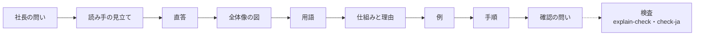
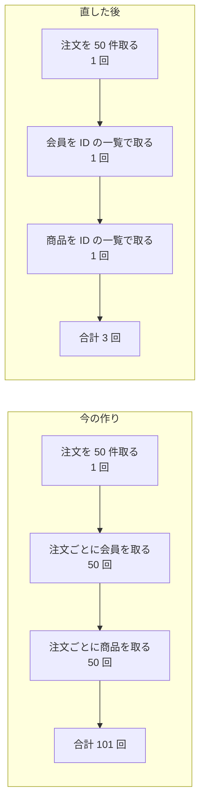

# 注文一覧の N+1 — 理解できない回答と教授の解説（完成例）

> **3 行でわかる要約**
> 1. 社長の質問「なぜ注文一覧で N+1（一覧を取ったあと、行ごとに 1 回ずつ問い合わせる作り）が起きるのか、どう直すのか」に対する、Cursor のチャット回答の完成例です。
> 2. 同じ中身を、理解できない AI の回答（before）と教授の解説（after）で並べ、違いを表にしました。数値はすべて架空です。
> 3. 仕様書を書く人は、after の節の並び（直答・全体像・用語・仕組み・例・手順・確認）をそのまま雛形の骨にしてください。

## 目的

この文書は、`ja-professor` スキルの完成例として、解説の型がどう見えるかを示すものです。読み手は、スキルの仕様書を書く人と、社長への回答を書く各部署です。題材は Cradle 社が運営する架空の EC サイト「Cradle Market」の管理画面で、注文一覧の表示が遅い件を扱います。件数と時間はすべて架空で、付録に出どころの設定を書きました。

## 全体像

教授の解説は、社長の問いから確認の問いまでを一定の順で並べます。図は、その順と、出す前に通す検査を示します。



図の読み方: 左から右へ、回答の節の順に並びます。点線の先の検査は、出す前に全体に掛けます。

## 1. 社長の問いと読み手の見立て

解説を書く前に、問いを言い直し、読み手が知っている語と知らない語を見立てます。見立ては回答の冒頭に 1 行だけ置き、残りは手元の記録に書きます。

| 項目 | 内容 |
|---|---|
| 問いの原文 | 「なぜ注文一覧で N+1 が起きるのか、どう直すのか」（社長、Cursor のチャット） |
| 問いの数 | 2 つ。(1) 原因、(2) 直し方 |
| 答えの形 | (1) は仕組みの説明、(2) は案と手順 |
| 読み手が知っている語 | 注文一覧、会員、商品、データベース、API（記録 `reader-profile.md` より。架空） |
| 読み手が知らない語 | N+1、ORM、遅延読み込み、結合、索引 |
| 段 | 解説（短答でも講義でもない。「なぜ」と「どう直す」の 2 つなので） |

## 2. 理解できない AI の回答（before）

先に、社長が「理解できない」と言った回答の例を置きます。中身の事実は間違っていませんが、答えが後ろにあり、英語と専門語が裸で出て、なぜ起きるかが書かれていません。

```text
N+1クエリ問題について説明します。

N+1問題とは、ORMのlazy loadingによって、親エンティティをfetchした後に各childに対して
個別のSELECTクエリがissueされる現象です。注文一覧の場合、OrdersをfetchしたあとにeachでUserと
Productをlazy loadしているため、O(N)のクエリが発生し、パフォーマンスのボトルネックとなります。

対策としては、以下のアプローチが考えられます。
- Eager Loading（includes / preload / eager_load）を活用することで、関連データを事前にロードし、
  クエリ数の最適化を実現することができます。
- JOINによるクエリの統合
- DataLoaderパターンによるbatching
- キャッシュレイヤーの導入
- インデックスの最適化

また、N+1を検出するためにbulletなどのgemを導入することも効果的です。
適切な手法を選択し、パフォーマンスを改善していきましょう。

以上です。ご参考になれば幸いです。
```

この回答を読んだ社長は、何が起きているかも、自分が次に何を決めればよいかも分かりません。選択肢が 5 つ並んでいて、推奨がないからです。

## 3. 教授の解説（after。Cursor のチャット回答）

この節が、Cursor のチャットにそのまま貼る回答です。宛名から結びまでが本文で、小見出しは回答の中でもそのまま使います。

社長

お疲れ様です。ご質問は 2 点ですね。(1) なぜ注文一覧で N+1 が起きるのか、(2) どう直すのか、です。N+1 は、一覧を取ったあとに行ごとに 1 回ずつ問い合わせる作りのことです。初めて出る語は、その場で括弧で説明し、下の用語の表にもまとめました。

### 答え

(1) 原因は、注文一覧の作りにあります。注文を 50 件取ったあと、注文ごとに会員と商品を 1 件ずつ取りに行く作りです。関連する表が会員と商品の 2 つなので、問い合わせは 1 + 50 + 50 = 101 回になります。(2) 直し方は、会員と商品を「ID の一覧でまとめて 1 回ずつ」取る作りに変えることです。50 人分の会員番号を 1 枚の紙に書いて渡し、1 回で 50 人分を受け取るやり方です。問い合わせは注文・会員・商品の 3 回になり、件数が増えても回数は変わりません。数値は架空です。

### 全体像

今の作りと直した後の作りを、問い合わせの回数で比べた図です。



図の読み方: 上が今、下が直した後です。矢印は処理の順で、箱の中の回数を足すと右端の合計になります。

### 用語

この回答で初めて出る語を、意味と正式な語で並べます。正式な語は、あとで調べるときの手がかりです。

| 用語 | 意味 | 正式な語 |
|---|---|---|
| N+1 | 一覧を 1 回取ったあと、行ごとに 1 回ずつ追加で問い合わせる作り。行が N 件なら 1 + N 回。関連する表が 2 つなら 1 + 2N 回 | N+1 query problem |
| 問い合わせ | プログラムがデータベースに「この条件の行をください」と頼むこと | query |
| ORM | プログラムの部品とデータベースの表を対応づける道具。注文一覧 API もこれで書かれています | Object-Relational Mapping |
| 遅延読み込み | 関連する行を、使う瞬間まで取りに行かない ORM の既定の動き | lazy loading |
| まとめ読み | 関連する行を、ID の一覧で先に 1 回で取っておく動き | eager loading |

### 仕組み（なぜ起きるのか）

注文一覧 API は ORM（プログラムの部品とデータベースの表を対応づける道具）で書かれています。ORM の既定は遅延読み込み（関連する行を、使う瞬間まで取りに行かない動き）です。画面の 1 行を描くたびに「この注文の会員は誰か」と聞かれ、ORM はそのたびに 1 回問い合わせます。書いた人は 1 行分の処理を書いただけなので、繰り返しの中で問い合わせが増えていることに気づきません。

なぜ本番まで見つからなかったかというと、開発環境のデータが 5 件だからです。5 件なら 11 回で済み、遅さも出ません。本番で 50 件、年末に 500 件になった日に、回数だけが増えました。1 回の問い合わせが 9 ミリ秒でも、101 回なら 0.9 秒になり、ネットワークの往復も 101 回です。回数がそのまま時間になる、というのがこの問題の正体です。

例えるなら、50 人分の弁当を 1 人分ずつ 50 回買いに行くのが今の作りです。直した後の作りは、注文票をまとめて 1 回で買いに行くやり方に当たります。

### 例（数値は架空）

件数ごとの回数と時間を、今の作りと直した後で並べます。時間は管理画面のアクセスログを想定した架空の値です。

| 画面に出す件数 | 回数（今） | 時間（今） | 回数（直した後） | 時間（直した後） |
|---|---|---|---|---|
| 5 件 | 11 回 | 0.1 秒 | 3 回 | 0.05 秒 |
| 50 件 | 101 回 | 0.9 秒 | 3 回 | 0.1 秒 |
| 500 件 | 1,001 回 | 9 秒 | 3 回 | 0.4 秒 |

表の読み方: 今の作りは件数に比例して回数が増えます。直した後は 3 回のままで、時間は取ってくる行の量の分だけ増えます。

### 直し方（手順）

案は 3 つあり、推奨は A です。B は問い合わせが 1 回で済みますが、3 つの表を 1 回でつなぐと取り出す行が膨らみ、画面の作りも変える必要があります。A は一覧 API に指定を 1 行足すだけで、3 回に減ります。件数が 1 万件を超える期間指定があるなら、C も一緒に入れます。

| 案 | やること | 回数 | 手間（架空） | 向く場面 |
|---|---|---|---|---|
| A まとめ読み（推奨） | 一覧 API にまとめ読みの指定を足す（指定の名前は道具ごとに違い、Rails では `includes`） | 3 回 | 1〜2 時間 | 一覧の行に関連する行を付けるとき全般 |
| B 3 つの表を 1 回でつなぐ | 注文・会員・商品を 1 回の問い合わせでつなげて取る | 1 回 | 半日 | 絞り込みの条件が会員や商品にかかるとき |
| C 画面に出す分だけ読む | 1 ページ 50 件に区切り、注文日で速く探せる仕組み（索引）を足す | A と同じ | 1〜2 日 | 1 万件を超える期間指定があるとき |

手順は 4 つです。

1. 問い合わせの回数をテストで数えます。1 件のときと 100 件のときで回数が同じなら合格で、今は 3 回と 201 回なので不合格です。
2. 一覧 API に、会員と商品の 2 つについてまとめ読みの指定を足します。
3. 再発を止める設定を一覧 API に入れます。まとめ読みの指定が無い行をプログラムが触ったら、その場でエラーにする設定です（Rails では `strict_loading` という名前）。
4. 本番の表示時間を 1 週間測り、50 件で 1 秒を切っていることを確かめました、と報告できる状態にします。

### 確認の問い

一つだけ教えてください。この説明で一番分かりにくかった所はどこでしょうか。次の説明はそこから始めます。

案 A で進めてよければ「進めて」と一言ください。承認までコードは変えません。

よろしくお願いします。

## 4. 何がどう違うか（before と after の対応表）

同じ事実を伝えているのに読める回答になった理由を、観点ごとに並べます。根拠の番号は、`references/sources.md` の出典一覧（P 番号）を指します。

| 観点 | before（理解できない回答） | after（教授の解説） | 根拠 |
|---|---|---|---|
| 答えの位置 | 定義から始まり、対策は 3 段落目 | 2 行目で (1)(2) に直答 | P9 公用文「結論は早めに」、P15 |
| 問いへの対応 | 「なぜ」に答えず「何か」を定義する | 問いを言い直し、同じ番号で答える | 手紙の型（問いの順に答える） |
| 用語 | lazy loading、eager load、ORM が裸のまま | 初出で括弧、用語の表に正式な語 | P9、P14 |
| 英語と翻訳調 | 「O(N) のクエリが発生」「パフォーマンスのボトルネック」 | 「問い合わせの回数」「表示までの時間」 | P9、P10、`.company/rules/writing.md` |
| 全体像 | 無し | 図 1 枚と読み方 | P4（図と文を離さない） |
| なぜ | 「ORM の仕様」で終わる | 遅延読み込み → 1 行ずつ → 開発環境では気づかない、の順で理由を書く | P16、P17 |
| 例 | 無し | 架空の件数と時間の表、弁当の例え 1 つ | P4（完成した例）、P1 |
| 手順 | 選択肢を 5 つ並べて終わる | 3 案の比較と推奨 1 つ、手順 4 つ、承認の一言 | 秘書の決まり（推奨を 1 つ置く） |
| 確認 | 締めの常套句で終わり、問いが無い | 一番分かりにくかった所を 1 つ聞く | P8、P6 |
| 文 | 一文 90 字、「〜ます」の連続、締めの常套句 | 60 字以内、文末を変える、常套句なし | P9、`.company/rules/writing.md` |

## 5. 検査の結果

この文書は 4 つの検査を通しました。設計のときに「想定」と書いていた項目は、実際に検査を回した結果に置き換えました。

| 検査 | 結果 |
|---|---|
| `tools/check-ja.sh`（文体） | RESULT: PASS |
| `tools/check-doc.sh`（資料の型） | RESULT: PASS |
| `tools/check-mermaid.sh` と `tools/render-mermaid.mjs`（図） | RESULT: PASS（2 図） |
| `skills/ja-professor/scripts/explain-check.sh`（解説の型） | RESULT: PASS（FAIL 0、WARN 0） |

理解できない回答（before）は `evals/fixtures/bad-ai-answer.txt` に置き、同じ `explain-check.sh` を掛けると FAIL が 29 件出ます。落ちるのは、答えの位置・用語の初出・例・英単語の裸出し・専門語の密度・確認の問いです。

## やらないこと

この完成例では、講義（資料の形）と実際のコードの差分は扱いません。

| やらないこと | 理由 |
|---|---|
| 講義の形（3 行の要約から付録までの資料） | 社長の問いは解説の段で足りる。資料にする依頼は `.company/rules/documents.md` の型で書く |
| コードの差分 | 道具（Rails、Django、Prisma）が決まっていない。決まったら各部署が書く |
| 案 B と C の詳しい設計 | 社長の判断に要るのは推奨 1 つと違いの表までで、設計は承認後に書く |

## 未確定事項

架空にした値と、実際の案件で確かめる事項を分けて書きます。

| # | 決まっていないこと | 決め方 |
|---|---|---|
| 1 | 注文一覧 API が使っている ORM と、本番の件数と表示時間 | バックエンドが実装とアクセスログで確かめ、表の値を実測に置き換える |
| 2 | 社長が既に知っている語の記録（`reader-profile.md`） | 最初の解説の確認の問いの答えから作り始める |

## 付録: 数値の出どころと出典

この文書の数値はすべて架空で、出どころの名前も架空の設定です。本物の案件では、同じ表に実測の出どころと日付を書きます。

| 数値 | 値 | 扱い |
|---|---|---|
| 画面に出す件数 | 5 件、50 件、500 件 | 架空（開発環境、本番、年末という設定） |
| 問い合わせの回数 | 11 回、101 回、1,001 回、3 回 | 架空（1 + 2N の式から計算） |
| 表示までの時間 | 0.1 秒〜9 秒 | 架空（アクセスログという設定） |
| 手間 | 1〜2 時間、半日、1〜2 日 | 架空（バックエンドの見積もりという設定） |

| 出典 | 確かめた内容 | URL |
|---|---|---|
| Ruby on Rails Guides, Active Record Query Interface | 10 件の本と著者で 1 + 10 = 11 回になる説明、`includes`、`strict_loading` | https://guides.rubyonrails.org/active_record_querying.html |
| Django docs, QuerySet API reference | 結合で 1 回にする `select_related` と、別の問い合わせでまとめて取る `prefetch_related` | https://docs.djangoproject.com/en/5.2/ref/models/querysets/ |
| Prisma docs, Query optimization and performance | 結果ごとに 1 回追加で問い合わせる問題と、`in` の一覧でまとめる直し方 | https://www.prisma.io/docs/orm/prisma-client/queries/query-optimization-performance |
| 文化審議会『公用文作成の考え方』2022 | 結論は早めに、専門用語は言い換えるか説明を付ける、外来語をむやみに使わない | https://www.bunka.go.jp/seisaku/bunkashingikai/kokugo/hokoku/pdf/93651301_01.pdf |
