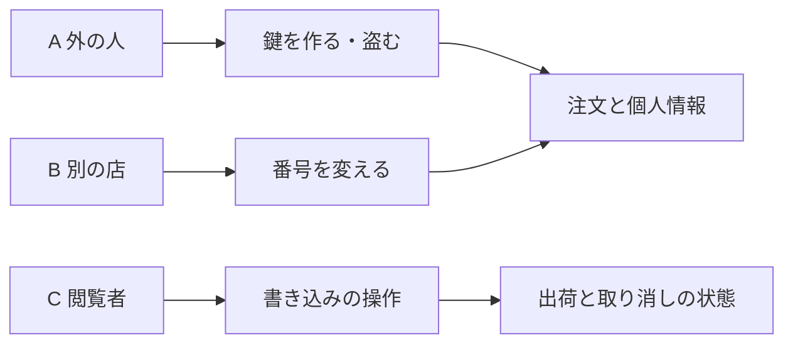

# 侵入テストの計画: 注文一覧の見本 API

> **3 行でわかる要約**
> 1. 注文一覧の見本 API を、攻撃者の目で 1 日で試す計画の完成例です。数値はすべて架空です。
> 2. 攻撃者を 3 人に分け、鍵・他人の注文・役割の 3 つの穴を 9 本の試験で確かめます。
> 3. 始める前に RoE（交戦規則）の署名を確かめ、宛先は 127.0.0.1 だけにします。

| 項目 | 内容 |
|---|---|
| 作成日 | 2026-11-08 |
| 状態 | RoE の署名済み、実施待ち |
| 数値 | すべて架空 |
| RoE | `roe-order-list.md` |
| 報告の行き先 | `pentest-report-order-list.md` |
| 置き場 | tmp/flow/order-list/pentest-plan.md |

## 目的と範囲

この計画の目的は、運営担当者の管理画面から注文の個人情報が漏れる道を、見つけて塞ぐことです。範囲は RoE の範囲の表の 2 行と同じで、見本の API とそのコードに限ります。立てる置き場は、RoE が宛先ごとに書いた `samples/api/` です。

画面（`samples/app/`）と基盤（`samples/infra/`）は、この回では試しません。画面の試験はフロントエンド、基盤の構成の検査はインフラの `iac-scan` が持っています。

## 攻撃者の見立て

誰が、何を持って、何を狙うかを先に決めます。見立てが無いと、試す順番が決まらないからです。

| 攻撃者 | 持っている物 | 狙い |
|---|---|---|
| A 外の人 | 宛先と利用者の id（画面に出る名前から推せる） | 鍵を作るか盗んで、注文を読む |
| B 別の店の運営担当者 | 自分の店の正しい鍵 | 番号を変えて、ほかの店の注文を読む |
| C 閲覧者 | 見るだけの役割の正しい鍵 | 出荷指示と取り消しを出す |

図の読み方: 左が攻撃者、中が使う手、右が奪われうる物です。3 本の道のどれも、最後は注文のデータか状態に届きます。

## 試すこと

攻撃者ごとに、何を送って何が返れば穴かを決めます。どれも OWASP API Security Top 10（API の穴の世界の一覧、2023 年版）の項目に結びつけます。

| # | 攻撃者 | 試すこと | 穴とみなす応答 | 結びつく項目 |
|---|---|---|---|---|
| T-1 | A | 利用者の id から作った鍵で一覧を読む | 200 | API2 認証の穴 |
| T-2 | A | 期限を過ぎた鍵で一覧を読む | 200 | API2 認証の穴 |
| T-3 | A | 鍵なしで一覧を読む | 200 | API2 認証の穴 |
| T-4 | B | ほかの店の注文の番号で詳細を読む | 200 か 403 | API1 資源ごとの認可 |
| T-5 | B | ほかの店の注文の番号で出荷指示を出す | 行の結果が成功 | API1 資源ごとの認可 |
| T-6 | C | 閲覧者の鍵で出荷指示を出す | 200 | API5 操作ごとの認可 |
| T-7 | C | 閲覧者の鍵で取り消しを出す | 200 | API5 操作ごとの認可 |
| T-8 | A〜C | 誤りの応答に SQL の文や内部の値が出るか | 本文に表や列の名 | API8 設定の穴 |
| T-9 | A〜C | 一覧の件数の上限を超えて読む | 上限より多い行 | API4 量の制限 |

## 進め方

1 日の中で、次の順に進めます。どの段でも、止める条件に当たったら API を止めて秘書へ知らせます。

1. RoE の署名と期間を `roe-check.sh` で確かめる。通らなければ始めない。
2. 見本の API を、RoE の置き場 `samples/api/` から 127.0.0.1:18080 で立てる。鍵は標準出力から一時のファイルに取り、文書には書かない。
3. T-1 から T-9 を、要求 1 本ずつ送る。応答の状態番号と要約のログの 1 行を、証拠として残す。
4. 穴を見つけたら、報告の型で 5 点を書く。CVSS（穴の重さを測る世界の採点の決まり）4.0 の点数は `cvss4.sh` で出す。
5. 終わったら API を止め、一時のファイルの鍵を消す。

## 証拠の残し方

証拠は、応答の状態番号と、誤りのコードと、要約のログの 1 行の 3 つです。鍵・氏名・住所は証拠に入れず、伏せた形でも書きません。

| 証拠 | 取り方 | 残す場所 |
|---|---|---|
| 状態番号と誤りのコード | curl の `-w '%{http_code}'` と応答の本文 | 報告の発見の節 |
| 要約のログの 1 行 | 見本の API の標準エラー | 報告の発見の節（鍵の項目は元から無い） |
| 試験の名 | RoE の置き場の試験 `samples/api/test_orders_api.py` の関数名。置き場に無い試験は名を挙げない | 報告の再検証の節 |

## 終わりの条件

T-1 から T-9 の全部に、穴か穴でないかの判定が付いたら終わりです。穴の発見は報告にまとめ、バックエンドへ渡して直しと再検証を頼みます。
