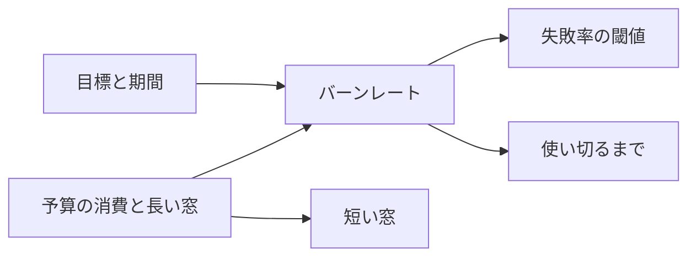

# 多窓・多段のバーンレートの通知

> **3 行でわかる要約**
> 1. SLO の通知を、予算を減らす速さ（バーンレート）で設計するための式と、原典の推奨の表です。
> 2. 呼び出しは 1 時間で 2% と 6 時間で 5%、チケットは 3 日で 10% を既定にし、長い窓と短い窓の両方が超えたときだけ鳴らします。
> 3. 値は burn-rate.sh で計算し、定義書の表を burn-rate.sh で照らして食い違いを 0 件にしてください。

## 用語

この節は、資料に出る略語をまとめます。2 回目からは説明を省きます。

| 用語 | 意味 |
|---|---|
| SLO | 利用者に約束する信頼性の目標 |
| エラーバジェット | 1 − 目標。期間のうちに失敗してよい量 |
| バーンレート | 予算を減らす速さ。失敗率 ÷（1 − 目標）。1 なら期間のちょうど終わりに使い切る |
| 長い窓、短い窓 | 失敗率を数える 2 つの時間の幅。短い窓は長い窓の 12 分の 1 |
| Runbook | 当番の手順書。通知 1 つに 1 本 |

## 式

この節は、burn-rate.sh が使う 4 つの式です。どれも原典の章の定義を、そのまま式にしました。

| 求めるもの | 式 | 99.9% と 30 日、1 時間で 2% の例 |
|---|---|---|
| バーンレート | 予算の消費 × 期間 ÷ 長い窓 | 0.02 × 720 時間 ÷ 1 時間 = 14.4 |
| 失敗率の閾値 | バーンレート ×（1 − 目標） | 14.4 × 0.001 = 1.44% |
| 短い窓 | 長い窓 ÷ 12 | 60 分 ÷ 12 = 5 分 |
| 使い切るまで | 期間 ÷ バーンレート | 720 時間 ÷ 14.4 = 50 時間 |

図の読み方: 左の 2 つの決めごとから、右の 3 つの値が決まります。定義書に書くのは右の値で、左が変われば全部を計算し直します。

## 原典の推奨の表

この節は、原典の 2 つの表を写したものです。evals/workbook-reference.tsv に同じ値を置き、burn-rate.sh の計算がこの値と一致することを試験で確かめます。

原典の「Alert on burn rate」の節の表は、99.9% と 30 日でのバーンレートと使い切るまでの時間です。

| バーンレート | 99.9% での失敗率 | 使い切るまで |
|---|---|---|
| 1 | 0.1% | 30 日 |
| 2 | 0.2% | 15 日 |
| 10 | 1% | 3 日 |
| 1000 | 100% | 43 分 |

原典の「Multiwindow, Multi-Burn-Rate Alerts」の節の表は、推奨の 3 段です。短い窓は、同じ節の本文で長い窓の 12 分の 1 とされています。

| 予算の消費 | 長い窓 | 短い窓 | バーンレート | 通知 |
|---|---|---|---|---|
| 2% | 1 時間 | 5 分 | 14.4 | 呼び出し |
| 5% | 6 時間 | 30 分 | 6 | 呼び出し |
| 10% | 3 日 | 6 時間 | 1 | チケット |

## 多窓にする理由

この節は、長い窓だけ、短い窓だけで鳴らさない理由です。長い窓だけだと、直ったあとも長い窓が明けるまで鳴り続けます。短い窓だけだと、数分の揺れで当番を起こします。

| 方式 | 起きること |
|---|---|
| 失敗率が目標を超えたら鳴らす | 1 回の揺れで鳴り、当番が通知を信じなくなる |
| 長い窓のバーンレートだけ | 直ったあとも 1 時間鳴り続け、直ったことが分からない |
| 長い窓と短い窓の両方 | 揺れでは鳴らず、直れば 5 分で閉じる。原典の推奨 |

## 要求の少ないサービス

この節は、要求が少ないときの注意です。1 時間の要求が数十件だと、1 件の失敗で 1.44% を超え、呼び出しが鳴ります。

| 対策 | 中身 |
|---|---|
| 外形の確かめで量を足す | 1 分に 1 回の probe を有効な要求に入れる |
| 小さいサービスをまとめる | 同じ利用者の用事の API を 1 つの SLO で数える |
| 最小の件数を条件に足す | 長い窓の失敗が N 件以上のときだけ鳴らす |

## 出典

この節は、表と式の根拠です。値は公開の本文の表を手で写し、作業の中では原典を開き直していません。

| 資料 | 場所 |
|---|---|
| The Site Reliability Workbook、5 章「Alerting on SLOs」 | https://sre.google/workbook/alerting-on-slos/ |
